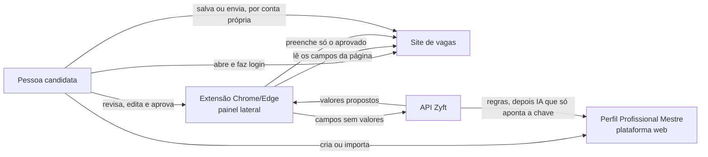

# Zyft — Candidatura Assistida

O **Zyft** é um assistente digital para pessoas que se candidatam a vagas de emprego pela internet. Ele reduz o esforço repetitivo da candidatura, ajuda a pessoa a apresentar informações profissionais **verdadeiras** e facilita o preenchimento de formulários de vagas, **mantendo a pessoa no controle de cada decisão**.

> "Um assistente que ajuda você a preparar e preencher candidaturas com base nas suas informações, revisar cada resposta e confirmar cada ação antes do envio."

O produto não é exclusivo de nenhuma área, nível de experiência, modalidade de trabalho ou tipo de candidato.

## Estado do projeto

| Item | Situação |
|---|---|
| MVP 1 | **Implementado** em C#/.NET 8 (Clean Architecture): API, plataforma web, extensão MV3 e portal demo. 157 testes automatizados passando ([ADR-0017](docs/03-arquitetura/adr/0017-backend-em-csharp-dotnet-clean-architecture.md), em status Proposta; [Entrega 3](docs/entregas/entrega-3-desenvolvimento-e-validacao.md)) |
| Protótipo Node | Virou **referência**: a lógica de de-para, análise de vaga, redação e importação foi portada para a API .NET; o [ADR-0003](docs/03-arquitetura/adr/0003-monorepo-typescript-node.md) foi substituído pelo ADR-0017 |
| Pendências | Verificação de e-mail e login com Google (Entrega 4), decisão sobre `Users.DeletedAt`, CI rodando no GitHub ([Entrega 3, §14](docs/entregas/entrega-3-desenvolvimento-e-validacao.md#14-pendências-e-limitações-conhecidas)) |
| MVP 2 | Marketplace de TI (PJ/CLT), painel central de candidaturas, outros portais ([histórico](docs/00-contexto/historico-e-reposicionamento.md)) |

## Como executar

Pré-requisito: .NET 8 SDK (`global.json` fixa a linha 8.0.4xx). Docker e Ollama são opcionais. Detalhes no [runbook local](docs/06-operacao/runbook-local.md).

**Local com SQLite (mais rápido):**

```bash
dotnet run --project src/Zyft.Api        # http://localhost:5080
```

- Plataforma web em `/`, Swagger em `/swagger`, portal demo em `/demo/`, saúde em `/health`.
- Usuário de demonstração (só em Development): **demo@zyft.local / Zyft@2026**.
- Sem Ollama em `localhost:11434`, tudo funciona só com regras (`/health` fica `Degraded`).

**Docker com PostgreSQL 16:**

```bash
docker compose up -d --build                 # API + PostgreSQL (aplica a migration)
docker compose --profile ai up -d --build    # + Ollama (depois: docker compose exec ollama ollama pull qwen2.5:7b)
docker compose down -v
```

Segredos em `.env` (fora do Git): `ZYFT_JWT_SECRET`, `ZYFT_ENCRYPTION_KEY`, `ZYFT_DB_PASSWORD`.

**Testes:**

```bash
dotnet test        # unidade, integração e aceitação (Reqnroll); não precisa de Docker nem de Ollama
```

**Extensão:** em `chrome://extensions` (ou `edge://extensions`), ligue o Modo do desenvolvedor, clique em **Carregar sem compactação** e escolha `extension/`. Na plataforma, gere o código em **Extensão** e digite no painel lateral. Teste em `http://localhost:5080/demo/`.

## Como funciona (MVP 1)



1. A pessoa monta o **Perfil Mestre**, à mão ou importando um currículo em PDF ou Word, e revisa e aprova cada informação.
2. No site de vagas, com login feito por ela mesma, a **extensão** lê o formulário e propõe o preenchimento.
3. Os campos objetivos vêm do perfil. A IA só indica **qual** dado do perfil usar, nunca escreve o valor. Os textos abertos são sugeridos apenas com fatos aprovados.
4. A pessoa confere cada campo, edita o que quiser e decide se salva ou envia. **O Zyft nunca envia nada.**

## Regras inegociáveis

- Nada é enviado sem confirmação explícita; a extensão nunca clica em enviar.
- A IA não inventa fatos e não escreve valores objetivos.
- O Zyft não pede nem guarda a senha dos sites de vagas e não contorna CAPTCHA ou autenticação.
- Dados sensíveis ficam separados, fora da IA, e só são usados com ação expressa.
- O Zyft não promete compatibilidade nem contratação.

## Documentação

O índice completo está em [`docs/README.md`](docs/README.md).

| Área | Documentos |
|---|---|
| Contexto | [Histórico e reposicionamento](docs/00-contexto/historico-e-reposicionamento.md) · [Glossário](docs/00-contexto/glossario.md) |
| Produto | [DVP-E](docs/01-produto/dvp-e.md) · [DRP](docs/01-produto/drp.md) · [Personas](docs/01-produto/personas.md) · [Fluxos](docs/01-produto/fluxos.md) · [Roadmap](docs/01-produto/roadmap.md) · [Métricas](docs/01-produto/metricas.md) |
| Viabilidade | [DVS](docs/02-viabilidade/dvs.md) |
| Arquitetura | [DAT](docs/03-arquitetura/dat.md) · [Backend](docs/03-arquitetura/backend.md) · [Extensão](docs/03-arquitetura/extensao.md) · [Web](docs/03-arquitetura/frontend-web.md) · [IA](docs/03-arquitetura/ia.md) · [API](docs/03-arquitetura/api.md) · [Dados](docs/03-arquitetura/modelo-de-dados.md) · [Segurança](docs/03-arquitetura/seguranca.md) · [ADRs](docs/03-arquitetura/adr/README.md) |
| Qualidade | [Estratégia de testes e evals](docs/04-qualidade/estrategia-de-testes.md) · [Critérios de aceite](docs/04-qualidade/criterios-de-aceite-mvp1.md) |
| Pesquisa | [Plano](docs/05-pesquisa/plano-de-pesquisa.md) · [Questionário v2](docs/05-pesquisa/questionario-v2.md) · [Ferramentas](ferramentas/pesquisa/README.md) |
| Operação | [Ambientes](docs/06-operacao/ambientes.md) · [Rodar localmente](docs/06-operacao/runbook-local.md) |
| Entregas | [Entrega 2: projeto e arquitetura](docs/entregas/entrega-2-projeto-e-arquitetura.md) · [Entrega 3: desenvolvimento e validação](docs/entregas/entrega-3-desenvolvimento-e-validacao.md) · [Relatório do backend](docs/entregas/entrega-3-relatorio-backend.md) · [Frontend e extensão](docs/entregas/entrega-3-frontend.md) |
| Legal | [Termos de uso](docs/07-legal/termos-de-uso.md) · [Privacidade](docs/07-legal/politica-de-privacidade.md) (rascunhos) |
| Time | [Papéis e RACI](docs/08-time/papeis-e-raci.md) · [Processo](docs/08-time/processo.md) · [Agentes de IA](docs/08-time/agentes-de-ia.md) · [Contribuir](CONTRIBUTING.md) |

## Time de agentes de IA

O time trabalha com agentes do Claude Code definidos em [`.claude/agents/`](.claude/agents/): CEO, Product Owner, Product Manager, arquiteto de software, arquiteto de IA, dev backend, dev frontend, dev da extensão, QA, designer UX e privacidade e segurança. As regras do projeto para os agentes estão em [`CLAUDE.md`](CLAUDE.md) e a decisão no [ADR-0016](docs/03-arquitetura/adr/0016-time-de-agentes-de-ia-no-desenvolvimento.md). Os agentes não fazem push, não fazem merge e não aprovam o próprio trabalho.

## Estrutura do repositório

```
.
├── Zyft.sln  global.json  Directory.Build.props  Directory.Packages.props
├── docker-compose.yml         API + PostgreSQL 16 (+ Ollama no perfil "ai")
├── CLAUDE.md                  regras do projeto para o Claude Code
├── CONTRIBUTING.md            como contribuir (branches, commits, PRs)
├── CHANGELOG.md
├── .claude/agents/            agentes de IA do time
├── .config/dotnet-tools.json  dotnet-ef (ferramenta local)
├── .github/                   CI (build, testes, migrations, Docker) e templates
├── src/
│   ├── Zyft.Domain/           entidades e regras puras
│   ├── Zyft.Application/      casos de uso (CQRS/MediatR), de-para, análise de vaga, redação
│   ├── Zyft.Infrastructure/   EF Core, segurança (JWT, BCrypt, AES-GCM), Ollama, leitura de PDF/DOCX
│   └── Zyft.Api/              controllers, middleware, Program.cs, Dockerfile
├── tests/
│   ├── Zyft.UnitTests/        xUnit + FluentAssertions + Moq
│   ├── Zyft.IntegrationTests/ WebApplicationFactory + SQLite em memória
│   └── Zyft.AcceptanceTests/  Reqnroll (Gherkin em português)
├── web/                       plataforma web (servida em /) e portal demo (web/demo, servido em /demo/)
├── extension/                 extensão Chrome/Edge (Manifest V3)
├── docs/
│   ├── 00-contexto/ … 08-time/  produto, viabilidade, arquitetura (adr/), qualidade, pesquisa, operação, legal, time
│   ├── entregas/              documentos das entregas da disciplina (img/ com diagramas e capturas)
│   └── arquivo/marketplace-v1 documentação do marketplace (MVP 2)
└── ferramentas/
    ├── pesquisa/              scripts do Google Forms e do relatório
    └── entregas/              geradores dos PDFs das entregas (ReportLab)
```

A arquitetura está no [DAT](docs/03-arquitetura/dat.md), no [ADR-0017](docs/03-arquitetura/adr/0017-backend-em-csharp-dotnet-clean-architecture.md) e na [Entrega 2](docs/entregas/entrega-2-projeto-e-arquitetura.md).
