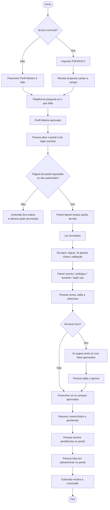
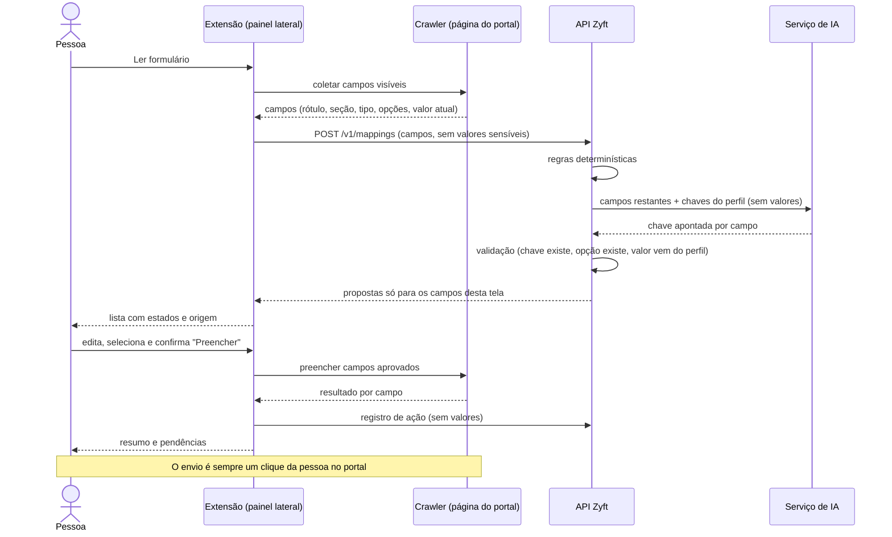
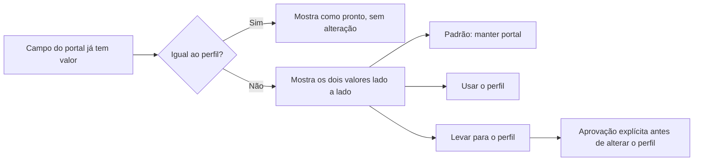
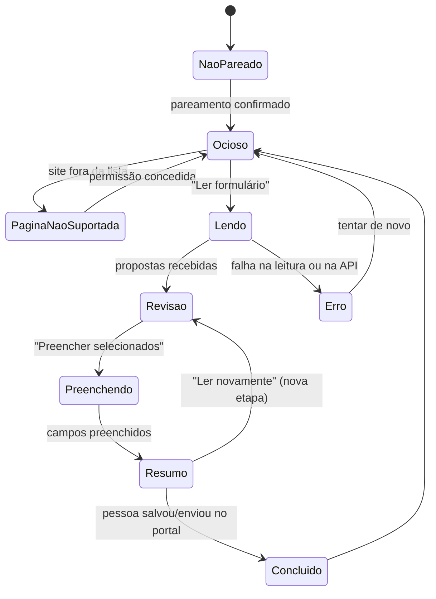

# Fluxos do MVP 1

## Controle do documento

| Campo | Valor |
|---|---|
| Projeto | Zyft — Candidatura Assistida |
| Documento | Fluxos de uso do MVP 1 |
| Versão | 1.0 |
| Status | Aprovado para refinamento |
| Dono | Product Owner (com UX) |
| Documentos relacionados | [DVP-E](dvp-e.md), [DRP](drp.md), [Personas](personas.md), [Critérios de aceite](../04-qualidade/criterios-de-aceite-mvp1.md), [Arquitetura da extensão](../03-arquitetura/extensao.md) |

**Histórico de revisões**

| Versão | Data | Alteração |
|---|---|---|
| 1.0 | 12/10/2026 | Fluxo principal (8 passos do reposicionamento §6), fluxos alternativos e estados do painel lateral. |

## 1. Fluxo principal

| Passo | O que acontece | Quem age | Requisitos |
|---|---|---|---|
| 1 | A pessoa cria uma conta e preenche o Perfil Mestre à mão ou importa um currículo. | Pessoa, plataforma | RF-01, RF-02, RF-03 |
| 2 | A plataforma apresenta os dados extraídos ou organizados para revisão. A pessoa corrige e aprova o que quer manter. | Pessoa, plataforma | RF-04, RF-05 |
| 3 | A pessoa abre, por conta própria, o site de vagas e faz login nele. O Zyft não pede nem guarda a senha do portal. | Pessoa | RNF-01 |
| 4 | No portal suportado, a extensão reconhece a página autorizada e mostra as ações disponíveis naquela tela. | Extensão | RF-09, RF-10 |
| 5 | A pessoa escolhe quais dados quer usar. A extensão propõe ou preenche campos compatíveis e sinaliza ambiguidades e informações ausentes. | Pessoa, extensão, API | RF-11 a RF-14, RF-16, RF-18 |
| 6 | Para campos de texto livre, a IA sugere uma redação baseada só em fatos aprovados. A pessoa revisa e edita. | IA, pessoa | RF-06, RF-15 |
| 7 | A pessoa confere os campos e decide se quer salvar ou enviar. Nenhuma candidatura é enviada sem confirmação explícita: quem clica em enviar é a pessoa, no portal. | Pessoa | RN-01, RF-14 |
| 8 | A extensão mostra a conclusão. O histórico central completo é MVP 2; um registro mínimo no MVP 1 depende do [ADR-0012](../03-arquitetura/adr/0012-registro-minimo-de-conclusao-no-mvp1.md). | Extensão | RF-19, RF-20 |

### 1.1 Sequência do preenchimento (passos 4 a 7)

## 2. Fluxos alternativos

### FA-01 — IA indisponível

| Gatilho | Comportamento | Requisitos |
|---|---|---|
| O serviço de IA não responde ou passa do tempo limite. | O de-para continua só com regras determinísticas; campos que dependiam da IA ficam "ausente" com o aviso "A IA está indisponível. Os campos simples continuam funcionando." Sugestão de texto e análise de vaga ficam desabilitadas com a mesma mensagem. Nada é preenchido por suposição. | RNF-12, RF-12 |

### FA-02 — Campo ambíguo

| Gatilho | Comportamento |
|---|---|
| Duas chaves do perfil servem para o campo, ou a opção do select não corresponde claramente ao valor do perfil. | O campo aparece como **ambíguo**, desmarcado, com as alternativas possíveis. A pessoa escolhe uma alternativa ou digita o valor. Nada é preenchido até a escolha (RN-05). |

### FA-03 — Valor divergente entre portal e perfil

| Regra | Requisito |
|---|---|
| A opção padrão é **manter o valor do portal**. Levar um valor do portal para o perfil sempre pede aprovação e fica no registro de ações. | RF-16 |

### FA-04 — Campo sensível

| Gatilho | Comportamento | Requisitos |
|---|---|---|
| O rótulo indica gênero, raça/etnia, deficiência, religião, saúde, orientação sexual, nome social, estado civil, filhos e similares. | O campo aparece como **ação sua**, com a explicação "Este é um dado sensível. Responda direto no formulário, se quiser." Só pode ser preenchido pelo Zyft se o consentimento (c) estiver ligado **e** a pessoa marcar o campo manualmente. O dado sensível nunca é enviado à IA. | RF-18, RN-04, [ADR-0014](../03-arquitetura/adr/0014-dados-sensiveis-segregados-e-criptografados.md) |

### FA-05 — CAPTCHA, senha, código de verificação, anexo ou termos

| Gatilho | Comportamento |
|---|---|
| A página tem CAPTCHA, campo de senha, código de verificação, upload de arquivo ou caixa de aceite de termos ou declaração. | O crawler ignora senha, CAPTCHA e upload; termos e declarações são listados como **ação sua**. O painel explica o que a pessoa precisa fazer. O Zyft nunca tenta resolver ou contornar ([ADR-0010](../03-arquitetura/adr/0010-sem-credenciais-sem-contorno-de-seguranca-campos-bloqueados.md)). |

### FA-06 — Modal aberto

| Gatilho | Comportamento |
|---|---|
| A candidatura acontece num modal ("candidatura simplificada") sobre a página. | O crawler lê só o modal visível mais recente. Se o modal mudar de etapa, a pessoa clica de novo em "Ler formulário"; o painel avisa quando detecta que a etapa mudou. |

### FA-07 — Currículo não suportado (PDF escaneado)

| Gatilho | Comportamento | Requisitos |
|---|---|---|
| O PDF não tem texto extraível (imagem escaneada), o arquivo passa de 10 MB ou o formato não é PDF nem DOCX. | Mensagem clara: "Não conseguimos ler o texto deste arquivo. Envie um PDF gerado por editor de texto ou um DOCX, ou preencha o perfil à mão." Nenhuma proposta parcial é criada. | RF-03 |

### FA-08 — Página fora do portal suportado

| Gatilho | Comportamento |
|---|---|
| A pessoa abre o painel numa página que não é do portal suportado. | O painel diz que o site não é suportado no MVP 1 e oferece "Usar neste site mesmo assim", que pede permissão do navegador para aquele domínio. Sem permissão, a extensão não lê nada da página ([ADR-0011](../03-arquitetura/adr/0011-primeiro-portal-e-conectores-por-portal.md)). |

### FA-09 — Extensão não pareada ou sessão expirada

| Gatilho | Comportamento |
|---|---|
| A extensão não tem pareamento ou o token foi revogado. | O painel mostra "Conectar à sua conta Zyft" e inicia o pareamento ([ADR-0007](../03-arquitetura/adr/0007-autenticacao-e-pareamento-da-extensao.md)). Nenhum dado do perfil fica guardado na extensão além do necessário para a tela atual. |

## 3. Estados do painel lateral

### 3.1 Estados da tela

| Estado | O que a pessoa vê |
|---|---|
| Não pareado | Botão "Conectar à sua conta Zyft". |
| Ocioso | Ações disponíveis para a tela: "Ler formulário", "Analisar vaga" (se for página de vaga e houver consentimento), "Importar do portal". |
| Página não suportada | Explicação e opção de autorizar o site. |
| Lendo | Progresso ("Lendo 42 campos…"). |
| Revisão | Lista de campos com estado, valor proposto, origem e edição. Resumo no topo: "Vamos preencher 18 campos. 3 precisam de você." |
| Preenchendo | Progresso por campo. |
| Resumo | Quantos campos foram preenchidos, quais falharam e o que ainda é ação da pessoa. Lembrete: "Confira no portal e envie quando estiver pronto(a)." |
| Concluído | Confirmação visual da conclusão (RF-19). |
| Erro | Mensagem que diz o que fazer e botão para tentar de novo. |

### 3.2 Estados de cada campo

| Estado | Significado | Vem marcado? | Cor e texto |
|---|---|---|---|
| Pronto | Correspondência segura (regra, IA validada ou resposta aprovada). | Sim | Verde + "Pronto" |
| Ambíguo | Mais de uma possibilidade ou opção sem correspondência clara. | Não | Amarelo + "Escolha" |
| Ausente | Não há dado no perfil. | Não | Cinza + "Falta no perfil" |
| Divergente | Portal já tem valor diferente do perfil. | Não (padrão: manter portal) | Azul + "Já preenchido no portal" |
| Sugestão de texto | Texto livre gerado pela IA. | Não | Roxo + "Sugestão — revise" |
| Ação sua | Sensível, termos, anexo, CAPTCHA, senha. | Nunca | Contorno + "Ação sua" |

Cada estado tem cor **e** texto, para não depender só de cor (RNF-06).
