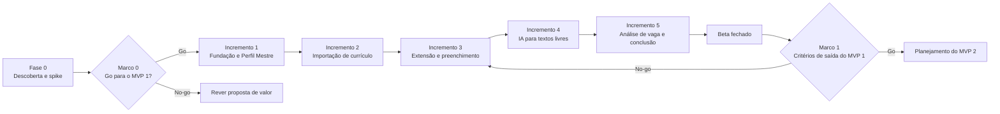

# Roadmap

## Controle do documento

| Campo | Valor |
|---|---|
| Projeto | Zyft — Candidatura Assistida |
| Documento | Roadmap MVP 1 e MVP 2 |
| Versão | 2.0 |
| Status | Vigente (revisado a cada marco de decisão) |
| Dono | Product Manager |
| Documentos relacionados | [DVP-E](dvp-e.md), [DRP](drp.md), [Métricas](metricas.md), [DVS](../02-viabilidade/dvs.md), [Plano de pesquisa](../05-pesquisa/plano-de-pesquisa.md), [Resultados da pesquisa v2](../05-pesquisa/resultados-v2.md), [Monetização](monetizacao.md) |

**Histórico de revisões**

| Versão | Data | Alteração |
|---|---|---|
| 1.0 | 12/10/2026 | Fase 0, incrementos do MVP 1, critérios de saída e MVP 2. |
| 2.0 | 21/10/2026 | Situação real: pesquisa v2 concluída (n = 15), incrementos I1 a I5 implementados em .NET na Entrega 3. Novo incremento I6 (versão 2 do produto: onboarding, área, campos personalizados, planos e anúncios), com a justificativa. Itens do mockup de Planos que são MVP 2. |

## 1. Princípios

- O roadmap é por **sequência e marco de decisão**, não por data. Datas entram quando o time fechar a capacidade de cada fase.
- Cada incremento termina com algo testável por uma pessoa real.
- Nada do MVP 2 entra antes do fim do MVP 1 sem decisão explícita (RN-07).

## 2. Visão geral

## 2.1 Onde estamos (21/10/2026)

| Etapa | Situação |
|---|---|
| F0.1 Pesquisa v2 | **Concluída (rodada 1).** 15 respostas válidas, abaixo da meta de 60 e com 60% de tecnologia. Uma segunda rodada fora de tecnologia continua necessária. Ver [resultados](../05-pesquisa/resultados-v2.md). |
| F0.2 Entrevistas | Pendente. |
| F0.3 Spike do primeiro portal | Pendente. O fluxo é demonstrado no portal de demonstração. |
| F0.5 Decisões técnicas | ADR-0017 (.NET 8) substituiu o ADR-0003; demais ADRs ainda propostos. |
| Marco 0 | Critério de dores atingido: "redigitar dados" e "manter perfis" passaram no critério da pesquisa. Critérios de portal e de interesse do beta ainda abertos. |
| I1 a I5 | Implementados na Entrega 3 (API .NET, web, extensão, portal demo, 157 testes). |
| I6 (versão 2) | Em implementação. |

## 3. Fase 0 — Descoberta e redução de risco

| Item | Objetivo | Entregável | Dono |
|---|---|---|---|
| F0.1 Pesquisa v2 | Validar dores, personas, etapas mais demoradas e disposição de uso | Relatório da pesquisa com ≥ 15 respostas; personas v2.0 | PM, PO |
| F0.2 Entrevistas | Aprofundar com 5 a 8 respondentes que aceitaram contato | Notas de entrevista e mapa de dores | PM, UX |
| F0.3 Spike do primeiro portal | Avaliar 2–3 portais candidatos: estrutura dos formulários, iframes, shadow DOM, termos de uso | Relatório do spike e [ADR-0011](../03-arquitetura/adr/0011-primeiro-portal-e-conectores-por-portal.md) aceito | Arquitetura, dev extensão |
| F0.4 Campos do primeiro fluxo | Levantar os campos do portal escolhido e separar obrigatórios, opcionais e sensíveis | Modelo de dados do Perfil Mestre v1 | PO, Arquitetura |
| F0.5 Decisões técnicas | Aprovar os ADRs propostos (stack, autenticação, banco, registro mínimo, observabilidade) | ADRs 0003, 0007, 0008, 0012, 0015 com status final | Arquitetura |
| F0.6 Migração do protótipo | Trazer o código do protótipo para o monorepo, como base de referência | Monorepo com o protótipo rodando e CI básico | Dev back, dev front |

**Marco 0 (go/no-go para o MVP 1)**

| Critério | Go se |
|---|---|
| Dores | Pelo menos uma das dores ligadas ao núcleo do MVP 1 (repetir dados, perguntas abertas, manter perfil atualizado) validada pelo critério da pesquisa |
| Portal | Existe ao menos um portal tecnicamente viável e sem impedimento nos termos de uso |
| Interesse | Pessoas suficientes aceitam participar do beta (meta definida após a pesquisa) |

## 4. MVP 1 — incrementos

| Incremento | Épicos | Requisitos | Pronto quando |
|---|---|---|---|
| **I1 — Fundação e Perfil Mestre** | Conta e login; Perfil Mestre; consentimentos; exportação e exclusão; registro de ações (base) | RF-01, RF-02, RF-05, RF-07, RF-08, RF-20 | Pessoa cria conta, preenche o perfil, liga/desliga consentimentos, exporta e exclui os dados |
| **I2 — Importação de currículo** | Upload PDF/DOCX; proposta; revisão campo a campo; perguntas do que falta | RF-03, RF-04, RF-05 | Currículo vira perfil aprovado sem nenhum dado entrar sem revisão |
| **I3 — Extensão e preenchimento** | Pareamento; reconhecimento do portal; crawler; de-para; painel de revisão; preenchimento; comparação portal × perfil; campos bloqueados | RF-09 a RF-14, RF-16, RF-18 | Cadastro completo no portal suportado preenchido com revisão, sem envio automático |
| **I4 — IA para textos livres** | Sugestão de texto; respostas aprovadas; melhorar texto (Could) | RF-06, RF-15, RF-21 | Campos abertos recebem sugestões só com fatos aprovados, passando nos evals |
| **I5 — Vaga e conclusão** | Análise de vaga com evidência (Should); confirmação de conclusão; registro mínimo (se aprovado) | RF-17, RF-19, RF-22 | Análise de vaga sem evidência falsa nos evals; conclusão visível |
| **I6 — Versão 2** | Onboarding em passos; área profissional e catálogo; campos personalizados; planos, limites e pacote; anúncio recompensado; anúncios no gratuito | RF-23 a RF-29 | A pessoa começa o perfil em minutos e adia o que quiser; Beatriz (Saúde) consegue um perfil sem campos de TI; o gratuito tem limite claro e anúncios só onde é permitido (TN-11, TN-12, TN-15) |
| **Beta fechado** | Testes com pessoas de trajetórias diversas, inclusive fora de tecnologia; correções | — | Critérios de saída medidos |

### 4.1 Por que o I6 entrou antes do beta

- **Onboarding (RF-23):** as duas dores validadas (redigitar dados e manter perfis) dependem de um Perfil Mestre preenchido. O formulário único de perfil da Entrega 3 pedia tudo de uma vez, o que repete a dor dentro do Zyft. Testar o beta sem resolver isso mediria o cansaço do cadastro, não o valor da extensão.
- **Área e campos personalizados (RF-24, RF-25):** o beta precisa ter pessoas de outras áreas (H8 falhou: 60% de tecnologia). Sem área dinâmica, essas pessoas encontrariam um perfil com GitHub e stack técnica e desistiriam, e o time concluiria errado que o produto não serve para elas.
- **Planos e anúncios (RF-26 a RF-29):** a pesquisa respondeu às perguntas de preço e de modelo de uso. Medir comportamento (clique em "Assinar", "Comprar pacote", "Ganhar +3") no beta, com pagamento simulado, custa pouco e evita refazer telas depois. A decisão de escopo está no [ADR-0020](../03-arquitetura/adr/0020-monetizacao-com-anuncios-e-planos.md).

O detalhamento dos épicos em histórias fica no backlog; os critérios de aceite estão em [criterios-de-aceite-mvp1.md](../04-qualidade/criterios-de-aceite-mvp1.md).

## 5. Critérios de saída do MVP 1 (Marco 1)

| # | Critério | Medida |
|---|---|---|
| S1 | Todos os requisitos Must implementados e com critérios de aceite aprovados | Checklist de CA |
| S2 | Zero valor objetivo escrito pela IA e zero evidência inexistente | Suíte de evals e auditoria do beta |
| S3 | Nenhum envio, aceite de termos, anexo ou CAPTCHA feito pelo Zyft | Testes E2E e revisão do registro de ações |
| S4 | Teste moderado com pessoas de trajetórias diferentes (primeiro emprego, experiente, transição, baixa familiaridade digital) | Conclusão do fluxo, erros, clareza e confiança, com metas fixadas após a pesquisa v2 |
| S5 | LGPD: política publicada, RIPD do MVP 1, exportação e exclusão funcionando | Revisão de privacidade |
| S6 | Acessibilidade WCAG 2.1 AA na plataforma e no painel | Auditoria |

Se S2 ou S3 falhar, o MVP 1 não sai, independentemente das outras métricas.

## 6. MVP 2 — capacidades planejadas

A ordem será definida no planejamento do MVP 2, a partir do aprendizado do MVP 1.

| Grupo | Itens | Requisitos |
|---|---|---|
| Acompanhamento | Painel central de candidaturas; estados, próximas ações, lembretes, filtros e busca | RF-M2-01, RF-M2-02 |
| Expansão de portais | Conectores para outros portais; importação ou sincronização de candidaturas | RF-M2-03, RF-M2-04 |
| Inteligência | Análise ampliada de vagas e comparação de oportunidades; relatórios e automações sob consentimento | RF-M2-05, RF-M2-06 |
| Plano Plus ampliado (vindos do mockup de Planos) | Versões do perfil por tipo de vaga; lembretes de retorno; gerar currículo em PDF a partir do perfil; suporte com prazo de resposta | A definir. Não podem ser anunciados como benefício do Plus antes de decisão (RN-06, RN-07) |
| Cobrança real | Provedor de pagamento, nota fiscal, reembolso, direito de arrependimento, revisão de termos | A definir ([monetização §7](monetizacao.md#7-pagamento-simulado)) |
| Marketplace (proposta original) | Marketplace bilateral; PJ e CLT; assinaturas sem comissão; matching e fila de prioridade; reputação; chat e liberação de contato | RF-M2-07 a RF-M2-12 |

A documentação do marketplace em [`docs/arquivo/marketplace-v1/`](../arquivo/marketplace-v1/) é o ponto de partida para o grupo Marketplace.

## 7. Marcos de decisão

| Marco | Quando | Decide | Quem decide |
|---|---|---|---|
| Marco 0 | Fim da Fase 0 | Seguir com o MVP 1 como está, ajustar o escopo ou rever a proposta | CEO, PO, PM |
| Marco 0.5 | Fim do I3 | O preenchimento no portal é confiável o bastante para seguir? Se não, mais um ciclo no conector antes da IA | PO, Arquitetura, QA |
| Marco 0.6 | Antes de publicar a extensão nas lojas | Os anúncios da extensão estão conformes à política de dados das lojas? Se não, a versão da loja sai sem `ext.job.contextual` | PO, Privacidade |
| Marco 1 | Fim do beta | Critérios de saída atingidos; abrir para mais pessoas e planejar o MVP 2 | CEO, PO, PM |
| Marco 2 | Planejamento do MVP 2 | Ordem entre acompanhamento, novos portais e marketplace | CEO, PM |
