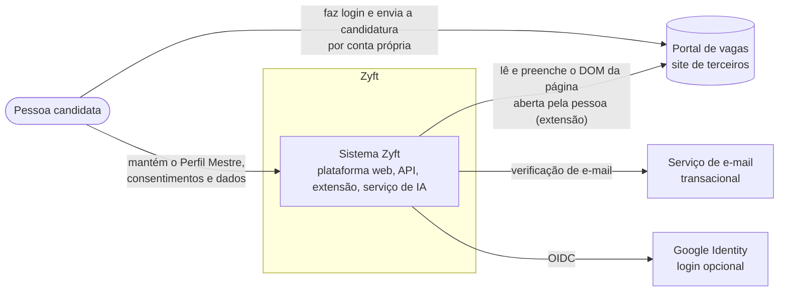
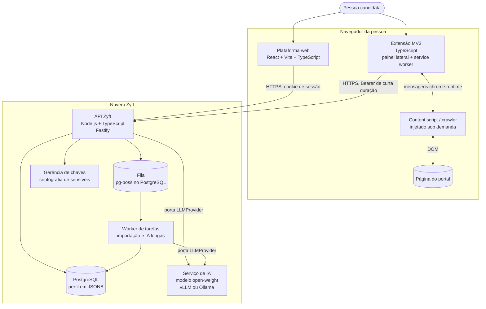
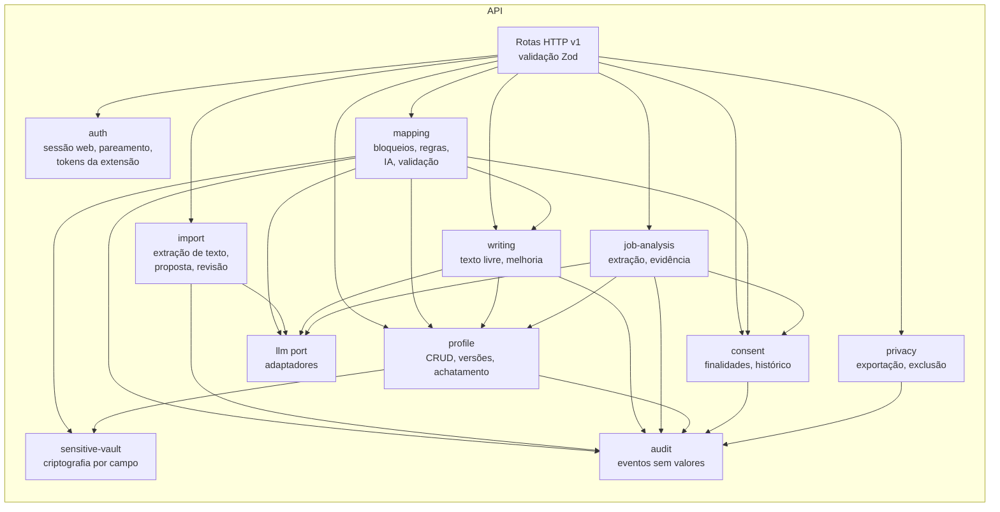
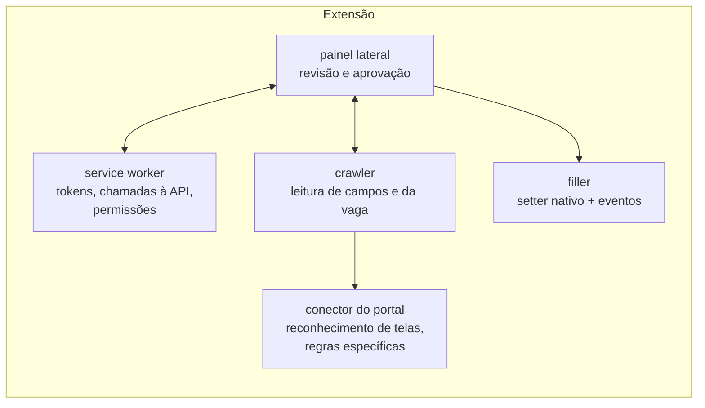
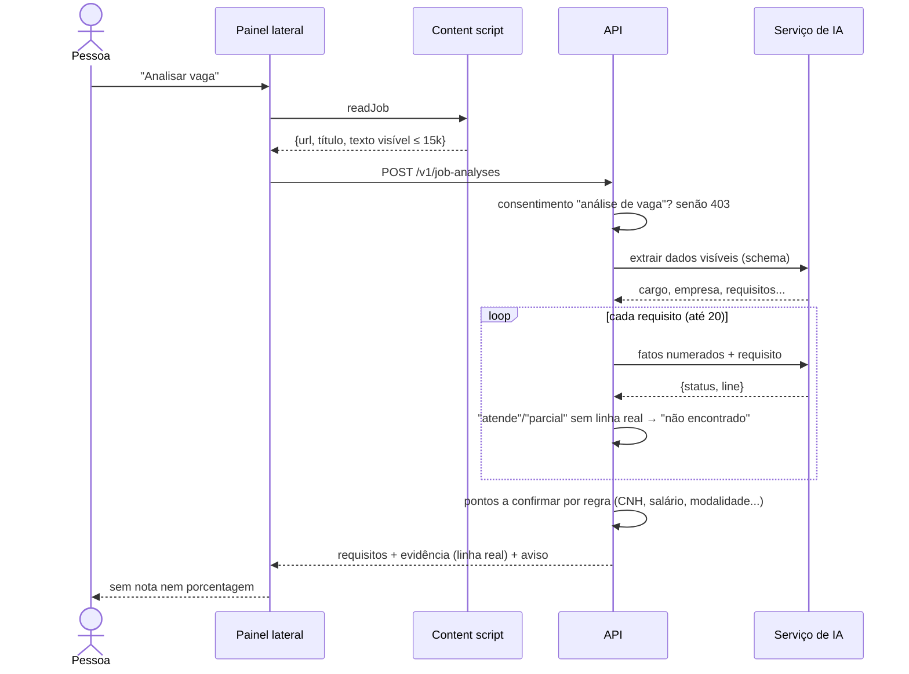

# DAT — Documento de Arquitetura Técnica

## Controle do documento

| Campo | Valor |
|---|---|
| Projeto | Zyft — Candidatura Assistida |
| Documento | Arquitetura Técnica (DAT) |
| Versão | 2.0 (substitui o DAT do marketplace, arquivado em `docs/arquivo/marketplace-v1/dat.md`) |
| Status | Em revisão. A arquitetura-alvo depende dos ADRs marcados como "Proposta". |
| Dono | Arquitetura de software |
| Documentos relacionados | [DRP](../01-produto/drp.md), [Backend](backend.md), [Extensão](extensao.md), [Frontend web](frontend-web.md), [IA](ia.md), [Modelo de dados](modelo-de-dados.md), [API](api.md), [Segurança](seguranca.md), [ADRs](adr/) |

**Histórico de revisões**

| Versão | Data | Alteração |
|---|---|---|
| 1.x | até 05/10/2026 | Arquitetura do marketplace (C#/.NET 8, PostgreSQL). Arquivada. |
| 2.0 | 12/10/2026 | Reescrita para a Candidatura Assistida: estado do protótipo, arquitetura-alvo do MVP 1, fluxos, qualidades e riscos. |

## 1. Objetivo e escopo

Este documento descreve como o Zyft é construído para atender ao MVP 1 definido no [DVP-E](../01-produto/dvp-e.md) e no [DRP](../01-produto/drp.md). Ele cobre:

- o protótipo funcional que já existe (seção 2), que é o ponto de partida técnico;
- a arquitetura-alvo do MVP 1 em visão C4 (seções 3 a 5);
- os fluxos críticos em diagramas de sequência (seção 6);
- rastreabilidade, atributos de qualidade, ambientes, riscos e evolução para o MVP 2 (seções 7 a 12).

Detalhes por contêiner ficam nos documentos específicos: [backend](backend.md), [extensão](extensao.md), [frontend web](frontend-web.md), [IA](ia.md).

## 2. Estado atual (protótipo)

O protótipo foi construído em 05–06/10/2026, **antes** do reposicionamento, a partir do documento *Automação Assistida de Candidaturas* (`docs/00-contexto/plano-automacao-candidaturas.pdf`). O código está fora deste repositório (repositório local de um membro do time) e será migrado para o monorepo conforme o [ADR-0003](adr/0003-monorepo-typescript-node.md).

### 2.1 Visão geral

```
extension/ (Chrome/Edge, Manifest V3)        server/ (Node.js 22, Express, ESM)
  manifest.json   permissões e hosts           src/index.js     API REST, só 127.0.0.1, token Bearer
  background.js   abre o painel lateral        src/profile.js   modelo do Perfil Mestre, "achatamento"
  content.js      crawler: lê e preenche       src/mapper.js    de-para campo → chave do perfil
  sidepanel.*     revisão e aprovação          src/jobs.js      análise de vaga com evidência
                                               src/writer.js    respostas abertas, melhoria de texto
                                               src/importer.js  PDF/DOCX/TXT → proposta de perfil
                                               src/llm.js       cliente Ollama (JSON com schema)
                                               src/store.js     persistência em data/db.json
                                               src/text.js      normalização, tokens, Jaccard
                                               public/          plataforma web (HTML/JS puro)
                                               public/demo/     portal de vagas de teste
```

### 2.2 Componentes e comportamento

| Componente | Implementação | Observações |
|---|---|---|
| Servidor | Express 4, escuta só em `127.0.0.1:4317`. Middleware recusa `Host` diferente de `localhost`/`127.0.0.1` (proteção contra DNS rebinding). CORS só para origens `chrome-extension://`, `moz-extension://` e `edge-extension://`. | Um único usuário. |
| Autenticação | Token aleatório de 128 bits gerado no primeiro uso e gravado em `db.json`. A plataforma web (mesma origem) obtém o token por `GET /api/session`; a extensão recebe o token colado pela pessoa ou por `config.local.json`. | Token fixo, sem expiração nem revogação. |
| Persistência | `store.js` grava `db.json` de forma atômica (arquivo temporário e `rename`). Contém token, consentimentos, perfil, candidaturas e log (últimos 500 eventos). | Sem criptografia em repouso. |
| Perfil Mestre | `profile.js`: seções `personal`, `objective`, `experiences`, `education`, `courses`, `certifications`, `skills`, `languages`, `preferences`, `approvedAnswers` e `sensitive` (separado). `flattenProfile` gera chaves como `experiences[0].company` com rótulo legível, **sem** os dados sensíveis. `profileFacts` gera linhas de fatos e calcula no código o tempo total de experiência. | É o contrato central entre mapeamento, IA e interface. |
| IA | `llm.js` chama `POST /api/chat` do Ollama com `format` = JSON Schema, temperatura 0,1 (0,3 para redação), `num_ctx` 8192 e um prompt de sistema com regras inegociáveis (só fatos do perfil, não inferir sensíveis, pt-BR). Modelo padrão `qwen2.5:7b`, configurável por `OLLAMA_MODEL`. | Timeout de 180 s (300 s na importação). |
| De-para | `mapper.js`: (1) bloqueios: `password`/`hidden`/`submit` ignorados, CAPTCHA e `file` viram "manual", campos sensíveis viram "sensível" (valor só com consentimento e sem pré-seleção), checkbox de declaração vira "declaração"; (2) regras em PT/EN (`TOP_RULES`, 30 chaves) e grupos repetíveis (`GROUPS`: experiências, formação, cursos, certificações, idiomas), com alinhamento de blocos por organização/instituição (`alignSlots`); (3) o que sobra vai à IA, que devolve `fill` com `profileKey`, `generate` ou `ask`; a chave é validada contra as chaves existentes e o **valor sempre vem do perfil**; (4) `pickOption` só escolhe opções que existem na página (exata, contida, sim/não ou Jaccard ≥ 0,5); sem opção segura, o campo fica "ambíguo". | Rodar só as regras leva milissegundos; a etapa da IA leva segundos. |
| Texto livre | `freeText` reaproveita uma resposta aprovada se a pergunta for parecida (Jaccard ≥ 0,6). Senão, `writer.generateAnswer` pede `answer`, `usedFacts` e `missingInfo`, e respeita `maxLength`. A sugestão nunca vem pré-selecionada. | Usa a vaga analisada como contexto, marcada como "não são qualificações". |
| Análise de vaga | `jobs.js`: a IA extrai cargo, empresa, local, contrato, modalidade, jornada, salário, resumo e requisitos; depois avalia cada requisito (até 20) contra fatos **numerados** e devolve o número da linha. "Atende" ou "parcial" sem linha real vira "não encontrado". `CONFIRM_RULES` detecta por regex pontos a confirmar (CNH, turnos, viagens, salário, modalidade, mudança, contrato). | Bloqueada na API se o consentimento `jobAnalysis` estiver desligado. Sempre com aviso de que não é garantia. |
| Importação | `importer.js`: PDF (`pdf-parse`), DOCX (`mammoth`) e TXT até 10 MB (`multer`). A IA converte o texto (até 12.000 caracteres) em JSON com schema, com instrução de não extrair sensíveis; limpezas determinísticas depois. Devolve uma **proposta**; nada é gravado sem a pessoa salvar. `missingQuestions` lista até 11 perguntas sobre dados ausentes. | PDF escaneado não é suportado. |
| Extensão | MV3 com `sidePanel`, `storage`, `scripting` e `tabs`. Hosts fixos: localhost, `*.maringa.com`, `*.gupy.io`, `*.linkedin.com` e `*.workana.com`; outros sites por `optional_host_permissions`, pedidos no primeiro uso. `content.js` é injetado sob demanda (`chrome.scripting.executeScript`). | "Conector" é só um rótulo por domínio; não há regras específicas por portal. |
| Crawler | `content.js` lê `input`, `select` e `textarea` visíveis; com modal aberto (`[role=dialog]`, `[aria-modal]`, `dialog[open]`), lê só o modal. Para cada campo: rótulo (aria-labelledby, label[for], label envolvente, aria-label, texto anterior, texto do pai), seção (legend ou último título), tipo, opções, `maxLength`, `required` e valor atual. Agrupa radios. Marca cada campo com `data-ca-id`. | Não lê iframes nem shadow DOM. |
| Preenchimento | Usa o setter nativo de `value` e dispara `input`, `change` e `blur` (compatível com React/Vue); radio e checkbox por `click()`; recusa `file` e `password`; destaca o resultado com contorno verde ou vermelho. **Não existe código que clique em enviar.** | Escuta o evento `submit` feito pela pessoa para sugerir o registro. |
| Painel lateral | Fluxo: "Analisar vaga" → "Ler formulário" (de-para) → revisão por campo (estados: perfil, resposta aprovada, sugestão IA, sensível, declaração, manual, ambíguo, falta no perfil, sem correspondência) → "Preencher selecionados". Divergência entre portal e perfil: o padrão é manter o portal, com as opções "usar o perfil" e "importar do portal" (com `confirm`). | Depois do envio, sugere registrar a candidatura no histórico. |
| Plataforma web | HTML e JS puros com abas: Perfil Mestre, Importar currículo, Candidaturas (10 status), Respostas aprovadas e Configurações (consentimentos, token, status da IA, exportar e excluir, registro de automação). | O histórico de candidaturas é escopo de MVP 2 (ver [ADR-0012](adr/0012-registro-minimo-de-conclusao-no-mvp1.md)). |
| Portal demo | `/demo/`: currículo vazio, currículo já preenchido (para importar e comparar), vaga e candidatura com triagem, pergunta aberta, dado sensível, termos, anexo e CAPTCHA. | Usado nos testes E2E com Playwright e nos vídeos. |

### 2.3 O que o protótipo provou

- O pipeline regras → IA aponta chave → validação preenche formulários longos de currículo **sem a IA escrever valores objetivos**.
- A evidência por linha numerada torna visível quando o modelo erra a classificação de um requisito.
- Um modelo de 7B local (`qwen2.5:7b`, cerca de 4,7 GB, numa GPU de 12 GB) é suficiente para de-para, redação curta e análise de vaga, **com ressalvas**: a classificação varia entre execuções (por exemplo, "parcial" em vez de "atende"), e a análise de vaga leva de 20 a 30 s.

### 2.4 Lacunas para o MVP 1

| Lacuna | Requisito afetado | Tratamento |
|---|---|---|
| Um usuário, servidor local, token fixo | RF-01, RF-09, RNF-03 | Contas, API na nuvem, pareamento com tokens curtos ([ADR-0007](adr/0007-autenticacao-e-pareamento-da-extensao.md)) |
| `db.json` sem criptografia | RNF-07, RN-04 | PostgreSQL, sensíveis criptografados por campo ([ADR-0008](adr/0008-postgresql-com-perfil-em-jsonb.md), [ADR-0014](adr/0014-dados-sensiveis-segregados-e-criptografados.md)) |
| `map-fields` devolve também o `profileValue` dos campos ambíguos e o perfil é enviado à IA com valores | RNF-02 | Contrato de mínimo retorno; prompt da IA com valores truncados e sem identificadores diretos ([api.md](api.md), [ia.md](ia.md)) |
| Hosts de quatro portais fixos no manifesto | RF-10, DVP-E §7.2 | Um portal suportado ([ADR-0011](adr/0011-primeiro-portal-e-conectores-por-portal.md)) |
| Conector genérico, sem regras por portal | RNF-10 | Pacote de conectores com fixtures gravadas |
| Histórico com 10 status | Fora do MVP 1 | [ADR-0012](adr/0012-registro-minimo-de-conclusao-no-mvp1.md) |
| JavaScript sem tipos, sem testes unitários | RNF-10 | TypeScript, testes por camada ([estratégia de testes](../04-qualidade/estrategia-de-testes.md)) |
| Logs sem política de dados pessoais (o `fill-log` grava a URL completa) | RNF-09 | [ADR-0015](adr/0015-observabilidade-sem-dados-pessoais.md) |
| **Senha lida pelo crawler.** A `scanFields()` de `extension/content.js` não exclui `type=password` da leitura: o valor de um campo de senha visível vai como `currentValue` em `POST /api/map-fields`. O servidor descarta o campo, mas o valor já trafegou (viola RNF-01). | RNF-01 | O crawler descarta, antes de ler o valor, campos `type=password` e campos com `autocomplete` `current-password`, `new-password` ou `one-time-code`; teste unitário e E2E obrigatórios([ADR-0010](adr/0010-sem-credenciais-sem-contorno-de-seguranca-campos-bloqueados.md)). |

## 3. Visão de contexto (C4 nível 1)



O Zyft **não** se integra a portais por API, **não** faz requisições ao portal (RNF-13) e **não** conhece a senha do portal (RNF-01). Toda interação com o portal acontece no DOM da aba que a pessoa abriu.

## 4. Visão de contêineres (C4 nível 2)



| Contêiner | Tecnologia (proposta) | Responsabilidade | Documento |
|---|---|---|---|
| Plataforma web | React 18, Vite, TypeScript, TanStack Query | Conta, Perfil Mestre, importação com revisão, respostas aprovadas, consentimentos, extensões pareadas, registro de ações, exportar e excluir | [frontend-web.md](frontend-web.md) |
| Extensão | MV3, TypeScript, bundler Vite (CRXJS ou similar) | Reconhecer o portal, ler campos, mostrar o de-para, preencher o aprovado, analisar a vaga | [extensao.md](extensao.md) |
| API | Node.js 22 LTS, TypeScript, Fastify, Zod | Regras de negócio, autenticação, mapeamento, orquestração da IA, auditoria | [backend.md](backend.md), [api.md](api.md) |
| Worker | Mesmo código da API, processo separado, pg-boss | Importação de currículo e análise de vaga quando passarem do tempo síncrono | [backend.md](backend.md#6-tarefas-assíncronas) |
| PostgreSQL | PostgreSQL 16 | Dados de conta, perfil (JSONB versionado), consentimentos, auditoria, fila | [modelo-de-dados.md](modelo-de-dados.md) |
| Serviço de IA | Modelo open-weight (baseline `qwen2.5:7b`) servido por Ollama (dev) e vLLM ou Ollama em GPU (produção, a decidir) | De-para residual, redação, extração de currículo e de vaga | [ia.md](ia.md) |

A escolha das tecnologias está nos ADRs [0003](adr/0003-monorepo-typescript-node.md) (TypeScript/Node, **proposta**), [0005](adr/0005-modelo-open-weight-self-hosted-atras-de-porta-llm.md) (porta de IA aceita; hospedagem de produção **proposta**) e [0008](adr/0008-postgresql-com-perfil-em-jsonb.md) (PostgreSQL, **proposta**).

## 5. Visão de componentes (C4 nível 3)

### 5.1 API



### 5.2 Extensão



### 5.3 Pacotes compartilhados

As regras determinísticas e o esquema do perfil são usados pela API **e** pela extensão. Por isso ficam em pacotes do monorepo, não duplicados.

```
zyft/
  apps/
    api/            Fastify, módulos de domínio, worker (entrypoint separado)
    web/            plataforma React
    extension/      MV3: service worker, side panel, content script
  packages/
    profile-schema/ esquema Zod do Perfil Mestre, achatamento, rótulos, fatos (profileFacts)
    field-rules/    normalização, TOP_RULES, GROUPS, alinhamento de blocos, pickOption, bloqueios
    connectors/     conectores por portal (detecção de telas, regras, fixtures HTML gravadas)
    llm/            porta LLMProvider, adaptadores Ollama/OpenAI-compatível, schemas e prompts versionados
    api-contract/   tipos de request/response da API v1 (gerados a partir dos schemas Zod)
    ui/             design tokens e componentes compartilhados entre web e painel lateral
    test-fixtures/  perfis sintéticos, páginas de portal gravadas, casos de avaliação de IA
  docs/             esta documentação
  ferramentas/      scripts de apoio (pesquisa, migração)
```

Ferramentas: pnpm workspaces, Turborepo, TypeScript `strict`, ESLint, Prettier, Vitest e Playwright.

## 6. Fluxos principais

### 6.1 Importação de currículo (RF-03, RF-04, RF-05)

```mermaid
sequenceDiagram
  actor P as Pessoa
  participant W as Plataforma web
  participant A as API
  participant Q as Fila/Worker
  participant L as Serviço de IA
  participant D as PostgreSQL

  P->>W: envia PDF ou DOCX (até 10 MB)
  W->>A: POST /v1/resume-imports (multipart)
  A->>A: valida tipo e tamanho; extrai texto em memória
  A->>D: cria resume_import (status=processing), sem o arquivo
  A->>Q: enfileira parse(importId)
  A-->>W: 202 {importId}
  Q->>L: texto (até 12k caracteres) + schema do perfil
  L-->>Q: JSON da proposta
  Q->>Q: normaliza; descarta campos sensíveis; limpezas determinísticas
  Q->>D: grava proposta (status=ready)
  W->>A: GET /v1/resume-imports/{id} (polling ou SSE)
  A-->>W: proposta + diferenças em relação ao perfil atual
  P->>W: aceita, edita ou descarta cada campo
  W->>A: POST /v1/resume-imports/{id}/apply {decisões}
  A->>D: nova versão do perfil; import=applied
  A->>D: audit_event (curriculo.aplicado, contagens)
  A-->>W: perfil + perguntas sobre o que falta (RF-05)
```

### 6.2 Ler formulário, de-para, revisão e preenchimento (RF-10 a RF-14, RF-16, RF-18)

```mermaid
sequenceDiagram
  actor P as Pessoa
  participant SP as Painel lateral
  participant CS as Content script
  participant SW as Service worker
  participant A as API
  participant L as Serviço de IA

  P->>SP: "Ler formulário"
  SP->>SW: verificar permissão do host
  SW-->>SP: ok (portal suportado ou site autorizado)
  SP->>CS: scan
  CS->>CS: lê campos visíveis (ou só o modal)<br/>ignora senha, hidden, submit
  CS-->>SP: campos {id, rótulo, seção, tipo, opções, valor atual}
  SP->>SW: map-fields(campos, connectorId, jobId?)
  SW->>A: POST /v1/mappings (Bearer)
  A->>A: bloqueios (sensível, declaração, CAPTCHA, anexo)
  A->>A: regras determinísticas + alinhamento de blocos
  alt sobram campos e IA disponível
    A->>L: rótulos dos campos restantes + chaves do perfil
    L-->>A: {fieldId, action, profileKey}
    A->>A: valida chave; valor vem do perfil; opção existe
  end
  A-->>SW: propostas só para os campos enviados
  SW-->>SP: propostas
  SP-->>P: lista com estados (pronto, ambíguo, ausente, bloqueado)
  P->>SP: revisa, edita, marca e desmarca
  P->>SP: "Preencher selecionados"
  SP->>CS: fill(itens aprovados)
  CS->>CS: setter nativo + input/change/blur
  CS-->>SP: relatório por campo
  SP->>SW: registrar ação (contagens, sem valores)
  SW->>A: POST /v1/audit-events
  SP-->>P: "18 preenchidos. 3 precisam de você. Envie pelo portal."
```

A extensão nunca chama `submit()`, `requestSubmit()` nem clica em botões ([ADR-0009](adr/0009-nunca-enviar-confirmacao-explicita.md)).

### 6.3 Texto livre (RF-15, RF-06)

```mermaid
sequenceDiagram
  participant SP as Painel lateral
  participant A as API
  participant L as Serviço de IA

  SP->>A: POST /v1/writing/answers {pergunta, maxLength, jobId?}
  A->>A: consentimento "IA para textos livres"?
  alt resposta aprovada parecida (Jaccard ≥ 0,6)
    A-->>SP: {kind: approved, texto, pergunta original}
  else
    A->>A: monta fatos do perfil (sem sensíveis)
    A->>L: fatos + pergunta + limite
    L-->>A: {answer, usedFacts, missingInfo}
    A->>A: corta no limite; verifica usedFacts contra os fatos
    A-->>SP: {kind: generated, texto, fatos usados, aviso}
  end
  Note over SP: sugestão nunca vem pré-selecionada
  SP->>A: (opcional) POST /v1/approved-answers ao aprovar
```

### 6.4 Análise de vaga (RF-17)



### 6.5 Pareamento da extensão (RF-09)

Fluxo proposto no [ADR-0007](adr/0007-autenticacao-e-pareamento-da-extensao.md). **Principal:** OAuth 2.1 Authorization Code + PKCE via `chrome.identity.launchWebAuthFlow`, com a plataforma web como servidor de autorização.

```mermaid
sequenceDiagram
  actor P as Pessoa
  participant SP as Painel lateral
  participant SW as Service worker
  participant A as API / servidor de autorização
  participant W as Plataforma web

  P->>SP: "Conectar à minha conta"
  SW->>SW: gera code_verifier e code_challenge (S256), state
  SW->>W: launchWebAuthFlow(/oauth/authorize?client_id=extensao&code_challenge&state&redirect_uri=chromiumapp.org)
  P->>W: faz login (se preciso) e autoriza "Extensão Zyft neste navegador"
  W-->>SW: redirect para https://<id>.chromiumapp.org/?code&state
  SW->>A: POST /v1/oauth/token {grant_type=authorization_code, code, code_verifier}
  A-->>SW: {accessToken 15 min, refreshToken rotativo}
  SW->>SW: access em chrome.storage.session;<br/>refresh em chrome.storage.local
  Note over W: a plataforma lista os dispositivos e permite revogar
```

**Alternativa** (quando `launchWebAuthFlow` falha, por exemplo em diferenças do Edge): código de pareamento no estilo *device authorization* (RFC 8628, adaptado). A extensão pede um código (`POST /v1/devices/pairing`), mostra `userCode` (ex.: "K7Q-4MZP", válido por 10 min, uso único), a pessoa confirma o código na plataforma logada (`POST /v1/devices/pairing/confirm`) e o service worker consulta `POST /v1/devices/token {grantType: device_code}` a cada 5 s até receber o mesmo par de tokens. Armazenamento, validade e rotação são idênticos nos dois fluxos.

## 7. Mapeamento requisito → componente

| Requisito | Web | Extensão | API (módulo) | IA | Banco |
|---|---|---|---|---|---|
| RF-01 Conta | Telas de conta | — | auth | — | users, auth_identities |
| RF-02 Perfil | Editor do perfil | — | profile | — | profiles |
| RF-03/04 Importação | Revisão lado a lado | — | import + worker | Extração | resume_imports |
| RF-05 Perguntas do que falta | Lista de pendências | — | profile | — | — |
| RF-06 Respostas aprovadas | Biblioteca | Reuso | writing | — | approved_answers |
| RF-07 Consentimentos | Configurações | Respeita estado | consent | — | consents |
| RF-08 Exportar/excluir | Configurações | Revogação | privacy | — | todas |
| RF-09 Pareamento | Autorização, confirmação de código, lista | `launchWebAuthFlow` + PKCE (alternativa: código) | auth | — | extension_devices, device_pairings |
| RF-10 Página autorizada | — | Conector, permissões | — | — | — |
| RF-11 Leitura | — | Crawler | — | — | — |
| RF-12 De-para | — | Painel | mapping | Apontar chave | — |
| RF-13 Revisão | — | Painel | — | — | — |
| RF-14 Preenchimento | — | Filler | audit | — | audit_events |
| RF-15 Texto livre | — | Painel | writing | Redação | — |
| RF-16 Portal × perfil | — | Painel | profile (patch) | — | profiles |
| RF-17 Vaga | — | Painel, crawler | job-analysis | Extração e evidência | — (efêmero) |
| RF-18 Bloqueios | — | Crawler, painel | mapping | — | — |
| RF-19 Conclusão | — | Painel | (ADR-0012) | — | completion_records (opcional) |
| RF-20 Registro | Registro de ações | Envia eventos | audit | — | audit_events |

## 8. Decisões de arquitetura (ADRs)

| ADR | Título | Status |
|---|---|---|
| [0001](adr/0001-reposicionamento-mvp1-candidatura-assistida.md) | Reposicionamento: MVP 1 é a Candidatura Assistida | Aceita |
| [0002](adr/0002-extensao-de-navegador-mv3-com-painel-lateral.md) | Extensão de navegador MV3 com painel lateral | Aceita |
| [0003](adr/0003-monorepo-typescript-node.md) | Monorepo TypeScript/Node.js (substitui C#/.NET do marketplace) | Proposta |
| [0004](adr/0004-ia-aponta-chave-nunca-escreve-valor.md) | A IA aponta a chave e nunca escreve o valor | Aceita |
| [0005](adr/0005-modelo-open-weight-self-hosted-atras-de-porta-llm.md) | Modelo open-weight self-hosted atrás de uma porta de IA | Aceita (porta); Proposta (hospedagem de produção) |
| [0006](adr/0006-regras-deterministicas-antes-da-ia.md) | Regras determinísticas antes da IA | Aceita |
| [0007](adr/0007-autenticacao-e-pareamento-da-extensao.md) | Autenticação e pareamento da extensão | Proposta |
| [0008](adr/0008-postgresql-com-perfil-em-jsonb.md) | PostgreSQL com perfil em JSONB | Proposta |
| [0009](adr/0009-nunca-enviar-confirmacao-explicita.md) | Nunca enviar; confirmação explícita | Aceita |
| [0010](adr/0010-sem-credenciais-sem-contorno-de-seguranca-campos-bloqueados.md) | Sem credenciais, sem contorno de segurança, campos bloqueados | Aceita |
| [0011](adr/0011-primeiro-portal-e-conectores-por-portal.md) | Primeiro portal e conectores por portal | Proposta (portal a definir) |
| [0012](adr/0012-registro-minimo-de-conclusao-no-mvp1.md) | Registro mínimo de conclusão no MVP 1 | Proposta |
| [0013](adr/0013-evidencia-por-linha-numerada-na-analise-de-vaga.md) | Evidência por linha numerada na análise de vaga | Aceita |
| [0014](adr/0014-dados-sensiveis-segregados-e-criptografados.md) | Dados sensíveis segregados e criptografados | Aceita |
| [0015](adr/0015-observabilidade-sem-dados-pessoais.md) | Observabilidade sem dados pessoais | Proposta |
| [0016](adr/0016-time-de-agentes-de-ia-no-desenvolvimento.md) | Time de agentes de IA no desenvolvimento | Aceita |

## 9. Atributos de qualidade

| Atributo | Requisito | Tática arquitetural |
|---|---|---|
| Desempenho | RNF-04 | Regras rodam antes e sem IA (milissegundos); uma única chamada de IA por leitura de formulário, só com os campos restantes; análise de vaga com progresso e, se preciso, no worker; cache por hash do texto da vaga durante a sessão. |
| Confiabilidade da IA | RNF-05, RN-02, RN-03 | IA aponta a chave e nunca escreve o valor; JSON Schema obrigatório com `enum` de `fieldId`; validação de chave e opção no servidor; evidência por linha; fatos derivados calculados em código; suíte de avaliação no CI. |
| Segurança | RNF-01, RNF-03 | Tokens curtos e revogáveis; TLS; CORS restrito; nenhum campo `password` lido; CSP estrita na web e na extensão; ver [seguranca.md](seguranca.md). |
| Privacidade | RNF-02, RNF-07, RN-04 | Mínimo retorno; sensíveis em cofre criptografado e fora dos prompts; arquivo de currículo descartado após a extração; exportação e exclusão. |
| Disponibilidade | RNF-12 | Meta de 99,5%; sem IA, a extensão continua com as regras (estados "sem correspondência" em vez de erro); health checks; banco gerenciado com backup diário. |
| Manutenibilidade | RNF-10 | Conectores versionados com fixtures gravadas; pacotes compartilhados; TypeScript `strict`; ADRs. |
| Acessibilidade | RNF-06 | Componentes acessíveis no pacote `ui`; testes axe no CI. |
| Observabilidade | RNF-09 | Logs estruturados com lista de campos permitidos; métricas por etapa do pipeline; eventos de auditoria separados da telemetria ([ADR-0015](adr/0015-observabilidade-sem-dados-pessoais.md)). |

## 10. Ambientes

| Ambiente | Uso | IA | Dados |
|---|---|---|---|
| Local | Desenvolvimento; `docker compose` com PostgreSQL e Ollama | Ollama local (`qwen2.5:7b`) | Perfis sintéticos (`packages/test-fixtures`) |
| CI | Lint, testes unitários, contrato, E2E com o portal demo, avaliação de IA | Ollama em runner com GPU, ou adaptador gravado (respostas fixadas) para PRs | Sintéticos |
| Homologação | Testes de usabilidade com pessoas convidadas | Mesmo serviço de produção, isolado | Reais, de participantes com consentimento; apagados ao fim do ciclo |
| Produção | MVP 1 | A decidir ([ADR-0005](adr/0005-modelo-open-weight-self-hosted-atras-de-porta-llm.md)) | Reais |

Hospedagem da API, do banco e da GPU: **a decidir**. Os candidatos e critérios (custo da GPU, região no Brasil por LGPD, PostgreSQL gerenciado) estão em [`docs/06-operacao/`](../06-operacao/).

## 11. Riscos técnicos

| # | Risco | Prob. | Impacto | Mitigação |
|---|---|---|---|---|
| RT1 | O portal escolhido muda o layout e quebra o reconhecimento de campos | Alta | Alto | Conector versionado; fixtures gravadas; métrica de taxa de campos reconhecidos com alerta; fallback para regras genéricas |
| RT2 | Termos de uso do portal proíbem extensões que preenchem formulários | Média | Alto | Análise jurídica no spike ([ADR-0011](adr/0011-primeiro-portal-e-conectores-por-portal.md)); só ação iniciada pela pessoa; nenhuma requisição automatizada |
| RT3 | Campos dentro de iframes ou shadow DOM (comum em ATS) | Média | Alto | Critério de escolha do portal; suporte a shadow DOM aberto e `all_frames` só no domínio autorizado, como evolução |
| RT4 | Variação do modelo de 7B gera classificações inconsistentes | Alta | Médio | Evidência obrigatória; temperatura baixa; avaliação com casos fixos; troca de modelo pela porta de IA |
| RT5 | Custo ou latência da GPU em produção | Média | Alto | Regras primeiro; uma chamada por leitura; fila; modelo de 7–8B quantizado; medir antes de decidir a hospedagem |
| RT6 | Prompt injection no texto da vaga ou nos rótulos da página | Média | Médio | IA só devolve `enum` e chaves validadas; texto da página marcado como dado; nenhuma ação derivada de texto livre da IA ([seguranca.md](seguranca.md)) |
| RT7 | Vazamento de dados de perfil | Baixa | Muito alto | Mínimo retorno, criptografia, tokens curtos, revisão de segurança, logs sem dados pessoais |
| RT8 | Revisão da Chrome Web Store atrasa a distribuição | Média | Médio | Permissões mínimas; política de privacidade publicada; testes com distribuição não listada |

## 12. Evolução para o MVP 2

| Capacidade do MVP 2 | Base criada no MVP 1 | Mudança esperada |
|---|---|---|
| Painel central de candidaturas | `completion_records` (se o ADR-0012 for aceito), eventos de auditoria | Novo módulo `applications` com estados configuráveis e lembretes |
| Outros portais | Pacote `connectors` com interface comum | Um conector por portal, cada um com fixtures e testes |
| Marketplace PJ/CLT, matching, reputação | Perfil Mestre estruturado e versionado | Novos contextos (empresas, oportunidades, avaliações) em módulos ou serviços separados; os documentos arquivados em `docs/arquivo/marketplace-v1/` são o ponto de partida |
| Assinaturas | Contas e consentimentos | Módulo de cobrança com provedor de pagamento |

A API é um monólito modular. A separação em serviços só deve acontecer quando um módulo tiver carga ou ciclo de vida próprios (por exemplo, o serviço de IA, que já é separado).
