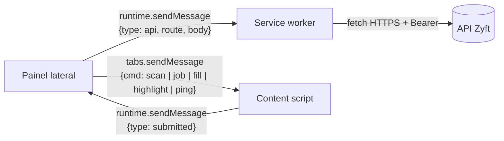

# Arquitetura da extensão de navegador

## Controle do documento

| Campo | Valor |
|---|---|
| Projeto | Zyft — Candidatura Assistida |
| Documento | Arquitetura da extensão |
| Versão | 1.0 |
| Status | Em revisão. O portal suportado depende do [ADR-0011](adr/0011-primeiro-portal-e-conectores-por-portal.md) e o pareamento do [ADR-0007](adr/0007-autenticacao-e-pareamento-da-extensao.md) (ambos propostos). |
| Dono | Arquitetura de software, com o time da extensão |
| Documentos relacionados | [DAT](dat.md), [API](api.md), [Segurança](seguranca.md), [ADR-0002](adr/0002-extensao-de-navegador-mv3-com-painel-lateral.md), [ADR-0009](adr/0009-nunca-enviar-confirmacao-explicita.md), [ADR-0010](adr/0010-sem-credenciais-sem-contorno-de-seguranca-campos-bloqueados.md) |

## 1. Papel da extensão

A extensão é a única parte do Zyft que toca a página do portal. Ela:

- reconhece se a aba ativa é uma tela do portal suportado ou de um site autorizado pela pessoa (RF-10);
- lê os campos visíveis e o texto da vaga (RF-11, RF-17);
- mostra o de-para proposto pela API para revisão (RF-12, RF-13, RF-16, RF-18);
- preenche só os campos aprovados (RF-14).

Ela **não** decide nada sozinha, **não** envia, **não** faz requisições ao portal e **não** guarda o Perfil Mestre.

## 2. Componentes (Manifest V3)

| Componente | Arquivo (alvo) | Responsabilidade | Origem no protótipo |
|---|---|---|---|
| Service worker | `apps/extension/src/background/` | Abre o painel ao clicar no ícone; guarda e renova os tokens; faz **todas** as chamadas à API; checa e pede permissões de host | `background.js` (só abria o painel); as chamadas à API ficavam no painel |
| Painel lateral | `apps/extension/src/sidepanel/` (React, pacote `ui`) | Fluxo de revisão: analisar vaga, ler formulário, revisar, preencher, conclusão | `sidepanel.html/js/css` |
| Content script (crawler e filler) | `apps/extension/src/content/` | Lê campos e vaga; preenche; destaca campos; detecta o envio feito pela pessoa | `content.js` |
| Conectores | `packages/connectors/<portal>/` | Reconhecimento de telas e regras específicas do portal | Rótulo por domínio em `sidepanel.js` (`CONNECTORS`) |

O content script é injetado **sob demanda** com `chrome.scripting.executeScript` quando a pessoa aciona uma ação, e não em toda página (sem `content_scripts` declarativo). Isso reduz a superfície de ataque e evita custo em páginas que não interessam.

## 3. Manifesto (alvo do MVP 1)

```json
{
  "manifest_version": 3,
  "name": "Zyft — Candidatura Assistida",
  "permissions": ["sidePanel", "storage", "scripting", "activeTab", "identity"],
  "host_permissions": ["https://<portal-suportado>/*"],
  "optional_host_permissions": ["https://*/*"],
  "background": { "service_worker": "background.js", "type": "module" },
  "side_panel": { "default_path": "sidepanel.html" },
  "action": { "default_title": "Abrir o Zyft" },
  "content_security_policy": { "extension_pages": "script-src 'self'; object-src 'none'; connect-src https://api.zyft.app" }
}
```

Mudanças em relação ao protótipo:
- `host_permissions` passa a ter **um** portal (o do [ADR-0011](adr/0011-primeiro-portal-e-conectores-por-portal.md)), não quatro. Localhost só no build de desenvolvimento.
- `tabs` sai e entra `activeTab`, o que basta para ler a URL da aba quando a pessoa interage com a extensão.
- `identity` entra para o pareamento por `chrome.identity.launchWebAuthFlow` com PKCE (fluxo principal do [ADR-0007](adr/0007-autenticacao-e-pareamento-da-extensao.md)); o código de pareamento é a alternativa quando esse fluxo falha.
- `optional_host_permissions` continua, para que a pessoa autorize outro site explicitamente, com o aviso de que o site não é suportado oficialmente e o conector genérico pode errar.
- `connect-src` restrito ao domínio da API.

## 4. Mensagens



| Mensagem | De → Para | Payload | Resposta |
|---|---|---|---|
| `scan` | Painel → content | — | `{fields: ScannedField[], url, title, host, screen?}` |
| `job` | Painel → content | — | `{url, title, text}` (texto visível, até 15.000 caracteres) |
| `fill` | Painel → content | `{items: {fieldId, value}[]}` | `{report: {fieldId, ok, error?}[]}` |
| `highlight` | Painel → content | `{fieldId}` | `{}` |
| `submitted` | Content → painel | `{url, title}` | — (evento do envio **feito pela pessoa**) |
| `api` | Painel → service worker | `{route, body}` | resposta da API ou erro Problem Details |

Regras:
- O content script **nunca** fala com a API e não tem tokens. Só o service worker tem.
- O content script valida o `sender` (`sender.id === chrome.runtime.id`) e ignora mensagens de `window.postMessage` da página.
- Os `fieldId` são atribuídos pelo content script (`data-zyft-id`) e só valem para aquela leitura. Um `fill` com `fieldId` desconhecido falha campo a campo, sem efeito colateral.

## 5. Crawler (leitura)

Algoritmo herdado de `content.js`:

1. **Raiz**: se houver um diálogo visível (`[role=dialog]`, `[aria-modal=true]`, `dialog[open]`), lê só o último; senão, o documento.
2. **Campos**: `input`, `select` e `textarea` não desabilitados. Descarta `hidden`, `submit`, `button`, `reset` e `image`. **Descarta `password`** sem ler o valor (RNF-01). Campos invisíveis são descartados, exceto radio e checkbox (que costumam ser estilizados com o input escondido).
3. **Rótulo**, em ordem: `aria-labelledby`, `label[for]`, `label` envolvente, `aria-label`, texto do irmão anterior, texto do pai (se tiver menos de 150 caracteres). O texto dos controles internos é removido.
4. **Seção**: `legend` do `fieldset`; senão, o último título (`h1`–`h5`, `[role=heading]`) antes do campo.
5. **Radios** são agrupados por `name`; a pergunta é o texto do contêiner comum menos os rótulos das opções.
6. **Metadados**: tipo, `name`, `id`, `placeholder`, `required`/`aria-required`, `maxLength`, opções e valor atual (`file` sempre vazio).
7. **Conector**: se houver conector para o host, ele pode identificar a tela (`screen`) e acrescentar dicas (`hint: profileKey`) a campos conhecidos.

**Leitura da vaga**: `main`, `article` ou `[role=main]` (senão `body`); título do `h1`; `innerText` até 15.000 caracteres. O conector pode fornecer seletores melhores.

### 5.1 Limitações conhecidas

| Limitação | Efeito | Plano |
|---|---|---|
| Iframes (de terceiros ou do próprio portal) | Campos não são lidos | Critério de escolha do portal. Evolução: injetar com `allFrames` **só** nos frames do domínio autorizado. |
| Shadow DOM | Campos de web components não aparecem | Evolução: percorrer `shadowRoot` abertos; os fechados não são suportados. |
| Componentes customizados (selects de bibliotecas, autocomplete) | Sem `select` nativo, as opções não são lidas | Regras do conector por tela |
| Formulários em várias etapas | Cada etapa é uma nova leitura | O painel orienta "Ler formulário" a cada etapa |
| Canvas ou campos sem rótulo acessível | De-para fraco | Aparecem como "sem correspondência" |

## 6. Preenchimento (filler)

- Texto, e-mail, telefone, data e textarea: foco, **setter nativo** de `value` (protótipo de `HTMLInputElement`/`HTMLTextAreaElement`), depois eventos `input`, `change` e `blur` com `bubbles: true`. É isso que faz frameworks como React e Vue perceberem a mudança.
- Select: só se a opção existir (`option.value`); setter nativo e eventos.
- Radio: `click()` na opção cujo `value` corresponde.
- Checkbox: `click()` só se o estado precisar mudar. Checkboxes de declaração chegam sempre com `selected=false` e só são preenchidos se a pessoa marcar no painel.
- `file` e `password`: recusados com erro, mesmo que cheguem num `fill`.
- Feedback visual: contorno verde (ok) ou vermelho (falha) por 4 s; relatório por campo no painel.

### 6.1 O que a extensão nunca faz (ADR-0009, ADR-0010)

| Nunca | Como é garantido |
|---|---|
| Enviar, salvar, avançar ou aceitar | Não existe código que chame `submit()`, `requestSubmit()` ou `click()` em `button`, `input[type=submit]` ou links. Regra de lint (`no-restricted-syntax`) e teste E2E que falha se o formulário demo receber `submit` sem ação humana. |
| Ler ou preencher senha | O crawler descarta `type=password` antes de ler o valor; o filler recusa. Teste unitário e E2E. |
| Resolver CAPTCHA ou código de verificação | Classificados como `manual` pela API; o filler não recebe esses campos. |
| Anexar arquivos | `type=file` é sempre `manual`. |
| Requisições ao portal | O content script não usa `fetch`/`XMLHttpRequest`; a CSP da extensão só libera a API. |
| Agir sem a pessoa | Toda leitura e todo preenchimento começam por um clique no painel. Não há timers nem gatilhos automáticos. |

O listener de `submit` (em fase de captura) só **observa** o envio feito pela pessoa, para mostrar a confirmação (RF-19). Ele não chama `preventDefault`.

## 7. Armazenamento

| Dado | Onde | Por quê |
|---|---|---|
| Access token (15 min) | `chrome.storage.session` | Fica só em memória, apaga ao fechar o navegador e não é acessível a content scripts (`setAccessLevel` mantido em `TRUSTED_CONTEXTS`) |
| Refresh token (rotativo) | `chrome.storage.local` | Sobrevive ao reinício; é revogável na plataforma; a rotação detecta reuso |
| Identificador do dispositivo (concessão) | `chrome.storage.local` | Pareamento (PKCE ou, na alternativa, código) |
| Última vaga analisada | `chrome.storage.session` | Contexto para respostas abertas durante a sessão |
| Perfil Mestre | **Não é armazenado** | Mínimo acesso (RNF-02) |
| Resultado do de-para | Memória do painel | Descartado ao fechar o painel |

O protótipo guardava o token fixo em `chrome.storage.local` e aceitava um `config.local.json`. Os dois são removidos no MVP 1.

## 8. Conectores por portal

Interface no pacote `connectors`:

```ts
export interface PortalConnector {
  id: string;                       // 'portal-x'
  version: string;                  // semver; muda a cada ajuste de seletores
  matches(url: URL): boolean;
  detectScreen(doc: Document): 'job' | 'resume-form' | 'application-form' | 'unknown';
  fieldHints?(doc: Document): { selector: string; profileKey: string }[];
  jobSelectors?: { title?: string; company?: string; body?: string };
}
```

- O **conector genérico** é o comportamento do protótipo e é sempre o fallback.
- Cada conector tem **fixtures HTML gravadas** das telas reais (sem dados pessoais) em `packages/test-fixtures/portals/<portal>/<data>/`. Os testes rodam o crawler e o de-para sobre elas (RNF-10).
- Métrica operacional: taxa de campos reconhecidos por tela e por versão do conector. Uma queda acima de 20% em relação à média de 7 dias abre um alerta (ver [ADR-0015](adr/0015-observabilidade-sem-dados-pessoais.md)).

## 9. Distribuição

- Chrome Web Store e Microsoft Edge Add-ons, com distribuição **não listada** durante os testes de usabilidade.
- A política de privacidade e a justificativa de cada permissão vão na ficha da loja.
- Versionamento semântico; a API aceita a versão atual e a anterior da extensão (header `X-Zyft-Extension-Version`), e versões antigas recebem um aviso de atualização.

## 10. Testes

| Nível | Exemplo |
|---|---|
| Unitário (jsdom) | Rótulo por `aria-labelledby`; agrupamento de radios; modal tem precedência; `password` descartado |
| Fixtures de portal | Para cada tela gravada: número de campos lidos, chaves esperadas por campo |
| E2E (Playwright com a extensão carregada, Chrome e Edge) | Portal demo: ler, revisar e preencher; o formulário **não** é enviado; CAPTCHA, anexo, termos e sensível ficam como "ação sua" |
| Segurança | Página hostil tenta `postMessage` para o content script; tenta ler `chrome.storage.session`; injeta rótulos com instruções para a IA |
