# Modelo de dados

## Controle do documento

| Campo | Valor |
|---|---|
| Projeto | Zyft — Candidatura Assistida |
| Documento | Modelo de dados (ER e dicionário) |
| Versão | 3.1 |
| Status | Em revisão. Implementado: **25 tabelas** (17 da Entrega 3 e 8 da versão 2) e 3 colunas novas em `Profiles`, criadas pela migration `20261021233314_V2PlanosAnunciosOnboarding`. **A migration é a fonte da verdade.** |
| Dono | Arquitetura de software, com o time de backend |
| Documentos relacionados | [API](api.md), [Backend](backend.md), [Segurança](seguranca.md), [ADR-0017](adr/0017-backend-em-csharp-dotnet-clean-architecture.md), [ADR-0014](adr/0014-dados-sensiveis-segregados-e-criptografados.md), [ADR-0019](adr/0019-area-profissional-dinamica-e-campos-personalizados.md), [ADR-0020](adr/0020-monetizacao-com-anuncios-e-planos.md), [Entrega 2 §2](../entregas/entrega-2-projeto-e-arquitetura.md#2-modelagem-do-banco-de-dados) |

**Histórico de revisões**

| Versão | Data | Alteração |
|---|---|---|
| 1.x | até 05/10/2026 | Modelo do marketplace. Arquivado em `docs/arquivo/marketplace-v1/`. |
| 2.0 | 12/10/2026 | Modelo-alvo em PostgreSQL com o Perfil Mestre em JSONB ([ADR-0008](adr/0008-postgresql-com-perfil-em-jsonb.md)). |
| 3.0 | 21/10/2026 | Reescrito para o modelo **relacional** implementado em EF Core ([ADR-0017](adr/0017-backend-em-csharp-dotnet-clean-architecture.md) ajustou o ADR-0008). Acrescenta as colunas e tabelas da versão 2: área profissional, campos personalizados, progresso do onboarding, planos, uso, pacotes e anúncios. |
| 3.1 | 21/10/2026 | Conferido com a migration da v2: nomes reais das 8 tabelas novas, tamanhos de coluna (`SalaryType` 30, `Answered`/`Skipped` 600), índices criados (os "propostos" viraram implementados, com `CustomFields(ProfileId, Label)` único e `AdHides(UserId)` simples). |

## 1. Decisões de modelagem

- **PostgreSQL 16 com EF Core 8 e Migrations**; SQLite em desenvolvimento e nos testes (`EnsureCreated`). As migrations são só do PostgreSQL: `20261015200622_InitialCreate` (Entrega 3) e `20261021233314_V2PlanosAnunciosOnboarding` (versão 2).
- **Perfil relacional**, uma tabela por seção (experiências, formação, cursos, competências, idiomas, campos personalizados). O JSONB do ADR-0008 foi trocado porque a disciplina pede entidades e relacionamentos explícitos e porque o de-para precisa de chaves estáveis (`experiences[0].company`, `custom:<id>`).
- **Ids `Guid`** gerados na aplicação; `CreatedAt` e `UpdatedAt` em UTC, preenchidos no `SaveChangesAsync`. Enums gravados como texto.
- **Tudo pendurado em `Users` com `ON DELETE CASCADE`**: excluir a conta apaga tudo (RF-08). A exceção proposital é `AdStats`, que não tem usuário.
- **Sensíveis fora do perfil**, cifrados com AES-256-GCM (ADR-0014). Campos personalizados **não** podem guardar sensíveis (RN-15).
- **Auditoria e uso sem conteúdo**: `AuditEvents` guarda ação, portal e contagem; `MonthlyUsage` guarda contadores; `UsageMarks` guarda só o hash de origem + caminho da página.
- **Arquivo de currículo não é guardado**: o texto é extraído em memória; só a proposta fica, até ser aplicada ou descartada.
- **Catálogos fixos ficam no código, não no banco**: o catálogo por área (`AreaCatalog`) e o catálogo de anúncios de demonstração (`AdCatalog`) são estáticos na camada Application. O banco guarda só o que é da pessoa (ocultos) e contadores agregados.

## 2. Diagrama ER

```mermaid
erDiagram
  Users ||--o{ RefreshTokens : "renova"
  Users ||--o{ Consents : "concede"
  Users ||--|| Profiles : "tem"
  Profiles ||--o{ Experiences : ""
  Profiles ||--o{ Educations : ""
  Profiles ||--o{ Courses : ""
  Profiles ||--o{ Skills : ""
  Profiles ||--o{ Languages : ""
  Profiles ||--o{ CustomFields : "v2"
  Users ||--o{ ApprovedAnswers : "aprova"
  Users ||--o{ SensitiveData : "guarda"
  Users ||--o{ ResumeImports : "importa"
  Users ||--o{ ExtensionDevices : "pareia"
  Users ||--o{ PairingCodes : "gera"
  Users ||--o{ AuthorizedSites : "autoriza"
  Users ||--o{ Applications : "registra"
  Users ||--o{ AuditEvents : "gera"
  Users ||--o| OnboardingProgress : "v2"
  Users ||--o| Subscriptions : "v2"
  Users ||--o{ MonthlyUsages : "v2, uma por mês"
  Users ||--o{ UsagePacks : "v2"
  Users ||--o{ UsageMarks : "v2"
  Users ||--o{ AdHides : "v2"
  AdStats }o..o{ AdCatalog : "por id do anúncio, sem usuário"

  Profiles {
    uuid Id PK
    uuid UserId FK
    varchar WorkArea "v2"
    varchar ProfessionalRegistration "v2"
    varchar SalaryType "v2"
  }
  CustomFields {
    uuid Id PK
    uuid ProfileId FK
    varchar Label "até 80"
    varchar Value "até 500"
  }
  OnboardingProgress {
    uuid Id PK
    uuid UserId FK
    varchar Answered "ids de passo, 600"
    varchar Skipped "ids de passo, 600"
    varchar LastStep
    timestamptz CompletedAt
  }
  Subscriptions {
    uuid Id PK
    uuid UserId FK
    varchar Plan "Free | Plus"
    varchar Period "Monthly | Yearly"
    timestamptz StartedAt
    timestamptz TrialEndsAt
    timestamptz RenewsAt
    timestamptz CanceledAt
    bool TrialUsed
  }
  MonthlyUsages {
    uuid Id PK
    uuid UserId FK
    char Month "AAAA-MM"
    int AssistedUsed
    int AiUsed
    int JobAnalysesUsed
    int ResumeImportsUsed
    int BonusGranted
    int BonusUsed
    int RewardedClaims
  }
  UsagePacks {
    uuid Id PK
    uuid UserId FK
    int AssistedRemaining
    int AiRemaining
    timestamptz PurchasedAt
    timestamptz ExpiresAt
  }
  UsageMarks {
    uuid Id PK
    uuid UserId FK
    char Month
    varchar Resource
    varchar KeyHash "hash de origem+caminho"
  }
  AdHides {
    uuid Id PK
    uuid UserId FK
    varchar Scope "Ad | Topic"
    varchar AdId
    varchar Topic
    timestamptz ExpiresAt "nulo = para sempre"
  }
  AdStats {
    uuid Id PK
    varchar AdId
    bigint Impressions
    bigint Clicks
  }
```

O diagrama acima mostra só as tabelas e colunas da versão 2. O diagrama das 17 tabelas da Entrega 3, com todas as colunas, está em [`docs/entregas/img/04-der.png`](../entregas/img/04-der.png) e na Entrega 2 §2.2.

## 3. Tabelas da Entrega 3 (resumo)

O dicionário completo (tipos, nulidade, restrições) está na [Entrega 2 §2.5](../entregas/entrega-2-projeto-e-arquitetura.md#25-dicionário-de-dados).

| Tabela | Conteúdo | Requisitos |
|---|---|---|
| `Users` | Conta: e-mail único, nome, hash BCrypt da senha. `DeletedAt` existe sem uso (pendência D-05). | RF-01 |
| `RefreshTokens` | Hash SHA-256 do refresh, validade, `ReplacedByHash` para detectar reuso, escopo e dispositivo | RF-01, RF-09 |
| `Consents` | Uma linha por finalidade (`AiText`, `JobAnalysis`, `SensitiveData`), todas nascem desligadas | RF-07 |
| `Profiles` | Dados básicos, objetivo e preferências (1 : 1 com `Users`) | RF-02 |
| `Experiences`, `Educations`, `Courses`, `Skills`, `Languages` | Seções do perfil; `Courses` tem `Type` (curso ou certificação) | RF-02 |
| `ApprovedAnswers` | Pergunta original, texto aprovado, datas | RF-06 |
| `SensitiveData` | Tipo + valor cifrado (AES-256-GCM, nonce por valor) | RN-04 |
| `ResumeImports` | Proposta estruturada e status; nunca o arquivo | RF-03, RF-04 |
| `ExtensionDevices`, `PairingCodes` | Extensões pareadas; código de 6 dígitos, 10 min, uso único | RF-09 |
| `AuthorizedSites` | Origem (protocolo + domínio) autorizada pela pessoa | RF-10 |
| `Applications` (`JobApplication`) | Portal, cargo, empresa, URL da vaga, status, campos preenchidos, anotação | RF-19 |
| `AuditEvents` | Ação (lista fechada), portal, quantidade de campos, data | RF-20 |

Observação: `Applications` tem status e anotações. O [ADR-0012](adr/0012-registro-minimo-de-conclusao-no-mvp1.md), ainda proposto, recomendava um registro mínimo **sem** status. A divergência está registrada como decisão pendente; lembretes e acompanhamento ativo continuam MVP 2 (RF-M2-02).

## 4. Tabelas e colunas da versão 2

Nomes conferidos na migration `20261021233314_V2PlanosAnunciosOnboarding` e em `Persistence/Configurations/Configurations.cs`. As 8 tabelas novas: `CustomFields`, `OnboardingProgress`, `Subscriptions`, `MonthlyUsages`, `UsagePacks`, `UsageMarks`, `AdHides` e `AdStats`. Toda tabela tem `Id`, `CreatedAt` e `UpdatedAt` (classe base `Entity`).

### 4.1 `Profiles` — colunas novas (RF-24)

| Coluna | Tipo | Nulo | Regra |
|---|---|---|---|
| `WorkArea` | varchar(80) | sim | Área escolhida (nome do catálogo ou texto livre em "Outra área") |
| `ProfessionalRegistration` | varchar(120) | sim | Registro em conselho, OAB, NR etc. |
| `SalaryType` | varchar(30) | sim | `CLT (bruto)`, `PJ`, `Por hora` ou `Por plantão` |

### 4.2 `CustomFields` — informações da sua área (RF-25)

| Coluna | Tipo | Nulo | Regra |
|---|---|---|---|
| `Id` | uuid | não | PK; forma a chave `custom:<id>` do de-para |
| `ProfileId` | uuid | não | FK → `Profiles`, cascade |
| `Label` | varchar(80) | não | Recusado se parecer sensível (`profile.custom_field_sensitive`) |
| `Value` | varchar(500) | não | Texto livre |
| `CreatedAt`, `UpdatedAt` | timestamptz | não | `updatedAt` aparece na API |

Até 50 campos por perfil (`Profile.MaxCustomFields`). O rótulo é único no perfil (índice `IX_CustomFields_ProfileId_Label`).

### 4.3 `OnboardingProgress` (RF-23)

| Coluna | Tipo | Nulo | Regra |
|---|---|---|---|
| `UserId` | uuid | não | FK → `Users`, cascade; único |
| `Answered`, `Skipped` | varchar(600) | não | Ids de passo separados por vírgula, só da lista fechada de 26; nenhum conteúdo pessoal |
| `LastStep` | varchar(30) | sim | Último passo visto, para retomar |
| `CompletedAt` | timestamptz | sim | Preenchido uma vez, quando a pessoa conclui |

### 4.4 Planos e uso (RF-26 a RF-28)

| Tabela | Coluna | Regra |
|---|---|---|
| `Subscriptions` | `Plan`, `Period` | `Free`/`Plus`; `Monthly`/`Yearly` (texto). Sem linha = Gratuito |
| | `StartedAt`, `TrialEndsAt`, `RenewsAt`, `CanceledAt`, `TrialUsed` | O teste grátis de 7 dias vale uma vez por conta. Tudo **simulado**: não há id de gateway nem dado de cartão |
| `MonthlyUsages` | `Month` | `AAAA-MM` em UTC; único com `UserId` |
| | `AssistedUsed`, `AiUsed`, `JobAnalysesUsed`, `ResumeImportsUsed` | Consumo do limite do mês (no Plus, o total, para métricas internas) |
| | `BonusGranted`, `BonusUsed`, `RewardedClaims` | Anúncio recompensado: +3 por claim, até 3 claims no mês |
| `UsagePacks` | `AssistedRemaining`, `AiRemaining` | Começam em 15 e 10 |
| | `ExpiresAt` | Compra + 60 dias; consome primeiro o que vence antes |
| `UsageMarks` | `Month`, `Resource`, `KeyHash` | Deduplicação de candidatura assistida: SHA-256 (64 caracteres em hexadecimal) de `esquema://host/caminho` em minúsculas, sem query; **nunca a URL** |

### 4.5 Anúncios (RF-29)

| Tabela | Coluna | Regra |
|---|---|---|
| `AdHides` | `Scope` | `Ad` (o anúncio, por 30 dias) ou `Topic` (o assunto, para sempre) |
| | `AdId`, `Topic` | Ids do catálogo de demonstração; nenhum dado pessoal |
| | `ExpiresAt` | Nulo no escopo `Topic` |
| `AdStats` | `AdId`, `Impressions`, `Clicks` | Contadores **agregados**, sem `UserId` e sem FK para `Users`, sem data por pessoa. Cada `GET /ads` com anúncio soma uma exibição; cada `POST /ads/{id}/click`, um clique |

O catálogo de anúncios (título, corpo, chamada, URL, área, assunto, palavras-chave) não é tabela: é o `AdCatalog` (`src/Zyft.Application/Ads/AdCatalog.cs`), com **16 anúncios** de "Anunciante de demonstração" e ids de texto (`demo-tec-cloud`, `demo-sau-sbv`…). Por isso `AdId` é varchar(60), não uuid.

## 5. Retenção

| Dado | Retenção | Como é apagado |
|---|---|---|
| Conta, perfil, campos personalizados, respostas, consentimentos, candidaturas | Enquanto a conta existir | Exclusão da conta (cascata) |
| `SensitiveData` | Enquanto a conta existir e o consentimento estiver ligado | Desligar o consentimento apaga os dados; excluir a conta também |
| `ResumeImports` | Até aplicar ou descartar | Arquivo nunca persistido |
| `PairingCodes` | 10 minutos, uso único | Invalidado ao usar ou expirar |
| `RefreshTokens` | 7 dias | Revogação ou expiração |
| `OnboardingProgress` | Enquanto a conta existir | Cascata |
| `Subscriptions` | Enquanto a conta existir | Cascata |
| `MonthlyUsages`, `UsageMarks` | Por mês; o mês corrente é o que importa para o limite. Proposta: apagar marcas com mais de 2 meses e contadores com mais de 12 meses | Tarefa de limpeza (proposta) e cascata |
| `UsagePacks` | 60 dias de validade; o registro expirado pode ser apagado depois de 12 meses (proposta) | Cascata |
| `AdHides` | 30 dias (anúncio) ou até a conta ser excluída (assunto) | Expiração lógica e cascata |
| `AdStats` | Indefinida, por não ter dado pessoal | — |
| `AuditEvents` | Enquanto a conta existir (proposta de 12 meses no ADR-0015) | Cascata |

## 6. Índices e restrições

Da Entrega 3: únicos em `Users.Email`, `RefreshTokens.TokenHash`, `Consents(UserId, Purpose)`, `Profiles.UserId`, `Skills(ProfileId, Name)`, `Languages(ProfileId, Name)`, `SensitiveData(UserId, Kind)`, `AuthorizedSites(UserId, Origin)`; *check constraints* de período em `Experiences` e `Educations`.

Criados pela migration da versão 2:

- `OnboardingProgress(UserId)` único; `Subscriptions(UserId)` único.
- `MonthlyUsages(UserId, Month)` único.
- `UsageMarks(UserId, Month, Resource, KeyHash)` único (garante a contagem uma vez por página, mesmo com duas requisições simultâneas).
- `UsagePacks(UserId, ExpiresAt)`.
- `AdHides(UserId)` (simples; as ocultações de uma pessoa são poucas e filtradas em memória).
- `AdStats(AdId)` único.
- `CustomFields(ProfileId, Label)` único.

## 7. Migrations

- Migrations em `src/Zyft.Infrastructure/Persistence/Migrations`, só para a frente, aplicadas na subida (`Database.Migrate()`) em PostgreSQL. O CI confere se o modelo e a migration estão em dia.
- A versão 2 entrou na migration `20261021233314_V2PlanosAnunciosOnboarding`, sobre a `InitialCreate`. Todas as colunas novas de `Profiles` são opcionais, então perfis antigos continuam válidos.
- Em SQLite (desenvolvimento), o `DatabaseInitializer` usa `EnsureCreated`, que não altera um banco que já existe. Apague `src/Zyft.Api/zyft-dev.db` (e os arquivos `-shm` e `-wal`) para recriar o banco com o esquema novo e os usuários de demonstração.
