# Modelo de dados

## Controle do documento

| Campo | Valor |
|---|---|
| Projeto | Zyft — Candidatura Assistida |
| Documento | Modelo de dados (ER e dicionário) |
| Versão | 2.0 (substitui `docs/arquivo/marketplace-v1/diagrama-er-e-dicionario-de-dados.md`) |
| Status | Em revisão. Depende do [ADR-0008](adr/0008-postgresql-com-perfil-em-jsonb.md) (proposto). Os campos do perfil necessários no primeiro fluxo dependem do ponto V2 do DVP-E. |
| Dono | Arquitetura de software, com o time de backend |
| Documentos relacionados | [DAT](dat.md), [Backend](backend.md), [API](api.md), [Segurança](seguranca.md), [ADR-0014](adr/0014-dados-sensiveis-segregados-e-criptografados.md) |

## 1. Decisões de modelagem

- **PostgreSQL 16**, com o Perfil Mestre em **JSONB**. O perfil é um documento lido e gravado inteiro, validado pelo esquema Zod do pacote `profile-schema`, e sua estrutura vai evoluir rápido durante o MVP 1. Colunas relacionais ficam para o que é consultado ou tem integridade própria (contas, dispositivos, consentimentos, auditoria).
- **Versionamento do perfil**: cada gravação cria uma linha em `profile_versions`; `profiles` aponta para a versão atual. Isso permite desfazer e mostrar o que mudou após uma importação.
- **Sensíveis fora do perfil**: tabela própria, criptografia por campo (envelope encryption), nunca no JSONB do perfil (ADR-0014).
- **Auditoria sem valores**: `audit_events` registra o que aconteceu e quantos campos, nunca o conteúdo (RF-20, RNF-09).
- **Arquivo de currículo não é guardado**: o texto é extraído em memória; só a proposta estruturada fica, até ser aplicada ou expirar.
- IDs `uuid` v7 (ordenáveis). Datas em `timestamptz` (UTC).

## 2. Diagrama ER

```mermaid
erDiagram
  users ||--o{ auth_identities : "autentica por"
  users ||--o{ web_sessions : "tem"
  users ||--o{ extension_devices : "pareia"
  users ||--o{ device_pairings : "inicia"
  users ||--|| profiles : "tem"
  profiles ||--o{ profile_versions : "versiona"
  users ||--o| profile_sensitive : "guarda"
  users ||--o{ approved_answers : "aprova"
  users ||--o{ consents : "concede"
  users ||--o{ consent_events : "histórico"
  users ||--o{ resume_imports : "importa"
  users ||--o{ audit_events : "gera"
  users ||--o{ completion_records : "conclui (opcional, ADR-0012)"
  extension_devices ||--o{ audit_events : "origem"

  users {
    uuid id PK
    citext email UK
    timestamptz email_verified_at
    text display_name
    timestamptz created_at
    timestamptz deleted_at
  }
  auth_identities {
    uuid id PK
    uuid user_id FK
    text provider "password | google"
    text provider_subject
    text password_hash "Argon2id, só provider=password"
    timestamptz created_at
  }
  web_sessions {
    uuid id PK
    uuid user_id FK
    bytea token_hash
    timestamptz expires_at
    timestamptz revoked_at
  }
  extension_devices {
    uuid id PK
    uuid user_id FK
    text name
    text browser
    text extension_version
    bytea refresh_token_hash
    uuid refresh_family_id
    timestamptz last_used_at
    timestamptz revoked_at
  }
  device_pairings {
    uuid id PK
    bytea device_code_hash
    text user_code UK
    uuid user_id FK "nulo até confirmar"
    timestamptz expires_at
    timestamptz confirmed_at
  }
  profiles {
    uuid user_id PK
    uuid current_version_id FK
    int schema_version
    timestamptz updated_at
  }
  profile_versions {
    uuid id PK
    uuid user_id FK
    int number
    jsonb data
    text source "plataforma | importacao | portal"
    timestamptz created_at
  }
  profile_sensitive {
    uuid user_id PK
    bytea gender_enc
    bytea ethnicity_enc
    bytea disability_enc
    bytea notes_enc
    bytea dek_enc "chave de dados cifrada pela KEK"
    text kek_id
    timestamptz updated_at
  }
  approved_answers {
    uuid id PK
    uuid user_id FK
    text question
    text answer
    timestamptz approved_at
    timestamptz last_used_at
  }
  consents {
    uuid user_id PK
    bool ai_free_text
    bool job_analysis
    bool sensitive_data
    timestamptz updated_at
  }
  consent_events {
    uuid id PK
    uuid user_id FK
    text purpose
    bool granted
    text policy_version
    timestamptz at
  }
  resume_imports {
    uuid id PK
    uuid user_id FK
    text status "processing | ready | applied | discarded | failed | expired"
    text file_kind "pdf | docx"
    int chars
    jsonb proposal
    text error_code
    timestamptz created_at
    timestamptz expires_at
  }
  audit_events {
    uuid id PK
    uuid user_id FK
    uuid device_id FK
    text action
    text portal_host
    jsonb counts
    timestamptz at
  }
  completion_records {
    uuid id PK
    uuid user_id FK
    text portal_host
    text job_title
    text company
    timestamptz completed_at
  }
```



## 3. Dicionário de dados

### 3.1 Conta e autenticação

| Tabela | Coluna | Tipo | Regra |
|---|---|---|---|
| `users` | `email` | `citext` | Único entre contas ativas; verificado antes de usar a extensão |
| | `deleted_at` | `timestamptz` | Marca a exclusão em andamento; os dados são apagados pela tarefa `privacy.delete` |
| `auth_identities` | `provider` | `text` | `password` ou `google` |
| | `password_hash` | `text` | Argon2id (m=19 MiB, t=2, p=1), só para `password` |
| `web_sessions` | `token_hash` | `bytea` | SHA-256 do token do cookie; o token em claro nunca é guardado |
| `extension_devices` | `refresh_token_hash` | `bytea` | Hash do refresh token atual |
| | `refresh_family_id` | `uuid` | Reuso de um refresh antigo da mesma família revoga o dispositivo (detecção de roubo) |
| `device_pairings` | `user_code` | `text` | Só no fluxo alternativo de código de pareamento ([ADR-0007](adr/0007-autenticacao-e-pareamento-da-extensao.md)); 7 caracteres sem ambiguidade (sem 0/O, 1/I), válido por 10 min, uso único |

### 3.2 Perfil

| Tabela | Coluna | Tipo | Regra |
|---|---|---|---|
| `profile_versions` | `data` | `jsonb` | Documento do Perfil Mestre validado pelo `profile-schema` (seções do DRP RF-02, como no `emptyProfile()` do protótipo, **sem** `sensitive`) |
| | `source` | `text` | `plataforma`, `importacao` (aplicação de proposta) ou `portal` ("levar para o perfil", RF-16) |
| | `number` | `int` | Sequencial por usuário; mantém as últimas 20 versões |
| `profile_sensitive` | `*_enc` | `bytea` | AES-256-GCM com a DEK do usuário; a DEK é cifrada pela KEK do KMS. Lida só pelo `sensitive-vault` |
| `approved_answers` | `question` | `text` | Texto da pergunta como apareceu no portal (sem URL) |
| | `answer` | `text` | Texto aprovado pela pessoa |

Estrutura do JSONB (resumo):

```json
{
  "personal": { "fullName": "", "email": "", "phone": "", "birthDate": "", "cpf": "", "city": "", "state": "",
                "address": "", "zipCode": "", "linkedin": "", "github": "", "portfolio": "" },
  "objective": { "desiredRoles": [], "areas": [], "seniority": "", "workModel": "", "locationPreference": "", "summary": "" },
  "experiences": [{ "company": "", "role": "", "start": "MM/AAAA", "end": "MM/AAAA", "current": false,
                    "activities": "", "tools": "", "results": "" }],
  "education": [{ "institution": "", "course": "", "degree": "", "start": "", "end": "", "status": "" }],
  "courses": [{ "name": "", "institution": "", "year": "", "hours": "" }],
  "certifications": [{ "name": "", "issuer": "", "year": "" }],
  "skills": [],
  "languages": [{ "language": "", "level": "" }],
  "preferences": { "availability": "", "salaryExpectation": "", "travel": "", "relocation": "",
                   "contractTypes": [], "driverLicense": "" }
}
```

O CPF e a data de nascimento ficam no perfil (não são dados sensíveis pela LGPD, art. 5º, II), mas são **dados pessoais de alto impacto**. Eles só são devolvidos à extensão quando um campo do portal os pede, e a decisão de mantê-los no MVP 1 depende do levantamento de campos do portal (ponto V2 do DVP-E).

### 3.3 Consentimento, importação e registro

| Tabela | Coluna | Tipo | Regra |
|---|---|---|---|
| `consents` | `ai_free_text`, `job_analysis` | `bool` | Padrão `true` no protótipo. **No MVP 1, o padrão é decisão do encarregado de dados** (proposta: perguntar no onboarding, sem pré-marcar) |
| | `sensitive_data` | `bool` | Padrão `false` |
| `consent_events` | `policy_version` | `text` | Versão da política vigente no momento do consentimento |
| `resume_imports` | `proposal` | `jsonb` | Proposta estruturada; nunca o arquivo nem o texto bruto |
| | `expires_at` | `timestamptz` | Criação + 7 dias; depois a proposta é apagada |
| `audit_events` | `action` | `text` | Ex.: `perfil.atualizado`, `curriculo.aplicado`, `campos.mapeados`, `campos.preenchidos`, `vaga.analisada`, `consentimento.alterado`, `dispositivo.pareado`, `dispositivo.revogado`, `dados.exportados` |
| | `portal_host` | `text` | Só o host (ex.: `vagas.exemplo.com`), nunca a URL completa (que pode conter identificadores) |
| | `counts` | `jsonb` | Ex.: `{"lidos": 24, "propostos": 21, "preenchidos": 18, "acaoSua": 3}`. **Proibido** conter valores, rótulos com dados ou textos |
| `completion_records` | — | — | Só existe se o [ADR-0012](adr/0012-registro-minimo-de-conclusao-no-mvp1.md) for aceito; os campos são os mínimos propostos lá |

## 4. Retenção

| Dado | Retenção | Como é apagado |
|---|---|---|
| Conta, perfil, respostas aprovadas, consentimentos | Enquanto a conta existir | Exclusão da conta (RF-08): apagados em até 24 h pela tarefa `privacy.delete` |
| `profile_versions` | Últimas 20 versões | Poda na gravação |
| `profile_sensitive` | Enquanto a conta existir, ou até a pessoa limpar | Exclusão destrói a DEK (crypto-shredding) e a linha |
| `resume_imports` | 7 dias se não aplicada; aplicada: `proposal` apagada na aplicação | `retention.sweep` diário |
| Arquivo e texto do currículo | Não persistidos | Memória do processo durante a requisição ou tarefa |
| `device_pairings` | 10 min | `retention.sweep` |
| `web_sessions` expiradas | 30 dias após expirar | `retention.sweep` |
| `audit_events` | 12 meses | `retention.sweep` |
| `consent_events` | Enquanto a conta existir mais 5 anos após a exclusão, só com o `user_id` pseudonimizado | Prova de consentimento (LGPD art. 8º, §2º). **A validar com o jurídico.** |
| Backups | 30 dias | Rotação; exclusões são reaplicadas na restauração por uma lista de contas excluídas |
| Logs técnicos | 30 dias | Sem dados pessoais por construção (ADR-0015) |

## 5. Índices e restrições

- `users(email)` único parcial `WHERE deleted_at IS NULL`.
- `auth_identities(provider, provider_subject)` único.
- `extension_devices(user_id) WHERE revoked_at IS NULL`.
- `device_pairings(user_code)` único; `(expires_at)` para a limpeza.
- `profile_versions(user_id, number DESC)`.
- `audit_events(user_id, at DESC)`; `(at)` para a retenção.
- `resume_imports(user_id, created_at DESC)`; `(expires_at) WHERE status IN ('processing','ready','failed')`.
- **Row-Level Security** ativada nas tabelas com `user_id`, com `current_setting('app.user_id')` definido pela API por transação. É uma defesa em profundidade contra IDOR; a verificação principal continua na aplicação.

## 6. Migrações

- Kysely migrator, migrações em `apps/api/migrations/`, numeradas e só para a frente.
- Mudanças no JSONB do perfil sobem `profiles.schema_version`. A migração de documentos é preguiçosa (na leitura, pelo `normalizeProfile` do `profile-schema`, como no protótipo) e há uma tarefa para migrar em lote.
- Importação do protótipo: um script lê o `db.json` local e cria um usuário com o perfil e as respostas aprovadas. **Não** importa o histórico de candidaturas (MVP 2).
