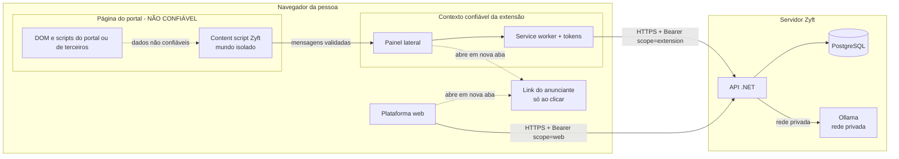

# Segurança e privacidade técnica

## Controle do documento

| Campo | Valor |
|---|---|
| Projeto | Zyft — Candidatura Assistida |
| Documento | Modelo de ameaças, controles e LGPD técnico |
| Versão | 2.2 |
| Status | Em revisão. Revisar a cada ADR que toque autenticação, dados pessoais, permissões da extensão, IA, anúncios ou pagamento. |
| Dono | Arquitetura de software, com privacidade e segurança |
| Documentos relacionados | [DAT](dat.md), [API](api.md), [Backend](backend.md), [Extensão](extensao.md), [IA](ia.md), [Modelo de dados](modelo-de-dados.md), [ADR-0020](adr/0020-monetizacao-com-anuncios-e-planos.md), [Monetização](../01-produto/monetizacao.md), [Termos e privacidade](../07-legal/) |

**Histórico de revisões**

| Versão | Data | Alteração |
|---|---|---|
| 1.0 | 12/10/2026 | STRIDE (T1–T16), controles por camada e LGPD para a arquitetura-alvo em TypeScript. |
| 2.0 | 21/10/2026 | Controles atualizados para a API real em .NET 8. Novas ameaças da versão 2 (T17–T25): anúncios, pagamento simulado, campos personalizados, abuso de cota e do recompensado. LGPD dos anúncios contextuais e risco da política da Chrome Web Store. |
| 2.1 | 21/10/2026 | Sincronizado com a implementação: status de T17–T25 revisados contra o código, nomes reais de testes, rate limit por rota, mensagens do service worker só de páginas da extensão (extensão 0.4.0), nova ameaça T26 e lacunas conhecidas (§3.3). |
| 2.2 | 21/10/2026 | Duas lacunas do §3.3 fechadas: `POST /billing/packs` passou a exigir `WebUser` e a extensão se desconecta revogando o próprio dispositivo (`DELETE /extension/devices/current`). Teste de logs estendido às rotas da v2. `personal.birthDate` trancado no painel. |
| 2.3 | 22/10/2026 | Rede de anúncios Google AdSense **simulada** ([ADR-0021](adr/0021-rede-de-anuncios-google-adsense.md)): nova ameaça T27, CSP e consentimento antes de ativar, nota na LGPD (§5.2) e na política das lojas (§5.1). |

## 1. Ativos

| Ativo | Sensibilidade | Onde fica |
|---|---|---|
| Perfil Mestre (contato, data de nascimento, histórico, pretensão, registro profissional) | Alta (dados pessoais) | PostgreSQL, tabelas do perfil |
| Campos personalizados | Alta (texto livre da pessoa) | `CustomFields` |
| Dados sensíveis (gênero, raça/etnia, deficiência, religião, saúde…) | Muito alta (LGPD art. 5º, II) | `SensitiveData`, cifrados com AES-256-GCM |
| Respostas aprovadas | Alta | `ApprovedAnswers` |
| Tokens (access JWT, refresh opaco) | Alta (dão acesso a tudo acima) | Navegador; no banco, só o hash do refresh |
| Plano e uso | Baixa a média (revela intensidade de busca de emprego) | `Subscriptions`, `MonthlyUsages`, `UsagePacks`, `UsageMarks` |
| Preferências de anúncio (ocultos) | Baixa | `AdHides` |
| Contadores de anúncio | Nenhuma (agregados, sem pessoa) | `AdStats` (exibições e cliques por anúncio). O catálogo de anúncios é estático, no código (`AdCatalog`) |
| Sessão da pessoa no portal | Alta, mas **não é do Zyft** | Cookies do portal; o Zyft nunca lê |
| Conteúdo da página do portal | Média | Memória da extensão e da API durante a requisição |
| Prompts e respostas da IA | Alta (contêm fatos do perfil) | Memória do processo; não persistidos nem logados |

## 2. Fronteiras de confiança

Tudo o que vem da página do portal é entrada não confiável. Na versão 2, o **anunciante também fica do lado de fora**: ele não recebe nada do Zyft. A pessoa só chega ao site do anunciante se clicar, numa aba nova, sem parâmetros que a identifiquem.

## 3. Modelo de ameaças (STRIDE)

### 3.1 Ameaças da Entrega 3 (situação atualizada)

| # | Categoria | Ameaça | Controles na implementação .NET | Status |
|---|---|---|---|---|
| T1 | Spoofing | Site malicioso fala com a API fingindo ser a extensão | CORS por lista (`Cors:AllowedOrigins`, `Cors:ExtensionIds`, obrigatório em Production); Bearer de 15 min | Implementado |
| T2 | Spoofing | DNS rebinding contra servidor local | Só existia no protótipo Node; a API .NET roda como serviço com CORS e token | Não se aplica |
| T3 | Spoofing | Roubo do token da extensão | Access token em `chrome.storage.session` (só contextos confiáveis); refresh rotativo com detecção de reuso (revoga a cadeia, teste `Refresh_token_reutilizado_revoga_a_cadeia_inteira`); revogação do dispositivo derruba o token na hora (pela plataforma ou, ao desconectar, pela própria extensão com `DELETE /extension/devices/current`); content script sem token; código de pareamento de 6 dígitos, 10 min, uso único, com rate limit por IP (10 por minuto) | Implementado |
| T4 | Tampering | Página hostil manipula o content script | Mundo isolado; validação de `sender.id`; ignora `window.postMessage`; só campos visíveis; `fieldId` vale para uma leitura; o service worker não atende mensagens vindas de content scripts (T26) | Implementado |
| T5 | Tampering | Formulário de phishing imitando o portal | Site fora da lista exige autorização explícita; o painel mostra o host atual | Implementado |
| T6 | Tampering / Elevação | Prompt injection pela vaga ou pelos rótulos | IA só devolve chaves validadas; valor vem do perfil; evidência por linha real; nenhuma ação derivada da IA (testes `Chave_inventada_pela_IA_e_descartada`, `IA_que_tenta_escrever_valor_ou_apontar_senha_nao_consegue`, `IA_que_inventa_linha_de_evidencia_tem_o_atende_rebaixado`) | Implementado; eval de injeção a ampliar |
| T7 | Repudiation | A pessoa não sabe o que foi preenchido | Registro de ações (RF-20); envio sempre da pessoa | Implementado |
| T8 | Information disclosure | Exfiltração do perfil pela extensão | Mínimo retorno: só os campos lidos; token de extensão não acessa `GET /profile` nem exportação (policy `WebUser`) | Implementado |
| T9 | Information disclosure | IDOR | Toda consulta filtra pelo `sub` do token; recurso de outra pessoa = 404 | Implementado (RLS não usado) |
| T10 | Information disclosure | Dados pessoais em logs | Serilog só com método, caminho sem query, status e duração; testes `Logs_nao_contem_dados_pessoais` e, para as rotas da v2 (`/profile/custom-fields`, `/ads`, `/billing`, `/onboarding`), `Logs_das_rotas_v2_nao_contem_dados_pessoais` | Implementado |
| T11 | Information disclosure | Vazamento do banco | Sensíveis cifrados com AES-256-GCM e chave por configuração (`Encryption:Key`, 32 bytes em Base64; tamanho errado falha cedo); criptografia em repouso do provedor (produção) | Parcial (sem KMS no MVP acadêmico) |
| T12 | Information disclosure | Currículo retido | Extração em memória; arquivo nunca gravado | Implementado |
| T13 | Information disclosure | Sensíveis enviados à IA | Perfil achatado e fatos sem sensíveis; testes `Prompt_da_IA_nao_contem_dados_sensiveis` e `Campos_bloqueados_sao_classificados_antes_da_IA_e_nem_chegam_ao_prompt` | Implementado |
| T14 | Denial of service | Abuso das rotas de IA | Rate limit por pessoa (60 por minuto, configurável) em `/forms/*`, `/jobs/analyze` e `POST /resume-imports`; login, cadastro e pareamento com 10 por minuto por IP; 429 com `Retry-After`. Na v2, também a cota mensal (402) | Implementado |
| T15 | Elevation of privilege | Extensão age no portal sem a pessoa | Não há código de envio; `submit` só observado | Implementado |
| T16 | Elevation of privilege | Cadeia de suprimentos | Versões centralizadas em `Directory.Packages.props`; poucas dependências; extensão sem bibliotecas externas | Parcial (sem auditoria automática no CI) |

### 3.2 Ameaças novas da versão 2

| # | Categoria | Ameaça | Cenário | Controles | Status |
|---|---|---|---|---|---|
| T17 | Information disclosure | **Dado pessoal chega ao anunciante** | A URL do anúncio leva e-mail, nome, cargo ou um id da pessoa; ou o anúncio é escolhido por dado sensível | A seleção usa só área, cargos desejados e o texto do requisito (RN-09). A resposta de `GET /ads` não tem dado pessoal. As URLs do catálogo são fixas, sem parâmetros montados com dados da pessoa. Cliques são contados em `AdStats` sem usuário. `AdStats` guarda só `AdId`, exibições e cliques. O teste `Anuncio_por_area_sem_dados_pessoais_e_ocultar_e_clique` confere que a resposta não traz nome, telefone nem e-mail do perfil; o teste geral `Logs_nao_contem_dados_pessoais` cobre os logs (RNF-14, TN-12) | Implementado. Lacuna: não há teste de log específico de `/ads` |
| T18 | Information disclosure | **Rastreamento por terceiros** | Imagem ou script do anunciante carregado na página registra quem viu | O catálogo de demonstração não tem imagem (`imageUrl = null`, verificado em teste); web e extensão mostram o logo do Zyft. Nenhum script de anunciante roda na web nem na extensão (CSP `script-src 'self'`). Na web o link abre em nova aba com `rel="noopener noreferrer sponsored"`; na extensão, por `chrome.tabs.create`. Se houver imagem externa no futuro, a extensão já a carrega com `referrerpolicy="no-referrer"` | Implementado na demonstração |
| T19 | Spoofing | **Anúncio imitando a interface** | Um criativo com botão "Aprovar" ou "Preencher" engana a pessoa | Moldura do Zyft com o selo "Patrocinado" fora do criativo, estilo neutro, sem cores de estado nem do botão principal (RN-10, [design system](design-system.md)); nunca na aba Formulário da extensão (RN-08). A API só serve os 6 espaços permitidos; qualquer outro responde 204 (teste `Espacos_proibidos_respondem_204`) | Implementado |
| T20 | Tampering | **Conteúdo enganoso** | Anúncio promete vaga garantida, "candidatura em massa" ou "aprovação com IA" | Catálogo revisado pela mesma régua do produto: sem promessa de contratação (RN-06) e sem vocabulário da antipersona. O catálogo é estático, no código (`AdCatalog`, 16 anúncios com `id` como `demo-tec-cloud`), revisado junto com o código; todo anúncio é de "Anunciante de demonstração" e vem com `demo: true` | Implementado na demonstração |
| T21 | Tampering | **Injeção pelo texto do anúncio** | Título ou corpo com HTML ou script | A web e a extensão criam o DOM com `textContent` (helper `h()`), nunca `innerHTML`; texto de anúncio nunca entra em prompt | Implementado no padrão do front; manter |
| T22 | Spoofing / Fraude | **Pagamento simulado confundido com real** | A pessoa acha que foi cobrada, ou alguém tenta usar a tela para coletar cartão | Nenhum campo de cartão existe; `demo: true` na API e aviso discreto "Ambiente de demonstração: nenhuma cobrança real" (RN-13); nenhum gateway configurado. Toda resposta de `/billing` tem `demo: true`; o aviso aparece na tela de planos da web e no cartão de limite da extensão | Implementado |
| T23 | Information disclosure | **Campo personalizado usado para guardar sensível** | A pessoa cria "Deficiência: sim" ou "CPF", que iria para a IA e para o de-para | Rótulo recusado no domínio (`SensitiveLabels.LooksSensitive`, 422 `profile.custom_field_sensitive`), com orientação para Dados sensíveis (RN-15, TN-13). Limite: o **valor** não é inspecionado; a orientação na tela e a revisão no painel continuam valendo | Implementado |
| T24 | Denial of service / Fraude | **Abuso da cota** | Ler o mesmo formulário com caminhos diferentes para gastar ou burlar a contagem; corrida entre duas requisições | Deduplicação por hash de origem + caminho, índice único em `UsageMarks` (`UserId`, `Month`, `Resource`, `KeyHash`); o consumo só é gravado no mesmo `SaveChanges` da operação (se a ação falhar, nada é cobrado); rate limit continua valendo | Implementado |
| T25 | Fraude | **Abuso do recompensado** | Script chama `POST /ads/rewarded/claim` em sequência | Máximo de 3 por mês por conta, conferido no domínio (`MonthlyUsage.ClaimRewarded`, 409 `ads.rewarded_exhausted`); no Plus, 409 `ads.rewarded_unavailable`; rota autenticada. Na demonstração não há receita real em jogo | Implementado, com lacunas: a rota **não** tem rate limit próprio e o servidor não tem prova de que a oferta foi exibida (§3.3) |
| T26 | Spoofing / Elevação | **Mensagem forjada ao service worker** | Um content script (ou página que consiga enviar mensagens à extensão) pede ao service worker uma chamada à API com os tokens da pessoa | Desde a 0.4.0, o service worker só atende mensagens com `sender.id` da extensão **e** `sender.url` em `chrome-extension://<id>/`, ou seja, só do painel. Mensagens de content scripts têm a URL do portal e são ignoradas. Antes, a regra era só ignorar mensagens com `sender.tab` | Implementado (sem teste automatizado) |
| T27 | Information disclosure / Compliance | **Rede de anúncios de terceiro (Google AdSense)** | Script do Google carregado na página define cookies de publicidade sem consentimento, rastreia a navegação na plataforma ou mostra anúncio que contraria RN-06; na extensão, carregar código remoto violaria o MV3 | Nesta versão a rede é **simulada** (`Ads:Network:Mock = true`): nenhum script, cookie ou requisição ao Google; o cliente desenha só um `<ins class="adsbygoogle">` local. A API não passa nada do perfil para o bloco (teste `Banner_web_vem_da_rede_simulada_sem_dados_do_perfil`). CSP da web segue `script-src 'self'` e a extensão nunca carrega script remoto. Plus e espaços proibidos nunca recebem rede (testes em `AdNetworkTests`). Antes de ativar: ADR-0021 aceita, CMP com consentimento prévio, CSP liberando só os domínios do Google na web, anúncios não personalizados e bloqueio de categorias; extensão só com anúncios diretos | Simulado; ativação bloqueada |

### 3.3 Lacunas conhecidas (verificadas no código em 21/10/2026)

Fechadas desde a versão 2.1 deste documento: `POST /billing/packs` exige `WebUser` (token de extensão recebe 403, como em `subscribe` e `cancel`), e "Desconectar extensão" no painel revoga o próprio dispositivo por `DELETE /extension/devices/current`, liberando a vaga de navegador (teste `Extensao_que_se_desconecta_libera_a_vaga_de_navegador_e_nao_compra_pacote`).

| Lacuna | Efeito | Proposta |
|---|---|---|
| `POST /ads/rewarded/claim` sem rate limit | Um script autenticado pode fazer as 3 chamadas do mês em sequência, sem ver oferta | Aplicar a política de rate limit por pessoa; antes de anúncios reais, conceder o bônus só com prova de exibição do servidor de anúncios |
| Sem teste automatizado da extensão | T4, T21 e T26 dependem de revisão de código e de roteiros manuais/Playwright | Testes do content script e do service worker com página hostil |
| CORS aceita qualquer extensão fora de Production | Em Development e Testing, sem `Cors:ExtensionIds`, qualquer `chrome-extension://` passa | Já bloqueado em Production (a API não sobe sem a lista) |

## 4. Controles por camada

| Camada | Controles |
|---|---|
| Extensão | Permissões mínimas; injeção sob demanda; CSP `script-src 'self'; object-src 'none'; font-src 'self'` com fontes empacotadas (nada de CDN); tokens só no service worker; service worker só atende páginas da própria extensão; DOM com `textContent` (helper `h()`); anúncio só em `ext.panel.banner`, `ext.job.contextual` e `ext.after-complete`, nunca desconectada nem na aba Formulário; CPF, RG, endereço, data de nascimento e `sensitive.*` trancados por lista de chaves no painel e fora de "Aprovar os N"; links só `http(s)` |
| Web | Access token em memória e refresh em `sessionStorage` (nada em `localStorage`); CSP por meta tag com `script-src 'self'`, `connect-src 'self'` e `form-action 'self'`; DOM sem HTML vindo da API; anúncio sempre com selo "Patrocinado", "Ocultar" e "Por que estou vendo isso?" |
| API | HTTPS em produção; validação FluentValidation; limites de tamanho (300 campos por leitura, currículo de 10 MB, multipart até 12 MB); rate limit; CORS por lista; ProblemDetails sem stack trace; BCrypt; hash do refresh; policies `WebUser`/`ExtensionOrWeb` (perfil, onboarding, assinatura e cancelamento só com token web); cota mensal com 402 `plan.limit_reached` (`resource`, `used`, `limit`); anúncios só nos 6 espaços permitidos |
| Dados | AES-256-GCM para sensíveis; cascata na exclusão; hash em vez de URL na deduplicação; contadores de anúncio sem usuário |
| IA | Ollama numa rede privada; prompts não persistidos; sensíveis e anúncios fora do prompt |
| Operação | Segredos por variável de ambiente ou `.env` fora do Git; a API não sobe sem `Jwt:Secret` de pelo menos 32 caracteres (em qualquer ambiente); `Encryption:Key` com tamanho errado falha ao criar o serviço de criptografia; em Production a API não sobe sem `Cors:ExtensionIds` |

## 5. LGPD — implementação técnica

| Exigência | Implementação | Requisito |
|---|---|---|
| Finalidade e necessidade (art. 6º, I e III) | Mínimo retorno para a extensão; anúncios selecionados com o mínimo (área, cargos, requisito) | RNF-02, RN-09 |
| Base legal | Execução de contrato para o perfil e o preenchimento; consentimento para IA em textos, análise de vaga e sensíveis (art. 11, I). **Anúncios contextuais no plano gratuito:** proposta de legítimo interesse (art. 7º, IX) com teste de balanceamento, porque usam dados mínimos e não sensíveis, dentro do próprio Zyft, sem compartilhamento, com oposição simples ("Ocultar" e o plano Plus). A decisão final é do encarregado de dados e precisa constar na política de privacidade | RF-07, RF-29 |
| Consentimento específico e revogável | Finalidades separadas, todas desligadas no início; revogação vale na próxima requisição | RF-07 |
| Dados sensíveis | Segregados, cifrados, fora da IA, fora dos anúncios, fora dos campos personalizados | RN-04, RN-09, RN-15 |
| Direitos do titular (art. 18) | Exportação JSON (inclui plano, uso, pacotes, ocultos e campos personalizados), correção, exclusão, registro de ações. Nunca bloqueados por limite de plano | RF-08, RF-20, RN-12 |
| Transparência | "Por que estou vendo isso?" em todo anúncio; `reason` em linguagem simples | RN-10 |
| Operadores | Nenhum anunciante recebe dado; nenhum gateway de pagamento no MVP 1 | RN-09, RN-13 |
| RIPD | Obrigatório antes de uso com pessoas reais (sensíveis, IA e, agora, anúncios) | RNF-07 |

### 5.1 Risco: política da Chrome Web Store

A política de dados de usuário da Chrome Web Store ("uso limitado") restringe o uso de dados coletados pela extensão para publicidade personalizada. O anúncio `ext.job.contextual` usa o texto de um requisito lido na página, e o banner do painel usa a área e os cargos do perfil. Antes de publicar a extensão numa loja:

1. revisar a política vigente da Chrome Web Store e do Microsoft Edge Add-ons;
2. se houver dúvida, publicar a extensão **sem** anúncios (placements `ext.*` devolvendo 204; hoje não existe chave de configuração para isso, a lista `AdPlacements.Allowed` está no código e precisaria virar configuração) e manter os anúncios só na web;
3. declarar os anúncios na ficha da loja e na política de privacidade;
4. não ativar a rede de anúncios (Google AdSense, [ADR-0021](adr/0021-rede-de-anuncios-google-adsense.md)) na extensão: em produção ela fica só com anúncios diretos (tirar `ext.*` de `Ads:Network:Slots`).

Na demonstração acadêmica a extensão é carregada sem compactação e os anúncios são de demonstração, então o risco não se materializa, mas a decisão precisa estar tomada antes de qualquer publicação. O registro está no [ADR-0020](adr/0020-monetizacao-com-anuncios-e-planos.md).

### 5.2 Rede de anúncios (Google AdSense, simulada)

A [ADR-0021](adr/0021-rede-de-anuncios-google-adsense.md) propõe o AdSense para preencher o inventário. Nesta versão é só simulação. Para ativar de verdade:

1. **Consentimento (LGPD, art. 7º, I e art. 8º):** cookies de publicidade de terceiros pedem consentimento livre, informado e prévio. É preciso um CMP (gestão de consentimento) certificado pelo Google, com "Recusar" tão fácil quanto "Aceitar"; sem consentimento, o script não carrega. O legítimo interesse dos anúncios contextuais próprios (§5) **não** cobre a rede.
2. **Operador/controlador:** o Google passa a ser listado na política de privacidade (seção de rede, hoje marcada como simulada) e no RIPD, com transferência internacional (art. 33).
3. **CSP:** liberar `script-src https://pagead2.googlesyndication.com https://partner.googleadservices.com`, `frame-src https://googleads.g.doubleclick.net https://tpc.googlesyndication.com` e os `img-src`/`connect-src` correspondentes, só na web e com revisão de segurança.
4. **Extensão:** sem rede. O MV3 proíbe código remoto e as políticas do AdSense não permitem anúncios dentro de extensões (confirmar na política vigente).
5. **Desempenho (RNF-15):** script `async`, depois do conteúdo, espaço com altura reservada.

## 6. Checklist de revisão de segurança (para PRs)

Obrigatório em PRs que tocam autenticação, de-para, sensíveis, privacidade, extensão, prompts, anúncios, planos ou dependências.

- [ ] Nenhum código novo submete formulário, clica em botão do portal ou faz requisição ao portal.
- [ ] Nenhum campo `password`, `file` ou CAPTCHA é lido ou preenchido.
- [ ] Respostas para a extensão continuam com mínimo retorno.
- [ ] Dados sensíveis não chegam a prompt, log, métrica, anúncio nem campo personalizado.
- [ ] Logs novos usam só método, caminho sem query, status, duração e nome do caso de uso.
- [ ] Toda consulta nova filtra pela pessoa do token; há teste de isolamento (404).
- [ ] Entrada nova validada (FluentValidation) com limites de tamanho.
- [ ] Saída de IA nova é validada e não vira ação nem valor objetivo.
- [ ] Anúncio novo: selo "Patrocinado", "Ocultar", "Por que estou vendo isso?", no máximo um por tela, fora das telas proibidas (RN-08 a RN-11), sem dado pessoal na seleção, na URL e no contador.
- [ ] Rota nova que gasta crédito ou concede bônus tem rate limit.
- [ ] Rota nova com custo de IA passa pela cota (`IUsageMeter`) antes de chamar o modelo, e o limite nunca bloqueia exportar, excluir ou editar o perfil (RN-12).
- [ ] Nada pede ou guarda dado de cartão; tela de plano mostra o aviso de demonstração (RN-13).
- [ ] Permissão nova da extensão tem justificativa no PR.
- [ ] Documentação de segurança e privacidade atualizada, se aplicável.
