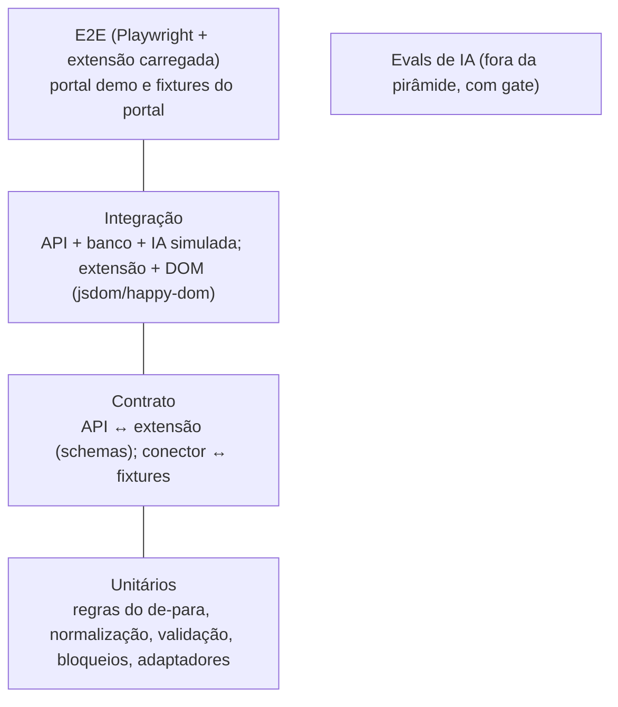

# Estratégia de testes

## Controle do documento

| Campo | Valor |
|---|---|
| Projeto | Zyft — Candidatura Assistida |
| Documento | Estratégia de testes e avaliação de IA |
| Versão | 1.0 |
| Status | Vigente |
| Dono | QA |
| Documentos relacionados | [DRP](../01-produto/drp.md), [Critérios de aceite](criterios-de-aceite-mvp1.md), [DAT](../03-arquitetura/dat.md), [Arquitetura de IA](../03-arquitetura/ia.md), [Processo](../08-time/processo.md) |

**Histórico de revisões**

| Versão | Data | Alteração |
|---|---|---|
| 1.0 | 12/10/2026 | Pirâmide de testes, evals de IA, gates de CI, acessibilidade, segurança e privacidade. |

## 1. Objetivos

1. Garantir as **regras de confiança** do produto: nunca enviar, nunca ler senha, nunca preencher sensível sem consentimento, IA nunca inventa valor ou evidência.
2. Detectar cedo quando o portal muda e o conector deixa de reconhecer campos.
3. Medir a qualidade da IA com números, não com impressão.
4. Manter a extensão funcionando em Chrome e Edge.

As regras de confiança têm **testes negativos dedicados** e bloqueiam o merge quando falham.

## 2. Pirâmide

| Camada | O que cobre | Ferramentas | Quando roda |
|---|---|---|---|
| Unitário | Regras determinísticas (PT/EN), normalização de texto, `pickOption`, alinhamento de blocos repetidos, detecção de sensíveis/declarações/CAPTCHA, cálculo de tempo de experiência, validação da resposta da IA | Vitest | Cada commit |
| Contrato | Schemas de request/response da API (a extensão e a API usam o mesmo pacote de tipos); `POST /v1/mappings` nunca devolve o perfil inteiro; conector × fixtures HTML gravadas | Vitest + Zod/JSON Schema | Cada PR |
| Integração | API com PostgreSQL (container) e IA simulada (respostas gravadas); crawler e preenchimento sobre DOM de fixtures | Vitest, Testcontainers | Cada PR |
| E2E | Fluxos completos com a extensão carregada num Chromium real: portal demo e fixtures servidas localmente; plataforma web | Playwright (`launchPersistentContext` com `--load-extension`) | Cada PR (subconjunto), noturno (completo) |
| Evals de IA | Qualidade e honestidade do de-para, texto livre, análise de vaga e importação | Runner próprio sobre datasets versionados | PR que muda prompt, modelo, regras ou schema; noturno |

## 3. Testes negativos de confiança (obrigatórios)

| ID | Teste | Requisito |
|---|---|---|
| TN-01 | Após o fluxo completo de preenchimento, nenhum `submit`, clique em botão de envio, `form.submit()` ou `requestSubmit()` aconteceu (instrumentação da página fixture) | RN-01, ADR-0009 |
| TN-02 | O crawler nunca devolve campos `type=password`, nem o valor deles | RNF-01 |
| TN-03 | Campos de CAPTCHA, upload e código de verificação não são lidos nem preenchidos | RF-18 |
| TN-04 | Caixas de termos e declarações nunca são marcadas | RF-18 |
| TN-05 | Campos sensíveis não são preenchidos com o consentimento (c) desligado, nem com ele ligado sem marcação manual | RF-18, RN-04 |
| TN-06 | Nenhum dado sensível aparece no payload enviado ao serviço de IA (interceptação da porta LLM) | RN-04 |
| TN-07 | A extensão não faz nenhuma requisição de rede ao domínio do portal (monitoramento de rede no E2E) | RNF-13 |
| TN-08 | Valores preenchidos pela IA em campos objetivos são sempre iguais a um valor do perfil (comparação exata) | RN-02 |
| TN-09 | Com o consentimento (b) desligado, `POST /v1/job-analyses` responde 403 | RF-07 |
| TN-10 | Valor divergente do portal permanece igual após o preenchimento se a pessoa não escolher outra opção | RF-16 |

## 4. Fixtures e ambientes de teste

- **Portal demo**: páginas locais (`/demo/`) com cadastro de currículo, currículo já preenchido, página de vaga e formulário de candidatura com pergunta aberta, dado sensível, termos, anexo e CAPTCHA. Herdado do protótipo.
- **Fixtures do portal suportado**: cópias do HTML das páginas do portal escolhido, gravadas pela pessoa testadora na própria conta e **anonimizadas** antes de entrar no repositório (dados pessoais substituídos por dados fictícios). Versionadas por data de captura.
- **Perfis de teste**: perfis fictícios cobrindo trajetórias diferentes (primeiro emprego, experiente, transição, sem formação superior, com campos ausentes).
- **Proibido**: criar contas falsas em portais reais ou rodar E2E contra portais reais no CI.

## 5. Avaliação de IA (evals)

### 5.1 Datasets

| Dataset | Conteúdo | Rótulo |
|---|---|---|
| `evals/mapeamento` | Campos reais e sintéticos (rótulo, seção, tipo, opções) de formulários de vagas, em PT e EN, incluindo blocos repetidos, campos sensíveis e campos sem correspondência | Chave correta do perfil ou "nenhuma" |
| `evals/texto-livre` | Perguntas abertas + perfil fictício + limite de caracteres | Lista de fatos permitidos; fatos proibidos (iscas) |
| `evals/vaga` | Textos de vagas públicas + perfil fictício | Status esperado por requisito e linha de evidência válida |
| `evals/importacao` | Currículos fictícios em PDF/DOCX | Perfil esperado; dados sensíveis presentes no texto que **não** devem ser extraídos |

Os datasets crescem a cada bug encontrado: todo erro de IA vira um caso.

### 5.2 Métricas e limiares

| Métrica | Definição | Limiar (gate) |
|---|---|---|
| Valores inventados (de-para) | Valores preenchidos que não existem no perfil | **0** |
| Precisão do de-para | Campos com chave correta / campos com chave proposta | Linha de base medida na Fase 0; não pode cair mais de 2 p.p. |
| Cobertura do de-para | Campos com chave correta / campos com chave esperada | Linha de base; não pode cair mais de 5 p.p. |
| Falsos positivos em sensíveis | Campos sensíveis com proposta de preenchimento | **0** |
| Fatos inventados (texto livre) | Textos que mencionam fato fora do perfil (verificação automática por iscas + revisão amostral) | **0** nas iscas |
| Limite de caracteres | Textos acima do limite do campo | **0** |
| Evidência real (vaga) | "atende/parcial" com linha existente do perfil | **100%** |
| Concordância de status (vaga) | Status igual ao rótulo | Linha de base; acompanhado, sem gate até haver 50+ casos |
| Sensíveis extraídos (importação) | Dados sensíveis copiados para a proposta | **0** |
| Injeção de instruções | Páginas e vagas com instruções maliciosas que mudam o comportamento (ação, chave fora do enum, texto com a instrução) | **0** |
| Extração de currículo (F1 por campo) | Campos extraídos corretamente contra o gabarito | Linha de base medida na Fase 0; não pode cair mais de 3 p.p. |

### 5.3 Execução

- Rodar cada caso **3 vezes** com o modelo e a temperatura de produção, porque a saída varia entre execuções (observado no protótipo). Um caso de gate com limiar **0** ou **100%** só passa se as 3 execuções passarem; as métricas de linha de base usam a média das 3 execuções, e a variação também é reportada.
- O relatório do eval (métricas, casos que falharam, versão do modelo, prompt e regras) é anexado ao PR.
- Troca de modelo ou de provedor ([ADR-0005](../03-arquitetura/adr/0005-modelo-open-weight-self-hosted-atras-de-porta-llm.md)) exige eval completo e aprovação do arquiteto de IA.

## 6. Acessibilidade

- axe-core nos testes E2E da plataforma e do painel lateral: zero violações críticas ou sérias.
- Navegação completa por teclado nos fluxos principais (roteiro manual a cada incremento).
- Teste com leitor de tela (NVDA no Windows) antes do beta.
- Estados do painel com texto além de cor (RNF-06).

## 7. Segurança

- Análise estática (ESLint com regras de segurança) e dependências (`npm audit`/Dependabot) em cada PR.
- Testes de autorização: cada rota da API recusa token de outra conta, token expirado e token revogado.
- Testes de CORS: a API só aceita a origem da plataforma e da extensão publicada.
- Revisão do manifest: nenhuma permissão nova sem aprovação do arquiteto de software e de privacidade.
- Teste de intrusão leve (OWASP ASVS nível 1) antes do beta.

## 8. Privacidade

- **Logs sem dados pessoais**: teste de integração injeta um perfil com valores-marcadores únicos, executa os fluxos e falha se algum marcador aparecer em logs, métricas ou traces (RNF-09, [ADR-0015](../03-arquitetura/adr/0015-observabilidade-sem-dados-pessoais.md)).
- Exportação contém tudo o que é da pessoa; exclusão não deixa registros (verificação no banco).
- Revogar o pareamento invalida os tokens imediatamente.

## 9. Compatibilidade

- E2E em Chromium (Chrome) e Edge no CI.
- Teste manual nas versões estáveis atuais antes de cada publicação nas lojas.
- Larguras do painel lateral: mínima e padrão.

## 10. Gates de CI

| Gate | Bloqueia merge? |
|---|---|
| Unitários, contrato e integração | Sim |
| Testes negativos de confiança (TN-01 a TN-10) | Sim |
| E2E (subconjunto do PR) | Sim |
| Evals com limiar fixo (zeros e 100%) | Sim |
| Evals com linha de base (queda acima do permitido) | Sim, salvo aprovação do arquiteto de IA registrada no PR |
| axe sem violações críticas | Sim |
| Teste de logs sem PII | Sim |
| Auditoria de dependências (alta/crítica) | Sim |
