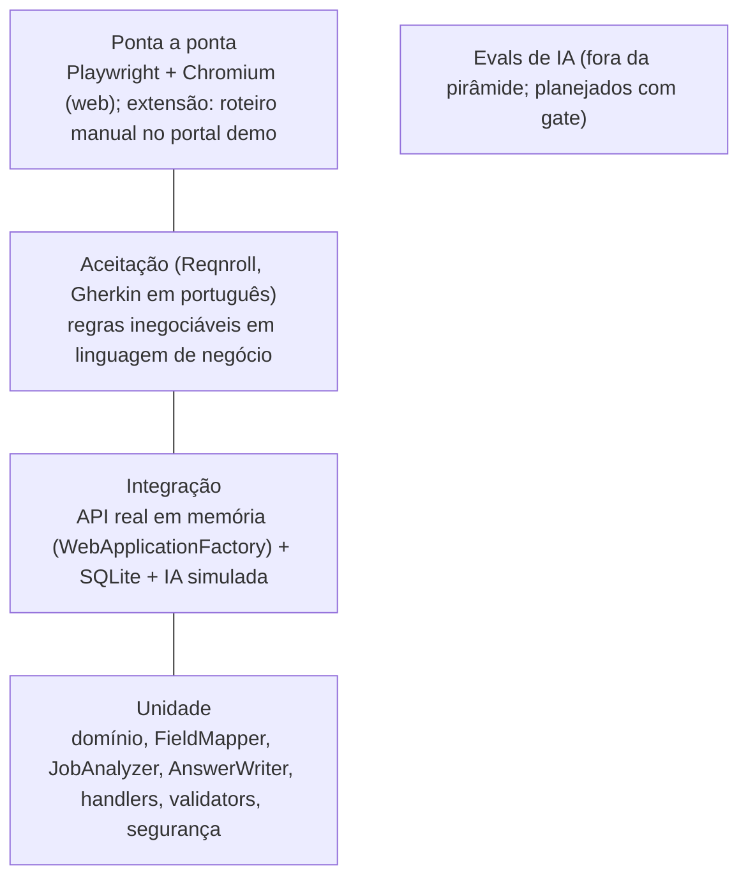

# Estratégia de testes

## Controle do documento

| Campo | Valor |
|---|---|
| Projeto | Zyft — Candidatura Assistida |
| Documento | Estratégia de testes e avaliação de IA |
| Versão | 2.3 |
| Status | Vigente |
| Dono | QA (papel acumulado pelos devs, ver [papéis](../08-time/papeis-e-raci.md)) |
| Documentos relacionados | [DRP](../01-produto/drp.md), [Critérios de aceite](criterios-de-aceite-mvp1.md), [DAT](../03-arquitetura/dat.md), [Arquitetura de IA](../03-arquitetura/ia.md), [ADR-0017](../03-arquitetura/adr/0017-backend-em-csharp-dotnet-clean-architecture.md), [Entrega 3](../entregas/entrega-3-desenvolvimento-e-validacao.md), [Processo](../08-time/processo.md) |

**Histórico de revisões**

| Versão | Data | Alteração |
|---|---|---|
| 1.0 | 12/10/2026 | Pirâmide de testes, evals de IA, gates de CI, acessibilidade, segurança e privacidade (stack TypeScript proposta no ADR-0003). |
| 2.0 | 21/10/2026 | Pirâmide reescrita para a stack .NET implementada (xUnit, FluentAssertions, Moq, `WebApplicationFactory` com SQLite, Reqnroll, Playwright), com os números da Entrega 3. Novos testes negativos TN-11 a TN-15 e plano de testes para RF-23 a RF-29 (onboarding, área, campos personalizados, planos, pacote, recompensado e anúncios). |
| 2.1 | 21/10/2026 | Números da v2 implementada: 223 testes (136 unidade, 75 integração, 12 aceitação), todos passando. Coluna "Situação" nos testes negativos e no plano da v2, com o que está automatizado e o que ainda falta. |
| 2.2 | 21/10/2026 | 230 testes (140 unidade, 78 integração, 12 aceitação), todos passando. Novos: `LinkedIn_e_GitHub_casam_por_regra_mesmo_com_camelCase` (4 casos), `Limite_atingido_nunca_bloqueia_exportar_nem_excluir_os_dados` (TN-14 automatizado), `Extensao_que_se_desconecta_libera_a_vaga_de_navegador_e_nao_compra_pacote` e `Logs_das_rotas_v2_nao_contem_dados_pessoais` (TN-12 completo). RNF-15 implementado no cliente. |
| 2.3 | 21/10/2026 | 252 testes (156 unidade, 84 integração, 12 aceitação), todos passando. Novos: `ResumeImportFixesTests` (16 casos) e `TourFixesTests` (6 casos), das correções da gravação do tour. |
| 2.4 | 22/10/2026 | 263 testes (160 unidade, 91 integração, 12 aceitação), todos passando. Novo: `AdNetworkTests` (7 casos) para a rede de anúncios simulada (ADR-0021). |

## 1. Objetivos

1. Garantir as **regras de confiança** do produto: nunca enviar, nunca ler senha, nunca preencher sensível sem consentimento, IA nunca inventa valor ou evidência.
2. Garantir as **regras da monetização** da v2: anúncio nunca no formulário nem nas telas de confiança, nunca com dado pessoal, sempre rotulado, no máximo um por tela, e limite que nunca bloqueia privacidade (RN-08 a RN-13).
3. Detectar cedo quando o portal muda e o de-para deixa de reconhecer campos.
4. Medir a qualidade da IA com números, não com impressão.
5. Manter a extensão funcionando em Chrome e Edge.

As regras de confiança e de anúncio têm **testes negativos dedicados** (seção 3) e bloqueiam o merge quando falham.

## 2. Pirâmide (implementada)

| Camada | O que cobre | Ferramentas | Casos (E3 → v2) | Quando roda |
|---|---|---|---|---|
| Unidade | Regras do domínio (períodos, CNH, duplicados), de-para (`FieldMapper`: regras PT/EN, bloqueios, `PickOption`, blocos repetidos, datas, `maxLength`), análise de vaga (`JobAnalyzer`), redação (`AnswerWriter`), handlers com Moq, validators, JWT, BCrypt, AES-GCM. v2 em `V2/V2DomainTests.cs`: planos, consumo, pacote, recompensado, assinatura, rótulos sensíveis, `custom:<id>`, onboarding, seleção de anúncios | xUnit, FluentAssertions, Moq | 90 → **140** | Cada commit (`dotnet test`) |
| Integração | HTTP real: autenticação e autorização (scopes `web` e `extension`), ProblemDetails, regras de confiança, importação, rate limiting, CORS, logs sem dados pessoais, Swagger. v2 em `V2Tests.cs`: perfil novo, campos personalizados, catálogo, onboarding, billing, 402, pacote, Plus, anúncios | `Microsoft.AspNetCore.Mvc.Testing` + SQLite em memória, IA desligada ou simulada | 55 → **78** | Cada PR |
| Aceitação | As regras inegociáveis (`Features/RegrasInegociaveis.feature`: 7 cenários e 1 esquema com 5 exemplos). Sem cenário novo na v2 | Reqnroll 2.2.1 | 12 → **12** | Cada PR |
| Ponta a ponta (web) | Fluxos da plataforma no navegador; capturas de evidência | Playwright + Chromium | 2 roteiros | Antes de cada entrega |
| Manual / exploratório | Extensão no portal demo, IA real (Ollama), PostgreSQL via Docker | curl, Swagger, Chrome/Edge | 3 roteiros | Antes de cada entrega |
| Evals de IA | De-para, texto livre, análise de vaga, importação | Runner próprio sobre datasets (seção 5) | Planejado | PR que muda prompt, modelo ou regras |

Execução de referência (22/10/2026): **263 testes, 263 passaram** (160 unidade, 91 integração, 12 aceitação); os 7 mais recentes são `AdNetworkTests` (rede de anúncios simulada, ADR-0021). Na v2 (21/10/2026) eram 252 (156 unidade, 84 integração, 12 aceitação). A primeira contagem da v2 foi 223 (136 + 75 + 12); depois entraram 4 casos de unidade (regras de LinkedIn e GitHub) e 3 de integração (TN-14, desconexão da extensão, logs das rotas v2), chegando a 230; as correções da gravação do tour somaram 16 casos de unidade (`ResumeImportFixesTests`: NFKC, extrator DOCX, heurística de certificação, regras do prompt de importação, `missingFields`) e 6 de integração (`TourFixesTests`: curso sem tipo e erro de formato apontando o campo, formação sem situação na importação e no `apply`, teste grátis indisponível depois de cancelar, rascunho de IA vazio em 3 variações). A contagem é por caso executado: cada `[InlineData]` de um `[Theory]` e cada exemplo do esquema Gherkin conta como um caso. Na Entrega 3 (15/10/2026) eram 157 (90 + 55 + 12); a lista daquela execução está no [Apêndice A da Entrega 3](../entregas/entrega-3-desenvolvimento-e-validacao.md#apêndice-a-lista-completa-dos-casos-de-teste-automatizados).

Lacuna conhecida: a extensão ainda não tem teste automatizado no navegador com ela carregada dentro do CI. As chamadas que ela faz são validadas por testes de integração com token `scope=extension`, pelo roteiro manual no portal demo e por roteiros Playwright com a extensão carregada (Chromium com `--load-extension`), usados para as capturas e os vídeos, ainda fora do CI.

## 3. Testes negativos de confiança (obrigatórios)

| ID | Teste | Requisito | Onde |
|---|---|---|---|
| TN-01 | Após o fluxo completo de preenchimento, nenhum `submit`, `form.submit()`, `requestSubmit()` ou clique em botão aconteceu | RN-01, ADR-0009 | Roteiro manual no portal demo; revisão de código do `content.js` (planejado: E2E com a extensão carregada) |
| TN-02 | Campos `type=password` nunca recebem valor nem são lidos | RNF-01 | Unidade (`FieldMapper`), integração, aceitação |
| TN-03 | CAPTCHA, anexo e código de verificação não recebem valor | RF-18 | Unidade, integração, aceitação |
| TN-04 | Termos e declarações nunca vêm marcados | RF-18 | Unidade, aceitação |
| TN-05 | Sensível bloqueado sem consentimento (c) e desmarcado com ele | RF-18, RN-04 | Unidade, integração, aceitação |
| TN-06 | Nenhum dado sensível no prompt da IA | RN-04 | Unidade (prompt montado) |
| TN-07 | A extensão não faz requisição ao domínio do portal | RNF-13 | Revisão de código e CSP da extensão (planejado: monitor de rede no E2E) |
| TN-08 | Valor de campo objetivo vem do perfil; valor escrito pela IA é ignorado e chave inventada é descartada | RN-02 | Unidade, integração (IA maliciosa), aceitação |
| TN-09 | Análise de vaga sem consentimento (b) responde 403 e não chama a IA | RF-07 | Unidade (Moq), integração, aceitação |
| TN-10 | Valor divergente do portal permanece se a pessoa não escolher outro | RF-16 | Unidade |
| **TN-11** | Nenhum anúncio em placement proibido (onboarding, entrar e criar conta, importar currículo, dados sensíveis, conta e privacidade, "Ler formulário") nem para quem é Plus: `GET /ads` responde 204 | RN-08 | Automatizado: integração com 5 placements proibidos (`web.onboarding`, `web.sensitive-data`, `ext.form.review`, `web.account`, `web.resume-import`) e Plus em `web.profile.rail`; unidade com o `AdSelector` e o handler (Plus não consulta o perfil). Não cobre todas as combinações placement × plano |
| **TN-12** | Anúncio sem dado pessoal: a requisição só aceita `placement` e `topic`; a resposta não contém nome, e-mail, telefone, dado sensível nem id da pessoa; os contadores de clique não guardam `UserId`; os logs de `/ads` passam no teste de PII | RN-09, RNF-14 | Parcial: integração confere a resposta com perfil de valores-marcadores; unidade confere que `AdTargeting` só tem área, cargos e tópico; `AdStats` não tem coluna de usuário. Logs: `Logs_das_rotas_v2_nao_contem_dados_pessoais` passa por `/profile`, `/profile/custom-fields`, `/ads`, `/billing` e `/onboarding` e falha se nome, registro profissional, valor de campo personalizado ou token aparecerem nos logs |
| **TN-13** | Rótulo de campo personalizado que pareça sensível (raça, religião, saúde, deficiência, gênero, orientação, CPF, RG, senha) é recusado com 422 `profile.custom_field_sensitive` | RN-15 | Automatizado: unidade (casos tabulares de `SensitiveLabels`) e integração (3 rótulos) |
| **TN-14** | Com todos os limites do Gratuito atingidos, editar o perfil, exportar (`GET /me/export`) e excluir a conta (`DELETE /me`) continuam funcionando | RN-12 | Automatizado: integração `Limite_atingido_nunca_bloqueia_exportar_nem_excluir_os_dados` (esgota as 10 candidaturas, confirma o 402 e depois `GET /me/export` 200, `GET /consents` 200 e `DELETE /me` 204). Editar o perfil é garantido por construção (a rota não chama o `IUsageMeter`) |
| **TN-15** | O painel "Ler formulário" nunca pede nem mostra anúncio, e a API recusa o placement equivalente | RN-08 | Integração (`ext.form.review` responde 204) + revisão de código da extensão (a aba Formulário não chama `/ads`) |

## 4. Plano de testes da v2 (RF-23 a RF-29)

Os critérios de aceite estão em [CA-23 a CA-29](criterios-de-aceite-mvp1.md#ca-23--onboarding-em-passos-rf-23). Abaixo, o que cada camada precisa cobrir.

Situação em 21/10/2026: as colunas de unidade e integração estão implementadas, com as exceções marcadas. **Nenhum cenário Reqnroll da v2 foi escrito**: a coluna de aceitação continua como plano.

| RF | Unidade | Integração | Aceitação (Reqnroll, planejada) |
|---|---|---|---|
| RF-23 Onboarding | Validator do `PUT /onboarding` (ids de passo da lista fechada; `answered` e `skipped` sem repetição) | `GET` de conta nova devolve listas vazias e `lastStep=null`; `PUT` salva e um novo `GET` retoma do mesmo passo (RNF-17); `completed=true` grava `completedAt` e o evento `onboarding.completed` sem conteúdo; passo desconhecido responde 400 | "Pular uma pergunta nunca bloqueia o uso" (RN-14) |
| RF-24 Área e catálogo | Catálogo estático: 8 áreas, Saúde com `registration`, Tecnologia com `linkLabel = GitHub`, "Outra área" com listas vazias | `GET /catalog/areas` exige autenticação; `PUT /profile` aceita e devolve `workArea`, `professionalRegistration`, `salaryType` | — |
| RF-25 Campos personalizados | Detector de rótulo sensível (TN-13); limites 80/500; `FieldMapper` casa rótulo do formulário com o label e devolve `custom:<id>` com valor do perfil; `ProfileFacts` inclui os campos | CRUD; rótulo acima de 80 caracteres responde 400; 422 com mensagem que orienta usar Dados sensíveis; campo entra no de-para com `custom:<id>` | "Campo personalizado com rótulo sensível é recusado" |
| RF-26 Planos e limites | Serviço de cota: limites por recurso; **consumo na ordem limite do mês → bônus recompensado → pacotes (o que vence antes primeiro)**; **deduplicação por (pessoa, origem+caminho, mês)**; virada de mês; Plus com `limit=null` | `GET /billing` com `demo: true` e preços 9,90/99,00/4,90; 11ª leitura de página nova no mês responde **402** `plan.limit_reached` com `resource`, `used`, `limit` no topo e em `extensions`; mesma página não conta duas vezes; `subscribe` e `cancel` mudam o plano e auditam `plan.changed`; `period` inválido responde 400; 16ª resposta aprovada recusada (reaprovar não conta); 2º navegador recusado no Gratuito; a extensão que se desconecta (`DELETE /extension/devices/current`, 204) libera a vaga e um token web recebe 404 nessa rota; TN-14 automatizado | "Atingir o limite não impede exportar nem excluir os dados" |
| RF-27 Pacote | Validade de 60 dias; pacote vencido não conta; ordem entre pacotes | `POST /billing/packs` responde **201** e libera sugestões de IA depois do limite; o pacote não cobre análise de vaga (unidade) | — |
| RF-28 Recompensado | Máximo de 3 resgates por mês, +3 cada | 4º resgate responde 409 `ads.rewarded_exhausted`; Plus recebe 409 `ads.rewarded_unavailable` | — |
| RF-29 Anúncios | Seleção por `workArea`, `desiredRoles` e `topic`, excluindo ocultos; rotação; `reason` preenchido; ocultar por anúncio (30 dias) e por tema (sempre) | TN-11 e TN-12 (parcial); `GET /ads` sem `placement` responde 400; contextual sem `topic` relacionado responde 204; ocultar o assunto vale para sempre; `hide` audita `ad.hidden` e recusa `scope` inválido (400) e id inexistente (404); `click` responde 204; os 16 anúncios do catálogo são de "Anunciante de demonstração" com ids únicos (unidade); extensão lê `/billing` e `/ads` mas recebe 403 ao assinar e ao comprar pacote | "Nenhum anúncio aparece no formulário" e "Anúncio não usa dado pessoal" |

Na web e na extensão (Playwright e roteiro manual): o espaço de anúncio aparece no máximo uma vez por tela (RN-11) e some sem quebrar o layout quando a API responde 204, erro ou passa de 1,5 s (RNF-15; o timeout está implementado em `web/js/ads.js` e em `fetchAd` do painel, mas não há teste automatizado que simule a lentidão); o painel trata o 402 mostrando as três opções; o aviso "Ambiente de demonstração: nenhuma cobrança real" aparece em **Planos** e na confirmação de assinatura e pacote (RN-13).

## 5. Fixtures e ambientes de teste

- **Portal demo** (`web/demo`, servido em `/demo/`): `vaga.html`, `curriculo.html` (e `?preenchido=1` para divergências) e `candidatura.html` com pergunta aberta, dado sensível, termos, anexo e CAPTCHA.
- **Usuários de demonstração** (só Development, senha `Zyft@2026`): Rafael Moreira (`demo@zyft.local`, Tecnologia, perfil rico, 7 de 10 candidaturas usadas) e Beatriz Lima (`beatriz@demo.zyft`, Saúde, onboarding parcialmente pulado). Servem para roteiros manuais, capturas e vídeos, não para testes automatizados, que criam os próprios usuários.
- **Catálogo de anúncios**: 16 anúncios estáticos de "Anunciante de demonstração" (`AdCatalog`, no código) para várias áreas, usados nos testes de seleção e de TN-11/TN-12.
- **Perfis de teste**: fictícios, cobrindo trajetórias e áreas diferentes, com campos ausentes.
- **Proibido**: criar contas falsas em portais reais ou rodar testes automatizados contra portais reais.

## 6. Avaliação de IA (evals)

Planejada: os datasets e o runner ainda não existem no código, e nada roda no CI. Os guardrails principais já são cobertos por testes de unidade e integração (TN-06, TN-08, evidência inventada rebaixada para "não encontrado").

### 6.1 Datasets

| Dataset | Conteúdo | Rótulo |
|---|---|---|
| `evals/mapeamento` | Campos de formulários de vagas em PT e EN, inclusive blocos repetidos, sensíveis, sem correspondência e **campos de outras áreas** (ex.: "Número do COREN", "Disponibilidade para plantão") para os campos personalizados | Chave correta do perfil, `custom:<id>` ou "nenhuma" |
| `evals/texto-livre` | Perguntas abertas + perfil fictício + limite de caracteres | Fatos permitidos e fatos proibidos (iscas) |
| `evals/vaga` | Vagas públicas de várias áreas + perfil fictício | Status por requisito e linha de evidência válida |
| `evals/importacao` | Currículos fictícios em PDF/DOCX | Perfil esperado; sensíveis que **não** podem ser extraídos |

### 6.2 Métricas e limiares

| Métrica | Limiar (gate) |
|---|---|
| Valores inventados no de-para | **0** |
| Falsos positivos em sensíveis | **0** |
| Fatos inventados no texto livre (iscas) | **0** |
| Textos acima do limite do campo | **0** |
| Evidência real na análise de vaga | **100%** |
| Sensíveis extraídos na importação | **0** |
| Injeção de instruções que muda o comportamento | **0** |
| Precisão e cobertura do de-para; F1 da importação | Linha de base; queda máxima de 2, 5 e 3 p.p. |

Cada caso roda **3 vezes** com o modelo e a temperatura de produção, porque a saída varia entre execuções; casos com limiar 0 ou 100% só passam se as 3 execuções passarem.

## 7. Acessibilidade

- Critério WCAG 2.1 AA em toda tela nova (onboarding, Planos, anúncios).
- O onboarding é navegável só pelo teclado, com foco no título de cada pergunta e "Preencher mais tarde" alcançável (RNF-17).
- Anúncios: o selo "Patrocinado" é texto (não só imagem), "Ocultar" e "Por que estou vendo isso?" são botões com rótulo acessível, e o anúncio fica fora da ordem de foco principal do formulário.
- Estados de campo sempre com cor, ícone e palavra (RNF-06).
- Planejado: axe-core no Playwright, zero violações críticas ou sérias; teste com NVDA antes do beta.

## 8. Segurança e privacidade

- Isolamento: recurso de outra pessoa responde 404 (inclusive campos personalizados, pacotes e ocultações de anúncio).
- Scopes: token `scope=extension` não acessa exportação nem perfil inteiro.
- **Logs sem dados pessoais**: o teste injeta um perfil com valores-marcadores, executa os fluxos e falha se algum marcador aparecer nos logs (RNF-09). Na v2, `Logs_das_rotas_v2_nao_contem_dados_pessoais` estende a verificação a `/ads`, `/billing`, `/profile/custom-fields` e `/onboarding` (RNF-14).
- Auditoria: os novos eventos (`plan.changed`, `pack.purchased`, `ad.hidden`, `rewarded.claimed`, `onboarding.completed`, `custom_field.changed`) usam a mesma entidade `AuditEvent`, que só tem ação, portal e contagem. Os testes de integração conferem `plan.changed` e `ad.hidden` na lista.
- Pagamento simulado: nenhum endpoint aceita número de cartão ou dado de pagamento (RN-13).
- Dependências: auditoria de pacotes NuGet no CI; revisão de qualquer permissão nova da extensão.

## 9. Compatibilidade

- Extensão testada manualmente em Chrome e Edge estáveis, nas larguras mínima e padrão do painel.
- Web até 390 px de largura; anúncios encolhem e quebram linha no celular.

## 10. Gates de CI

O workflow `.github/workflows/ci.yml` roda build Release, as três suítes com cobertura, a conferência das migrations e a subida da imagem Docker até `/health` responder.

| Gate | Bloqueia merge? |
|---|---|
| Unidade, integração e aceitação | Sim |
| Testes negativos TN-01 a TN-15 (os automatizados) | Sim |
| Migrations em dia com o modelo | Sim |
| Teste de logs sem PII | Sim |
| Evals com limiar fixo (quando implantados) | Sim |
| axe sem violações críticas (quando implantado) | Sim |
| Roteiro manual da extensão no portal demo | Sim, antes de cada entrega (checklist no PR) |
