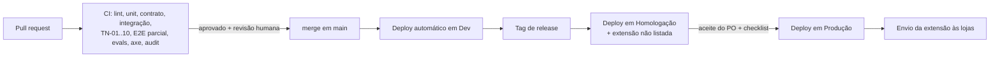

# Ambientes e implantação

## Controle do documento

| Campo | Valor |
|---|---|
| Projeto | Zyft — Candidatura Assistida |
| Documento | Ambientes, deploy e publicação |
| Versão | 1.0 |
| Status | Proposta (depende dos ADRs 0003, 0005, 0007 e 0008) |
| Dono | Arquiteto de software |
| Documentos relacionados | [DAT](../03-arquitetura/dat.md), [Runbook local](runbook-local.md), [Segurança](../03-arquitetura/seguranca.md), [Estratégia de testes](../04-qualidade/estrategia-de-testes.md) |

**Histórico de revisões**

| Versão | Data | Alteração |
|---|---|---|
| 1.0 | 12/10/2026 | Ambientes, variáveis, pipeline, publicação da extensão, backups e segredos. |

## 1. Ambientes

| Ambiente | Para quê | Dados | IA | Extensão | Quem acessa |
|---|---|---|---|---|---|
| **Local** | Desenvolvimento | Perfis fictícios; banco em container | Ollama local (`qwen2.5:7b` ou equivalente) | Carregada sem compactação, apontando para `localhost` | Cada dev |
| **Dev** | Integração contínua de `main` | Fictícios, recriados a cada deploy | Servidor de inferência compartilhado de dev (pode escalar a zero) | Build de dev (ID próprio) | Time |
| **Homologação** | Testes de aceite, beta interno e validação antes das lojas | Fictícios e contas do time | Mesmo modelo e configuração de produção | Build "não listada" nas lojas | Time e testadores convidados |
| **Produção** | Beta fechado e, depois, uso aberto | Reais | Modelo de produção | Publicada nas lojas | Pessoas usuárias |

Regras:

- Dados reais **nunca** saem da produção. Não há cópia de produção para outros ambientes.
- Cada ambiente tem banco, chaves, segredos e ID de extensão próprios.
- A extensão de produção só aceita a API de produção; a origem é fixada no build.

## 2. Configuração

Variáveis de ambiente da API (nomes propostos; valores no gerenciador de segredos):

| Variável | Descrição | Segredo? |
|---|---|---|
| `NODE_ENV` | `development`, `test` ou `production` | Não |
| `PORT` | Porta HTTP da API | Não |
| `DATABASE_URL` | Conexão PostgreSQL | Sim |
| `PII_ENCRYPTION_KEY` | Chave de criptografia de campo para dados sensíveis ([ADR-0014](../03-arquitetura/adr/0014-dados-sensiveis-segregados-e-criptografados.md)) | Sim |
| `JWT_SIGNING_KEY` | Chave de assinatura dos tokens de acesso ([ADR-0007](../03-arquitetura/adr/0007-autenticacao-e-pareamento-da-extensao.md)) | Sim |
| `GOOGLE_OAUTH_CLIENT_ID` / `_SECRET` | Login com Google | Sim (o segredo) |
| `ALLOWED_EXTENSION_IDS` | IDs de extensão aceitos no CORS | Não |
| `WEB_ORIGIN` | Origem da plataforma web | Não |
| `LLM_PROVIDER` | Adaptador da porta LLM (`ollama`, `openai-compatible`) | Não |
| `LLM_BASE_URL` | Endereço do servidor de inferência | Não |
| `LLM_MODEL` | Modelo usado | Não |
| `LLM_API_KEY` | Chave do servidor de inferência, se houver | Sim |
| `LLM_TIMEOUT_MS` | Tempo limite por chamada | Não |
| `EMAIL_PROVIDER_KEY` | E-mail transacional (verificação) | Sim |
| `LOG_LEVEL` | Nível de log | Não |

O protótipo usa `OLLAMA_URL`, `OLLAMA_MODEL`, `PORT` e `DATA_DIR`; esses nomes serão mapeados para os acima na migração ([ADR-0003](../03-arquitetura/adr/0003-monorepo-typescript-node.md)).

## 3. Pipeline

- **Stack de referência** ([ADR-0003](../03-arquitetura/adr/0003-monorepo-typescript-node.md), [ADR-0008](../03-arquitetura/adr/0008-postgresql-com-perfil-em-jsonb.md)): Node.js 22 LTS e TypeScript; API Fastify + Zod; Kysely sobre PostgreSQL 16; fila pg-boss; web React 18 + Vite; monorepo pnpm + Turborepo; testes Vitest e Playwright.
- **Deploy da API e da web**: imagem de container construída uma vez por tag e promovida entre ambientes (a mesma imagem de homologação vai para produção).
- **Migrações de banco**: versionadas, executadas antes do deploy, sempre compatíveis com a versão anterior da API (expand/contract).
- **Rollback**: redeploy da imagem anterior; migrações destrutivas só em release separada.
- **Provedor de hospedagem**: a definir na Fase 0 (container gerenciado e PostgreSQL gerenciado). A decisão será registrada em ADR.

## 4. Publicação da extensão

| Etapa | Chrome Web Store | Edge Add-ons |
|---|---|---|
| Conta | Conta de desenvolvedor (taxa única) | Conta no Partner Center (sem taxa) |
| Primeira publicação | Como **não listada** para homologação e beta | Idem |
| Requisitos | Política de privacidade pública; justificativa de cada permissão; declaração de uso de dados ("uso limitado"); capturas de tela | Política de privacidade; descrição de permissões |
| Revisão | Prazo variável (dias); permissões amplas atrasam a revisão | Prazo variável |
| Atualizações | Versão semântica no `manifest.json`; changelog | Idem |

Regras:

- **Permissões mínimas**: `host_permissions` só para o portal suportado e a API; outros sites via `optional_host_permissions` pedidos em tempo de uso ([ADR-0011](../03-arquitetura/adr/0011-primeiro-portal-e-conectores-por-portal.md)).
- Nenhuma permissão nova sem aprovação do arquiteto de software e de privacidade, porque permissões novas desativam a extensão até a pessoa aceitar.
- O código publicado não usa código remoto (exigência do MV3) e não é ofuscado.

## 5. Backups e recuperação

| Item | Política (proposta) |
|---|---|
| Banco de produção | Backup automático diário com retenção de 7 dias e recuperação ponto a ponto, se o provedor oferecer |
| Teste de restauração | Mensal, em ambiente isolado, com descarte imediato |
| Exclusão a pedido do titular | Dados apagados do banco imediatamente; backups expiram no ciclo de retenção e não são restaurados para reativar dados excluídos |
| Arquivos de currículo | Não guardados após a importação; só o texto da proposta durante a revisão |
| Objetivos | RPO ≤ 24 h, RTO ≤ 4 h no MVP 1 |

## 6. Segredos

- Guardados no gerenciador de segredos do provedor; nunca no repositório, em imagens ou em logs.
- Rotação: chaves de assinatura de token a cada 90 dias com sobreposição (duas chaves válidas durante a troca); credenciais de banco e de provedores a cada 180 dias ou imediatamente em caso de suspeita.
- `PII_ENCRYPTION_KEY` com rotação por envelope (chave de dados recriptografada pela nova chave mestra), sem perda de acesso.
- Acesso a segredos de produção restrito a duas pessoas do time, com registro.
- Varredura de segredos no CI (bloqueia merge).
