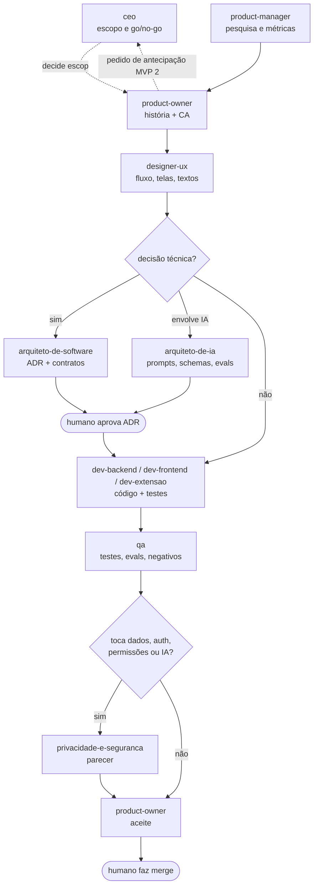

# Agentes de IA no time

| Campo | Valor |
|---|---|
| Documento | Uso de agentes de IA no desenvolvimento |
| Versão | 1.0 |
| Data | 12/10/2026 |
| Decisão | [ADR-0016](../03-arquitetura/adr/0016-time-de-agentes-de-ia-no-desenvolvimento.md) |
| Relacionados | [Papéis e RACI](papeis-e-raci.md), [Processo](processo.md), [`CLAUDE.md`](../../CLAUDE.md) |

## 1. O que são

São subagentes do Claude Code definidos em `.claude/agents/`. Cada um tem um papel, as ferramentas mínimas para esse papel, os documentos que deve ler, os artefatos que produz e as regras inegociáveis do produto. Eles **apoiam** as pessoas do time e não substituem nenhuma decisão humana.

| Agente | Arquivo | Usa para |
|---|---|---|
| CEO | `ceo.md` | Escopo MVP 1 × MVP 2, go/no-go, viabilidade |
| Product Owner | `product-owner.md` | Histórias, CA, DRP/DVP-E, aceite |
| Product Manager | `product-manager.md` | Pesquisa, roadmap, métricas, beta |
| Designer UX | `designer-ux.md` | Fluxos, telas, textos, acessibilidade |
| Arquiteto de Software | `arquiteto-de-software.md` | ADRs, DAT, contratos, spike do portal |
| Arquiteto de IA | `arquiteto-de-ia.md` | Modelo, prompts, schemas, guardrails, evals |
| Dev Backend | `dev-backend.md` | API, banco, integração com IA |
| Dev Frontend | `dev-frontend.md` | Plataforma web |
| Dev Extensão | `dev-extensao.md` | Extensão MV3, crawler, conector |
| QA | `qa.md` | Testes, evals, testes negativos de confiança |
| Privacidade e Segurança | `privacidade-e-seguranca.md` | LGPD, RIPD, AppSec, revisão de dados |

## 2. Fluxo de handoff



## 3. Exemplos de uso

No Claude Code, peça diretamente pelo nome do agente ou descreva a tarefa; o Claude escolhe o agente pela descrição.

```text
Use o agente product-owner para escrever a história de "importar currículo DOCX"
com critérios de aceite CA-03 e CA-04, para a persona PN2.
```

```text
Use o arquiteto-de-software para propor um ADR sobre como a extensão guarda o
refresh token (contexto: ADR-0007). Status Proposta.
```

```text
Use o arquiteto-de-ia para avaliar se trocar qwen2.5:7b por llama3.1:8b mantém
0 valores objetivos escritos pela IA e o p95 de de-para abaixo de 10 s.
```

```text
Use o qa para escrever o teste E2E que garante que a extensão nunca clica no botão
"Enviar candidatura" no portal de demonstração.
```

```text
Use o agente ceo para decidir se o registro mínimo de conclusão (ADR-0012) antecipa
o painel do MVP 2 ou cabe no MVP 1.
```

Cadeia completa de uma história: peça ao **product-owner** a história; depois, na sequência, ao **designer-ux**, ao arquiteto (se houver decisão), ao dev, ao **qa** e ao **privacidade-e-seguranca**. Cada etapa produz um artefato revisável no repositório (issue, doc, ADR, PR), e uma pessoa confere antes da próxima.

## 4. Limites

- Agentes **não fazem push**, **não fazem merge** e **não publicam** nada fora do repositório.
- Agentes **não aprovam o próprio trabalho**. Todo PR tem revisão humana. Todo ADR passa de Proposta para Aceita só por decisão humana.
- Agentes não mudam escopo: pedidos de MVP 2 vão ao CEO humano (RN-07).
- Agentes não criam contas em portais, não fazem login em nome de ninguém e não acessam portais reais com dados pessoais.
- Dados pessoais reais não entram em prompts, fixtures ou evals. Use dados fictícios.
- Commits seguem o [processo](processo.md#7-convenção-de-commits), sem trailer de coautoria.

## 5. Riscos e mitigação

| Risco | Mitigação |
|---|---|
| Agente "alucina" requisito ou decisão inexistente | Agentes citam IDs (RF, ADR); o revisor confere a fonte. Sem ID, o item é tratado como sugestão. |
| Agente relaxa uma regra inegociável para cumprir a tarefa | As regras estão em cada agente e no `CLAUDE.md`. O QA tem testes negativos que bloqueiam o merge. O revisor checa as regras primeiro. |
| Volume de PRs maior do que a capacidade de revisão | Limite de WIP; PRs pequenos; agentes geram também testes e descrições. |
| Documentação diverge do código | A DoD exige atualização de docs no mesmo PR; o arquiteto revisa contratos. |
| Vazamento de dados pessoais em prompts de desenvolvimento | Proibido usar dados reais; fixtures fictícias; revisão de privacidade. |
| Dependência excessiva de um fornecedor de IA | Agentes são arquivos Markdown portáveis; o processo funciona sem eles. |
| Responsabilidade difusa ("o agente fez") | RACI: agentes nunca são A; a pessoa que aprova responde pela mudança. |
