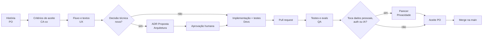

# Processo de trabalho

| Campo | Valor |
|---|---|
| Documento | Processo de trabalho |
| Versão | 1.0 |
| Data | 12/10/2026 |
| Relacionados | [Papéis e RACI](papeis-e-raci.md), [Agentes de IA](agentes-de-ia.md), [CONTRIBUTING](../../CONTRIBUTING.md) |

## 1. Modelo

**Scrum leve com quadro Kanban.** O time é pequeno e segue o calendário acadêmico, então valem ciclos curtos com limite de trabalho em andamento, e não cerimônias pesadas.

- **Ciclo:** 2 semanas.
- **Quadro:** Backlog → Pronto para desenvolver (DoR) → Em desenvolvimento → Em revisão → Em teste → Aceite → Feito.
- **WIP:** no máximo 1 item por pessoa em "Em desenvolvimento" e 3 no total em "Em revisão".

## 2. Cerimônias

| Cerimônia | Quando | Duração | Saída |
|---|---|---|---|
| Planejamento | Início do ciclo | 45 min | Objetivo do ciclo e itens puxados, todos com DoR |
| Sincronização | 2× por semana (assíncrona permitida) | 15 min | Bloqueios visíveis |
| Refinamento | Meio do ciclo | 45 min | Histórias do próximo ciclo com CA e dúvidas técnicas resolvidas |
| Revisão (demo) | Fim do ciclo | 30 min | Demonstração no portal de demonstração ou nas fixtures; aceite do PO |
| Retrospectiva | Fim do ciclo | 30 min | Até 2 ações de melhoria com dono |
| Revisão de pesquisa | A cada lote de 15 respostas ou 5 entrevistas | 30 min | Síntese do PM e ajustes de backlog |

## 3. Definition of Ready

Uma história só entra em desenvolvimento quando:

- [ ] Segue o formato "Como [persona PN1–PN5], quero ..., para ..." e cita o problema (P1–P6).
- [ ] Está vinculada a RF/RNF do [DRP](../01-produto/drp.md) e confirmada como **MVP 1**.
- [ ] Os critérios de aceite (CA-xx) estão escritos e são verificáveis.
- [ ] Os estados de erro, de "ação sua" e de IA indisponível estão descritos.
- [ ] O impacto em privacidade foi marcado (sim/não).
- [ ] Os textos e as telas existem, se houver interface.
- [ ] Toda decisão técnica nova tem ADR (ao menos como Proposta).
- [ ] O tamanho cabe em até 3 dias de trabalho; senão, foi quebrada.

## 4. Definition of Done

- [ ] Código revisado por pelo menos um humano diferente do autor.
- [ ] CA cobertos por testes automatizados (ou roteiro manual registrado, quando não automatizável), passando no CI.
- [ ] Testes negativos de confiança passando: nenhum clique em envio, nenhum campo de senha lido, nenhum CAPTCHA ou declaração tocado, nenhum sensível sem consentimento e marcação.
- [ ] Evals de IA dentro dos limiares, quando a mudança envolve IA ([estratégia de testes](../04-qualidade/estrategia-de-testes.md)).
- [ ] Nenhum erro crítico do axe; navegação por teclado verificada nas telas alteradas.
- [ ] Teste de logs sem dados pessoais passando.
- [ ] OpenAPI, documentação de arquitetura e DRP atualizados quando aplicável.
- [ ] Parecer de privacidade e segurança, quando aplicável.
- [ ] Aceite do PO registrado.

## 5. Da história ao código



## 6. Branches e integração

- **Trunk-based:** a `main` está sempre funcional. Branches vivem no máximo 3 dias.
- **Nome:** `tipo/descricao-curta`, por exemplo `feat/bloqueio-declaracoes`, `fix/crawler-modal`, `docs/adr-0017`.
- **PRs pequenos** (até cerca de 400 linhas alteradas, sem contar fixtures), com o template de PR preenchido.
- **Merge:** squash, com a mensagem no padrão de commits. Só depois do CI verde e das aprovações exigidas.
- Funcionalidade incompleta entra atrás de **feature flag**, desligada por padrão.

## 7. Convenção de commits

[Conventional Commits](https://www.conventionalcommits.org/pt-br/) em português:

```
<tipo>(<escopo>): <descrição no imperativo> (<IDs>)
```

- **Tipos:** `feat`, `fix`, `docs`, `test`, `refactor`, `perf`, `build`, `ci`, `chore`.
- **Escopos:** `api`, `web`, `extensao`, `ia`, `conector`, `dados`, `adr`, `produto`, `pesquisa`, `infra`.
- **Exemplos:**
  - `feat(extensao): ignora campos de upload e senha (RF-18, RNF-01)`
  - `fix(api): impede valor objetivo vindo da IA no de-para (RN-02)`
  - `docs(adr): propõe ADR-0017 sobre cache de mapeamentos`
- **Sem** trailer `Co-Authored-By` e sem atribuição a ferramentas de IA.

## 8. Revisão de código

O revisor verifica, nesta ordem:

1. **Regras inegociáveis** (ver [CLAUDE.md](../../CLAUDE.md)). Qualquer violação bloqueia o PR.
2. Aderência aos ADRs e contratos.
3. Testes que provam os CA e os casos negativos.
4. Dados pessoais: mínimo acesso, nada em logs, nada sensível na IA.
5. Legibilidade e simplicidade.

Comentários com prefixo: `bloqueante:`, `sugestão:`, `pergunta:`.

## 9. Versionamento de documentos

- Documentos de produto e arquitetura têm a tabela **Controle do documento** e o **histórico de revisões**. Mudança de conteúdo exige nova linha no histórico.
  - Versão maior (x.0): mudança de escopo ou de decisão.
  - Versão menor (x.y): correção ou detalhamento.
- ADRs não são editados depois de aceitos, exceto para mudar o status. Uma decisão nova gera um ADR novo, que marca o anterior como "Substituído por ADR-NNNN".
- Documentos do marketplace ficam congelados em `docs/arquivo/marketplace-v1/`.
- A versão do produto segue SemVer (`0.y.z` até o fim do MVP 1), com `CHANGELOG.md` na raiz.
