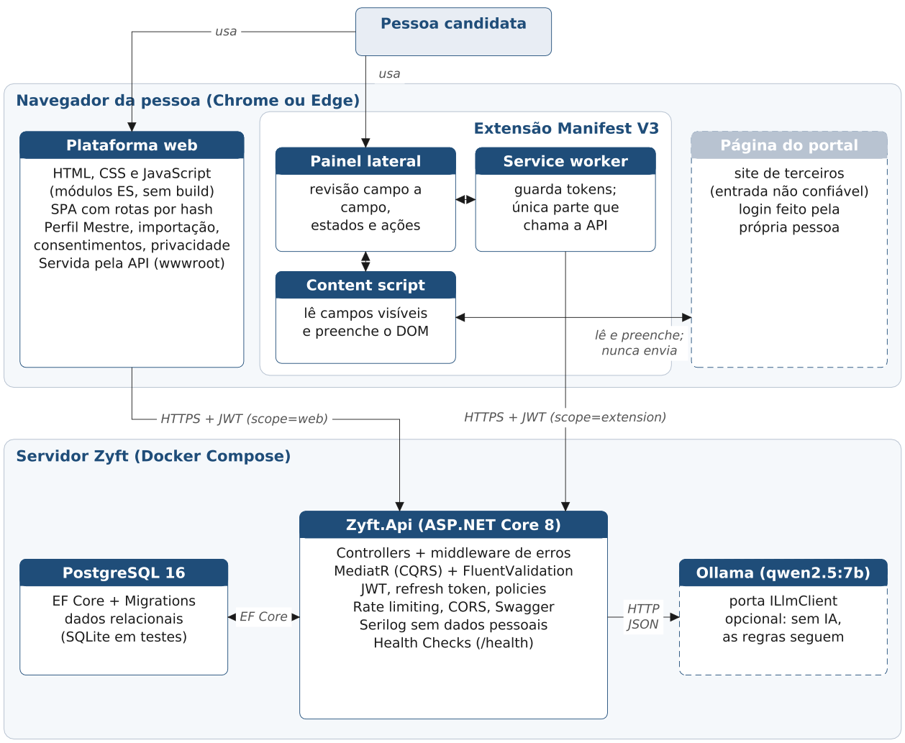
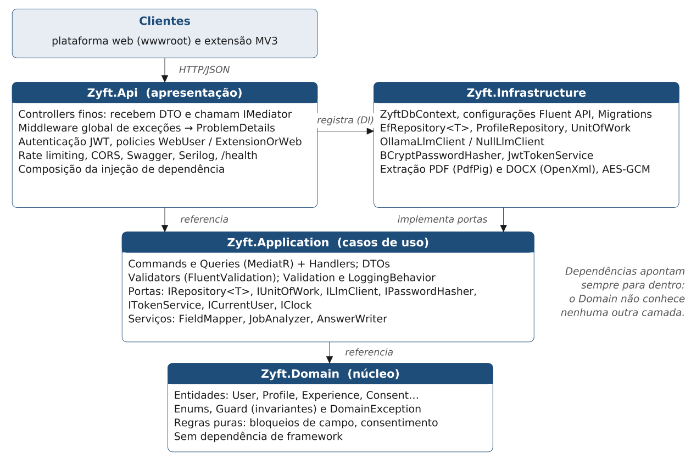
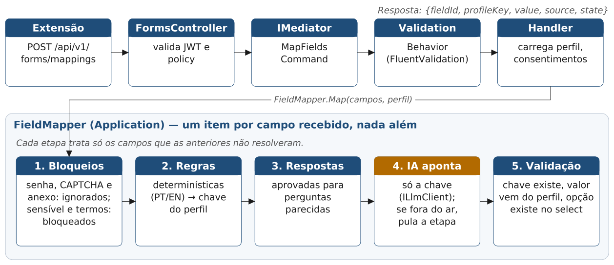
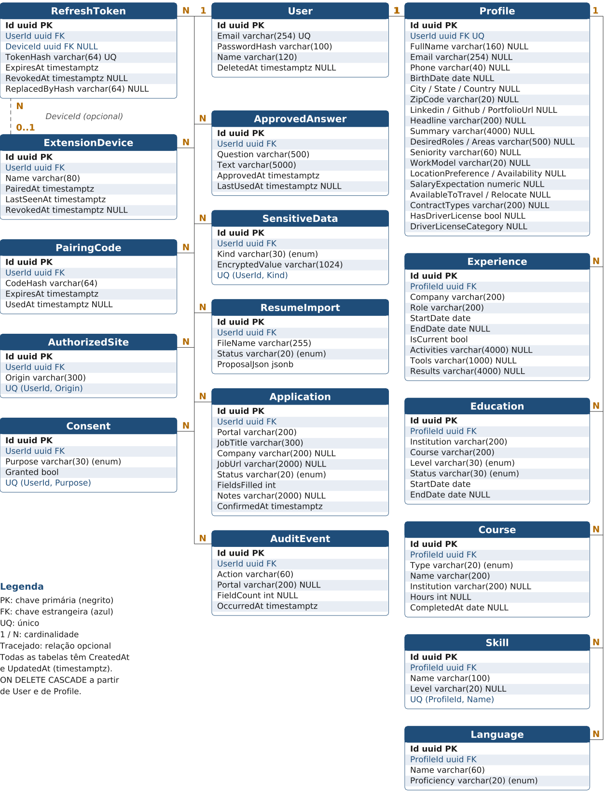
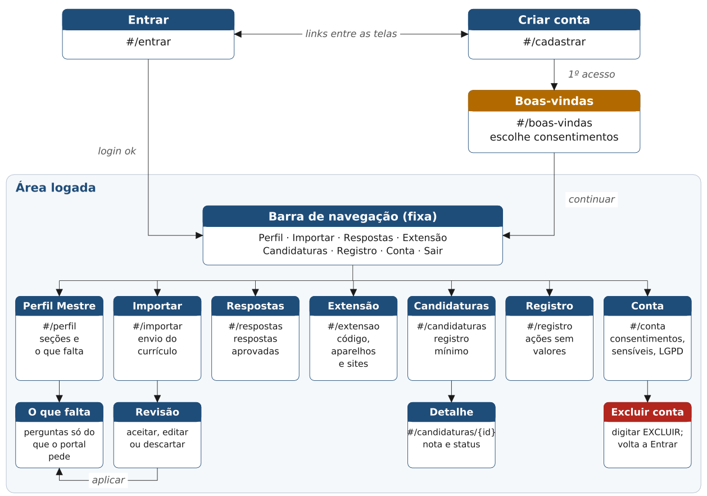
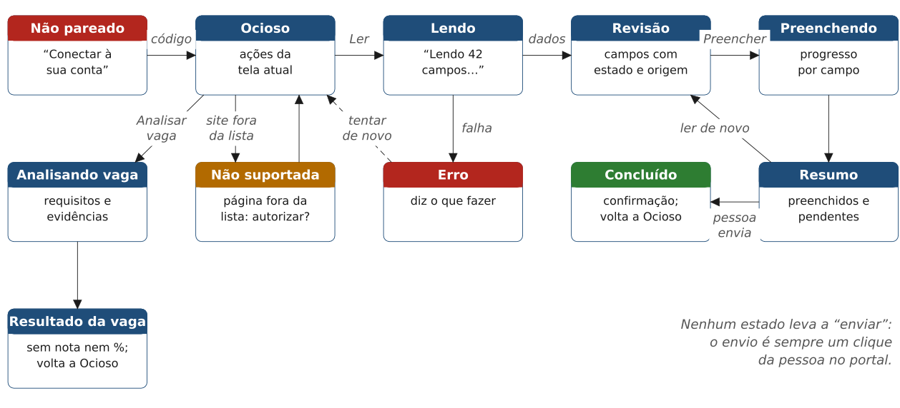

<!-- pdf:ignorar-inicio -->
# Zyft — Entrega 2: Projeto e Arquitetura

**Assistente de Candidatura a Vagas** · Disciplinas: Tópicos Especiais em Engenharia de Software (.NET) e UX — Experiência do Usuário

**Integrantes:** Antonio Randolfo Barroso Neto, Guilherme Brogio Macedo da Silva, Lucas Ulisses Clementino De Arruda E Silva, Matheus Guilherme Moreira De Oliveira

**Data:** 18 de outubro de 2026 · **Versão:** 1.0

O PDF desta entrega é gerado a partir deste arquivo por `ferramentas/entregas/gerar_entrega2.py`. Os diagramas ficam em `img/` e são desenhados por `ferramentas/entregas/diagramas.py`.

## Sumário

- [Apresentação](#apresentação)
- [1. Arquitetura da solução](#1-arquitetura-da-solução)
- [2. Modelagem do banco de dados](#2-modelagem-do-banco-de-dados)
- [3. Definição da API](#3-definição-da-api)
- [4. Autenticação e segurança](#4-autenticação-e-segurança)
- [5. Estrutura do frontend](#5-estrutura-do-frontend)
- [6. Plano de testes (v1)](#6-plano-de-testes-v1)
- [7. Rastreabilidade e próximos passos](#7-rastreabilidade-e-próximos-passos)
<!-- pdf:ignorar-fim -->

## Apresentação

Na Entrega 1, a equipe definiu o problema (repetir os mesmos dados em cada site, manter currículos inconsistentes, travar em perguntas abertas e não saber se o perfil atende à vaga), o público-alvo, a pesquisa com usuários, as personas por necessidade (PN1 a PN5), a jornada da Camila e a solução: o **Zyft — Candidatura Assistida (MVP 1)**, formado por uma plataforma web com o Perfil Profissional Mestre, uma extensão para Chrome e Edge que lê e preenche só o que a pessoa aprovou, e uma camada de IA que usa apenas fatos aprovados. As metáforas escolhidas foram o **Copiloto** (o Zyft aponta e sugere; a pessoa decide e envia) e o **Passaporte** (um perfil único, verdadeiro e aprovado, reaproveitado em cada portal).

Esta entrega transforma essa solução em projeto técnico: arquitetura, banco de dados, contrato da API, autenticação e segurança, estrutura do frontend e o plano de testes da primeira versão. A API passa a ser construída em **C# com .NET 8**, por exigência da disciplina; a mudança está registrada no ADR-0017 (seção 1.7). As regras do produto não mudam:

- **Nunca enviar:** a extensão nunca clica em enviar, salvar, aceitar ou avançar (RN-01).
- **IA só com fatos:** a IA aponta a chave do perfil; o valor vem do perfil (RN-02, RN-03).
- **Sem senhas:** nenhum campo de senha é lido e nada contorna CAPTCHA ou autenticação (RNF-01).
- **Sensíveis bloqueados:** dados sensíveis ficam separados, fora da IA, e só são preenchidos com consentimento e marcação manual (RN-04).
- **Sem dados pessoais em logs** (RNF-09) e **sem nota ou promessa** de compatibilidade (RN-06).

Os identificadores RF, RNF e RN são os do Documento de Requisitos do Produto (DRP) do repositório. CA-xx são os critérios de aceite de mesmo número.

<!-- pdf:quebra -->

## 1. Arquitetura da solução

### 1.1 Visão geral

O Zyft tem cinco partes. A pessoa usa a **plataforma web** para montar o Perfil Mestre e a **extensão** para preencher formulários no portal de vagas. As duas falam só com a **API Zyft**, que guarda os dados no **PostgreSQL** e consulta o **modelo de IA** quando precisa. A extensão é a única parte que toca a página do portal, e só no DOM da aba que a pessoa abriu: o Zyft não faz requisições ao portal (RNF-13).



| Componente | Tecnologia | Responsabilidade |
|---|---|---|
| Plataforma web | HTML, CSS e JavaScript (módulos ES, sem etapa de build), servida pela API em `wwwroot` | Conta, consentimentos, Perfil Mestre, importação de currículo, respostas aprovadas, pareamento da extensão, registro de ações, exportação e exclusão |
| Extensão | Manifest V3 (Chrome e Edge): painel lateral, service worker e content script | Ler os campos visíveis, mostrar o de-para para revisão e preencher só o que foi aprovado |
| API Zyft | ASP.NET Core 8 (C#), Clean Architecture, CQRS com MediatR | Regras de negócio, autenticação, autorização, de-para, análise de vaga, redação, auditoria |
| Banco de dados | PostgreSQL 16 com EF Core 8 e Migrations (SQLite em testes e desenvolvimento sem Docker) | Persistência relacional de contas, perfil, consentimentos, tokens e registros |
| Serviço de IA | Ollama com o modelo aberto `qwen2.5:7b`, em servidor próprio, atrás da porta `ILlmClient` | Apontar a chave do perfil para campos que as regras não resolveram, redigir texto livre com fatos aprovados, extrair requisitos de vaga |

### 1.2 Tecnologias

| Área | Tecnologia | Uso no projeto |
|---|---|---|
| Linguagem e runtime | C# 12, .NET 8 (LTS) | API e testes |
| Web API | ASP.NET Core 8 com Controllers | Rotas `/api/v1`, filtros, model binding |
| CQRS | MediatR 12 | Um command ou query por caso de uso; `ValidationBehavior` no pipeline |
| Validação | FluentValidation 11 | Regras de entrada por DTO, mensagens em português |
| ORM e migrações | Entity Framework Core 8 + Npgsql; `Microsoft.EntityFrameworkCore.Sqlite` nos testes | Mapeamento por Fluent API, Migrations versionadas |
| Banco | PostgreSQL 16 (Docker) | Banco relacional de produção e desenvolvimento |
| Autenticação | JWT Bearer (`Microsoft.AspNetCore.Authentication.JwtBearer`), BCrypt.Net-Next | Tokens de acesso, hash de senha, policies |
| Proteção | ASP.NET Core Rate Limiting, CORS, AES-GCM (`System.Security.Cryptography`) | Limite de tentativas, origens permitidas, criptografia de sensíveis |
| Documentos | PdfPig (PDF) e DocumentFormat.OpenXml (DOCX) | Extração do texto do currículo em memória |
| IA | Ollama (`/api/chat` com `format` = JSON Schema), modelo `qwen2.5:7b` | Porta `ILlmClient`; `NullLlmClient` quando a IA está desligada |
| Observabilidade | Serilog (console), Health Checks | Logs sem dados pessoais; `GET /health` |
| Documentação da API | Swashbuckle (Swagger/OpenAPI) com esquema Bearer | Exploração e testes manuais |
| Testes | xUnit, FluentAssertions, Moq, `WebApplicationFactory`, Reqnroll | Unitários, integração e aceitação (BDD em português) |
| Frontend | HTML5, CSS com variáveis (tokens), JavaScript ES2022 | Plataforma web e painel lateral, sem framework |
| Entrega | Docker Compose (PostgreSQL + API + Ollama opcional), GitHub Actions | Ambiente local e CI com build e testes |

### 1.3 Camadas e responsabilidades

A solução segue a **Clean Architecture**: o domínio fica no centro e as dependências apontam sempre para dentro. A camada de aplicação define **portas** (interfaces) que a infraestrutura implementa; a API só compõe as peças e traduz HTTP.



| Camada (projeto) | Responsabilidade | Contém | Pode depender de |
|---|---|---|---|
| **Zyft.Domain** | Regras de negócio puras e o vocabulário do produto | Entidades por agregado (`Users/User`, `Profiles/Profile` com `Experience`, `Education`, `Course`, `Skill`, `Language`, `Consents/Consent`, `Applications/JobApplication`…), enums (`ConsentPurpose`, `WorkModel`…), classe base `Entity` (Id, CreatedAt, UpdatedAt), `Guard` para invariantes, `DomainException`, nomes das ações de auditoria (`AuditActions`) | Nada (só a biblioteca padrão do .NET) |
| **Zyft.Application** | Casos de uso e contratos | Commands, queries, handlers e validators agrupados por funcionalidade (`ProfileFeatures.cs`, `FormFeatures.cs`…); DTOs; `ValidationBehavior` e `LoggingBehavior` no pipeline do MediatR; portas (`IRepository<T>`, `IProfileRepository`, `IUnitOfWork`, `ILlmClient`, `IPasswordHasher`, `ITokenService`, `ICurrentUser`, `IResumeTextExtractor`, `ISensitiveDataProtector`, `IClock`); `IConsentGuard`; serviços `FieldMapper`, `JobAnalyzer`, `AnswerWriter` e `ResumeParser` | Domain |
| **Zyft.Infrastructure** | Detalhes técnicos que implementam as portas | `ZyftDbContext` (também é o `IUnitOfWork`), configurações Fluent API, `DatabaseInitializer`, `EfRepository<T>` e `ProfileRepository`; `OllamaLlmClient` e `NullLlmClient`; `BCryptPasswordHasher`; `JwtTokenService`; `ResumeTextExtractor` (PDF e DOCX); `AesGcmSensitiveDataProtector`; `SystemClock` | Application, Domain |
| **Zyft.Api** | Entrada HTTP e composição | Controllers (base `ApiControllerBase` com o `ISender`); `ExceptionHandlingMiddleware` (ProblemDetails); autenticação JWT e policies; `HttpCurrentUser` (lê as claims); rate limiting; CORS; Swagger; Serilog; Health Checks (`LlmHealthCheck`); arquivos estáticos da web | Application, Infrastructure (só para registrar a injeção de dependência) |

### 1.4 Organização do código

| Elemento | Onde fica | Exemplo | Regra |
|---|---|---|---|
| API (host) | `src/Zyft.Api/Program.cs` | Registro de serviços, pipeline de middlewares | Sem regra de negócio |
| Controllers | `src/Zyft.Api/Controllers/` | `ProfileController`, `FormsController` | Recebem o DTO, enviam ao MediatR (`ISender`) e devolvem o resultado; não acessam o `DbContext` |
| Handlers CQRS (os "services") | `src/Zyft.Application/<Funcionalidade>/<Funcionalidade>Features.cs` | `RegisterCommand` + `RegisterValidator` + `RegisterHandler` | Um caso de uso por handler; leitura em queries, escrita em commands; command, validator e handler lado a lado |
| Serviços de aplicação | `src/Zyft.Application/Forms/`, `Jobs/`, `Writing/`, `Imports/` | `FieldMapper`, `JobAnalyzer`, `AnswerWriter`, `ResumeParser` | Sem I/O direto: usam portas |
| Repositories | Interfaces em `Application/Common/Interfaces/Ports.cs`, implementação em `Infrastructure/Persistence/Repositories.cs` | `IRepository<T>` / `EfRepository<T>`; `IProfileRepository` / `ProfileRepository` (carrega o perfil com as seções) | Toda consulta filtra pelo `UserId` do usuário atual |
| Models / Entities | `src/Zyft.Domain/<Agregado>/` | `Profiles/Experience.cs` | Métodos de fábrica e de alteração garantem as invariantes (ex.: fim não antes do início) |
| DTOs | `src/Zyft.Application/<Funcionalidade>/` (records) | `ProfileDto`, `FieldSuggestion`, `AuthResult` | Nunca expõem entidades nem campos internos (hash, chaves) |
| Banco | `src/Zyft.Infrastructure/Persistence/` | `ZyftDbContext`, `Configurations/Configurations.cs`, `DatabaseInitializer` | Esquema descrito por Fluent API e versionado por Migrations |
| Autenticação e autorização | `src/Zyft.Api/Program.cs` + `Infrastructure/Security/SecurityServices.cs` | `JwtTokenService`, policies `WebUser` e `ExtensionOrWeb` | Todo controller tem `[Authorize]` com policy, salvo as rotas anônimas listadas na seção 4 |
| Frontend | `web/` (copiado para `wwwroot` no build) | `web/js/views/profile.js` | Só fala com a API por `web/js/api.js` |
| Integração frontend–API | `web/js/api.js` e `extension/background.js` | Cliente único com Bearer, renovação por refresh e tratamento de ProblemDetails | Uma tentativa de renovação por 401 |
| Extensão | `extension/` | `sidepanel.js`, `background.js`, `content.js` | Só o service worker chama a API; o content script não tem token |
| IA | Porta `ILlmClient` em `Application/Common/Interfaces/Ports.cs`; adaptador em `Infrastructure/Ai/` | `OllamaLlmClient`, `NullLlmClient` | Saída validada por JSON Schema; a IA só devolve chaves; falha vira `LlmUnavailableException` e o caso de uso cai para regras |

### 1.5 Estrutura da solução

```
ZIFY/
  Zyft.sln, Directory.Packages.props (versões centralizadas), global.json (.NET 8)
  src/
    Zyft.Domain/           Common/ (Entity, Guard, DomainException), Users/, Profiles/, Consents/,
                           Answers/, Sensitive/, Imports/, Extension/, Applications/, Audit/
    Zyft.Application/      Common/ (Interfaces/Ports.cs, Behaviors/, Exceptions/, ConsentGuard, Text/)
                           Auth/, Account/, Consents/, Profiles/, Imports/, Answers/, Sensitive/,
                           Extension/, Sites/, Forms/, Writing/, Jobs/, Applications/, Audit/
                           (cada pasta: *Features.cs com commands, queries, validators e handlers)
    Zyft.Infrastructure/   Persistence/ (ZyftDbContext, Configurations/, Repositories.cs),
                           Ai/ (OllamaLlmClient), Security/, Files/ (ResumeTextExtractor)
    Zyft.Api/              Controllers/, Infrastructure/ (middleware, ProblemDetails, CurrentUser),
                           Program.cs, appsettings.json
  tests/
    Zyft.UnitTests/        domínio, validators, handlers, FieldMapper, JobAnalyzer
    Zyft.IntegrationTests/ WebApplicationFactory + SQLite em memória
    Zyft.AcceptanceTests/  Reqnroll: Features/*.feature + Steps/
  web/                     index.html, css/, js/ (api.js, app.js, validate.js, views/), demo/
  extension/               manifest.json, background.js, sidepanel.html/js, content.js
  docker-compose.yml       postgres:16 + api (+ ollama opcional)       (Entrega 3)
  .github/workflows/ci.yml build e testes a cada PR                  (Entrega 3)
```

### 1.6 Fluxo de uma requisição

O exemplo é o pedido de de-para (`POST /api/v1/forms/mappings`), o caso de uso central do produto. Os outros seguem o mesmo caminho: controller, MediatR, validação, handler, portas.



1. A extensão envia os campos lidos da página (rótulo, tipo, seção, opções, valor atual). Campos de senha nunca são lidos pelo content script.
2. O `FormsController` exige um JWT válido com a policy `ExtensionOrWeb` e envia o `MapFieldsCommand` ao MediatR (`ISender`).
3. O `ValidationBehavior` roda o validator do command; se falhar, o middleware devolve 400 com os erros por campo.
4. O handler carrega o perfil e os consentimentos do usuário atual e chama o `FieldMapper`, que trata os campos em cinco etapas: **bloqueios** (senha, CAPTCHA e anexo ignorados; sensíveis e declarações bloqueados), **regras determinísticas**, **respostas aprovadas**, **IA** (só para o que sobrou, devolvendo apenas a chave do perfil) e **validação** (a chave existe, o valor vem do perfil, a opção existe no select).
5. A resposta tem um item por campo recebido, com valor só para esses campos (RNF-02).

### 1.7 Justificativa das decisões

| Decisão | Alternativas consideradas | Por que escolhemos |
|---|---|---|
| **API em C#/.NET 8** (ADR-0017, substitui o ADR-0003) | Manter Node.js/TypeScript do protótipo; Minimal API em um projeto só | A disciplina exige .NET com Clean Architecture, CQRS, EF Core, JWT e testes em xUnit. O comportamento do protótipo é mantido; o código é portado. |
| **Clean Architecture** em quatro projetos | Monólito em camadas simples; projeto único | As regras de confiança (consentimento, bloqueios, IA só aponta chave) ficam no domínio e na aplicação, testáveis sem banco e sem IA. Trocar Ollama, banco ou extrator não toca as regras. |
| **CQRS com MediatR** | Services com muitos métodos chamados pelos controllers | Um handler por caso de uso deixa claro o que cada rota faz, facilita testes isolados e permite aplicar validação, log e transação no pipeline (behaviors) sem repetir código. |
| **FluentValidation** no pipeline | Data Annotations nos DTOs | Regras compostas (datas, consentimento, tamanho de arquivo) e mensagens em português num só lugar; o mesmo validator é testado em unidade. |
| **EF Core com Migrations** | Dapper com SQL manual; Kysely (proposta do ADR-0008) | Mapeamento por Fluent API, Migrations versionadas no repositório, LINQ tipado e troca de provedor (PostgreSQL ou SQLite) para testes de integração. |
| **PostgreSQL relacional** (ajusta o ADR-0008) | Perfil em JSONB; MongoDB | O modelo relacional evidencia entidades, chaves e relacionamentos, garante integridade (FK, únicos, checks) e torna a exclusão em cascata (RF-08) verificável. O custo, uma migração por campo novo, é aceitável no MVP 1. |
| **JWT de 15 min + refresh token rotativo** | Sessão por cookie (proposta inicial); token fixo do protótipo | Um único mecanismo serve à web e à extensão (que não usa cookies do domínio da API). Acesso curto (RNF-03) e refresh com rotação e detecção de reuso limitam o dano de um token roubado. |
| **Pareamento por código curto** (simplifica o ADR-0007) | Authorization Code + PKCE via `launchWebAuthFlow` | O código de 6 dígitos, gerado na plataforma logada e digitado na extensão, é simples de usar e de testar, expira em 10 minutos e é de uso único. O PKCE fica como evolução. |
| **Modelo aberto em servidor próprio atrás de `ILlmClient`** (ADR-0005) | API de IA de terceiros | Dados de currículo não saem para terceiros; o custo é previsível; a porta permite trocar de modelo ou provedor e usar um dublê (Moq) nos testes. Se a IA estiver fora, `NullLlmClient` mantém as regras funcionando (RNF-12). |
| **Regras antes da IA** (ADR-0006) e **IA só aponta a chave** (ADR-0004) | Mandar tudo para a IA | As regras são rápidas (meta de 300 ms para 100 campos), previsíveis e testáveis. A IA só escolhe entre chaves existentes, e o valor sempre vem do perfil: ela não tem como inventar um dado objetivo (RN-02). |
| **Extensão Manifest V3 com painel lateral** (ADR-0002) | Bookmarklet; aplicativo desktop; robô de navegador | Funciona na aba que a pessoa já abriu e logou, sem guardar senha. O painel lateral mostra tudo antes de agir, que é a metáfora do Copiloto. |
| **Frontend web sem framework** | React + Vite (proposta inicial) | O foco da disciplina é a API. HTML, CSS e JavaScript com módulos ES, servidos pela própria API, evitam uma segunda cadeia de build e mantêm o mesmo padrão da extensão. |
| **Dados sensíveis em tabela separada e criptografados** (ADR-0014) | Guardar junto do perfil | Segregação física facilita garantir que nunca vão para a IA nem para logs; AES-GCM protege o valor mesmo com acesso ao banco. |

**Sobre o ADR-0003 e o ADR-0017.** O ADR-0003 propunha um monorepo TypeScript/Node.js para API, web e extensão. Ele ficou como **Proposta** e nenhum código foi escrito nessa stack. Como a disciplina exige a API em .NET, foi redigido o **ADR-0017 — Backend em C#/.NET 8 com Clean Architecture** (status Proposta, em `docs/03-arquitetura/adr/0017-backend-em-csharp-dotnet-clean-architecture.md`). Ele substitui o ADR-0003, que passou a "Substituída por ADR-0017", ajusta o ADR-0008 (perfil relacional em vez de JSONB) e simplifica o pareamento do ADR-0007. As decisões de produto (ADRs 0001, 0002, 0004, 0006, 0009, 0010, 0013 e 0014) continuam valendo sem mudança.

<!-- pdf:quebra -->

## 2. Modelagem do banco de dados

### 2.1 Decisões de modelagem

- **Relacional:** cada seção do Perfil Mestre é uma tabela; nada de documento JSON para o perfil. A única coluna JSON é a proposta temporária da importação de currículo (`ResumeImports.ProposalJson`), descartada depois da decisão.
- **Chaves:** toda tabela tem `Id uuid` como chave primária, gerado pela aplicação (`Guid.NewGuid()` na classe base `Entity`), para não expor contagem de registros.
- **Auditoria de linha:** toda tabela tem `CreatedAt` e `UpdatedAt` (UTC), preenchidos pelo `ZyftDbContext` ao salvar. Nas tabelas abaixo essas duas colunas ficam implícitas.
- **Datas:** instantes em UTC (`timestamptz`); datas de calendário (início e fim de experiência) em `date` (`DateOnly` no C#).
- **Enums:** gravados como texto com o nome do valor (`varchar`), o que deixa o banco legível e a exportação estável. A lista de valores está na seção 2.6.
- **Exclusão:** todas as tabelas com dados da pessoa dependem de `Users` com `ON DELETE CASCADE`. Excluir a conta apaga tudo numa transação (RF-08).
- **Sem valores no registro de ações:** `AuditEvents` guarda ação, portal e contagem de campos, nunca valores (RF-20).
- **Sem senhas de portal:** não existe nenhuma coluna para credenciais de terceiros (RNF-01).

<!-- pdf:quebra -->

### 2.2 Diagrama entidade-relacionamento



### 2.3 Entidades e relacionamentos

| Relacionamento | Cardinalidade | Chave estrangeira | Exclusão | Observação |
|---|---|---|---|---|
| User — Profile | 1 : 1 | `Profiles.UserId` (único) | Cascade | O perfil é criado vazio junto com a conta |
| User — RefreshToken | 1 : N | `RefreshTokens.UserId` | Cascade | Um por sessão web ou extensão pareada |
| ExtensionDevice — RefreshToken | 0..1 : N | `RefreshTokens.DeviceId` (opcional) | Sem ação (os tokens caem pelo cascade de `UserId`) | Tokens da extensão apontam o dispositivo; os da web não |
| User — ExtensionDevice | 1 : N | `ExtensionDevices.UserId` | Cascade | Revogar o dispositivo revoga seus tokens |
| User — PairingCode | 1 : N | `PairingCodes.UserId` | Cascade | Só um código ativo por usuário |
| User — AuthorizedSite | 1 : N | `AuthorizedSites.UserId` | Cascade | Único por (`UserId`, `Origin`) |
| User — Consent | 1 : 3 | `Consents.UserId` | Cascade | Exatamente uma linha por finalidade |
| User — ApprovedAnswer | 1 : N | `ApprovedAnswers.UserId` | Cascade | RF-06 |
| User — SensitiveData | 1 : N | `SensitiveData.UserId` | Cascade | No máximo um valor por tipo |
| User — ResumeImport | 1 : N | `ResumeImports.UserId` | Cascade | Proposta enquanto pendente |
| User — JobApplication | 1 : N | `Applications.UserId` | Cascade | Registro mínimo de conclusão (ADR-0012) |
| User — AuditEvent | 1 : N | `AuditEvents.UserId` | Cascade | Sem valores preenchidos |
| Profile — Experience | 1 : N | `Experiences.ProfileId` | Cascade | |
| Profile — Education | 1 : N | `Educations.ProfileId` | Cascade | |
| Profile — Course | 1 : N | `Courses.ProfileId` | Cascade | Cursos e certificações (`Type`) |
| Profile — Skill | 1 : N | `Skills.ProfileId` | Cascade | Único por (`ProfileId`, `Name`) |
| Profile — Language | 1 : N | `Languages.ProfileId` | Cascade | |

### 2.4 Regras de integridade

| ID | Regra | Onde é garantida |
|---|---|---|
| RI-01 | E-mail da conta é único, sem diferença entre maiúsculas e minúsculas (gravado normalizado em minúsculas). | Índice único em `Users.Email` + `User.NormalizeEmail` |
| RI-02 | Um perfil por usuário. | Índice único em `Profiles.UserId` |
| RI-03 | Um consentimento por usuário e finalidade, criado junto com a conta. `SensitiveData` começa desligado e só pode ser ligado pela plataforma web. | Índice único (`UserId`, `Purpose`) + `Consent.Defaults` + policy `WebUser` |
| RI-04 | Data de fim maior ou igual à de início em experiências e formações. | `CHECK ("EndDate" IS NULL OR "EndDate" >= "StartDate")` (`CK_Experiences_Period`, `CK_Educations_Period`) + entidade |
| RI-05 | Experiência atual não tem data de fim. | Entidade `Experience` (`DomainException`, resposta 422) |
| RI-06 | Data de nascimento no passado (a partir de 1900). | Validator do perfil |
| RI-07 | Competência e idioma não se repetem no mesmo perfil. | Índice único (`ProfileId`, `Name`) em `Skills` + regra na entidade `Profile` (resposta 422) |
| RI-08 | Um valor sensível por tipo e por usuário; valor sempre criptografado. | Índice único (`UserId`, `Kind`) + `ISensitiveDataProtector` |
| RI-09 | Hash de refresh token é único; o token em texto nunca é gravado. Códigos de pareamento também só existem como hash. | Índice único em `RefreshTokens.TokenHash`; SHA-256 na aplicação |
| RI-10 | Código de pareamento vale 10 minutos e uma única vez; gerar um novo invalida o anterior. | `ExpiresAt`, `UsedAt` + handler |
| RI-11 | `FieldsFilled` entre 0 e 1000; `Hours` até 10.000. | Validators |
| RI-12 | Origem de site autorizado é só protocolo e domínio (`https://vagas.exemplo.com`), única por usuário. | Validator + índice único (`UserId`, `Origin`) |
| RI-13 | Excluir o usuário apaga todas as linhas dependentes. | `ON DELETE CASCADE` nas FKs de `UserId` e `ProfileId` + teste de integração |
| RI-14 | Uma importação aplicada ou descartada não pode ser aplicada de novo. | Máquina de estados em `ResumeImport` (`DomainException`, resposta 422) |

### 2.5 Dicionário de dados

Convenções: **PK** chave primária, **FK** chave estrangeira, **UQ** único, **NN** não nulo. Tipos do PostgreSQL (no SQLite dos testes, `uuid` e `timestamptz` viram `TEXT`). Colunas sem "NN" aceitam nulo. Todas as tabelas têm ainda `CreatedAt` e `UpdatedAt` (`timestamptz`, NN). Nenhum campo do perfil é obrigatório (RF-02).

#### Users — conta da plataforma

| Coluna | Tipo | Nulo | Restrições | Descrição |
|---|---|---|---|---|
| Id | uuid | NN | PK | Identificador da conta |
| Email | varchar(254) | NN | UQ | E-mail de login, em minúsculas |
| PasswordHash | varchar(100) | NN | | Hash BCrypt (fator 11) da senha do Zyft |
| Name | varchar(120) | NN | | Como a pessoa quer ser chamada |
| DeletedAt | timestamptz | | | Reservado; a exclusão é física (RF-08) |

#### RefreshTokens — sessões renováveis

| Coluna | Tipo | Nulo | Restrições | Descrição |
|---|---|---|---|---|
| Id | uuid | NN | PK | |
| UserId | uuid | NN | FK → Users, cascade | Dono do token |
| DeviceId | uuid | | FK → ExtensionDevices | Preenchido quando o token é da extensão (define `scope=extension`) |
| TokenHash | varchar(64) | NN | UQ | SHA-256 do token em hexadecimal |
| ExpiresAt | timestamptz | NN | | Emissão + 7 dias |
| RevokedAt | timestamptz | | | Preenchido no logout, na rotação ou por reuso |
| ReplacedByHash | varchar(64) | | | Hash do token que substituiu este (cadeia de rotação) |

#### ExtensionDevices — extensões pareadas

| Coluna | Tipo | Nulo | Restrições | Descrição |
|---|---|---|---|---|
| Id | uuid | NN | PK | Vai na claim `device_id` dos tokens da extensão |
| UserId | uuid | NN | FK → Users, cascade | |
| Name | varchar(80) | NN | | Nome dado pela pessoa ("Chrome do notebook") |
| PairedAt | timestamptz | NN | | Data do pareamento |
| LastSeenAt | timestamptz | NN | | Último uso (atualizado no refresh) |
| RevokedAt | timestamptz | | | Revogação pela plataforma |

#### PairingCodes — códigos de pareamento

| Coluna | Tipo | Nulo | Restrições | Descrição |
|---|---|---|---|---|
| Id | uuid | NN | PK | |
| UserId | uuid | NN | FK → Users, cascade | Quem gerou o código |
| CodeHash | varchar(64) | NN | índice | SHA-256 do código de 6 dígitos |
| ExpiresAt | timestamptz | NN | | Criação + 10 minutos |
| UsedAt | timestamptz | | | Preenchido no uso ou quando um código novo é gerado |

#### Consents — consentimentos por finalidade

| Coluna | Tipo | Nulo | Restrições | Descrição |
|---|---|---|---|---|
| Id | uuid | NN | PK | |
| UserId | uuid | NN | FK → Users, cascade; UQ com Purpose | |
| Purpose | varchar(30) | NN | enum `ConsentPurpose` | `AiText`, `JobAnalysis` ou `SensitiveData` |
| Granted | boolean | NN | | Estado atual |

#### Profiles — Perfil Mestre (contato, objetivo e preferências)

| Coluna | Tipo | Nulo | Restrições | Descrição |
|---|---|---|---|---|
| Id | uuid | NN | PK | |
| UserId | uuid | NN | FK → Users, cascade; UQ | Relação 1 : 1 |
| FullName | varchar(160) | | | Nome completo |
| Email | varchar(254) | | | E-mail de contato (pode diferir do login) |
| Phone | varchar(40) | | só dígitos, espaço, ( ) + - . | Telefone |
| BirthDate | date | | passado, ≥ 1900 | Data de nascimento |
| City / State / Country | varchar(120) / varchar(60) / varchar(80) | | | Localização |
| ZipCode | varchar(20) | | | CEP |
| LinkedinUrl / GithubUrl / PortfolioUrl | varchar(300) | | URL http(s) | Links profissionais |
| Headline | varchar(200) | | | Título profissional ("Assistente administrativa") |
| Summary | varchar(4000) | | | Resumo ou objetivo profissional |
| DesiredRoles / Areas | varchar(500) | | | Cargos e áreas de interesse |
| Seniority | varchar(60) | | | Senioridade desejada |
| WorkModel | varchar(20) | | enum `WorkModel` | Presencial, híbrido ou remoto |
| LocationPreference | varchar(200) | | | Onde deseja trabalhar |
| Availability | varchar(200) | | | Disponibilidade para início |
| SalaryExpectation | numeric(12,2) | | | Pretensão salarial (R$) |
| AvailableToTravel / AvailableToRelocate | boolean | | | Aceita viajar / mudar de cidade |
| ContractTypes | varchar(200) | | | Tipos de contrato aceitos (CLT, PJ, estágio…) |
| HasDriverLicense | boolean | | | Possui CNH |
| DriverLicenseCategory | varchar(5) | | só com CNH | Categoria da CNH |

#### Experiences — experiências profissionais

| Coluna | Tipo | Nulo | Restrições | Descrição |
|---|---|---|---|---|
| Id | uuid | NN | PK | |
| ProfileId | uuid | NN | FK → Profiles, cascade | |
| Company | varchar(200) | NN | | Organização |
| Role | varchar(200) | NN | | Cargo |
| StartDate | date | NN | | Início (aceita "AAAA-MM"; o dia vira 1) |
| EndDate | date | | ≥ StartDate; nulo se atual | Fim |
| IsCurrent | boolean | NN | | Emprego atual |
| Activities | varchar(4000) | | | Atividades realizadas |
| Tools | varchar(1000) | | | Ferramentas e tecnologias |
| Results | varchar(4000) | | | Resultados e conquistas |

#### Educations — formação

| Coluna | Tipo | Nulo | Restrições | Descrição |
|---|---|---|---|---|
| Id | uuid | NN | PK | |
| ProfileId | uuid | NN | FK → Profiles, cascade | |
| Institution | varchar(200) | NN | | Instituição de ensino |
| Course | varchar(200) | NN | | Curso |
| Level | varchar(30) | NN | enum `EducationLevel` | Nível (fundamental a doutorado) |
| Status | varchar(30) | NN | enum `EducationStatus` | Situação |
| StartDate | date | NN | | Início |
| EndDate | date | | ≥ StartDate | Conclusão ou previsão |

#### Courses — cursos e certificações

| Coluna | Tipo | Nulo | Restrições | Descrição |
|---|---|---|---|---|
| Id | uuid | NN | PK | |
| ProfileId | uuid | NN | FK → Profiles, cascade | |
| Type | varchar(20) | NN | enum `CourseType` | Curso livre ou certificação |
| Name | varchar(200) | NN | | Nome |
| Institution | varchar(200) | | | Instituição ou plataforma |
| Hours | int | | ≤ 10.000 | Carga horária |
| CompletedAt | date | | | Conclusão |

#### Skills e Languages — competências e idiomas

| Tabela.Coluna | Tipo | Nulo | Restrições | Descrição |
|---|---|---|---|---|
| Skills.Id | uuid | NN | PK | |
| Skills.ProfileId | uuid | NN | FK → Profiles, cascade | |
| Skills.Name | varchar(100) | NN | UQ com ProfileId | Competência ("Excel avançado") |
| Skills.Level | varchar(20) | | enum `SkillLevel` | Básico, intermediário ou avançado |
| Languages.Id | uuid | NN | PK | |
| Languages.ProfileId | uuid | NN | FK → Profiles, cascade | |
| Languages.Name | varchar(60) | NN | | Idioma |
| Languages.Proficiency | varchar(20) | NN | enum `LanguageProficiency` | Básico a nativo |

#### ApprovedAnswers — respostas aprovadas (RF-06)

| Coluna | Tipo | Nulo | Restrições | Descrição |
|---|---|---|---|---|
| Id | uuid | NN | PK | |
| UserId | uuid | NN | FK → Users, cascade; índice | |
| Question | varchar(500) | NN | | Pergunta original do formulário |
| Text | varchar(5000) | NN | | Texto aprovado pela pessoa |
| ApprovedAt | timestamptz | NN | | Data da aprovação (ou da última edição) |
| LastUsedAt | timestamptz | | | Último reuso |

#### SensitiveData — dados sensíveis (RN-04, ADR-0014)

| Coluna | Tipo | Nulo | Restrições | Descrição |
|---|---|---|---|---|
| Id | uuid | NN | PK | |
| UserId | uuid | NN | FK → Users, cascade; UQ com Kind | |
| Kind | varchar(30) | NN | enum `SensitiveDataKind` | Gênero, etnia, deficiência etc. |
| EncryptedValue | varchar(1024) | NN | | AES-256-GCM: nonce, tag e texto cifrado em Base64 |

#### ResumeImports — propostas de importação (RF-03, RF-04)

| Coluna | Tipo | Nulo | Restrições | Descrição |
|---|---|---|---|---|
| Id | uuid | NN | PK | |
| UserId | uuid | NN | FK → Users, cascade | |
| FileName | varchar(255) | NN | | Nome do arquivo enviado (o arquivo não é guardado) |
| Status | varchar(20) | NN | enum `ResumeImportStatus` | Pendente, aplicada ou descartada |
| ProposalJson | text (jsonb no PostgreSQL) | NN | | Proposta extraída, sem dados sensíveis |

#### AuthorizedSites — sites autorizados pela pessoa (RF-10)

| Coluna | Tipo | Nulo | Restrições | Descrição |
|---|---|---|---|---|
| Id | uuid | NN | PK | |
| UserId | uuid | NN | FK → Users, cascade; UQ com Origin | |
| Origin | varchar(300) | NN | só protocolo e domínio | Ex.: `https://vagas.exemplo.com` |

#### Applications — registro mínimo de conclusão (entidade `JobApplication`; RF-19, ADR-0012)

| Coluna | Tipo | Nulo | Restrições | Descrição |
|---|---|---|---|---|
| Id | uuid | NN | PK | |
| UserId | uuid | NN | FK → Users, cascade; índice com ConfirmedAt | |
| Portal | varchar(200) | NN | | Domínio ou nome do portal |
| JobTitle | varchar(300) | NN | | Cargo da vaga |
| Company | varchar(200) | | | Empresa |
| JobUrl | varchar(2000) | | URL absoluta | Endereço da vaga |
| Status | varchar(20) | NN | enum `ApplicationStatus` | `Confirmed` ao registrar |
| FieldsFilled | int | NN | 0 a 1000 | Campos preenchidos pelo Zyft |
| Notes | varchar(2000) | | | Anotação da pessoa |
| ConfirmedAt | timestamptz | NN | | Quando a pessoa confirmou o envio no portal |

#### AuditEvents — registro de ações (RF-20)

| Coluna | Tipo | Nulo | Restrições | Descrição |
|---|---|---|---|---|
| Id | uuid | NN | PK | |
| UserId | uuid | NN | FK → Users, cascade; índice com OccurredAt | |
| Action | varchar(60) | NN | lista fechada (`AuditActions`) | Ex.: `conta.criada`, `formulario.mapeado`, `vaga.analisada`, `extensao.pareada`, `candidatura.confirmada`, `dados.exportados` |
| Portal | varchar(200) | | | Domínio do portal, quando houver |
| FieldCount | int | | | Quantidade de campos envolvidos |
| OccurredAt | timestamptz | NN | | |

### 2.6 Enumerações

| Enum | Valores |
|---|---|
| ConsentPurpose | `AiText` (IA para textos livres), `JobAnalysis` (análise de vaga), `SensitiveData` (uso de dados sensíveis) |
| WorkModel | `OnSite`, `Hybrid`, `Remote` |
| EducationLevel | `ElementarySchool`, `HighSchool`, `Technical`, `Undergraduate`, `Postgraduate`, `Masters`, `Doctorate` |
| EducationStatus | `InProgress`, `Completed`, `Paused`, `Incomplete` |
| CourseType | `Course`, `Certification` |
| SkillLevel | `Basic`, `Intermediate`, `Advanced` |
| LanguageProficiency | `Basic`, `Intermediate`, `Advanced`, `Fluent`, `Native` |
| SensitiveDataKind | `Gender`, `Ethnicity`, `Disability`, `Religion`, `SexualOrientation`, `Health`, `SocialName`, `Other` |
| ResumeImportStatus | `Pending`, `Applied`, `Discarded` |
| ApplicationStatus | `Confirmed` (o único que o MVP 1 cria), `InReview`, `Interview`, `Test`, `Offer`, `Hired`, `Rejected`, `Withdrawn`, `NoResponse`, `Archived`. Os demais servem às anotações da pessoa; acompanhamento com lembretes é MVP 2 (RF-M2-02) |
| SuggestionState (só na API) | `Ready`, `Ambiguous`, `Missing`, `Blocked`, `Divergent` |
| SuggestionSource (só na API) | `Rule`, `Ai`, `Answer`, `None` |

<!-- pdf:quebra -->

## 3. Definição da API

### 3.1 Convenções

- **Base:** `/api/v1`. Corpo em JSON (`application/json; charset=utf-8`), exceto o envio de currículo (`multipart/form-data`). Nomes de campos em camelCase e em inglês; enums como texto com o nome do valor (`"AiText"`, `"Ready"`); mensagens para pessoas em português. Campos nulos são omitidos da resposta.
- **Autenticação:** cabeçalho `Authorization: Bearer <accessToken>`. As rotas anônimas são só cadastro, login, renovação, logout, pareamento da extensão e `/health`.
- **Identificadores:** `uuid` nas rotas. Recurso de outro usuário responde **404**, nunca 403, para não revelar que existe.
- **Datas:** ISO 8601. Instantes em UTC (`2026-10-18T14:03:00Z`); datas de calendário como `2024-03-01` (também aceita `2024-03`).
- **Criação:** `201 Created`. Exclusão: `204 No Content`.
- **Documentação viva:** Swagger em `/swagger`, com o botão *Authorize* para colar o access token.
- **Erros:** sempre em **ProblemDetails** (RFC 7807/9457), gerados pelo `ExceptionHandlingMiddleware`, com `code` (identificador estável), `traceId` e, na validação, `errors` por campo (caminho em camelCase).

```json
{
  "type": "https://httpstatuses.io/400",
  "title": "Requisição inválida",
  "status": 400,
  "detail": "Um ou mais campos são inválidos.",
  "instance": "/api/v1/profile/experiences",
  "code": "validation_failed",
  "traceId": "0HN7Q2B4J6KQ1:00000003",
  "errors": {
    "company": ["Informe a organização."],
    "startDate": ["Informe a data de início."]
  }
}
```

| HTTP | Código (`code`) | Quando | Origem |
|---|---|---|---|
| 400 Bad Request | `validation_failed` | Entrada inválida (FluentValidation ou JSON malformado), inclusive arquivo fora de PDF/DOCX ou acima de 10 MB | `ValidationException`, model binding |
| 401 Unauthorized | `unauthorized` | Sem token, token inválido ou expirado, extensão revogada; login ou refresh recusado | autenticação JWT, `UnauthorizedException` |
| 403 Forbidden | `forbidden` / `consent_required` | Token sem permissão para a rota (ex.: token da extensão numa rota só da web) ou consentimento desligado | policy, `ForbiddenException`, `ConsentRequiredException` |
| 404 Not Found | `not_found` | Recurso inexistente ou de outro usuário | `NotFoundException` |
| 409 Conflict | `conflict` | E-mail já cadastrado, item duplicado, violação de índice único | `ConflictException`, `DbUpdateException` |
| 413 Payload Too Large | `payload_too_large` | Corpo acima do limite do servidor (12 MB no upload) | Kestrel |
| 422 Unprocessable Entity | código da regra (ex.: `import.no_text`, `experience.invalid_period`) | Regra de domínio violada com entrada bem formada: PDF sem texto, fim antes do início, importação já decidida | `DomainException` |
| 429 Too Many Requests | `rate_limited` | Limite de tentativas excedido (cabeçalho `Retry-After: 60`) | Rate limiter |
| 500 Internal Server Error | `internal_error` | Erro inesperado; a resposta não traz detalhes internos, só o `traceId` | qualquer outra exceção |

**IA indisponível não é erro.** Quando o Ollama não responde, o de-para segue só com regras (`aiUsed: false`), a análise de vaga e a importação usam heurística por palavras-chave, e a sugestão de texto devolve `kind: "unknown"` com uma nota (RNF-12).

### 3.2 Mapa de endpoints

Acesso: **A** = anônimo; **W** = só plataforma web (policy `WebUser`); **E/W** = extensão ou web (policy `ExtensionOrWeb`).

<!-- pdf:larguras 0.065,0.105,0.27,0.27,0.13,0.16 -->
| # | Método | Rota | Objetivo | Acesso | Requisitos |
|---|---|---|---|---|---|
| 1 | POST | `/auth/register` | Criar conta | A | RF-01, RF-07 |
| 2 | POST | `/auth/login` | Entrar com e-mail e senha | A | RF-01 |
| 3 | POST | `/auth/refresh` | Renovar tokens (rotação) | A (refresh token) | RNF-03 |
| 4 | POST | `/auth/logout` | Revogar o refresh token | A (refresh token) | RNF-03 |
| 5 | GET | `/me` | Dados da conta logada | E/W | RF-01 |
| 6 | DELETE | `/me` | Excluir a conta e todos os dados | W | RF-08 |
| 7 | GET | `/me/export` | Exportar todos os dados em JSON | W | RF-08 |
| 8 | GET | `/consents` | Listar consentimentos | W | RF-07 |
| 9 | PUT | `/consents/{purpose}` | Ligar ou desligar uma finalidade | W | RF-07 |
| 10 | GET | `/profile` | Perfil Mestre completo | W | RF-02 |
| 11 | PUT | `/profile` | Atualizar contato, objetivo e preferências | W | RF-02 |
| 12 | GET | `/profile/missing` | Listar só o que falta | W | RF-05 |
| 13–16 | GET, POST, PUT, DELETE | `/profile/experiences[/{id}]` | Experiências | W | RF-02 |
| 17–20 | GET, POST, PUT, DELETE | `/profile/educations[/{id}]` | Formação | W | RF-02 |
| 21–24 | GET, POST, PUT, DELETE | `/profile/courses[/{id}]` | Cursos e certificações | W | RF-02 |
| 25–28 | GET, POST, PUT, DELETE | `/profile/skills[/{id}]` | Competências | W | RF-02 |
| 29–32 | GET, POST, PUT, DELETE | `/profile/languages[/{id}]` | Idiomas | W | RF-02 |
| 33 | POST | `/resume-imports` | Enviar currículo e gerar proposta | W | RF-03 |
| 34 | GET | `/resume-imports/{id}` | Ver a proposta | W | RF-04 |
| 35 | POST | `/resume-imports/{id}/apply` | Aplicar os itens aprovados | W | RF-04 |
| 36 | POST | `/resume-imports/{id}/discard` | Descartar a proposta | W | RF-04 |
| 37–38 | GET | `/answers`, `/answers/{id}` | Listar e ver respostas aprovadas | W | RF-06 |
| 39 | POST | `/answers` | Guardar resposta aprovada | E/W | RF-06 |
| 40–41 | PUT, DELETE | `/answers/{id}` | Editar ou excluir resposta | W | RF-06 |
| 42–45 | GET, POST, PUT, DELETE | `/sensitive-data[/{id}]` | Dados sensíveis | W + consentimento | RN-04 |
| 46 | POST | `/extension/pairing-codes` | Gerar código de pareamento | W | RF-09 |
| 47 | POST | `/extension/pair` | Parear a extensão com o código | A (código) | RF-09 |
| 48 | GET | `/extension/devices` | Listar extensões pareadas | W | RF-09 |
| 49 | DELETE | `/extension/devices/{id}` | Revogar uma extensão | W | RF-09 |
| 50 | GET | `/authorized-sites` | Listar sites autorizados | E/W | RF-10 |
| 51 | POST | `/authorized-sites` | Autorizar um site | W | RF-10 |
| 52 | DELETE | `/authorized-sites/{id}` | Remover autorização | W | RF-10 |
| 53 | POST | `/forms/mappings` | De-para dos campos lidos | E/W | RF-11 a RF-13, RF-16, RF-18, RNF-02 |
| 54 | POST | `/forms/open-answers` | Sugerir texto para pergunta aberta | E/W + `AiText` | RF-15, RF-06 |
| 55 | POST | `/forms/completions` | Registrar conclusão e ação | E/W | RF-19, RF-20 |
| 56 | POST | `/jobs/analyze` | Analisar a vaga visível | E/W + `JobAnalysis` | RF-17 |
| 57 | GET | `/applications` | Listar candidaturas confirmadas | E/W | RF-19 |
| 58 | GET | `/applications/{id}` | Detalhe de uma candidatura | E/W | RF-19 |
| 59 | PATCH | `/applications/{id}` | Editar status ou nota | W | RF-19 |
| 60 | DELETE | `/applications/{id}` | Excluir registro | W | RF-19, RF-08 |
| 61 | GET | `/audit-events` | Registro de ações | W | RF-20 |
| 62 | GET | `/health` (fora do prefixo) | Verificar API, banco e IA | A | RNF-12 |

### 3.3 Detalhamento por endpoint

Cada ficha traz objetivo, acesso, parâmetros, entrada, saída, regras de negócio, validações e erros. Os erros 401 (sem token ou token inválido), 403 por policy e 500 valem para todas as rotas autenticadas e só são repetidos quando há algo específico.

#### 3.3.1 Autenticação

**1. `POST /api/v1/auth/register` — Criar conta**

| Item | Descrição |
|---|---|
| Objetivo | Criar a conta na plataforma e já iniciar a sessão web. |
| Acesso | Anônimo. Limite de 10 requisições por minuto por IP (configurável). |
| Entrada | `{ "name": "Camila Souza", "email": "camila@exemplo.com", "password": "senha1234" }` |
| Saída | `201 Created` com `{ "accessToken": "eyJ...", "accessTokenExpiresAt": "…", "expiresIn": 900, "refreshToken": "q9X...", "refreshTokenExpiresAt": "…", "tokenType": "Bearer", "scope": "web", "user": { "id": "…", "name": "Camila Souza", "email": "camila@exemplo.com" } }` |
| Regras de negócio | Cria `User` (e-mail em minúsculas), `Profile` vazio com nome e e-mail de contato e as três linhas de `Consent`, com `SensitiveData` desligado. Grava `conta.criada`. Não existe campo para senha de portal (CA-01.3). |
| Validações | `name` obrigatório, até 120 caracteres; `email` obrigatório, válido, até 254; `password` de 8 a 128 caracteres, com pelo menos uma letra e um número. |
| Erros | 400 campos inválidos; 409 "Já existe uma conta com este e-mail."; 429. |

**2. `POST /api/v1/auth/login` — Entrar**

| Item | Descrição |
|---|---|
| Objetivo | Autenticar com e-mail e senha e iniciar uma sessão web. |
| Acesso | Anônimo. Limite de 10 tentativas por minuto por IP. |
| Entrada | `{ "email": "camila@exemplo.com", "password": "senha1234" }` |
| Saída | `200 OK` com o mesmo formato do cadastro. |
| Regras de negócio | Compara a senha com `BCrypt.Verify`. Emite access token com `scope=web` e um refresh token novo (sem `DeviceId`). |
| Validações | `email` e `password` obrigatórios. |
| Erros | 400 campos vazios; 401 "E-mail ou senha incorretos." (mesma mensagem para e-mail inexistente e senha errada); 429. |

**3. `POST /api/v1/auth/refresh` — Renovar tokens**

| Item | Descrição |
|---|---|
| Objetivo | Trocar um refresh token válido por um novo par de tokens (rotação). |
| Acesso | Anônimo; a prova é o próprio refresh token. |
| Entrada | `{ "refreshToken": "q9X..." }` |
| Saída | `200 OK` com o mesmo formato do login; `scope` é `extension` quando o token pertence a um dispositivo. |
| Regras de negócio | Procura pelo SHA-256 do token. Se ele **já foi trocado** (tem `ReplacedByHash`), é reuso: a API revoga todos os tokens que descendem dele na cadeia e responde 401. Se expirou ou foi revogado, 401. Se for de extensão, exige o dispositivo ativo e atualiza `LastSeenAt`. Senão, emite um par novo e revoga o atual, gravando o hash do sucessor. |
| Validações | `refreshToken` obrigatório. |
| Erros | 400 campo vazio; 401 "Sessão expirada. Faça login novamente.", "Sessão encerrada por segurança (token reutilizado)…" ou "Esta extensão foi desconectada. Pareie novamente." |

**4. `POST /api/v1/auth/logout` — Sair**

| Item | Descrição |
|---|---|
| Objetivo | Encerrar a sessão revogando o refresh token. |
| Acesso | Anônimo; recebe o refresh token. |
| Entrada | `{ "refreshToken": "q9X..." }` |
| Saída | `204 No Content` (também quando o token já não existe, para não revelar nada). |
| Regras de negócio | Marca `RevokedAt`. O access token expira sozinho em até 15 minutos; o cliente o descarta da memória. |

#### 3.3.2 Conta e consentimentos

**5. `GET /api/v1/me` — Dados da conta**

| Item | Descrição |
|---|---|
| Objetivo | Mostrar quem está logado; usado pela web e pelo painel para confirmar a sessão. |
| Acesso | E/W. |
| Saída | `200 OK` com `{ "id": "…", "email": "camila@exemplo.com", "name": "Camila Souza", "createdAt": "…", "scope": "web" }` |

**6. `DELETE /api/v1/me` — Excluir conta**

| Item | Descrição |
|---|---|
| Objetivo | Apagar a conta e todos os dados (RF-08). |
| Acesso | W. A confirmação ("digite EXCLUIR") é feita na tela, antes da chamada. |
| Saída | `204 No Content`. |
| Regras de negócio | Remove o `User`; o cascade apaga perfil, seções, respostas, sensíveis, importações, candidaturas, registro, dispositivos, códigos e tokens numa transação. Os tokens da extensão deixam de valer na hora. |
| Erros | 403 token da extensão. |

**7. `GET /api/v1/me/export` — Exportar dados**

| Item | Descrição |
|---|---|
| Objetivo | Entregar todos os dados da pessoa em JSON legível (RF-08). |
| Acesso | W. |
| Saída | `200 OK`, `Content-Disposition: attachment; filename="zyft-meus-dados.json"`, com data da exportação, conta, consentimentos, perfil com todas as seções, respostas aprovadas, dados sensíveis (decifrados), candidaturas, registro de ações, dispositivos e sites autorizados. |
| Regras de negócio | Nunca inclui `PasswordHash` nem hashes de tokens ou códigos. Grava `dados.exportados`. |
| Erros | 403 token da extensão. |

**8. `GET /api/v1/consents` — Listar consentimentos**

| Item | Descrição |
|---|---|
| Objetivo | Estado de cada finalidade. |
| Acesso | W. A extensão não lê consentimentos: quando uma finalidade está desligada, a rota correspondente responde 403 com a instrução, e o painel mostra a mensagem. |
| Saída | `200 OK` com `[ { "purpose": "AiText", "granted": true, "updatedAt": "…" }, { "purpose": "JobAnalysis", … }, { "purpose": "SensitiveData", "granted": false, … } ]` |

**9. `PUT /api/v1/consents/{purpose}` — Alterar consentimento**

| Item | Descrição |
|---|---|
| Objetivo | Ligar ou desligar uma finalidade (RF-07). |
| Acesso | W. |
| Parâmetros | `purpose` na rota: `AiText`, `JobAnalysis` ou `SensitiveData`. |
| Entrada | `{ "granted": false }` |
| Saída | `200 OK` com o consentimento atualizado. |
| Regras de negócio | Grava `consentimento.alterado`. Desligar vale na hora para as rotas protegidas: a checagem é feita na API (`IConsentGuard`), não só na tela. |
| Erros | 400 finalidade desconhecida ou corpo inválido; 403 token da extensão. |

#### 3.3.3 Perfil Mestre

**10. `GET /api/v1/profile` — Ler o perfil**

| Item | Descrição |
|---|---|
| Objetivo | Devolver o Perfil Mestre completo para edição na web. |
| Acesso | W. A extensão **não** pode ler o perfil inteiro (RNF-02). |
| Saída | `200 OK` com os dados básicos e as listas `experiences`, `educations`, `courses`, `skills` e `languages`. Dados sensíveis **não** vêm aqui. |

**11. `PUT /api/v1/profile` — Atualizar dados básicos**

| Item | Descrição |
|---|---|
| Objetivo | Salvar contato, localização, objetivo e preferências. |
| Acesso | W. |
| Entrada | `{ "fullName": "Camila Souza", "email": "camila@exemplo.com", "phone": "(11) 98888-7777", "city": "São Paulo", "state": "SP", "country": "Brasil", "headline": "Assistente administrativa", "summary": "…", "desiredRoles": "Assistente administrativo", "workModel": "Hybrid", "availability": "Imediata", "salaryExpectation": 2500.00, "availableToTravel": false, "availableToRelocate": false, "contractTypes": "CLT", "hasDriverLicense": true, "driverLicenseCategory": "B", "linkedinUrl": null }` |
| Saída | `200 OK` com o perfil atualizado. |
| Regras de negócio | Nenhum campo é obrigatório (CA-02.1). Campos omitidos ou nulos ficam vazios. A categoria da CNH só é guardada se `hasDriverLicense` for verdadeiro. Grava `perfil.atualizado`. |
| Validações | Tamanhos do dicionário (seção 2.5); e-mail válido; telefone só com dígitos, espaço, parênteses, `+`, `-` e `.`; URLs absolutas http(s); `birthDate` no passado e a partir de 1900; `workModel` no enum. |
| Erros | 400 campos inválidos. |

**12. `GET /api/v1/profile/missing` — O que falta**

| Item | Descrição |
|---|---|
| Objetivo | Listar só os dados ausentes que o fluxo do portal suportado pede (RF-05). |
| Acesso | W. |
| Saída | `200 OK` com `[ { "key": "personal.phone", "question": "Qual é o seu telefone com DDD?" } ]` |
| Regras de negócio | Compara a lista de chaves exigidas pelo portal com o perfil. Não pergunta o que o portal não pede (CA-05.2). |

**13 a 32. Seções do perfil — `/api/v1/profile/{secao}`**

As cinco seções (`experiences`, `educations`, `courses`, `skills`, `languages`) seguem o mesmo contrato:

| Método e rota | Objetivo | Entrada | Saída | Erros específicos |
|---|---|---|---|---|
| `GET /profile/{secao}` | Listar os itens | — | `200` lista | — |
| `POST /profile/{secao}` | Criar item | DTO da seção | `201` item | 400; 422 (regra de domínio, inclusive competência ou idioma repetido) |
| `PUT /profile/{secao}/{id}` | Substituir item | DTO da seção | `200` item | 400; 404; 422 |
| `DELETE /profile/{secao}/{id}` | Excluir item | — | `204` | 404 |

Acesso W em todas. Exemplo de entrada de experiência:

```json
{
  "company": "Mercado Bom Preço",
  "role": "Operadora de caixa",
  "startDate": "2023-02",
  "endDate": null,
  "isCurrent": true,
  "activities": "Atendimento, fechamento de caixa, controle de troco.",
  "tools": "Sistema PDV, Excel",
  "results": "Menor diferença de caixa da equipe por 6 meses."
}
```

| Seção | Validações e regras |
|---|---|
| Experiência | `company` e `role` obrigatórios (até 200); `startDate` obrigatória; `activities` e `results` até 4000, `tools` até 1000. Fim antes do início ou experiência atual com fim: 422. |
| Formação | `institution` e `course` obrigatórios (até 200); `level` e `status` obrigatórios no enum; `startDate` obrigatória; conclusão antes do início: 422. |
| Curso/certificação | `name` obrigatório (até 200); `institution` até 200; `hours` até 10.000; `type` no enum (padrão `Course`). |
| Competência | `name` obrigatório (até 100), único no perfil sem diferença de maiúsculas (repetido: 422); `level` opcional no enum. |
| Idioma | `name` obrigatório (até 60), único no perfil (repetido: 422); `proficiency` obrigatória no enum. |

Regra comum: o item é sempre buscado pelo `id` **e** pelo perfil do usuário atual; item de outra pessoa responde 404.

#### 3.3.4 Importação de currículo

**33. `POST /api/v1/resume-imports` — Enviar currículo**

| Item | Descrição |
|---|---|
| Objetivo | Ler um PDF com texto ou DOCX e gerar uma **proposta** de perfil, sem alterar o perfil (RF-03). |
| Acesso | W. |
| Entrada | `multipart/form-data` com o campo `file`. |
| Saída | `201 Created` com `{ "id": "…", "fileName": "curriculo.pdf", "status": "Pending", "createdAt": "…", "aiUsed": true, "proposal": { "profile": {…}, "experiences": [...], "educations": [...], "courses": [...], "skills": [...], "languages": [...], "warnings": ["Não encontramos o telefone."] } }` |
| Regras de negócio | O arquivo é lido em memória e nunca gravado. O texto é extraído (PdfPig ou OpenXml) e estruturado pela IA com saída em JSON Schema; sem IA, por heurística. Termos sensíveis (estado civil, gênero, deficiência etc.) não entram na proposta nem no texto enviado à IA (CA-03.5). Grava `curriculo.importado`. |
| Validações | Arquivo obrigatório; extensão `.pdf` ou `.docx` com assinatura coerente (`%PDF` ou `PK`); até 10 MB. |
| Erros | 400 "Envie um arquivo PDF ou DOCX." ou arquivo acima de 10 MB; 413 corpo acima do limite do servidor; 422 "Não conseguimos ler o texto deste arquivo…" (PDF escaneado). |

**34. `GET /api/v1/resume-imports/{id}` — Ver proposta**

| Item | Descrição |
|---|---|
| Objetivo | Mostrar a proposta para revisão (RF-04). A tela compara com `GET /profile` e mostra os dois valores lado a lado (CA-04.2). |
| Acesso | W. |
| Saída | `200 OK` com o mesmo formato do envio (`proposal` só enquanto pendente). |
| Erros | 404 inexistente ou de outro usuário. |

**35. `POST /api/v1/resume-imports/{id}/apply` — Aplicar itens aprovados**

| Item | Descrição |
|---|---|
| Objetivo | Levar ao perfil só o que a pessoa aceitou ou editou (CA-04.1). |
| Acesso | W. |
| Entrada | Mesmo formato da proposta, só com os itens aprovados: `{ "profile": { "fullName": "Camila Souza", "phone": "(11) 98888-7777" }, "experiences": [ {…} ], "educations": [], "courses": [], "skills": [ { "name": "Excel" } ], "languages": [] }` |
| Saída | `200 OK` com `{ "profile": {…perfil atualizado…}, "missing": [ { "key", "question" } ] }`, que leva direto ao "O que falta". |
| Regras de negócio | Só os itens enviados são gravados; o que não vem no corpo é descartado. Passa pelas mesmas regras das seções. Muda o status para `Applied`. Grava `curriculo.aplicado`. |
| Erros | 400 item inválido; 404; 422 "Esta importação já foi aplicada ou descartada." |

**36. `POST /api/v1/resume-imports/{id}/discard` — Descartar proposta**

| Item | Descrição |
|---|---|
| Objetivo | Encerrar a proposta sem mudar o perfil (CA-04.3). |
| Acesso | W. |
| Saída | `200 OK` com a importação (`status: "Discarded"`). Grava `curriculo.descartado`. |
| Erros | 404; 422 já decidida. |

#### 3.3.5 Respostas aprovadas e dados sensíveis

**37 a 41. Respostas aprovadas — `/api/v1/answers`**

| Item | Descrição |
|---|---|
| Objetivo | Guardar respostas a perguntas recorrentes para reuso com revisão (RF-06). |
| Acesso | `GET`, `PUT` e `DELETE`: W. `POST`: E/W (o painel oferece "Guardar esta resposta", CA-06.1). |
| Entrada (POST/PUT) | `{ "question": "Por que você quer trabalhar aqui?", "text": "Gosto de atendimento e…" }` |
| Saída | `GET` 200 lista ou item; `POST` 201; `PUT` 200; `DELETE` 204. Cada item: `{ "id", "question", "text", "approvedAt", "lastUsedAt" }`. |
| Regras de negócio | Criar ou editar atualiza `ApprovedAt`. O reuso é proposto pelo de-para e pela sugestão de texto, mas nunca vem marcado: a pessoa revisa antes (CA-06.2). |
| Validações | `question` obrigatória (até 500); `text` obrigatório (até 5000). |
| Erros | 400; 404; 403 token da extensão em `GET`, `PUT` e `DELETE`. |

**42 a 45. Dados sensíveis — `/api/v1/sensitive-data`**

| Item | Descrição |
|---|---|
| Objetivo | Guardar, se a pessoa quiser, dados sensíveis separados do perfil (RN-04). |
| Acesso | W e consentimento `SensitiveData` ligado em todas as operações. |
| Entrada (POST/PUT) | `{ "kind": "Gender", "value": "Feminino" }` |
| Saída | `GET` 200 `[ { "id", "kind", "value", "updatedAt" } ]` (decifrado só nesta resposta); `POST` 201; `PUT` 200; `DELETE` 204. |
| Regras de negócio | O valor é cifrado com AES-256-GCM antes de gravar. Nunca é enviado à IA, nunca aparece em log e não sai em `GET /profile`. O tipo não muda depois de criado. Grava `sensivel.alterado` (sem o valor). |
| Validações | `kind` no enum e único por usuário; `value` obrigatório. |
| Erros | 400; 403 "Ative o uso de dados sensíveis…" (`consent_required`) ou token da extensão; 404; 409 tipo já cadastrado. |

#### 3.3.6 Extensão e sites autorizados

**46. `POST /api/v1/extension/pairing-codes` — Gerar código**

| Item | Descrição |
|---|---|
| Objetivo | Gerar o código curto que a pessoa digita na extensão (RF-09). |
| Acesso | W. |
| Saída | `201 Created` com `{ "code": "482913", "expiresAt": "2026-10-18T14:13:00Z" }` |
| Regras de negócio | Código numérico de 6 dígitos gerado por `RandomNumberGenerator`; grava só o SHA-256. Invalida os códigos anteriores ainda não usados do mesmo usuário. Validade de 10 minutos. |
| Erros | 403 token da extensão. |

**47. `POST /api/v1/extension/pair` — Parear extensão**

| Item | Descrição |
|---|---|
| Objetivo | Trocar o código por tokens da extensão. |
| Acesso | Anônimo. Limite de 10 tentativas por minuto por IP. |
| Entrada | `{ "code": "482913", "deviceName": "Chrome do notebook" }` |
| Saída | `200 OK` com `{ "device": { "id", "name", "pairedAt", "lastSeenAt", "active": true }, "tokens": { …mesmo formato do login, com "scope": "extension"… } }` |
| Regras de negócio | Procura o hash do código; exige não usado e não expirado. Marca `UsedAt`, cria `ExtensionDevice` e emite tokens com `scope=extension` e claim `device_id`. Grava `extensao.pareada`. |
| Validações | `code` com exatamente 6 dígitos; `deviceName` obrigatório (até 80). |
| Erros | 400 formato inválido; 401 "Código de pareamento inválido ou expirado. Gere um novo na plataforma."; 429. |

**48. `GET /api/v1/extension/devices` e 49. `DELETE /api/v1/extension/devices/{id}`**

| Item | Descrição |
|---|---|
| Objetivo | Listar extensões pareadas e revogar uma delas (RF-09). |
| Acesso | W. |
| Saída | `GET` 200 `[ { "id", "name", "pairedAt", "lastSeenAt", "revokedAt", "active" } ]`; `DELETE` 204. |
| Regras de negócio | Revogar marca `RevokedAt` no dispositivo e nos refresh tokens dele. Como a validação do JWT confere a cada requisição se o `device_id` está ativo, o acesso cai na hora, sem esperar os 15 minutos. Grava `extensao.revogada`. |
| Erros | 404; 403 token da extensão. |

**50 a 52. Sites autorizados — `/api/v1/authorized-sites`**

| Item | Descrição |
|---|---|
| Objetivo | Registrar os sites, fora do portal suportado, em que a pessoa autorizou a extensão a atuar (RF-10, FA-08). |
| Acesso | `GET`: E/W (o painel consulta a lista). `POST` e `DELETE`: W (a autorização é dada na plataforma, onde a pessoa vê a explicação). |
| Entrada (POST) | `{ "origin": "https://vagas.exemplo.com" }` |
| Saída | `GET` 200 `[ { "id", "origin", "createdAt" } ]`; `POST` 201; `DELETE` 204. |
| Regras de negócio | A extensão só lê páginas do portal suportado ou de origens desta lista, e o navegador também pede a permissão de host. |
| Validações | `origin` com protocolo e domínio, sem caminho, consulta ou fragmento; único por usuário. |
| Erros | 400 "Informe só a origem (protocolo e domínio), sem caminho."; 404; 409 já autorizado. |

#### 3.3.7 Formulários (extensão)

**53. `POST /api/v1/forms/mappings` — De-para dos campos**

| Item | Descrição |
|---|---|
| Objetivo | Propor, para cada campo lido, qual dado do perfil usar e em que estado ele fica (RF-12, RF-13). |
| Acesso | E/W. |
| Entrada | `{ "pageUrl": "http://localhost:5080/demo/candidatura.html", "fields": [ { "id": "z-12", "tag": "input", "type": "email", "label": "E-mail", "name": "email", "section": "Dados pessoais", "required": true, "maxLength": 120, "currentValue": "" }, { "id": "z-13", "tag": "select", "type": "select-one", "label": "Gênero", "options": [ { "value": "f", "text": "Feminino" }, { "value": "m", "text": "Masculino" } ] } ] }` |
| Saída | `200 OK` com `{ "mappings": [ { "fieldId": "z-12", "label": "E-mail", "kind": "profile", "state": "Ready", "source": "Rule", "profileKey": "personal.email", "profileLabel": "E-mail", "value": "camila@exemplo.com", "selected": true }, { "fieldId": "z-13", "label": "Gênero", "kind": "sensitive", "state": "Blocked", "source": "None", "selected": false, "note": "Dado sensível: responda direto no formulário, se quiser." } ], "stats": { "fields": 2, "byRules": 1, "byAi": 0, "byAnswers": 0, "ready": 1, "ambiguous": 0, "missing": 0, "blocked": 1, "divergent": 0 }, "aiUsed": false, "elapsedMs": 12 }` |
| Regras de negócio | (1) **Bloqueios**: `password`, `hidden`, `submit`, `button`, `file` e CAPTCHA nunca recebem valor; sensíveis e declarações ficam `Blocked` e nunca `selected` (kind `sensitive`, `declaration` ou `manual`). (2) **Regras determinísticas** em português e inglês. (3) **Respostas aprovadas** para perguntas parecidas (`source=Answer`, nunca `selected`). (4) **IA** só para o que sobrou: recebe rótulo, tipo, seção e opções dos campos e a **lista de chaves** do perfil, nunca valores nem sensíveis, e devolve só a chave. (5) **Validação**: a chave existe, o valor é lido do perfil, a opção existe no select; senão vira `Ambiguous` ou `Missing`. Campo com `currentValue` diferente do perfil vira `Divergent` com `selected=false` e `profileValue` para comparação (manter o portal é o padrão, RF-16). Perguntas abertas voltam com kind `openQuestion` para a sugestão de texto. Só `Ready` vem marcado. Um item por campo recebido e nada além (RNF-02). Sem IA, `aiUsed=false` e as regras seguem. Grava `formulario.mapeado` com portal e número de campos. |
| Validações | `fields` com 1 a 300 itens e `id` único por requisição; `pageUrl` URL absoluta (até 2000); `label` até 2000; até 500 opções por campo. |
| Erros | 400 entrada inválida. |

**54. `POST /api/v1/forms/open-answers` — Sugerir texto**

| Item | Descrição |
|---|---|
| Objetivo | Sugerir resposta para pergunta aberta usando só fatos aprovados (RF-15). |
| Acesso | E/W e consentimento `AiText`. |
| Entrada | `{ "question": "Por que você quer trabalhar conosco?", "maxLength": 600, "pageUrl": "…", "jobTitle": "Assistente administrativo", "company": "Empresa X", "jobText": "…" }` |
| Saída | `200 OK` com `{ "question": "…", "kind": "generated", "source": "Ai", "value": "…", "usedFacts": ["Operadora de caixa no Mercado Bom Preço (2023–atual)"], "note": "Sugestão: revise antes de usar.", "selected": false }`; com resposta aprovada parecida, `source: "Answer"` e `approvedAnswerId`. |
| Regras de negócio | Primeiro procura resposta aprovada parecida; senão, monta os fatos do perfil (sem sensíveis) e pede à IA. O texto respeita `maxLength` e sempre volta com `selected=false`. IA fora do ar: `kind: "unknown"` e a nota "IA indisponível no momento. Responda manualmente ou tente de novo mais tarde." Grava `texto.sugerido`. |
| Validações | `question` obrigatória (até 1000); `maxLength` entre 20 e 10.000 quando informado; `jobText` até 20.000. |
| Erros | 400; 403 `consent_required` "Ative a IA para textos livres…". |

**55. `POST /api/v1/forms/completions` — Registrar conclusão**

| Item | Descrição |
|---|---|
| Objetivo | Registrar que a pessoa concluiu a candidatura **no portal, por conta própria** (RF-19) e a ação automatizada (RF-20). |
| Acesso | E/W. |
| Entrada | `{ "portal": "localhost:5080", "jobTitle": "Assistente administrativo", "company": "Empresa X", "jobUrl": "http://localhost:5080/demo/vaga.html", "fieldsFilled": 18 }` |
| Saída | `201 Created` com a candidatura (`status: "Confirmed"`). |
| Regras de negócio | Cria `JobApplication` e o evento `candidatura.confirmada` com portal e quantidade de campos, **sem valores**. O Zyft não envia nada: este registro só acontece depois do clique da pessoa no portal. |
| Validações | `portal` e `jobTitle` obrigatórios (até 200 e 300); `jobUrl` URL absoluta; `fieldsFilled` entre 0 e 1000. |
| Erros | 400. |

#### 3.3.8 Vagas, candidaturas, registro e saúde

**56. `POST /api/v1/jobs/analyze` — Analisar vaga**

| Item | Descrição |
|---|---|
| Objetivo | Extrair os dados visíveis da vaga e marcar cada requisito com evidência do perfil (RF-17). |
| Acesso | E/W e consentimento `JobAnalysis`. |
| Entrada | `{ "text": "…texto visível da vaga…", "url": "http://localhost:5080/demo/vaga.html", "title": "Assistente administrativo" }` |
| Saída | `200 OK` com `{ "job": { "title", "company", "location", "contractType", "workModel", "schedule", "salary", "summary" }, "requirements": [ { "text": "Excel avançado", "kind": "…", "status": "atende", "evidence": "Competência: Excel avançado", "evidenceLine": 7, "analysis": "…" } ], "toConfirm": [ { "label": "CNH", "profileKey": "preferences.driverLicense", "hasValue": true } ], "stats": { "atende", "parcial", "naoEncontrado", "confirmar", "total", "requiredTotal", "requiredMet" }, "aiUsed": true, "disclaimer": "…" }` |
| Regras de negócio | O perfil vira linhas numeradas (sem sensíveis). "atende" e "parcial" exigem uma linha real; sem ela, o status vira "nao_encontrado" (ADR-0013). Status fora da lista vira "confirmar". Pontos como CNH, pretensão salarial e modalidade vão para `toConfirm`, que informa só se o perfil tem o dado, não o valor. **Só contagens: nada de nota, porcentagem ou promessa** (RN-06). Sem IA, avaliação por palavras-chave. Grava `vaga.analisada`. |
| Validações | `text` obrigatório (até 50.000); `url` até 2000; `title` até 500. |
| Erros | 400; 403 `consent_required` "Ative a análise de vagas…". |

**57 a 60. Candidaturas — `/api/v1/applications`**

| Item | Descrição |
|---|---|
| Objetivo | Consultar e anotar o registro mínimo das candidaturas concluídas (RF-19). O painel completo com lembretes é MVP 2. |
| Acesso | `GET`: E/W (o painel mostra as candidaturas já registradas). `PATCH` e `DELETE`: W. |
| Entrada (PATCH) | `{ "status": "Interview", "notes": "Entrevista marcada para 22/10." }` (pelo menos um dos dois) |
| Saída | `GET` 200 lista (mais recentes primeiro) ou item `{ "id", "portal", "jobTitle", "company", "jobUrl", "status", "fieldsFilled", "confirmedAt", "notes" }`; `PATCH` 200; `DELETE` 204. |
| Validações | `status` no enum; `notes` até 2000; corpo vazio é recusado ("Informe status e/ou notes."). |
| Erros | 400; 404; 403 token da extensão em `PATCH` e `DELETE`. |

**61. `GET /api/v1/audit-events` — Registro de ações**

| Item | Descrição |
|---|---|
| Objetivo | Linha do tempo legível das ações automatizadas (RF-20). |
| Acesso | W. |
| Parâmetros | `limit` (query, padrão 200). |
| Saída | `200 OK` com `[ { "id", "action": "formulario.mapeado", "portal": "localhost:5080", "fieldCount": 18, "occurredAt": "…" } ]`, mais recentes primeiro. Nunca contém valores preenchidos. |
| Erros | 403 token da extensão. |

**62. `GET /health` — Saúde**

| Item | Descrição |
|---|---|
| Objetivo | Verificar se a API, o banco e a IA respondem (RNF-12). |
| Acesso | Anônimo. |
| Saída | `200 OK` com `{ "status": "Healthy", "checks": [ { "name": "database", "status": "Healthy" }, { "name": "llm", "status": "Healthy", "description": "…" } ] }`. Com a IA fora, `llm` fica `Degraded` e a resposta continua 200, porque as regras seguem funcionando. Banco fora: `503` e `Unhealthy`. |

<!-- pdf:quebra -->

## 4. Autenticação e segurança

### 4.1 Registro e login

- **Registro** (`POST /auth/register`): a pessoa informa nome, e-mail e senha. A senha precisa ter de 8 a 128 caracteres, com pelo menos uma letra e um número. É guardada só como hash **BCrypt** com fator de custo 11; a senha em texto não é gravada nem registrada em log.
- **Login** (`POST /auth/login`): compara a senha com o hash. A resposta de erro é a mesma para e-mail inexistente e senha errada ("E-mail ou senha incorretos."), para não revelar quais e-mails têm conta.
- **Limite de tentativas:** o **Rate Limiter** do ASP.NET Core (janela fixa) permite 10 requisições por minuto por IP no login, no cadastro e no pareamento (`RateLimiting:AuthPermitLimit`). Acima disso, `429` com `Retry-After: 60`.
- **Fora do escopo desta versão:** verificação de e-mail por link e login com Google (previstos no RF-01) ficam para a Entrega 4; a estrutura de `ITokenService` e `User` já comporta os dois.
- **Nunca há senha de portal:** nenhuma tela, DTO ou tabela tem campo para credenciais de portais de vagas (RNF-01).

### 4.2 Tokens JWT

| Item | Valor |
|---|---|
| Algoritmo | HS256, chave simétrica de pelo menos 32 caracteres lida de `Jwt:Secret` (variável de ambiente `Jwt__Secret`); nunca versionada. A API não sobe sem ela |
| Emissor e público | `iss = zyft-api`, `aud = zyft-clients` |
| Validade do access token | **15 minutos** (`expiresIn: 900`), tolerância de relógio de 30 segundos |
| Claims | `sub` (Id do usuário), `email`, `scope` (`web` ou `extension`), `device_id` (só na extensão), `jti`, `exp` |
| Refresh token | Valor aleatório (`RandomNumberGenerator`); validade de **7 dias** (`Jwt:RefreshTokenDays`); no banco fica só o SHA-256 |
| Onde o cliente guarda | Web: access token só em memória; refresh token em `sessionStorage` (some ao fechar a aba). Extensão: access token em `chrome.storage.session`; refresh token em `chrome.storage.local`, acessíveis só ao service worker |

### 4.3 Renovação com rotação e detecção de reuso

1. Quando a API responde 401 por token expirado, o cliente chama `POST /auth/refresh` **uma vez** e repete a requisição original com o novo access token.
2. A API procura o refresh token pelo hash. Se estiver válido, ela o revoga, grava em `ReplacedByHash` o hash do novo token e devolve um par novo. Cada refresh token serve **uma única vez**.
3. Se chegar um refresh token que já foi trocado, alguém pode tê-lo copiado. A API trata como **reuso**: segue a cadeia `ReplacedByHash` e revoga todos os tokens que descendem dele, inclusive o que está com o cliente legítimo, e responde 401 "Sessão encerrada por segurança". Quem tiver qualquer um dos tokens precisa entrar de novo.
4. Logout, exclusão de conta e revogação de dispositivo marcam `RevokedAt` nos tokens correspondentes.

### 4.4 Pareamento da extensão

| Passo | Quem | O que acontece |
|---|---|---|
| 1 | Pessoa, na plataforma (logada) | Abre **Extensão** e clica em "Gerar código". A API cria um código de 6 dígitos, válido por 10 minutos e de uso único (`POST /extension/pairing-codes`). |
| 2 | Pessoa, no painel lateral | Digita o código e um nome para o dispositivo ("Chrome do notebook"). |
| 3 | Service worker da extensão | Chama `POST /extension/pair`. A API confere o código, cria o `ExtensionDevice` e devolve tokens com `scope=extension` e `device_id`. |
| 4 | Plataforma | O dispositivo aparece na lista, com último uso e o botão "Desconectar", que revoga na hora (RF-09). |

O código é curto, mas tem 10 minutos de validade, uso único, só um ativo por usuário e limite de 10 tentativas por minuto por IP: adivinhar exige, em média, centenas de milhares de tentativas. O fluxo com Authorization Code + PKCE do ADR-0007 fica como evolução.

### 4.5 Autorização: policies e regras por funcionalidade

| Policy | Exige | Usada em |
|---|---|---|
| `WebUser` | JWT válido com `scope = web` | Perfil completo, consentimentos, dados sensíveis, importação, exportação, exclusão, dispositivos, autorizar e remover sites, editar candidaturas, registro de ações |
| `ExtensionOrWeb` | JWT válido com `scope = web` ou `extension`; para `extension`, o `device_id` precisa estar ativo (conferido no evento `OnTokenValidated` da autenticação JWT) | De-para, texto livre, conclusão, análise de vaga, `GET /me`, listar sites autorizados e candidaturas, guardar resposta |
| Consentimento | Verificado no handler (`IConsentGuard`) e não só na tela; responde 403 com `code: consent_required` | `AiText` em `/forms/open-answers`; `JobAnalysis` em `/jobs/analyze`; `SensitiveData` em `/sensitive-data` e no uso de sensíveis no de-para |
| Propriedade | Toda consulta filtra pelo `UserId` vindo de `ICurrentUser` (claim `sub`); nunca pelo corpo da requisição | Todas as rotas autenticadas (evita IDOR) |

### 4.6 Matriz de acesso por funcionalidade

Legenda: **Sim** = permitido; **Não** = 401 (anônimo) ou 403 (token sem permissão); **Cons.** = permitido só com o consentimento indicado.

| Funcionalidade (endpoints) | Anônimo | Web | Extensão |
|---|---|---|---|
| Cadastro, login, renovação, logout | Sim | Sim | Sim (renovação e logout) |
| Saúde (`/health`) | Sim | Sim | Sim |
| Parear extensão com código (`/extension/pair`) | Sim (com código) | — | — |
| Ver conta (`GET /me`) | Não | Sim | Sim |
| Excluir conta e exportar (`DELETE /me`, `/me/export`) | Não | Sim | Não |
| Ver consentimentos (`GET /consents`) | Não | Sim | Não |
| Alterar consentimentos (`PUT /consents/{purpose}`) | Não | Sim | Não |
| Perfil Mestre e seções (`/profile/**`) | Não | Sim | Não (RNF-02) |
| Importação de currículo (`/resume-imports/**`) | Não | Sim | Não |
| Respostas aprovadas: listar, editar, excluir | Não | Sim | Não |
| Respostas aprovadas: guardar (`POST /answers`) | Não | Sim | Sim |
| Dados sensíveis (`/sensitive-data/**`) | Não | Cons. `SensitiveData` | Não |
| Gerar código, listar e revogar dispositivos | Não | Sim | Não |
| Sites autorizados: listar | Não | Sim | Sim |
| Sites autorizados: autorizar e remover | Não | Sim | Não |
| De-para (`/forms/mappings`) | Não | Sim | Sim |
| Texto livre (`/forms/open-answers`) | Não | Cons. `AiText` | Cons. `AiText` |
| Registrar conclusão (`/forms/completions`) | Não | Sim | Sim |
| Análise de vaga (`/jobs/analyze`) | Não | Cons. `JobAnalysis` | Cons. `JobAnalysis` |
| Candidaturas: listar e ver (`GET /applications/**`) | Não | Sim | Sim |
| Candidaturas: editar e excluir | Não | Sim | Não |
| Registro de ações (`/audit-events`) | Não | Sim | Não |

### 4.7 Validações e controles de segurança

| Controle | Como é feito | Requisito |
|---|---|---|
| Senhas | BCrypt fator 11; política mínima de 8 caracteres com letra e número; nunca em log | RF-01 |
| Limite de requisições | Rate Limiter: 10/min por IP em login, cadastro e pareamento. Limites por usuário nas rotas de IA (30/min no de-para, 20/min no texto livre, 10/min na análise de vaga, 10/h na importação) estão previstos para a Entrega 3 | RNF-03 |
| CORS | Só as origens da plataforma (`Cors:AllowedOrigins`) e os IDs publicados da extensão (`Cors:ExtensionIds`, origem `chrome-extension://<id>`). Sem IDs configurados (desenvolvimento), aceita qualquer extensão; em produção a lista é obrigatória. Outras origens não recebem `Access-Control-Allow-Origin` | RNF-03 |
| Transporte | HTTPS obrigatório fora do ambiente local (HSTS); TLS 1.2 ou superior | RNF-03 |
| Segredos | `Jwt:Secret`, `Encryption:Key` (AES) e a string de conexão vêm de variáveis de ambiente ou user-secrets; no `appsettings.json` os segredos ficam vazios; a API não sobe sem `Jwt__Secret` | — |
| Sem senhas de portal | Nenhum campo, DTO ou tabela; o content script descarta `type=password` antes de ler o valor; a API ignora esses campos se chegarem | RNF-01 |
| Mínimo retorno | `/forms/mappings` só devolve valores dos campos enviados; nenhuma rota da extensão devolve o perfil inteiro | RNF-02 |
| Dados sensíveis | Tabela separada; AES-256-GCM com chave `Encryption:Key`; nunca vão à IA nem ao log; uso exige consentimento e marcação manual | RN-04 |
| Logs sem dados pessoais | Serilog registra método, caminho (sem query string), status e duração; o `LoggingBehavior` registra só o nome do caso de uso e o tempo. Não registra corpo de requisição, e-mail, nome, token nem valores de campo. O middleware de exceções devolve ProblemDetails só com `traceId`, sem pilha de chamadas | RNF-09 |
| Entrada não confiável | Tudo que vem da página do portal (rótulos, opções, texto da vaga) é tratado como dado: delimitado no prompt, validado por JSON Schema na saída da IA, nunca executado. A IA só devolve chaves de uma lista fechada | ADR-0004 |
| IDOR | Repositórios sempre filtram por `UserId`; recurso alheio responde 404 | — |
| Upload | Limite de 10 MB no Kestrel e no validator; checagem de extensão e tipo MIME; leitura em memória, sem gravar o arquivo | RF-03 |
| Revogação imediata | O evento `OnTokenValidated` do JWT confere se o `device_id` está ativo em cada requisição da extensão | RF-09 |

### 4.8 LGPD

- **Consentimento por finalidade** (art. 7º e 11): três finalidades separadas e desligáveis; a de dados sensíveis começa desligada e só pode ser ligada na plataforma web, com explicação.
- **Minimização:** a extensão recebe só os valores dos campos da tela; o arquivo do currículo não é guardado; propostas pendentes expiram em 7 dias.
- **Direitos do titular** (art. 18): exportação completa em JSON (`GET /me/export`) e exclusão total imediata (`DELETE /me`), com revogação das extensões.
- **Transparência:** o registro de ações mostra o que foi feito, quando e onde, sem os valores.
- **Segurança:** criptografia de sensíveis, hash de senhas e tokens, logs sem dados pessoais.

<!-- pdf:quebra -->

## 5. Estrutura do frontend

### 5.1 Visão geral

O frontend tem duas partes que falam com a mesma API:

- **Plataforma web** (`web/`): aplicação de página única em HTML, CSS e JavaScript com módulos ES, sem framework e sem etapa de build, servida pela própria API (`wwwroot`). Rotas por hash (`#/perfil`), guarda de autenticação e foco no título a cada troca de tela. Todo acesso à API passa por `web/js/api.js`.
- **Extensão** (`extension/`): Manifest V3 para Chrome e Edge. O **painel lateral** mostra o de-para e as ações; o **service worker** guarda os tokens e é o único que chama a API; o **content script** é injetado sob demanda para ler e preencher a página.

### 5.2 As metáforas aplicadas às telas

As duas metáforas da Entrega 1 orientam textos, hierarquia e comportamento das telas.

| Metáfora | Princípio | Onde aparece | Como aparece |
|---|---|---|---|
| **Passaporte** | Um documento único, verdadeiro e da pessoa; cada informação vale depois de "carimbada" (aprovada) | Perfil Mestre, Importar, O que falta, Conta | O perfil é apresentado como "seu passaporte profissional", com seções como páginas. Na revisão da importação, cada item tem o botão **Aprovar** (o carimbo); nada entra sem ele. "O que falta" lista só as páginas em branco que o portal vai pedir. Em Conta, "O passaporte é seu": exportar e excluir ficam à vista. |
| **Passaporte** (limite) | Passaporte não garante entrada | Análise de vaga | A tela mostra "atende", "parcial", "não encontrado" e "confirmar" com a linha do perfil como prova, e nunca nota, porcentagem ou promessa. |
| **Copiloto** | O Copiloto lê os instrumentos, aponta e sugere; quem pilota é a pessoa | Painel lateral da extensão | O painel é o "painel de instrumentos": antes de agir, diz o que vai acontecer ("Vamos preencher 18 campos. 3 precisam de você."). Cada campo mostra estado, origem (regra, resposta aprovada, IA) e o valor, sempre editável. Só os prontos vêm marcados. |
| **Copiloto** (limite) | O Copiloto não aterrissa sozinho | Painel lateral, Resumo, Extensão (web) | Não existe botão "Enviar" no Zyft. O resumo termina com "Confira no portal e envie quando estiver pronta(o)". O registro só acontece depois que a pessoa envia no portal. |
| **Copiloto** (transparência) | O piloto sabe o que o copiloto fez | Registro de ações | Linha do tempo legível ("18 campos preenchidos, 3 deixados para você"), sem valores. |

### 5.3 Telas previstas

| Tela | Rota | Objetivo | Requisitos | Metáfora |
|---|---|---|---|---|
| Entrar | `#/entrar` | Login com e-mail e senha | RF-01 | — |
| Criar conta | `#/cadastrar` | Cadastro com nome, e-mail e senha | RF-01 | — |
| Boas-vindas | `#/boas-vindas` | Explicar o que o Zyft faz e escolher os consentimentos de IA e de análise de vaga | RF-07 | Copiloto (a pessoa decide) |
| Perfil Mestre | `#/perfil` | Editar dados básicos e as seções; ver "O que falta" | RF-02, RF-05 | Passaporte |
| Importar currículo | `#/importar` | Enviar PDF/DOCX e revisar a proposta lado a lado | RF-03, RF-04 | Passaporte (carimbo) |
| Respostas aprovadas | `#/respostas` | Ver, editar e excluir respostas reutilizáveis | RF-06 | Passaporte |
| Extensão | `#/extensao` | Gerar código de pareamento, listar e desconectar extensões, gerenciar sites autorizados | RF-09, RF-10 | Copiloto |
| Candidaturas | `#/candidaturas` e `#/candidaturas/{id}` | Registro mínimo das candidaturas concluídas e anotações | RF-19 | Copiloto |
| Registro de ações | `#/registro` | Linha do tempo das ações automatizadas, sem valores | RF-20 | Copiloto |
| Conta e privacidade | `#/conta` | Consentimentos, dados sensíveis, exportar e excluir | RF-07, RF-08, RN-04 | Passaporte |
| Painel lateral (extensão) | — | Parear, ler formulário, revisar, preencher, analisar vaga, sugerir texto | RF-09 a RF-18 | Copiloto |

### 5.4 Mapa de navegação



Sem sessão, qualquer rota leva a **Entrar**. Depois do primeiro cadastro, a pessoa passa por **Boas-vindas**; nos acessos seguintes, vai direto para o **Perfil Mestre**. A barra de navegação fica sempre visível na área logada e marca a tela atual (`aria-current`). Sair ou excluir a conta volta para Entrar.

### 5.5 Fluxos principais

| Fluxo | Passos na interface | Chamadas à API |
|---|---|---|
| F1 — Primeiro acesso | Criar conta → Boas-vindas (confirma ou desliga IA e análise de vaga) → Perfil Mestre | `POST /auth/register` → `PUT /consents/AiText`, `PUT /consents/JobAnalysis` → `GET /profile` |
| F2 — Montar o Passaporte | Importar → escolher arquivo → revisar lado a lado (aprovar, editar, descartar) → Aplicar → O que falta | `POST /resume-imports` → `GET /resume-imports/{id}` → `POST /resume-imports/{id}/apply` → `GET /profile/missing` |
| F3 — Conectar a extensão | Extensão (web) → Gerar código → digitar no painel → aparelho listado | `POST /extension/pairing-codes` → `POST /extension/pair` → `GET /extension/devices` |
| F4 — Preencher com o Copiloto | No portal, abrir o painel → Ler formulário → revisar estados → editar o que quiser → Preencher selecionados → Resumo → a pessoa envia no portal → Concluído | `POST /forms/mappings` → (opcional) `POST /forms/open-answers` → `POST /forms/completions` |
| F5 — Analisar vaga | Na página da vaga → Analisar vaga → requisitos com evidência | `POST /jobs/analyze` |
| F6 — Privacidade | Conta → Baixar meus dados / Excluir minha conta (digitar EXCLUIR) | `GET /me/export` / `DELETE /me` |

### 5.6 Formulários e campos

| Formulário (tela) | Campos | Validação no frontend |
|---|---|---|
| Entrar | E-mail; Senha | Obrigatórios; e-mail com formato válido |
| Criar conta | Seu nome; E-mail; Senha (com "mostrar senha") | Nome obrigatório (até 120); e-mail válido (até 254); senha com 8+ caracteres, letra e número |
| Consentimentos (Boas-vindas e Conta) | Interruptores: "Sugestões de texto com IA", "Análise de vagas", "Dados sensíveis" (este começa desligado) | Cada mudança é salva na hora, com mensagem de confirmação; sensíveis pedem confirmação extra |
| Dados básicos (Perfil) | Nome completo; E-mail de contato; Telefone; Data de nascimento; Cidade; Estado; País; CEP; LinkedIn; GitHub; Portfólio; Título profissional; Resumo; Cargos desejados; Áreas de interesse; Senioridade; Modelo de trabalho (select); Onde deseja trabalhar; Disponibilidade; Pretensão salarial; Aceita viajar; Aceita mudar de cidade; Tipos de contrato; Possui CNH e categoria | Nenhum obrigatório; e-mail e URLs válidos; telefone só com dígitos e ( ) + - .; nascimento no passado; contador de caracteres no resumo (4000); categoria da CNH só aparece se "Possui CNH" |
| Experiência | Organização; Cargo; Início (mês/ano); Fim (mês/ano); "Trabalho aqui atualmente"; Atividades; Ferramentas; Resultados | Organização e cargo obrigatórios; início não futuro; fim ≥ início; marcar "atual" limpa e desabilita o fim |
| Formação | Instituição; Curso; Nível (select); Situação (select); Início; Conclusão | Instituição, curso, nível, situação e início obrigatórios; conclusão ≥ início |
| Curso ou certificação | Tipo (curso/certificação); Nome; Instituição; Carga horária; Conclusão | Nome obrigatório; carga até 10.000 h; conclusão não futura |
| Competência | Nome; Nível (opcional) | Nome obrigatório (até 100); aviso se já existir |
| Idioma | Idioma; Nível (select) | Ambos obrigatórios; aviso se já existir |
| Importar currículo | Arquivo (PDF ou DOCX) | Extensão `.pdf`/`.docx`, tipo MIME, não vazio, até 10 MB, antes do envio |
| Revisão da importação | Por campo ou item: "No currículo", "No seu perfil hoje" e a decisão Aprovar / Editar / Descartar | Itens editados passam pelas mesmas regras do perfil; conflitos nunca vêm aprovados |
| Resposta aprovada | Pergunta; Texto | Ambos obrigatórios; contador (500 e 5000) |
| Dado sensível (Conta) | Tipo (select); Valor | Desabilitado com o consentimento desligado; valor obrigatório |
| Sites autorizados (Extensão, web) | Origem do site | URL só com protocolo e domínio, sem caminho |
| Candidatura (detalhe) | Situação (select); Anotação | Anotação até 2000 caracteres |
| Excluir conta | Campo de confirmação | Botão só habilita com o texto exato "EXCLUIR" |
| Pareamento (painel) | Código de 6 dígitos; Nome do dispositivo | Só dígitos, exatamente 6; nome obrigatório |
| Revisão do de-para (painel) | Por campo: caixa "preencher", valor editável, alternativas (se ambíguo), "manter portal / usar perfil" (se divergente) | Ambíguos, ausentes, divergentes e bloqueados nunca vêm marcados; sensível só com marcação manual |
| Sugestão de texto (painel) | Texto sugerido editável; "Usar este texto"; "Guardar como resposta aprovada" | Respeita o `maxlength` do campo do portal |

### 5.7 Interação de cada tela com a API

| Tela | Ao abrir | Ações |
|---|---|---|
| Entrar / Criar conta | — | `POST /auth/login` / `POST /auth/register`; guarda os tokens e vai para Boas-vindas ou Perfil |
| Boas-vindas | `GET /consents` | `PUT /consents/{purpose}` a cada interruptor |
| Perfil Mestre | `GET /profile`, `GET /profile/missing` | `PUT /profile`; `POST`, `PUT` e `DELETE` em `/profile/{secao}` |
| Importar | — | `POST /resume-imports` (com progresso); `GET /resume-imports/{id}`; `POST …/apply` ou `…/discard` |
| Respostas | `GET /answers` | `PUT /answers/{id}`, `DELETE /answers/{id}` |
| Extensão | `GET /extension/devices`, `GET /authorized-sites` | `POST /extension/pairing-codes`; `DELETE /extension/devices/{id}`; `POST` e `DELETE /authorized-sites` |
| Candidaturas | `GET /applications` | `GET`, `PATCH` e `DELETE /applications/{id}` |
| Registro | `GET /audit-events` | Filtro por ação e paginação |
| Conta | `GET /me`, `GET /consents`, `GET /sensitive-data` (se ligado) | `PUT /consents/{purpose}`; CRUD `/sensitive-data`; `GET /me/export`; `DELETE /me` |
| Painel lateral | `GET /me`, `GET /authorized-sites` | `POST /extension/pair`; `POST /forms/mappings`; `POST /forms/open-answers`; `POST /answers`; `POST /jobs/analyze`; `POST /forms/completions`; `POST /auth/refresh` |

**Tratamento comum:** o cliente envia `Authorization: Bearer`; em 401 tenta renovar uma vez e repete a chamada; se falhar, volta ao login preservando o que estava digitado. Erros de validação (`errors` do ProblemDetails) aparecem ao lado de cada campo, ligados por `aria-describedby`; os demais erros mostram o `detail` com uma ação de recuperação ("Tentar de novo").

### 5.8 Validações no frontend

- As validações espelham as do backend (`web/js/validate.js`): e-mail, senha, obrigatórios, tamanhos, intervalo de datas, data não futura, URL, origem de site e arquivo de currículo. O backend continua sendo a fonte da verdade.
- A validação acontece ao sair do campo e ao enviar; o foco vai para o primeiro campo com erro; a mensagem diz o que fazer ("A data de fim deve ser igual ou posterior à de início.").
- Botões de envio ficam desabilitados durante a requisição, para evitar duplicidade.
- Estados de tela: carregando (com texto, `aria-busy`), vazio (explica o próximo passo), erro (mensagem e "Tentar de novo"), IA indisponível ("Os campos simples continuam funcionando") e consentimento desligado (recurso desabilitado com link para Conta).
- Acessibilidade (RNF-06): rótulos associados, navegação completa por teclado, foco visível, anúncios em `aria-live`, contraste AA, estados com cor **e** texto.

### 5.9 Extensão: painel lateral e estados



| Estado do painel | O que a pessoa vê |
|---|---|
| Não pareado | "Conectar à sua conta Zyft": campo do código e nome do dispositivo |
| Ocioso | Ações da tela atual: "Ler formulário", "Analisar vaga" (se houver consentimento) |
| Página não suportada | Explicação e "Usar neste site mesmo assim": a extensão pede a permissão do navegador e orienta autorizar o site na plataforma (Extensão > Sites autorizados) |
| Lendo | Progresso ("Lendo 42 campos…") |
| Revisão | Resumo no topo ("Vamos preencher 18 campos. 3 precisam de você.") e a lista de campos |
| Preenchendo / Resumo | Progresso por campo; depois, preenchidos, falhas e o que é ação da pessoa, com "Confira no portal e envie quando estiver pronta(o)." |
| Concluído | Confirmação visual depois que a pessoa enviou no portal (RF-19) |
| Erro | Mensagem que diz o que fazer e "Tentar de novo" |

| Estado do campo | Significado | Vem marcado? | Cor e texto |
|---|---|---|---|
| Pronto (`ready`) | Correspondência segura por regra, IA validada ou resposta aprovada exata | Sim | Verde + "Pronto" |
| Ambíguo (`ambiguous`) | Mais de uma possibilidade ou opção sem correspondência clara | Não | Amarelo + "Escolha" |
| Ausente (`missing`) | Não há dado no perfil | Não | Cinza + "Falta no perfil" |
| Divergente (`divergent`) | O portal já tem valor diferente do perfil; padrão: manter o do portal | Não | Azul + "Já preenchido no portal" |
| Sugestão de texto | Texto livre sugerido pela IA ou resposta aprovada parecida | Não | Roxo + "Sugestão — revise" |
| Ação sua (`blocked`) | Sensível, declaração ou termos (CAPTCHA, anexo e senha nem são lidos) | Nunca | Contorno + "Ação sua" |

<!-- pdf:quebra -->

## 6. Plano de testes (v1)

### 6.1 Estratégia

| Nível | Ferramentas | O que cobre | Onde |
|---|---|---|---|
| Unitário | xUnit, FluentAssertions, Moq | Entidades e regras do domínio, validators, handlers com repositórios e `ILlmClient` simulados, `FieldMapper`, `JobAnalyzer`, `AnswerWriter`, serviço de tokens | `tests/Zyft.UnitTests` |
| Integração | xUnit, `WebApplicationFactory<Program>`, SQLite em memória, `ILlmClient` falso | Rotas HTTP de ponta a ponta na API: autenticação, autorização, validação, ProblemDetails, persistência, cascata | `tests/Zyft.IntegrationTests` |
| Aceitação (BDD) | Reqnroll com Gherkin em português | Regras inegociáveis escritas como cenários legíveis: sensível bloqueado, IA não escreve valor, consentimento | `tests/Zyft.AcceptanceTests` |
| E2E manual | Chrome e Edge com a extensão carregada, portal de demonstração (`web/demo`) | Fluxos completos de interface, "nunca envia", acessibilidade por teclado | Roteiro deste plano |

Regras do plano: nenhum teste usa portal real nem conta falsa (só o portal de demonstração e dados fictícios); a IA é sempre simulada nos testes automatizados; todo teste de rota protegida verifica também o acesso negado. O CI (GitHub Actions) roda `dotnet test` nas três suítes a cada PR; o roteiro manual roda a cada entrega.

### 6.2 Funcionalidades e regras a testar

| Funcionalidade | Regras de negócio verificadas | Casos |
|---|---|---|
| Conta e autenticação | Senha forte; e-mail único; erro genérico no login; JWT de 15 min; rotação e reuso de refresh | CT-01 a CT-08 |
| Consentimentos | Começam desligados; bloqueio na API; extensão não altera | CT-09 a CT-11 |
| Privacidade | Exportação completa sem segredos; exclusão em cascata | CT-12, CT-13 |
| Perfil Mestre | Nada obrigatório; datas coerentes; únicos; isolamento entre usuários; "o que falta" | CT-14 a CT-19 |
| Importação | Proposta não altera o perfil; formatos e tamanho; sem sensíveis; aplicar só aprovados; não aplicar duas vezes | CT-20 a CT-24 |
| Respostas aprovadas | CRUD; reuso nunca pré-aprovado | CT-25, CT-41 |
| Extensão e sites | Código de uso único e com validade; revogação imediata; mínimo acesso; origem válida | CT-26 a CT-30 |
| De-para | Regras; senha ignorada; sensível e termos bloqueados; IA só aponta chave; ambíguo; divergente; IA fora do ar; um item por campo | CT-31 a CT-40 |
| Texto livre e vaga | Limite de caracteres; só fatos; evidência real; sem nota | CT-41, CT-42 |
| Conclusão e registro | Registro sem valores | CT-43 |
| Transversais | Logs sem dados pessoais; CORS; saúde | CT-44 a CT-46 |
| Interface (manual) | Nunca envia; estados com texto; jornada completa | CT-47 a CT-50 |

### 6.3 Casos de teste

Na tabela, "Req." é o requisito do DRP verificado pelo caso.

<!-- pdf:larguras 0.08,0.095,0.125,0.18,0.245,0.275 -->
| ID | Req. | Tipo | Pré-condição | Passos | Resultado esperado |
|---|---|---|---|---|---|
| CT-01 | RF-01 | Unitário | — | Validar `RegisterCommand` com senha "abcdefgh" | Falha em `password`: "A senha precisa ter pelo menos uma letra e um número." |
| CT-02 | RF-01 | Integração | Conta com camila@exemplo.com | `POST /auth/register` com o mesmo e-mail em maiúsculas | 409 ProblemDetails "Já existe uma conta com este e-mail." |
| CT-03 | RF-01, RF-07 | Integração | Banco vazio | `POST /auth/register` válido; depois `GET /consents` | 201 com tokens; três consentimentos com `granted=false`; perfil vazio criado |
| CT-04 | RF-01 | Integração | Conta existente; limite configurado em 10/min | `POST /auth/login` com senha errada 11 vezes no mesmo minuto | 401 "E-mail ou senha incorretos." nas 10 primeiras; 429 na 11ª |
| CT-05 | RNF-03 | Unitário | `IClock` fixo | Gerar access token para um usuário web | Claims `sub`, `email`, `scope=web`; `exp` = agora + 15 min |
| CT-06 | RNF-03 | Integração | Sessão com refresh R1 | `POST /auth/refresh` com R1 | 200 com R2; R1 revogado e com `ReplacedByHash` = hash(R2) |
| CT-07 | RNF-03 | Integração | R1 já trocado por R2 | `POST /auth/refresh` com R1; depois com R2 | 401 nas duas ("Sessão encerrada por segurança"); R2 revogado por descender de R1 |
| CT-08 | RNF-03 | Integração | Token emitido há 16 min (relógio simulado) | `GET /me` | 401 |
| CT-09 | RF-07 | Integração | Extensão pareada | `PUT /consents/SensitiveData` com token da extensão | 403; consentimento continua desligado |
| CT-10 | RF-07, RF-17 | Integração | `JobAnalysis` desligado | `POST /jobs/analyze` com texto válido | 403 "Ative a análise de vagas…"; `ILlmClient` não é chamado |
| CT-11 | RF-07, RF-15 | Integração | `AiText` desligado | `POST /forms/open-answers` | 403; nenhuma chamada à IA |
| CT-12 | RF-08 | Integração | Perfil, respostas e eventos cadastrados | `GET /me/export` | 200 com todas as seções; sem `passwordHash`, `tokenHash` ou `codeHash` |
| CT-13 | RF-08 | Integração | Usuário com dados em todas as tabelas e extensão pareada | `DELETE /me` com "EXCLUIR"; tentar refresh da extensão | 204; zero linhas do usuário em todas as tabelas; refresh responde 401 |
| CT-14 | RF-02 | Integração | Perfil vazio | `PUT /profile` só com nome e e-mail | 200; demais campos nulos (CA-02.1) |
| CT-15 | RF-02 | Unitário | — | Criar `Experience` com fim antes do início; e com `isCurrent=true` e fim preenchido | `DomainException` nos dois casos (`experience.invalid_period`, `experience.current_with_end`); na API, 422 |
| CT-16 | RF-02 | Integração | Perfil existente | `POST` de três experiências; `GET /profile/experiences` | 201 em cada; a lista devolve as três, com `id` |
| CT-17 | RF-02 | Integração | Competência "Excel" cadastrada | `POST /profile/skills` com "excel" | 422 "A competência "excel" já está no perfil." |
| CT-18 | RF-02 (IDOR) | Integração | Usuários A e B; experiência de B | A faz `PUT` e `DELETE` na experiência de B | 404 nos dois; dado de B intacto |
| CT-19 | RF-05 | Unitário | Perfil sem telefone e sem CNH; conector exige telefone e não CNH | Executar `GetMissingFieldsQuery` | Lista contém telefone e não contém CNH |
| CT-20 | RF-03 | Integração | Perfil com nome preenchido | `POST /resume-imports` com PDF fictício com texto | 201 com `status=Pending` e proposta; perfil inalterado |
| CT-21 | RF-03 | Integração | — | Enviar arquivo de 11 MB; um `.png`; um PDF só com imagem | 400; 400; 422 com a mensagem de arquivo não legível; nenhuma proposta criada |
| CT-22 | RF-03, RN-04 | Unitário | Texto de currículo com "Estado civil: casada" e "Gênero: feminino" | Executar o extrator de proposta com `ILlmClient` simulado | Proposta sem esses termos; o texto enviado à IA também não os contém |
| CT-23 | RF-04 | Integração | Proposta com 20 campos | `apply` com 15 aprovados, 3 editados; repetir `apply` | 200 com o perfil e o "o que falta"; perfil só com os 18; segunda chamada 422 |
| CT-24 | RF-04 | Integração | Proposta pendente | `discard` | 200 com `status=Discarded`; perfil igual ao anterior |
| CT-25 | RF-06 | Integração | Conta web | Criar, listar, editar e excluir resposta aprovada | 201, 200, 200 (com `approvedAt` atualizado), 204 |
| CT-26 | RF-09 | Integração | Conta web | Gerar código; `POST /extension/pair`; repetir com o mesmo código | 201 código de 6 dígitos; 200 com `scope=extension`; segunda tentativa 401 "Código de pareamento inválido ou expirado" |
| CT-27 | RF-09 | Integração | Código gerado; relógio + 11 min | `POST /extension/pair` | 401; nenhum dispositivo criado |
| CT-28 | RF-09 | Integração | Extensão pareada com access token válido | `DELETE /extension/devices/{id}`; depois `POST /forms/mappings` com o mesmo token | 204; 401 na chamada seguinte (revogação imediata) |
| CT-29 | RNF-02 | Integração | Extensão pareada | `GET /profile` e `GET /me/export` com token da extensão | 403 nos dois |
| CT-30 | RF-10 | Integração | Conta web | `POST /authorized-sites` com `https://site.com/vagas`; depois com `https://site.com` duas vezes | 400 (tem caminho); 201; 409 |
| CT-31 | RF-12 | Unitário | Perfil com e-mail; campo "E-mail" | `FieldMapper.Map` | `profileKey=personal.email`, `source=Rule`, `state=Ready`, `selected=true`; IA não chamada |
| CT-32 | RNF-01, RF-18 | Unitário | Campo `type=password` com `currentValue` | `FieldMapper.Map` | Nenhum valor devolvido para o campo; estado `Blocked`; o campo não vai para a IA |
| CT-33 | RF-18, RN-04 | Unitário | Consentimento `SensitiveData` desligado; campo "Gênero" | `FieldMapper.Map` | `state=Blocked`, `kind=sensitive`, `selected=false`, sem `value` |
| CT-34 | RF-18 | Unitário | Checkbox "Li e aceito os termos" | `FieldMapper.Map` | `state=Blocked`, `kind=declaration`, `selected=false` |
| CT-35 | RN-02, RNF-05 | Unitário | `ILlmClient` (Moq) devolve chave inexistente para um campo e um texto livre como "valor" para outro | `FieldMapper.Map` | Primeiro campo `Missing`; segundo ignora o texto; todo valor devolvido existe no perfil |
| CT-36 | RN-05 | Unitário | Perfil com `workModel=Hybrid`; select sem opção correspondente | `FieldMapper.Map` | `state=Ambiguous`, `selected=false` |
| CT-37 | RF-16 | Unitário | Campo "Telefone" com valor do portal diferente do perfil | `FieldMapper.Map` | `state=Divergent`, `selected=false`, `profileValue` presente (manter portal é o padrão) |
| CT-38 | RNF-12 | Unitário | `ILlmClient` lança timeout | `FieldMapper.Map` com campos de regra e sem regra | Campos de regra `Ready`; demais `Missing`; `aiUsed=false`; sem exceção |
| CT-39 | RNF-02 | Integração | Perfil completo | `POST /forms/mappings` com 3 campos | Exatamente 3 itens; nenhum valor do perfil fora desses campos aparece no corpo |
| CT-40 | RN-04 | Unitário | Perfil com sensível cadastrado e consentimento ligado | Capturar (Moq `Callback`) o prompt enviado à IA | Prompt contém só rótulos e chaves; nenhum valor do perfil nem sensível |
| CT-41 | RF-15, RF-06 | Unitário | Resposta aprovada para "Por que você quer trabalhar aqui?" | `AnswerWriter` com "Por que deseja trabalhar conosco?", `maxLength=100` | Devolve a resposta aprovada (`source=answer`), cortada em 100; nunca marcada como aprovada |
| CT-42 | RF-17, RN-06 | Unitário | IA simulada marca "Inglês fluente" como "atende" sem linha real | `JobAnalyzer.Analyze` | Requisito rebaixado para "nao_encontrado"; saída sem nota ou porcentagem |
| CT-43 | RF-19, RF-20 | Integração | Extensão pareada | `POST /forms/completions` com `fieldsFilled=18`; `GET /audit-events` | 201 `status=Confirmed`; evento `candidatura.confirmada` com portal e 18 campos e nenhum valor |
| CT-44 | RNF-09 | Integração | Perfil com valores-marcadores únicos (ex.: "ZZ-MARCADOR-123") e sink de log em memória | Executar cadastro, de-para, importação e um erro 500 forçado | Nenhum marcador, e-mail ou senha nos logs |
| CT-45 | RNF-03 | Integração | — | Requisição com `Origin: https://malicioso.com` | Sem `Access-Control-Allow-Origin`; origem da web e da extensão recebem o cabeçalho |
| CT-46 | RNF-12 | Integração | Banco ativo; IA desligada | `GET /health` | 200; check `database` `Healthy` e `llm` `Degraded` |
| CT-47 | RN-01 | E2E manual | Extensão pareada; portal de demonstração com contador de envios | Ler formulário, preencher todos os prontos, aguardar 1 min | Formulário não enviado (contador = 0); nenhum botão clicado pela extensão |
| CT-48 | RF-13, RNF-06 | E2E manual | Formulário demo com campo sensível, termos, anexo e CAPTCHA | Ler formulário e navegar só pelo teclado | Cada estado tem cor e texto; sensível, termos e anexo como "Ação sua"; foco visível em todo o painel |
| CT-49 | RF-01 a RF-05 | E2E manual | Navegador limpo | Criar conta → Boas-vindas → importar DOCX fictício → aprovar → O que falta | Jornada sem erro; perfil só com o que foi aprovado |
| CT-50 | RF-09, RF-08 | E2E manual | Conta com extensão pareada | Desconectar a extensão na web; tentar ler formulário; depois excluir a conta | Painel volta a "Não pareado"; após exclusão, login falha |

### 6.4 Cenários de aceitação (Gherkin, Reqnroll)

Arquivos em `tests/Zyft.AcceptanceTests/Features/`. Os passos usam a API em memória (`WebApplicationFactory`) e um `ILlmClient` controlado pelo cenário.

```gherkin
# language: pt
Funcionalidade: Dados sensíveis ficam bloqueados (RN-04, RF-18)
  Para decidir sozinha o que informar sobre mim
  Como pessoa candidata
  Quero que o Zyft nunca preencha um campo sensível por conta própria

  Contexto:
    Dado que estou autenticada pela extensão
    E meu perfil tem o nome "Camila Souza"

  Cenário: Campo de gênero com o consentimento desligado
    Dado que o consentimento "SensitiveData" está desligado
    Quando a extensão pede o de-para do campo "Gênero" do tipo "select"
    Então o campo volta com o estado "Blocked"
    E o campo não vem marcado para preenchimento
    E a resposta não traz valor para o campo

  Cenário: Com consentimento, a marcação continua manual
    Dado que o consentimento "SensitiveData" está ligado
    E guardei o dado sensível "Gender" com o valor "Feminino"
    Quando a extensão pede o de-para do campo "Gênero" do tipo "select"
    Então o campo volta com o estado "Blocked"
    E o campo não vem marcado para preenchimento
    E o serviço de IA não recebeu o valor "Feminino"
```

```gherkin
# language: pt
Funcionalidade: A IA aponta a chave, nunca escreve o valor (RN-02, ADR-0004)

  Contexto:
    Dado que estou autenticada pela extensão
    E meu perfil tem a experiência "Operadora de caixa" no "Mercado Bom Preço"

  Cenário: A IA tenta devolver um valor inventado
    Dado que o serviço de IA responde ao campo "Função exercida" com o texto "Gerente de projetos"
    Quando a extensão pede o de-para do campo "Função exercida"
    Então nenhum valor proposto é "Gerente de projetos"
    E todo valor proposto existe no meu perfil

  Cenário: A IA aponta uma chave que não existe no perfil
    Dado que o serviço de IA aponta a chave "personal.passport" para o campo "Número do passaporte"
    Quando a extensão pede o de-para do campo "Número do passaporte"
    Então o campo volta com o estado "Missing"
    E a origem do campo é "None"
```

```gherkin
# language: pt
Funcionalidade: Análise de vaga respeita o consentimento e não dá nota (RF-07, RF-17, RN-06)

  Cenário: Consentimento desligado bloqueia na API
    Dado que estou autenticada pela extensão
    E o consentimento "JobAnalysis" está desligado
    Quando a extensão pede a análise de uma vaga de "Assistente administrativo"
    Então a resposta tem o status 403
    E a mensagem diz "Ative a análise de vagas em Conta > Consentimentos."

  Cenário: Requisito atendido exige evidência real do perfil
    Dado que estou autenticada pela extensão
    E o consentimento "JobAnalysis" está ligado
    E meu perfil tem a competência "Excel avançado"
    Quando a extensão pede a análise de uma vaga que exige "Excel avançado" e "Inglês fluente"
    Então o requisito "Excel avançado" vem como "atende" com uma linha existente do meu perfil
    E o requisito "Inglês fluente" vem como "nao_encontrado"
    E a resposta não contém nota nem porcentagem
```

### 6.5 Ambiente, dados e critérios de saída

- **Dados:** perfis fictícios (primeiro emprego, experiente, transição de carreira, com campos ausentes) em `tests/**/Fixtures`; currículos fictícios em PDF e DOCX; páginas do portal de demonstração. Nenhum dado real.
- **Ambiente:** testes automatizados com SQLite em memória e IA simulada, sem rede; E2E manual com `docker compose up` (PostgreSQL + API) e a extensão carregada sem empacotar.
- **Critérios de saída da v1:** 100% dos casos unitários, de integração e de aceitação passando no CI; casos negativos de confiança (CT-09 a CT-11, CT-13, CT-28, CT-29, CT-32 a CT-35, CT-39, CT-40, CT-44, CT-47) sem nenhuma falha; nenhum defeito crítico aberto no roteiro manual.

<!-- pdf:quebra -->

## 7. Rastreabilidade e próximos passos

| Requisito | Endpoints | Tabelas | Telas | Testes |
|---|---|---|---|---|
| RF-01 | `/auth/*`, `GET /me` | Users, RefreshTokens | Entrar, Criar conta | CT-01 a CT-08 |
| RF-02, RF-05 | `/profile/**` | Profiles, Experiences, Educations, Courses, Skills, Languages | Perfil Mestre | CT-14 a CT-19 |
| RF-03, RF-04 | `/resume-imports/**` | ResumeImports | Importar | CT-20 a CT-24 |
| RF-06 | `/answers/**` | ApprovedAnswers | Respostas, painel | CT-25, CT-41 |
| RF-07 | `/consents/**` + checagens nas rotas | Consents | Boas-vindas, Conta | CT-03, CT-09 a CT-11 |
| RF-08 | `GET /me/export`, `DELETE /me` | Todas (cascade) | Conta | CT-12, CT-13, CT-50 |
| RF-09, RF-10 | `/extension/**`, `/authorized-sites/**` | ExtensionDevices, PairingCodes, AuthorizedSites | Extensão, painel | CT-26 a CT-30, CT-50 |
| RF-11 a RF-14, RF-16, RF-18 | `POST /forms/mappings` | — | Painel lateral | CT-31 a CT-40, CT-47, CT-48 |
| RF-15 | `POST /forms/open-answers` | ApprovedAnswers | Painel lateral | CT-11, CT-41 |
| RF-17 | `POST /jobs/analyze` | — | Painel lateral | CT-10, CT-42 |
| RF-19, RF-20 | `POST /forms/completions`, `/applications/**`, `/audit-events` | Applications, AuditEvents | Candidaturas, Registro | CT-43 |
| RN-04 | `/sensitive-data/**`, `POST /forms/mappings` | SensitiveData | Conta, painel | CT-22, CT-33, CT-40 |
| RNF-09 | Todas | — | — | CT-44 |

### 7.1 Alinhamento com o código

A API foi implementada em paralelo a este documento. Em 15/10/2026 o documento foi conferido contra o código de `ZIFY/src`, `web/` e `extension/`: nomes de entidades, tabelas, colunas, rotas, policies, enums e códigos de erro seguem o código. A conferência encontrou as divergências abaixo; as que já foram corrigidas estão marcadas.

| # | Divergência encontrada | Situação |
|---|---|---|
| D-01 | Consentimentos `AiText` e `JobAnalysis` nasciam ligados; a Entrega 1 diz que a IA começa desligada. | Corrigido: todos nascem desligados e a pessoa liga na tela de Boas-vindas. |
| D-02 | O painel lateral chamava `POST /authorized-sites`, mas a rota só aceitava token da web (403). | Corrigido: a extensão pode autorizar um site; só a web pode remover. |
| D-03 | O painel enviava `maxLength: 0` para `/forms/open-answers` quando o campo não tem limite (400). | Corrigido: `null` ou 0 significam "sem limite". |
| D-04 | Não havia limite de uso por pessoa nas rotas de IA e importação. | Corrigido: rate limit por usuário (`sub`). |
| D-05 | `Users.DeletedAt` existe, mas a exclusão da conta é física (RF-08). | Aberto: remover a coluna ou documentar uso futuro. |
| D-06 | Faltava índice único (`ProfileId`, `Name`) em `Languages`. | Corrigido na Migration. |
| D-07 | O CORS aceitava qualquer extensão com `Cors:ExtensionIds` vazio. | Corrigido: em produção a API não inicia sem a lista. |
| D-08 | Verificação de e-mail e login com Google (RF-01) não existem. | Aberto: previsto para a Entrega 4. |
| D-09 | Faltavam `docker-compose.yml`, workflow de CI e os casos de teste. | Corrigido: estão no repositório. |

**Próximos passos (Entrega 3, 25/10/2026):** implementar e demonstrar a API com as camadas descritas, as Migrations do modelo acima, autenticação completa e as suítes de teste deste plano rodando no GitHub Actions. **Entrega 4 (06/11/2026):** frontend e extensão integrados, Docker Compose completo, verificação de e-mail e roteiro E2E executado.
