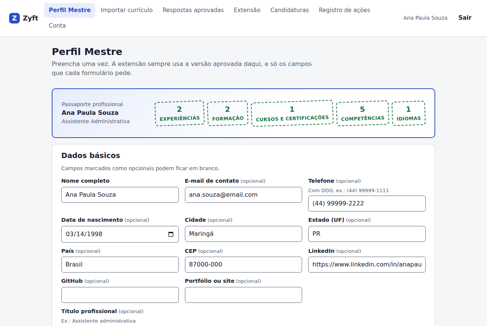
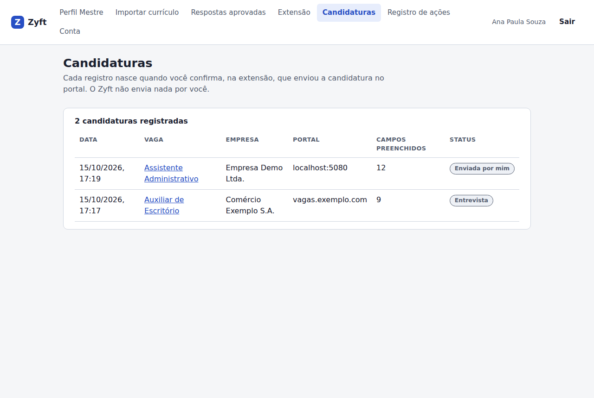

<!-- pdf:ignorar-inicio -->
# Zyft — Entrega 3: Desenvolvimento e Validação

**Assistente de Candidatura a Vagas** · Disciplinas: Tópicos Especiais em Engenharia de Software (.NET) e UX — Experiência do Usuário

**Integrantes:** Antonio Randolfo Barroso Neto, Guilherme Brogio Macedo da Silva, Lucas Ulisses Clementino De Arruda E Silva, Matheus Guilherme Moreira De Oliveira

**Data:** 25 de outubro de 2026 · **Versão:** 1.0

O PDF desta entrega é gerado a partir deste arquivo por `ferramentas/entregas/gerar_entrega3.py`. Os relatórios de trabalho que deram origem a este documento estão em [entrega-3-relatorio-backend.md](entrega-3-relatorio-backend.md) e [entrega-3-frontend.md](entrega-3-frontend.md).

## Sumário

- [Apresentação](#apresentação)
- [1. Descrição da solução](#1-descrição-da-solução)
- [2. Tecnologias utilizadas](#2-tecnologias-utilizadas)
- [3. Estrutura do projeto](#3-estrutura-do-projeto)
- [4. Configuração do ambiente](#4-configuração-do-ambiente)
- [5. Como executar o projeto](#5-como-executar-o-projeto)
- [6. Informações para utilização](#6-informações-para-utilização)
- [7. Endpoints da API](#7-endpoints-da-api)
- [8. Banco de dados](#8-banco-de-dados)
- [9. Autenticação e autorização](#9-autenticação-e-autorização)
- [10. Validação: casos de teste e resultados](#10-validação-casos-de-teste-e-resultados)
- [11. Evidências](#11-evidências)
- [12. Falhas encontradas e correções](#12-falhas-encontradas-e-correções)
- [13. Controle de versão](#13-controle-de-versão)
- [14. Pendências e limitações conhecidas](#14-pendências-e-limitações-conhecidas)
- [Apêndice A. Lista completa dos casos de teste automatizados](#apêndice-a-lista-completa-dos-casos-de-teste-automatizados)
<!-- pdf:ignorar-fim -->

## Apresentação

A Entrega 1 definiu o problema, as personas e a solução: o **Zyft — Candidatura Assistida (MVP 1)**. A Entrega 2 transformou a solução em projeto técnico (arquitetura, banco de dados, contrato da API, autenticação, frontend e plano de testes). Esta entrega mostra o **sistema implementado e validado**:

- uma **API em C# com .NET 8**, em Clean Architecture, com PostgreSQL (ou SQLite em desenvolvimento);
- uma **plataforma web** servida pela própria API;
- uma **extensão Manifest V3** para Chrome e Edge;
- um **portal de vagas de demonstração** para testar a extensão sem usar sites reais;
- **157 testes automatizados** (unidade, integração e aceitação), todos passando, mais testes de ponta a ponta com Playwright.

O documento segue os itens pedidos no enunciado: descrição, tecnologias, estrutura, configuração, execução, utilização, endpoints, banco de dados, autenticação, testes, evidências, bugs corrigidos e controle de versão. Para não repetir a Entrega 2, a modelagem completa (dicionário de dados, fichas de endpoint e matriz de acesso) fica referenciada por seção.

<!-- pdf:quebra -->

## 1. Descrição da solução

O Zyft ajuda quem se candidata a vagas pela internet a não digitar os mesmos dados em cada portal, **sem tirar da pessoa o controle de cada decisão**. O fluxo tem três momentos:

1. **Preparar (plataforma web).** A pessoa cria a conta, escolhe os consentimentos e monta o **Perfil Profissional Mestre**, à mão ou importando um currículo PDF ou DOCX. Na importação, cada item proposto é revisado e só entra no perfil o que ela aceitar.
2. **Usar (extensão).** No portal de vagas, com login feito por ela, a pessoa abre o painel lateral do Zyft. A extensão lê os campos visíveis do formulário, a API devolve o de-para com o perfil e o painel mostra cada campo com o estado (pronto, escolha, falta no perfil, divergente, ação sua). Só o que a pessoa marcar é preenchido.
3. **Concluir (pessoa).** A pessoa confere e envia a candidatura no portal. Depois, se quiser, registra no painel que concluiu; o registro aparece em **Candidaturas** na plataforma.

As regras inegociáveis do produto estão no código e cobertas por testes (seção 10):

| Regra | Como está implementada |
|---|---|
| Nunca enviar (RN-01) | O content script não chama `submit()` nem `requestSubmit()` e não clica em botões; o observador de `submit` só avisa o painel. |
| IA só com fatos (RN-02, RN-03) | A IA só devolve a **chave** do perfil; o valor vem do perfil. Chave inexistente é descartada. Texto livre usa só fatos do perfil e chega desmarcado. |
| Sem senhas e sem atalhos (RNF-01) | Campos `password`, CAPTCHA, anexo e declarações são classificados como **bloqueados** antes de qualquer chamada à IA e nunca recebem valor. |
| Sensíveis bloqueados (RN-04) | Tabela separada, cifrada com AES-256-GCM, fora da IA. Sem consentimento: bloqueado. Com consentimento: valor vem **desmarcado**. |
| Sem dados pessoais em logs (RNF-09) | Serilog registra só método, caminho sem query, status e duração. Há teste que procura e-mail, senha, nome, telefone e token nos logs. |
| Sem promessas (RN-06) | A análise de vaga devolve requisitos com status e evidência (linha real do perfil), **sem nota nem porcentagem**. |

A IA (Ollama com `qwen2.5:7b`) é opcional: sem ela, as regras determinísticas continuam funcionando e a API responde `Degraded` em `/health` (RNF-12).

## 2. Tecnologias utilizadas

| Área | Tecnologia | Versão | Uso |
|---|---|---|---|
| Linguagem e runtime | C# 12, .NET SDK | 8.0.4xx (`global.json`) | API e testes |
| Web API | ASP.NET Core | 8 | Controllers, middleware, rate limiting, CORS, arquivos estáticos |
| CQRS e validação | MediatR, FluentValidation | 12.4.1, 11.11.0 | Casos de uso e validação de entrada (com *pipeline behaviors*) |
| ORM | Entity Framework Core | 8.0.11 | Mapeamento Fluent API e Migrations |
| Banco de dados | PostgreSQL (Npgsql), SQLite | 16, 8.0.11 | Produção e Docker; desenvolvimento e testes |
| Autenticação | JwtBearer, BCrypt.Net-Next | 8.0.11, 4.0.3 | JWT HS256 e hash de senha |
| Criptografia | `System.Security.Cryptography.AesGcm` | .NET 8 | Dados sensíveis |
| Leitura de currículo | PdfPig, DocumentFormat.OpenXml | 0.1.9, 3.2.0 | Texto de PDF e DOCX, em memória |
| Documentação da API | Swashbuckle (Swagger/OpenAPI) | 6.9.0 | `/swagger`, com comentários XML |
| Logs | Serilog.AspNetCore | 8.0.3 | Logs estruturados sem dados pessoais |
| IA | Ollama, modelo `qwen2.5:7b` | atual | De-para, texto livre, análise de vaga, importação |
| Frontend web | HTML, CSS, JavaScript (ES modules) | — | Sem etapa de build, servido pela API |
| Extensão | Chrome Extensions Manifest V3 | — | Painel lateral, service worker, content script |
| Testes | xUnit, FluentAssertions, Moq | 2.9.2, 6.12.2, 4.20.72 | Unidade e integração |
| Testes de aceitação | Reqnroll (Gherkin em pt) | 2.2.1 | Regras inegociáveis em linguagem de negócio |
| Testes de API | `Microsoft.AspNetCore.Mvc.Testing` | 8.0.11 | API real em memória (`WebApplicationFactory`) |
| Testes de interface | Playwright + Chromium | — | Ponta a ponta da plataforma web e capturas |
| Contêineres | Docker, Docker Compose | — | API + PostgreSQL (+ Ollama opcional) |
| Integração contínua | GitHub Actions | — | Build, testes, migrations em dia e imagem Docker |

As versões dos pacotes NuGet ficam centralizadas em `Directory.Packages.props`.

## 3. Estrutura do projeto

```
ZIFY/
  Zyft.sln  global.json  Directory.Build.props  Directory.Packages.props
  docker-compose.yml  .dockerignore  .editorconfig  .gitignore
  .config/dotnet-tools.json            dotnet-ef 8.0.11 (ferramenta local)
  .github/workflows/ci.yml             build, testes, migrations e imagem Docker
  src/
    Zyft.Domain/                       entidades e regras puras (nenhum pacote)
    Zyft.Application/                  casos de uso (CQRS), portas, de-para, análise de vaga, redação
    Zyft.Infrastructure/               EF Core, repositórios, JWT, BCrypt, AES-GCM, Ollama, leitura de PDF/DOCX
    Zyft.Api/                          13 controllers finos (mais uma classe base), middleware de erros, Program.cs, Dockerfile
  tests/
    Zyft.UnitTests/                    domínio, FieldMapper, JobAnalyzer, AnswerWriter, handlers, segurança
    Zyft.IntegrationTests/             HTTP real com SQLite em memória
    Zyft.AcceptanceTests/              Reqnroll: Features/RegrasInegociaveis.feature
  web/                                 plataforma web (servida em /)
    js/  js/views/  styles.css  index.html
    demo/                              portal de vagas de demonstração (servido em /demo/)
  extension/                           extensão MV3 (manifest, background, content, sidepanel)
  docs/                                produto, arquitetura, ADRs, qualidade, entregas
  ferramentas/                         scripts da pesquisa e geradores dos PDFs das entregas
```

As dependências apontam para dentro: `Api → Application/Infrastructure`, `Infrastructure → Application → Domain`. O domínio não referencia pacotes e a aplicação não referencia o EF Core (usa as portas `IRepository<T>`, `IProfileRepository` e `IUnitOfWork`). O detalhamento das camadas está na Entrega 2, seções 1.3 a 1.6.

## 4. Configuração do ambiente

### 4.1 Pré-requisitos

| Item | Versão | Obrigatório? |
|---|---|---|
| .NET SDK | 8.0.400 ou mais novo da linha 8 | Sim (execução sem Docker e testes) |
| Docker e Docker Compose | Atual | Só para rodar com PostgreSQL |
| Chrome ou Edge | Atual | Para a extensão |
| Ollama + `qwen2.5:7b` | Atual (~4,7 GB) | Não. Sem IA, as regras continuam funcionando. |

Se o .NET foi instalado na pasta do usuário: `export PATH=$HOME/.dotnet:$PATH DOTNET_ROOT=$HOME/.dotnet`.

### 4.2 Configurações da API

As configurações ficam em `src/Zyft.Api/appsettings.json` e podem ser trocadas por variável de ambiente (`Secao__Chave`).

| Chave | Padrão | Uso |
|---|---|---|
| `Database:Provider` | `Postgres` (`Sqlite` em Development) | Banco usado |
| `ConnectionStrings:Default` | PostgreSQL local; `Data Source=zyft-dev.db` em Development | Conexão |
| `Jwt:Secret` | vazio (definido em Development) | Segredo HS256, 32+ caracteres. A API não sobe sem ele. |
| `Jwt:AccessTokenMinutes`, `Jwt:RefreshTokenDays` | 15, 7 | Validade dos tokens |
| `Encryption:Key` | vazio (definido em Development) | Chave AES de 32 bytes em Base64. Tamanho errado derruba a subida. |
| `Llm:Provider`, `Llm:BaseUrl`, `Llm:Model` | `Ollama`, `http://localhost:11434`, `qwen2.5:7b` | IA. `None` desliga. |
| `Cors:AllowedOrigins`, `Cors:ExtensionIds` | `http://localhost:5080`, vazio | Origens aceitas. Em Production, `ExtensionIds` é obrigatório. |
| `RateLimiting:AuthPermitLimit`, `RateLimiting:AiPermitPerMinute` | 10, 60 | Limites por IP (login) e por pessoa (IA) |
| `Seed:DemoUser` | `true` só em Development | Cria o usuário de demonstração |

No Docker, os segredos vêm de um arquivo `.env` (fora do Git): `ZYFT_JWT_SECRET`, `ZYFT_ENCRYPTION_KEY`, `ZYFT_DB_PASSWORD`, `ZYFT_LLM_PROVIDER` e `ZYFT_LLM_URL`. Os valores padrão do `docker-compose.yml` servem só para demonstração local.

## 5. Como executar o projeto

Há duas formas de rodar a API: localmente com SQLite, que é a mais rápida e já traz o usuário de demonstração, ou em Docker com PostgreSQL, que é o ambiente mais próximo de produção.

### 5.1 Desenvolvimento com SQLite (sem Docker)

```bash
cd ZIFY
dotnet build
dotnet run --project src/Zyft.Api        # http://localhost:5080
```

| Endereço | O que é |
|---|---|
| `http://localhost:5080/` | Plataforma web |
| `http://localhost:5080/swagger` | Swagger (botão **Authorize**: cole só o `accessToken`) |
| `http://localhost:5080/demo/` | Portal de vagas de demonstração |
| `http://localhost:5080/health` | Saúde do banco e da IA |

O banco SQLite (`src/Zyft.Api/zyft-dev.db`) é criado na primeira subida, já com o usuário de demonstração. Para começar do zero, pare a API e apague esse arquivo.

### 5.2 Docker com PostgreSQL 16

```bash
docker compose up -d --build                  # API + PostgreSQL; a migration é aplicada na subida
docker compose --profile ai up -d --build     # + Ollama no contêiner
docker compose exec ollama ollama pull qwen2.5:7b
docker compose down -v                        # para e apaga o volume
```

A API sobe em `http://localhost:5080`, em ambiente `Staging` e com usuário não-root no contêiner. Nesse modo não há usuário de demonstração: crie uma conta em **Criar conta**.

### 5.3 Testes

```bash
dotnet test                         # 157 testes: unidade, integração e aceitação
dotnet test tests/Zyft.UnitTests    # só unidade
```

Os testes de integração e aceitação sobem a API real em memória com SQLite e IA desligada ou simulada. Não precisam de Docker nem de Ollama.

### 5.4 Extensão (modo desenvolvedor)

1. Suba a API (5.1 ou 5.2).
2. Abra `chrome://extensions` (ou `edge://extensions`) e ligue o **Modo do desenvolvedor**.
3. Clique em **Carregar sem compactação** e escolha a pasta `extension/` do repositório.
4. Fixe o ícone do Zyft e clique nele para abrir o painel lateral.
5. Na plataforma web, vá em **Extensão → Gerar código de pareamento** e digite o código de 6 dígitos no painel (vale 10 minutos e uma única vez).
6. Se a API estiver em outro endereço, troque em **Ajustes** (engrenagem) no painel.

## 6. Informações para utilização

### 6.1 Usuário de demonstração

| Campo | Valor |
|---|---|
| E-mail | `demo@zyft.local` |
| Senha | `Zyft@2026` |
| Disponível em | Execução local com SQLite (ambiente Development) |
| Conteúdo | Perfil fictício "Ana Paula Souza" (2 experiências, 2 formações, 1 curso, 5 competências, 1 idioma) e uma resposta aprovada |

### 6.2 Roteiro sugerido

1. Entre com o usuário de demonstração em `http://localhost:5080/`.
2. Em **Perfil Mestre**, confira o passaporte com os itens aprovados e edite um dado básico.
3. Em **Importar currículo**, envie um PDF ou DOCX e revise a proposta campo a campo.
4. Em **Extensão**, gere o código de pareamento e pareie a extensão.
5. Abra o portal demo em `http://localhost:5080/demo/`:
   - `vaga.html`: no painel, **Analisar vaga** (requisitos com evidência do perfil, sem porcentagem);
   - `curriculo.html` e `curriculo.html?preenchido=1`: **Ler formulário**, revisar, preencher e ver a divergência com valores já preenchidos;
   - `candidatura.html`: pergunta aberta, dado sensível, termos, anexo e CAPTCHA aparecem como **Ação sua**. O formulário **não** é enviado pela extensão.
6. No painel, clique em **Concluí a candidatura** e veja o registro em **Candidaturas** e em **Registro de ações**.
7. Em **Conta**, exporte os dados em JSON. A exclusão da conta pede que se digite `EXCLUIR`.

Não use portais reais com contas falsas. Para demonstrar em um portal real, a pessoa testadora faz login na própria conta e o fluxo para antes de salvar ou enviar.

## 7. Endpoints da API

A API expõe **61 operações**, todas sob `/api/v1`, exceto `/health`. Erros seguem o padrão ProblemDetails em pt-BR (`type`, `title`, `status`, `detail`, `instance`, `traceId` e `code`). A política de acesso de cada grupo está na seção 9. Corpos, respostas e códigos de erro por endpoint estão na Entrega 2, seção 3.3, e no Swagger.

<!-- pdf:larguras 0.15,0.37,0.48 -->
| Método | Rota | Descrição |
|---|---|---|
| `POST` | `/auth/register` | Cria a conta e devolve os tokens. |
| `POST` | `/auth/login` | Login com e-mail e senha (limitado por IP). |
| `POST` | `/auth/refresh` | Troca o refresh token por um novo par (rotação). |
| `POST` | `/auth/logout` | Revoga o refresh token. |
| `GET` | `/me` | Dados da conta (web ou extensão). |
| `DELETE` | `/me` | Exclui a conta e tudo o que depende dela. |
| `GET` | `/me/export` | Exporta todos os dados em JSON (só web). |
| `GET` | `/consents` | Lista as finalidades e se estão concedidas. |
| `PUT` | `/consents/{purpose}` | Liga ou desliga uma finalidade. |
| `GET` | `/profile` | Perfil completo. |
| `PUT` | `/profile` | Atualiza os dados básicos. |
| `GET` | `/profile/missing` | Perguntas sobre o que falta no perfil (RF-05). |
| `GET`, `POST` | `/profile/experiences` | Lista e adiciona experiências. |
| `PUT`, `DELETE` | `/profile/experiences/{id}` | Edita e remove experiência. |
| `GET`, `POST` | `/profile/educations` | Lista e adiciona formação. |
| `PUT`, `DELETE` | `/profile/educations/{id}` | Edita e remove formação. |
| `GET`, `POST` | `/profile/courses` | Lista e adiciona cursos e certificações. |
| `PUT`, `DELETE` | `/profile/courses/{id}` | Edita e remove curso. |
| `GET`, `POST` | `/profile/skills` | Lista e adiciona competências. |
| `PUT`, `DELETE` | `/profile/skills/{id}` | Edita e remove competência. |
| `GET`, `POST` | `/profile/languages` | Lista e adiciona idiomas. |
| `PUT`, `DELETE` | `/profile/languages/{id}` | Edita e remove idioma. |
| `POST` | `/resume-imports` | Envia currículo PDF/DOCX (até 10 MB) e recebe a proposta. |
| `GET` | `/resume-imports/{id}` | Consulta a importação. |
| `POST` | `/resume-imports/{id}/apply` | Aplica só os itens aceitos ou editados. |
| `POST` | `/resume-imports/{id}/discard` | Descarta a proposta. |
| `GET`, `POST` | `/answers` | Lista e aprova respostas para perguntas abertas. |
| `GET`, `PUT`, `DELETE` | `/answers/{id}` | Detalhe, edição e exclusão. |
| `GET`, `POST` | `/sensitive-data` | Lista e cadastra dados sensíveis. |
| `PUT`, `DELETE` | `/sensitive-data/{id}` | Altera e exclui dado sensível. |
| `POST` | `/extension/pairing-codes` | Gera o código de pareamento (só web). |
| `POST` | `/extension/pair` | A extensão troca o código por tokens `scope=extension`. |
| `GET` | `/extension/devices` | Lista extensões pareadas. |
| `DELETE` | `/extension/devices/{id}` | Revoga uma extensão na hora. |
| `GET`, `POST` | `/authorized-sites` | Lista e autoriza origens. |
| `DELETE` | `/authorized-sites/{id}` | Remove a autorização (só web). |
| `POST` | `/forms/mappings` | De-para campo → Perfil Mestre (RF-12). |
| `POST` | `/forms/open-answers` | Sugestão de texto com fatos do perfil (RF-15). |
| `POST` | `/forms/completions` | Registra que a pessoa concluiu a candidatura (RF-19). |
| `POST` | `/jobs/analyze` | Requisitos da vaga com evidência do perfil, sem porcentagem. |
| `GET` | `/applications` | Lista as candidaturas. |
| `GET`, `PATCH`, `DELETE` | `/applications/{id}` | Detalhe, status e notas, exclusão. |
| `GET` | `/audit-events` | Registro de ações (sem valores de campos). |
| `GET` | `/health` | Saúde do banco e da IA (fora do Swagger). |

Exemplo real de `POST /forms/mappings` (execução local, 8 campos):

<!-- pdf:larguras 0.42,0.58 -->
| Campo da página | Resultado |
|---|---|
| Nome completo | `Ready`, `Rule`, `personal.fullName`, valor do perfil, marcado |
| E-mail | `Ready`, `Rule`, `personal.email` |
| Senha (`type=password`) | `Blocked`, sem valor: "o Zyft nunca lê nem preenche senhas" |
| Modalidade (select) | `Ready`, opção existente na página ("Híbrido") |
| Gênero (select) | `Blocked`, sem valor (sem consentimento de sensíveis) |
| Empresa (`exp[0][empresa]`) | `Ready`, `experiences[0].company` |
| Currículo (`type=file`) | `Blocked`: "Anexe o arquivo manualmente." |
| "Declaro que as informações são verdadeiras" | `Blocked`, desmarcado |

## 8. Banco de dados

O modelo é relacional, com **17 tabelas de domínio** (18 com a tabela de histórico de migrations do EF Core). A modelagem completa (diagrama ER, dicionário de dados, enumerações e regras de integridade) está na Entrega 2, seção 2. A implementação seguiu essa modelagem, com as diferenças listadas abaixo.

| Aspecto | Implementação |
|---|---|
| Tabelas | `Users`, `RefreshTokens`, `Consents`, `Profiles`, `Experiences`, `Educations`, `Courses`, `Skills`, `Languages`, `ApprovedAnswers`, `SensitiveData`, `ResumeImports`, `ExtensionDevices`, `PairingCodes`, `AuthorizedSites`, `Applications`, `AuditEvents` |
| Chaves | `Guid` gerado na aplicação; `CreatedAt` e `UpdatedAt` em UTC, preenchidos no `SaveChangesAsync` |
| Integridade | FKs com `ON DELETE CASCADE` a partir de `Users` (exclusão de conta, RF-08); *check constraints* de período em `Experiences` e `Educations` |
| Índices únicos | `Users.Email`, `RefreshTokens.TokenHash`, `Consents(UserId, Purpose)`, `Profiles.UserId`, `Skills(ProfileId, Name)`, `Languages(ProfileId, Name)`, `SensitiveData(UserId, Kind)`, `AuthorizedSites(UserId, Origin)` |
| Enums | Gravados como texto (`Undergraduate`, `InProgress`) |
| Migrations | `InitialCreate` para PostgreSQL, aplicada com `Database.Migrate()` na subida. O CI confere se o modelo e a migration estão em dia. |
| SQLite | Usa `EnsureCreated()`: as migrations são do PostgreSQL (`uuid`, `timestamp with time zone`) e manter um segundo conjunto só para desenvolvimento dobraria a manutenção. |

| Diferença em relação à Entrega 2 | Motivo |
|---|---|
| Entidade `JobApplication` (tabela `Applications`) | `Application` colide com o namespace `Zyft.Application`. |
| Cursos e certificações numa entidade `Course` com `Type` | Mesmos campos; o de-para separa `courses[i]` e `certifications[i]`. |
| `Users.DeletedAt` mantido sem uso | A exclusão é física, em cascata. Decisão pendente (D-05). |

## 9. Autenticação e autorização

O desenho completo está na Entrega 2, seção 4. O que foi implementado:

| Item | Implementação |
|---|---|
| Senha | BCrypt (fator 11). Mínimo de 8 caracteres, com letra e número. |
| Login | Mesmo tempo de resposta com e-mail inexistente (hash descartável): não revela se o e-mail existe. Limite de 10 tentativas por minuto por IP (429 com `Retry-After`). |
| Access token | JWT HS256 de 15 minutos com `sub`, `email`, `scope` (`web` ou `extension`) e `device_id`. |
| Refresh token | Opaco, 48 bytes aleatórios, 7 dias. No banco fica só o SHA-256. **Rotação** a cada uso; se um token já trocado for reapresentado, **toda a cadeia é revogada**. |
| Pareamento da extensão | Código de 6 dígitos, 10 minutos, uso único. A extensão recebe tokens com `scope=extension`. Revogar o dispositivo derruba o access e o refresh na hora. |
| Policies | `WebUser` (scope `web`) e `ExtensionOrWeb`. Só web: conta, exportação, consentimentos, perfil completo, importação, sensíveis, dispositivos, edição de candidaturas e respostas, auditoria. Web ou extensão: `GET /me`, `/forms/*`, `/jobs/analyze`, `GET /applications`, `GET` e `POST /authorized-sites`, `POST /answers`. |
| Consentimentos | Três finalidades (`AiText`, `JobAnalysis`, `SensitiveData`) nascem **desligadas**. A tela de boas-vindas permite ligar as duas primeiras. O bloqueio é na API (403 com `code: consent_required`), não só na interface. |
| Isolamento | Recurso de outra pessoa responde 404 (não revela que existe). |
| Rate limiting de IA | 60 chamadas por minuto **por pessoa** em `/forms/*`, `/jobs/analyze` e `POST /resume-imports`. |
| Tokens no cliente | Web: access token em memória e refresh em `sessionStorage`. Extensão: só o service worker guarda tokens (`chrome.storage.session` e `chrome.storage.local`). |
| CORS e CSP | Origens configuradas e `chrome-extension://` (restrito por ID em Production). CSP `script-src 'self'` na web e na extensão. |

<!-- pdf:quebra -->

## 10. Validação: casos de teste e resultados

### 10.1 Estratégia

| Nível | Ferramenta | O que cobre | Casos |
|---|---|---|---|
| Unidade | xUnit, FluentAssertions, Moq | Regras do domínio, de-para (`FieldMapper`), análise de vaga, redação, handlers, validators, JWT, BCrypt, AES-GCM | 90 |
| Integração | `WebApplicationFactory` + SQLite em memória | HTTP real: autenticação, autorização, erros, regras de confiança, importação, rate limiting, CORS, logs, Swagger | 55 |
| Aceitação | Reqnroll (Gherkin em português) | As regras inegociáveis escritas como cenários de negócio | 12 |
| Ponta a ponta (web) | Playwright + Chromium | Fluxos da plataforma no navegador | 2 roteiros |
| Manual / exploratório | curl, Swagger, Ollama real, portal demo | Fluxo completo com PostgreSQL e com a IA real | 3 roteiros |

A lista completa dos casos automatizados está no Apêndice A.

### 10.2 Regras inegociáveis e onde são testadas

| Regra | Unidade | Integração | Aceitação |
|---|---|---|---|
| Senha, CAPTCHA, anexo e declaração nunca recebem valor | Sim | Sim | Sim |
| IA só aponta a chave; valor escrito pela IA é ignorado | Sim | Sim (IA maliciosa) | Sim |
| Chave inventada pela IA é descartada | Sim | — | — |
| Sensível bloqueado sem consentimento e desmarcado com consentimento | Sim | Sim | Sim |
| Prompt da IA sem dado sensível | Sim | — | — |
| Análise de vaga sem consentimento → 403 | Sim (Moq) | Sim | Sim |
| Evidência inventada vira `nao_encontrado`; sem nota nem porcentagem | Sim | Sim | Sim |
| Refresh reutilizado revoga a cadeia | Sim | Sim | — |
| Token de extensão não acessa exportação | — | Sim | Sim |
| Logs sem dados pessoais | — | Sim | — |

### 10.3 Resultados da execução automatizada

Execução de 15/10/2026, `dotnet test` em Debug (também compilado em Release, sem avisos):

| Projeto | Total | Passaram | Falharam | Ignorados |
|---|---|---|---|---|
| Zyft.UnitTests | 90 | 90 | 0 | 0 |
| Zyft.IntegrationTests | 55 | 55 | 0 | 0 |
| Zyft.AcceptanceTests | 12 | 12 | 0 | 0 |
| **Total** | **157** | **157** | **0** | **0** |

Teorias (`[Theory]`) e esquemas de cenário contam uma execução por exemplo. Os três casos a mais em relação ao relatório do backend (154) são o teste de regressão do bug 9 (seção 12).

### 10.4 Testes de ponta a ponta e manuais

| Roteiro | Ambiente | Passos | Resultado |
|---|---|---|---|
| E2E da plataforma (Playwright) | Mock da API com o contrato da entrega | Redirecionamento ao login; validação e conclusão do cadastro; consentimentos; Perfil Mestre (enum, fim antes do início bloqueado, nova experiência, salvar); importação (`.txt` recusado, revisão, "aceitar tudo que não conflita" sem aceitar conflito nem duplicado, aplicar); resposta aprovada; pareamento; site autorizado (origem com caminho recusada); status da candidatura; registro de ações; exclusão bloqueada até digitar `EXCLUIR` | Todos os passos passaram, sem erros de console |
| Fumaça da web contra a API real (Playwright) | Docker com PostgreSQL | Cadastro → boas-vindas (liga IA e Análise de vaga) → salvar perfil → registro de conclusão → candidatura listada | Passou, sem respostas 4xx/5xx; conferido por API |
| Fluxo da API via curl | `dotnet run` (SQLite) e `docker compose` (PostgreSQL) | register → login → perfil → experiência → `/forms/mappings` → `/forms/completions` → candidaturas → auditoria | Passou; auditoria sem valores e sem caminho ou query da URL |
| IA real (Ollama `qwen2.5:7b`) | Docker | De-para com campo que a regra não reconhece; análise de vaga; texto livre; importação de DOCX | Passou (tabela abaixo) |
| Capturas de evidência (Playwright) | `dotnet run`, usuário demo | Swagger, login, Perfil Mestre, candidaturas, portal demo | Passou após corrigir os bugs 9 e 10 |

| Chamada com IA real | Tempo | Observação |
|---|---|---|
| `POST /forms/mappings` ("Nome da última organização em que atuou") | 43 s (modelo carregando) | A IA apontou `experiences[0].company` e o valor veio do perfil (`source: Ai`). |
| `POST /jobs/analyze` (4 requisitos) | 9,9 s | "Experiência com ERP" → `atende` com a linha real do perfil; "Inglês fluente" → `nao_encontrado`. Sem porcentagem. |
| `POST /forms/open-answers` (até 300 caracteres) | 2,9 s | Texto em 1ª pessoa com 2 fatos usados, ambos existentes no perfil; `selected: false`. |
| `POST /resume-imports` (DOCX) | 8,5 s | Proposta com contatos, 2 experiências, formação, curso e idioma. "Estado civil" do currículo **não** foi extraído. |

## 11. Evidências

### 11.1 Saída do `dotnet test`

Execução feita para este documento, com o comando `dotnet test` na raiz do repositório (saída resumida):

```
$ export PATH=$HOME/.dotnet:$PATH DOTNET_ROOT=$HOME/.dotnet; dotnet test
  (saída de build e do VSTest omitida)
Passed!  - Failed: 0, Passed: 90, Skipped: 0, Total: 90, Duration: 1 s - Zyft.UnitTests.dll (net8.0)
Passed!  - Failed: 0, Passed: 55, Skipped: 0, Total: 55, Duration: 3 s - Zyft.IntegrationTests.dll (net8.0)
Passed!  - Failed: 0, Passed: 12, Skipped: 0, Total: 12, Duration: 5 s - Zyft.AcceptanceTests.dll (net8.0)
```

Saúde da API na mesma sessão (`GET /health`, com o Ollama local disponível):

```
{"status":"Healthy","checks":[{"name":"database","status":"Healthy"},
 {"name":"llm","status":"Healthy","description":"IA local disponível."}]}
```

### 11.2 Capturas de tela

Capturas feitas com Playwright (Chromium headless, 1280 × 860) contra `dotnet run --project src/Zyft.Api`, com o usuário de demonstração.







## 12. Falhas encontradas e correções

### 12.1 Principais bugs

| # | Bug | Como apareceu | Correção |
|---|---|---|---|
| 1 | `DisplayNames.TryParse` usava `Contains`: "Superior **incompleto**" casava com "completo" e virava `Completed`; o sinônimo "pos" casava com "**pos**suo". | Revisão do código | Lista ordenada ("incomplet" antes de "complet") e "pos" removido. Teste `Rotulos_pt_BR_viram_enum`. |
| 2 | Chave AES de desenvolvimento com **31 bytes**: a primeira operação com dado sensível derrubaria a API. | Conferência da configuração | Chave de 32 bytes, e o construtor do protetor valida o tamanho na subida. Teste `Chave_AES_com_tamanho_errado_falha_cedo`. |
| 3 | ProblemDetails e `/health` saíam com acentos escapados (`Não autenticado`). | Leitura da saída do curl | `JavaScriptEncoder.UnsafeRelaxedJsonEscaping` nos dois pontos. |
| 4 | **Ordem dos middlewares**: o log do Serilog ficava dentro do middleware de exceções, e um login errado (401 correto) era registrado como **500** com stack trace. | Teste `Logs_nao_contem_dados_pessoais` | `UseSerilogRequestLogging` antes do `ExceptionHandlingMiddleware`. |
| 5 | **Serilog com logger estático**: com várias `WebApplicationFactory` em paralelo, os logs de um host iam para o sink de outro. O teste de logs passava isolado e falhava na suíte completa. | Teste intermitente | `UseSerilog(..., preserveStaticLogger: true)` e logger da requisição vindo da injeção de dependência. |
| 6 | Contrato da importação: a proposta saía como `personal` e `skills: string[]`, mas a web espera `profile` e itens no formato das entidades. | Revisão do contrato com o frontend | `ResumeProposal.Profile`, `ProposalSkill` e enums como nome. Teste de integração do DOCX cobre o formato. |
| 7 | O painel da extensão chama `POST /authorized-sites`, mas a rota exigia token web: 403 para a extensão (D-02). | Revisão cruzada da Entrega 2 | Rota aberta para `ExtensionOrWeb`; a remoção continua só web. Teste `Extensao_pode_autorizar_site_mas_nao_remover`. |
| 8 | O painel enviava `maxLength: 0` para "sem limite" e a API devolvia 400 (D-03). | Revisão cruzada da Entrega 2 | A API aceita `0` ou `null` como sem limite e recusa negativos; a extensão envia `null`. Teste `MaxLength_negativo_ou_fora_da_faixa_e_400`. |
| 9 | **Registro de candidatura no portal demo falhava com 422 "Informe o portal."** O painel envia o host da aba (`localhost:5080`), e `Uri.TryCreate` lê esse texto como uma URL de esquema `localhost` e host vazio. | Coleta de evidências desta entrega (chamada a `/forms/completions`) | `TextTools.HostOf` só aceita URLs `http`/`https` com host; texto que não é URL é guardado como veio. Teste `Conclusao_aceita_o_host_que_o_painel_envia` (3 exemplos). |
| 10 | **Menu da plataforma aparecia na tela de login** para quem não estava logado. A regra `.topbar { display: flex }` vencia o atributo `hidden`. | Captura de tela da tela de login | Regra global `[hidden] { display: none !important; }` em `web/styles.css`. Conferido em nova captura (Figura 2). |

### 12.2 Outras falhas (ambiente e scripts de teste)

| # | Falha | Correção |
|---|---|---|
| 11 | Uma execução anterior deixou a porta 5080 ocupada ("address already in use"). | Encerrar o processo antigo. A porta é fixa porque é o padrão da extensão. |
| 12 | O script curl passava o header `Authorization` sem aspas e todas as rotas protegidas davam 401. | Header em *array* do bash. A API estava certa: o 401 veio em ProblemDetails. |
| 13 | O sink de teste do Serilog renderizava propriedades entre aspas e a asserção não achava a linha. | Formatter `{Message:lj}` no sink de teste. |
| 14 | A classe auxiliar de teste `Api` colidia com o namespace `Zyft.Api` (CS0234). | Renomeada para `TestApi`. |
| 15 | No Playwright, `wait_for_url` não dispara em navegação por *hash* e `wait_for_function` foi bloqueado pela CSP da web (o que confirma que a CSP está ativa). | Esperas por seletor e seletores por `name`. A aplicação não mudou. |

Cuidados tomados de antemão: a moeda em pt-BR usa espaço não separável (`R$ 2.500,00`), por isso o teste compara com `\s`; a imagem Docker usa Debian (com ICU), não Alpine, para a cultura `pt-BR` funcionar.

## 13. Controle de versão

| Item | Prática |
|---|---|
| Ferramenta | Git, com repositório remoto no GitHub |
| Repositório | `github.com/Ranchoneetoo26/ZIFY` |
| Fluxo | *Trunk-based*: `main` como tronco e branches curtas `tipo/descricao-curta` |
| Branch desta entrega | `feat/entregas-dotnet` |
| Mensagens | Conventional Commits em português, com escopo e IDs de requisito quando cabem, por exemplo `feat(api): implementa API .NET 8 em Clean Architecture (RF-01 a RF-20)` |
| Integração contínua | `.github/workflows/ci.yml` roda em push para `main`, `feat/**` e `fix/**` e em pull requests: build Release, as três suítes de teste com cobertura, conferência das migrations e subida da imagem Docker com PostgreSQL até `/health` responder |
| Revisão | Merge em `main` por pull request com revisão humana ([CONTRIBUTING.md](../../CONTRIBUTING.md)) |

Commits desta entrega na branch `feat/entregas-dotnet`:

| Commit | Mensagem |
|---|---|
| `5d59616` | `docs(adr): adiciona ADR-0017 backend em C#/.NET 8 com Clean Architecture` |
| `74a4102` | `feat(api): implementa API .NET 8 em Clean Architecture (RF-01 a RF-20)` |
| `7df67b4` | `test: adiciona testes unitários, de integração e de aceitação (Reqnroll)` |
| `f21e752` | `feat(web,extensao): plataforma web e extensão MV3 integradas à API .NET` |
| `8f61fa9` | `docs(entregas): documento da Entrega 2 e relatórios da Entrega 3` |

O histórico completo de commits está no repositório `github.com/Ranchoneetoo26/ZIFY`.

**Participação por integrante:** [participação por integrante]

## 14. Pendências e limitações conhecidas

| Item | Situação |
|---|---|
| D-05: `Users.DeletedAt` sem uso | Aberto. Decidir entre remover na próxima migration ou documentar o uso futuro. |
| D-08: verificação de e-mail e login com Google | Aberto, previsto para a Entrega 4. |
| Primeira chamada com IA | Leva cerca de 40 s enquanto o Ollama carrega o modelo; as seguintes levam segundos. |
| Importação sem IA | Traz só contatos, links, competências e idiomas. |
| Extensão | Ainda sem teste automatizado no navegador com a extensão carregada. As chamadas que ela faz foram validadas contra a API real por curl, Playwright e testes de integração com token `scope=extension`. Campos dentro de iframe ou shadow DOM não são lidos. |
| CI no GitHub | O workflow está pronto, mas só roda depois do push da branch. |
| Frontend | HTML, CSS e JavaScript sem build; a migração para React/Vite prevista na arquitetura fica para depois do MVP 1. |

<!-- pdf:quebra -->

## Apêndice A. Lista completa dos casos de teste automatizados

Gerada a partir dos arquivos `.trx` da execução de 15/10/2026. Casos com vários exemplos (`[Theory]` ou esquema de cenário) aparecem uma vez, com o número de exemplos.

<!-- pdf:larguras 0.14,0.23,0.49,0.14 -->
| Projeto | Classe | Casos de teste | Passaram |
|---|---|---|---|
| Unidade | AnswerWriterTests | Fatos que nao existem no perfil sao descartados e texto respeita limite<br>Prompt contem so fatos do perfil<br>Sem IA lanca indisponivel | 3/3 |
| Unidade | FieldMapperTests | Blocos repetidos sao alinhados pela organizacao<br>Campo numerico recebe so numero<br>Campos bloqueados sao classificados antes da IA e nem chegam ao prompt<br>Chave inventada pela IA e descartada<br>Datas sao adaptadas ao tipo do input (2 exemplos)<br>Declaracao e termos nunca marcados<br>Devolve exatamente um item por campo na ordem da pagina<br>IA fora do ar nao derruba o mapeamento<br>IA so aponta chave e o valor vem do perfil<br>Indices explicitos no name base 1 sao normalizados<br>Pergunta aberta reaproveita resposta aprovada sem marcar<br>PickOption casa por texto ou sim nao (3 exemplos)<br>Pretensao salarial em texto vem formatada em reais<br>Primeiro nome e sobrenome separados quando a pagina pede<br>Prompt da IA nao contem dados sensiveis<br>Regras PT EN mapeiam campos objetivos (9 exemplos)<br>Respeita maxLength do campo<br>Select escolhe opcao existente na pagina<br>Select sem opcao correspondente fica ambiguo e desmarcado<br>Senha captcha e arquivo nunca recebem valor (5 exemplos)<br>Sensivel com consentimento traz valor mas nunca marcado<br>Sensivel sem consentimento fica bloqueado sem valor<br>Valor diferente ja no portal fica divergente e mantem o do portal | 38/38 |
| Unidade | HandlerTests | Analise de vaga sem consentimento e bloqueada na API e nao chama a IA<br>Cadastro cria perfil e consentimentos com sensiveis desligado<br>Desligar consentimento de sensiveis apaga os dados sensiveis<br>Login com senha errada e 401 sem revelar se o email existe<br>Mapeamento recusa mais de 300 campos<br>Refresh token reutilizado revoga a cadeia inteira<br>Senha exige 8 caracteres com letra e numero (4 exemplos) | 10/10 |
| Unidade | InfrastructureTests | AES GCM cifra com nonce aleatorio e decifra<br>BCrypt verifica e nao quebra com hash invalido<br>Chave AES com tamanho errado falha cedo<br>Datas de curriculo sao interpretadas (5 exemplos)<br>Importacao sem IA extrai contatos competencias e idiomas sem sensiveis<br>JWT tem sub scope device e expira em 15 minutos<br>Rotulos pt BR viram enum (4 exemplos) | 14/14 |
| Unidade | JobAnalyzerTests | Atende sem linha real vira nao encontrado (3 exemplos)<br>Evidencia e a linha real do perfil apontada pela IA<br>Linhas do perfil incluem tempo total calculado<br>Resultado nao tem nota nem porcentagem<br>Sem IA usa heuristica e nunca inventa evidencia | 7/7 |
| Unidade | ProfileTests | Categoria de CNH sem possuir CNH viola regra<br>Competencia duplicada ignorando maiusculas viola regra<br>Curso com carga horaria zero viola regra<br>Experiencia atual nao pode ter termino<br>Experiencia com termino antes do inicio viola regra<br>Formacao com conclusao antes do inicio viola regra<br>Pretensao salarial negativa viola regra<br>Remover item inexistente devolve falso<br>Termino igual ao inicio e valido | 9/9 |
| Unidade | TokenAndCodeTests | Codigo de pareamento expira em 10 minutos e e de uso unico<br>Email do usuario e normalizado<br>Importacao so pode ser aplicada uma vez<br>Refresh token expirado ou revogado nao esta ativo<br>Site autorizado guarda so a origem (2 exemplos)<br>Site autorizado recusa origem invalida (3 exemplos) | 9/9 |
| Integração | AiGuardTests | IA que inventa linha de evidencia tem o atende rebaixado<br>IA que tenta escrever valor ou apontar senha nao consegue | 2/2 |
| Integração | AuthTests | Cadastro devolve 201 com tokens e scope web<br>Cadastro duplicado e 409 ProblemDetails pt BR<br>Cadastro invalido e 400 com errors por campo<br>JSON malformado e 400 pt BR<br>Login errado e 401 e rota protegida sem token e 401<br>Logout revoga o refresh token<br>Refresh rotaciona e reuso revoga a cadeia<br>Token adulterado e 401 | 8/8 |
| Integração | ExtensionAndAccountTests | Codigo de pareamento e de uso unico<br>Conclusao aceita o host que o painel envia (3 exemplos)<br>Conclusao cria candidatura e auditoria sem valores<br>Exportacao traz os dados e exclusao apaga tudo<br>Extensao pode autorizar site mas nao remover<br>Refresh de extensao mantem scope extension<br>Revogar extensao derruba access e refresh na hora<br>Token de extensao nao acessa exportacao nem perfil inteiro | 10/10 |
| Integração | PlatformTests | CORS aceita extensao e origem configurada (3 exemplos)<br>Erro 500 nao expoe stack trace<br>Frontend web e servido na raiz<br>Health responde com banco e IA<br>Logs nao contem dados pessoais<br>Swagger publica rotas e esquema Bearer | 8/8 |
| Integração | ProfileAndErrorsTests | CRUD de experiencia aceita mes AAAA MM<br>Campo obrigatorio ausente e 400 com mensagem pt BR<br>Data em formato invalido e 400<br>Missing lista so o que falta<br>Perfil e criado no cadastro e pode ser editado<br>Recurso de outra pessoa e 404<br>Regra de negocio violada e 422 com code<br>Respostas aprovadas CRUD<br>Rota inexistente da API e 404 ProblemDetails<br>Sites autorizados normalizam origem e recusam duplicata | 10/10 |
| Integração | RateLimitTests | Login acima do limite e 429 com Retry After<br>Rotas de IA tem limite por pessoa e nao por IP | 2/2 |
| Integração | ResumeImportTests | Arquivo acima de 10MB e recusado<br>Arquivo com extensao falsa ou formato errado e 400<br>DOCX vira proposta e apply aplica so o aceito<br>Descartar nao muda o perfil<br>PDF com texto vira proposta | 5/5 |
| Integração | TrustRulesTests | Analise de vaga com consentimento tem evidencia real e nenhuma porcentagem<br>Analise de vaga sem consentimento e 403<br>Consentimento desconhecido e 404<br>Conta nova nasce com todos os consentimentos desligados<br>Mappings devolvem so valores dos campos pedidos<br>Mappings nunca devolvem valor para senha captcha arquivo ou declaracao<br>MaxLength negativo ou fora da faixa e 400<br>Sensivel bloqueado sem consentimento e desmarcado com consentimento<br>Texto livre com IA fora devolve unknown sem valor<br>Texto livre sem consentimento e 403 | 10/10 |
| Aceitação | RegrasInegociaveisDoZyftFeature | A IA só aponta a chave; o valor escrito por ela é ignorado<br>Análise de vaga não aceita evidência inventada<br>Análise de vaga sem consentimento é recusada pela API<br>Campos que exigem ação humana nunca recebem valor (5 exemplos)<br>Dado sensível bloqueado sem consentimento<br>Dado sensível com consentimento vem desmarcado<br>Token da extensão não exporta os dados da conta<br>Valor objetivo vem do perfil por regra determinística | 12/12 |
