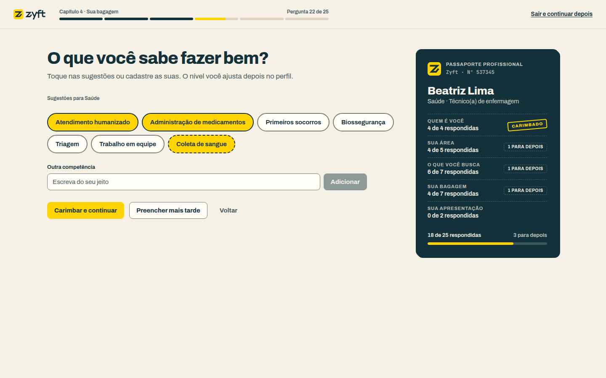
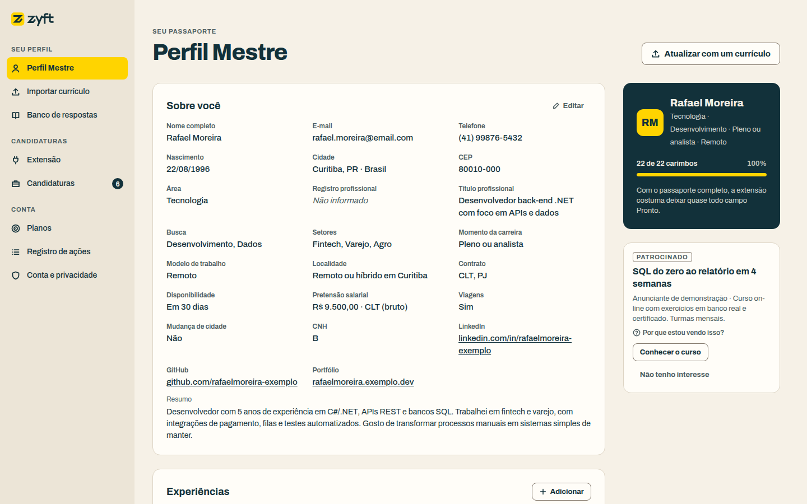
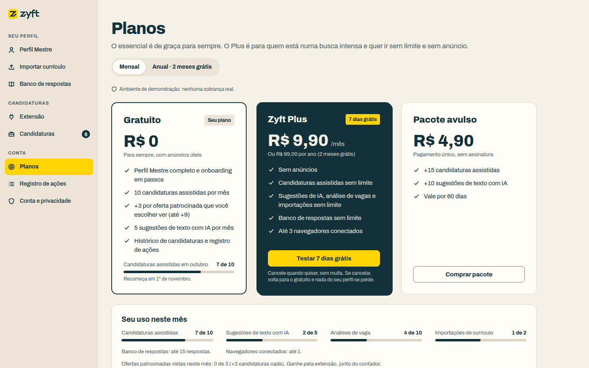
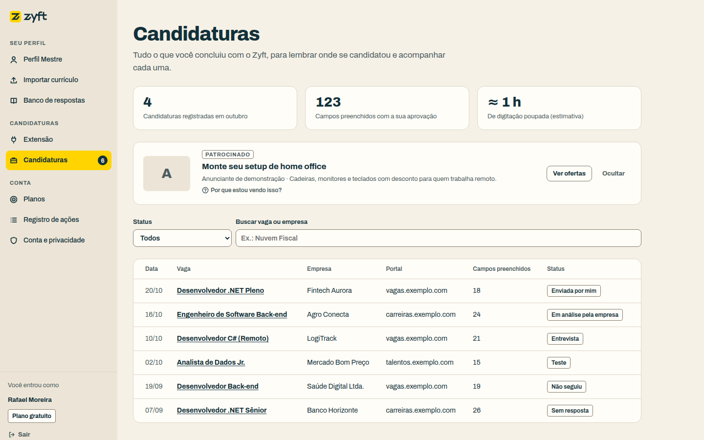
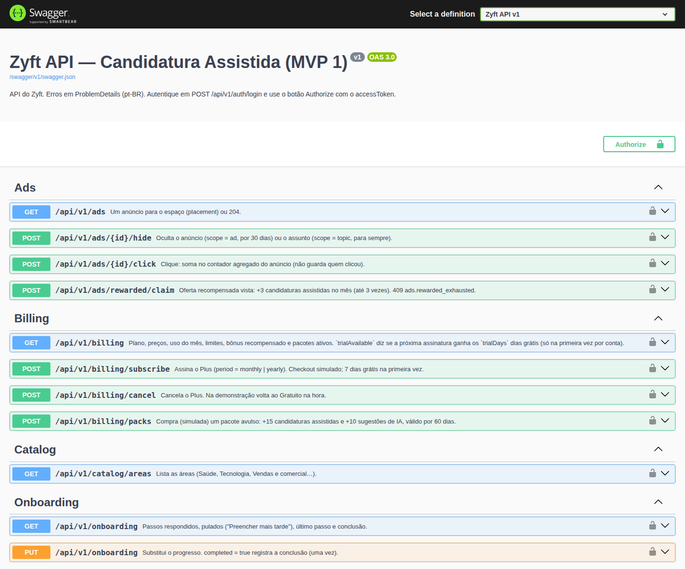
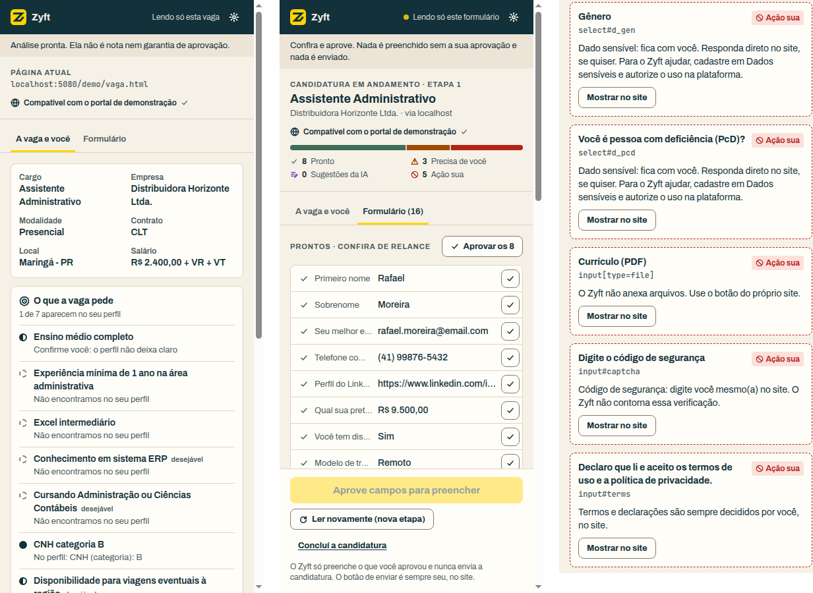

<!-- pdf:ignorar-inicio -->
# Zyft — Entrega 3: Desenvolvimento e Validação

**Assistente de Candidatura a Vagas** · Disciplinas: Tópicos Especiais em Engenharia de Software (.NET) e UX — Experiência do Usuário

**Integrantes:** Antonio Randolfo Barroso Neto, Guilherme Brogio Macedo da Silva, Lucas Ulisses Clementino De Arruda E Silva, Matheus Guilherme Moreira De Oliveira

**Data:** 25 de outubro de 2026 · **Versão:** 2.0

O PDF desta entrega é gerado a partir deste arquivo por `ferramentas/entregas/gerar_entrega3.py`. A versão 1.0 (15/10/2026) descrevia a primeira versão do sistema; esta versão 2.0 descreve o sistema que está hoje na `main` (v2). O que mudou de uma para outra, e por quê, está resumido em [entrega-3-v2-resumo.md](entrega-3-v2-resumo.md). Os relatórios de trabalho da primeira versão continuam em [entrega-3-relatorio-backend.md](entrega-3-relatorio-backend.md) e [entrega-3-frontend.md](entrega-3-frontend.md).

## Sumário

- [Apresentação](#apresentação)
- [1. Descrição da solução](#1-descrição-da-solução)
- [2. Tecnologias utilizadas](#2-tecnologias-utilizadas)
- [3. Estrutura do projeto](#3-estrutura-do-projeto)
- [4. Configuração do ambiente](#4-configuração-do-ambiente)
- [5. Como executar o projeto](#5-como-executar-o-projeto)
- [6. Informações para utilização](#6-informações-para-utilização)
- [7. Endpoints da API](#7-endpoints-da-api)
- [8. Banco de dados](#8-banco-de-dados)
- [9. Autenticação e autorização](#9-autenticação-e-autorização)
- [10. Validação: casos de teste e resultados](#10-validação-casos-de-teste-e-resultados)
- [11. Evidências](#11-evidências)
- [12. Falhas encontradas e correções](#12-falhas-encontradas-e-correções)
- [13. Controle de versão](#13-controle-de-versão)
- [14. Pendências e limitações conhecidas](#14-pendências-e-limitações-conhecidas)
- [Apêndice A. Lista completa dos casos de teste automatizados](#apêndice-a-lista-completa-dos-casos-de-teste-automatizados)
<!-- pdf:ignorar-fim -->

## Apresentação

**Repositório do projeto (GitHub): https://github.com/Ranchoneetoo26/ZIFY**

O código desta entrega está na branch `main`, integrado pelo pull request #1: https://github.com/Ranchoneetoo26/ZIFY/pull/1. O histórico de commits mostra a participação de cada integrante.

A Entrega 1 definiu o problema, as personas e a solução: o **Zyft — Candidatura Assistida (MVP 1)**. A Entrega 2 transformou a solução em projeto técnico. Esta entrega mostra o **sistema implementado e validado**.

Entre a primeira versão deste documento (15/10) e hoje, a pesquisa com usuários fechou com 15 respostas válidas e o time revisou o produto. O resultado é a **v2**, integrada à `main` pelo pull request #1 em 25/10/2026. Ela mantém a arquitetura e as regras de confiança da primeira versão e acrescenta:

- **onboarding em passos**, com uma pergunta por tela e a opção "Preencher mais tarde" em todas;
- **área profissional dinâmica** (8 áreas) e **campos personalizados** para o que cada profissão pede;
- **planos** (Gratuito com limites, Plus e pacote avulso) com **pagamento simulado**;
- **anúncios rotulados**, sem dado pessoal e fora das telas em que a pessoa confere dados, com uma rede AdSense **simulada**;
- **plataforma web redesenhada** e **extensão 0.4.0**.

Em números: API com **77 operações** em `/api/v1`, banco com **25 tabelas** e **263 testes automatizados** (160 de unidade, 91 de integração e 12 de aceitação), todos passando, mais roteiros de ponta a ponta com Playwright.

O documento segue os itens pedidos no enunciado. A modelagem detalhada da primeira versão (dicionário de dados, fichas de endpoint e matriz de acesso) continua na Entrega 2; aqui ficam o que foi implementado e o que mudou na v2.

<!-- pdf:quebra -->

## 1. Descrição da solução

O Zyft ajuda quem se candidata a vagas pela internet a não digitar os mesmos dados em cada portal, **sem tirar da pessoa o controle de cada decisão**. A pesquisa confirmou que essa é a dor principal: redigitar dados teve média 4,40 de 5, com 80% de notas 4 e 5. O fluxo tem três momentos:

1. **Preparar (plataforma web).** A pessoa cria a conta e responde ao onboarding, uma pergunta por vez, em 6 capítulos (quem é você, sua área, o que você busca, sua bagagem, sua apresentação e combinados). Pode pular qualquer pergunta; as puladas viram um alerta no **Perfil Mestre**. Também pode importar um currículo PDF ou DOCX, e cada item proposto é revisado antes de entrar no perfil.
2. **Usar (extensão).** No portal de vagas, com login feito por ela, a pessoa abre o painel lateral do Zyft. Na aba **A vaga e você**, vê os requisitos da vaga com a linha do perfil que os comprova. Na aba **Formulário**, a extensão lê os campos visíveis, a API devolve o de-para com o perfil e o painel mostra cada campo com o estado (Pronto, Precisa de você, Sugestão da IA, Ação sua). Só o que a pessoa aprovar é preenchido.
3. **Concluir (pessoa).** A pessoa confere e envia no portal. Depois, se quiser, registra no painel que enviou; o registro aparece em **Candidaturas**.

A área profissional muda as sugestões (cargos, setores, ferramentas, competências, link e registro profissional). Em Saúde, por exemplo, aparece "Registro no conselho" e o link pedido é o Currículo Lattes. O que o Zyft não conhece vira um **campo personalizado** ("Disponível para plantão noturno"), que a extensão e a IA usam como qualquer outro dado do perfil.

O plano **Gratuito** tem limites mensais (10 candidaturas assistidas, 5 sugestões de IA, 10 análises de vaga, 2 importações, 15 respostas guardadas, 1 navegador) e até um anúncio por tela. O **Plus** (R$ 9,90/mês ou R$ 99/ano) tira limites e anúncios; o **pacote avulso** (R$ 4,90) soma candidaturas e sugestões por 60 dias. Ver uma oferta patrocinada dá +3 candidaturas, até 3 vezes no mês. Nada disso cobra de verdade: a tela avisa "Ambiente de demonstração: nenhuma cobrança real".

As regras inegociáveis estão no código e cobertas por testes (seção 10):

| Regra | Como está implementada |
|---|---|
| Nunca enviar (RN-01) | O content script não chama `submit()` nem `requestSubmit()` e não clica em botões; o observador de `submit` só avisa o painel. |
| IA só com fatos (RN-02, RN-03) | A IA só devolve a **chave** do perfil (inclusive `custom:<id>` dos campos personalizados); o valor vem do perfil. Chave inexistente é descartada. Texto livre usa só fatos do perfil e chega desmarcado. |
| Sem senhas e sem atalhos (RNF-01) | Campos `password`, CAPTCHA, anexo e declarações são classificados como **bloqueados** antes de qualquer chamada à IA e nunca recebem valor. |
| Sensíveis bloqueados (RN-04, RN-15) | Tabela separada, cifrada com AES-256-GCM, fora da IA. Sem consentimento: bloqueado. Com consentimento: valor vem **desmarcado**. Campo personalizado com rótulo sensível (religião, saúde, CPF...) é recusado com 422. |
| Sem dados pessoais em logs (RNF-09) | Serilog registra só método, caminho sem query, status e duração. Dois testes procuram nome, e-mail, telefone, token e valores de campos personalizados nos logs. |
| Sem promessas (RN-06) | A análise de vaga devolve requisitos com status e evidência (linha real do perfil), **sem nota nem porcentagem**. |
| Anúncios com regras (RN-08 a RN-11) | Nenhum anúncio no onboarding, no login, na importação, em dados sensíveis, em conta e privacidade, na aba Formulário nem para Plus. A seleção usa só área, cargos desejados e o texto do requisito; nunca nome, contato ou sensíveis. |
| Limite não prende dados (RN-12) | Com o limite estourado, editar o perfil, exportar e excluir a conta continuam funcionando. |

A IA (Ollama com `qwen2.5:7b`) é opcional: sem ela, as regras determinísticas continuam funcionando e a API responde `Degraded` em `/health` (RNF-12).

## 2. Tecnologias utilizadas

| Área | Tecnologia | Versão | Uso |
|---|---|---|---|
| Linguagem e runtime | C# 12, .NET SDK | 8.0.4xx (`global.json`) | API e testes |
| Web API | ASP.NET Core | 8 | Controllers, middleware, rate limiting, CORS, arquivos estáticos |
| CQRS e validação | MediatR, FluentValidation | 12.4.1, 11.11.0 | Casos de uso e validação de entrada (com *pipeline behaviors*) |
| ORM | Entity Framework Core | 8.0.11 | Mapeamento Fluent API e Migrations |
| Banco de dados | PostgreSQL (Npgsql), SQLite | 16, 8.0.11 | Produção e Docker; desenvolvimento e testes |
| Autenticação | JwtBearer, BCrypt.Net-Next | 8.0.11, 4.0.3 | JWT HS256 e hash de senha |
| Criptografia | `System.Security.Cryptography.AesGcm` | .NET 8 | Dados sensíveis |
| Leitura de currículo | PdfPig, DocumentFormat.OpenXml | 0.1.9, 3.2.0 | Texto de PDF e DOCX, em memória, normalizado em NFKC |
| Documentação da API | Swashbuckle (Swagger/OpenAPI) | 6.9.0 | `/swagger`, com comentários XML e o 402 documentado |
| Logs | Serilog.AspNetCore | 8.0.3 | Logs estruturados sem dados pessoais |
| IA | Ollama, modelo `qwen2.5:7b` | atual | De-para, texto livre, análise de vaga, importação |
| Frontend web | HTML, CSS, JavaScript (ES modules) | — | Sem etapa de build, servido pela API; design system próprio em `web/css/tokens.css` |
| Extensão | Chrome Extensions Manifest V3 | 0.4.0 | Painel lateral, service worker, content script; fontes Archivo e JetBrains Mono empacotadas (OFL) |
| Anúncios | Catálogo estático + Google AdSense **simulado** | — | 16 anúncios de demonstração; bloco `<ins class="adsbygoogle">` sem carregar script do Google (ADR-0021) |
| Testes | xUnit, FluentAssertions, Moq | 2.9.2, 6.12.2, 4.20.72 | Unidade e integração |
| Testes de aceitação | Reqnroll (Gherkin em pt) | 2.2.1 | Regras inegociáveis em linguagem de negócio |
| Testes de API | `Microsoft.AspNetCore.Mvc.Testing` | 8.0.11 | API real em memória (`WebApplicationFactory`) |
| Testes de interface | Playwright + Chromium | — | Ponta a ponta da plataforma, extensão carregada, capturas e vídeos |
| Contêineres | Docker, Docker Compose | — | API + PostgreSQL (+ Ollama opcional) |
| Integração contínua | GitHub Actions | — | Build, testes, migrations em dia e imagem Docker |

As versões dos pacotes NuGet ficam centralizadas em `Directory.Packages.props`. A v2 não acrescentou nenhum pacote ao backend.

## 3. Estrutura do projeto

```
ZIFY/
  Zyft.sln  global.json  Directory.Build.props  Directory.Packages.props
  docker-compose.yml  .dockerignore  .editorconfig  .gitignore  CHANGELOG.md
  .config/dotnet-tools.json            dotnet-ef 8.0.11 (ferramenta local)
  .github/workflows/ci.yml             build, testes, migrations e imagem Docker
  src/
    Zyft.Domain/                       entidades e regras puras; v2: Billing, Ads, Onboarding, campos personalizados
    Zyft.Application/                  casos de uso (CQRS), portas, de-para, análise de vaga, redação;
                                       v2: Billing, Ads (AdCatalog, seleção), Catalog (8 áreas), Onboarding
    Zyft.Infrastructure/               EF Core e migrations, repositórios, JWT, BCrypt, AES-GCM, Ollama,
                                       leitura de PDF/DOCX, AdSenseNetwork (simulada), seed dos usuários demo
    Zyft.Api/                          17 controllers finos (mais uma classe base), middleware de erros, Program.cs, Dockerfile
  tests/
    Zyft.UnitTests/                    Domain, Forms, Handlers, Imports, Infrastructure, Jobs, V2
    Zyft.IntegrationTests/             HTTP real com SQLite em memória (inclui V2Tests, TourFixesTests, AdNetworkTests)
    Zyft.AcceptanceTests/              Reqnroll: Features/RegrasInegociaveis.feature
  web/                                 plataforma web (servida em /)
    css/  tokens.css components.css app.css
    js/   api, ui, ads, adsense, billing, catalog, store; views/ (uma por tela, incl. onboarding e plans)
    demo/                              portal de vagas de demonstração (servido em /demo/)
  extension/                           extensão MV3 0.4.0 (manifest, background, content, sidepanel, icons, fonts)
  docs/                                produto, pesquisa, arquitetura, 21 ADRs, qualidade, operação, entregas
  ferramentas/                         scripts da pesquisa e geradores dos PDFs das entregas
```

As dependências apontam para dentro: `Api → Application/Infrastructure`, `Infrastructure → Application → Domain`. O domínio não referencia pacotes e a aplicação não referencia o EF Core. A v2 seguiu o mesmo desenho: os novos controllers (`Billing`, `Ads`, `Catalog`, `Onboarding`) só repassam comandos ao MediatR, e a rede de anúncios entra pela porta `IAdNetwork`, implementada na infraestrutura.

## 4. Configuração do ambiente

### 4.1 Pré-requisitos

| Item | Versão | Obrigatório? |
|---|---|---|
| .NET SDK | 8.0.400 ou mais novo da linha 8 | Sim (execução sem Docker e testes) |
| Docker e Docker Compose | Atual | Só para rodar com PostgreSQL |
| Chrome ou Edge | Atual | Para a extensão |
| Ollama + `qwen2.5:7b` | Atual (~4,7 GB) | Não. Sem IA, as regras continuam funcionando. |

Se o .NET foi instalado na pasta do usuário: `export PATH=$HOME/.dotnet:$PATH DOTNET_ROOT=$HOME/.dotnet`.

### 4.2 Configurações da API

As configurações ficam em `src/Zyft.Api/appsettings.json` e podem ser trocadas por variável de ambiente (`Secao__Chave`).

| Chave | Padrão | Uso |
|---|---|---|
| `Database:Provider` | `Postgres` (`Sqlite` em Development) | Banco usado |
| `ConnectionStrings:Default` | PostgreSQL local; `Data Source=zyft-dev.db` em Development | Conexão |
| `Jwt:Secret` | vazio (definido em Development) | Segredo HS256, 32+ caracteres. A API não sobe sem ele. |
| `Jwt:AccessTokenMinutes`, `Jwt:RefreshTokenDays` | 15, 7 | Validade dos tokens |
| `Encryption:Key` | vazio (definido em Development) | Chave AES de 32 bytes em Base64. Tamanho errado derruba a subida. |
| `Llm:Provider`, `Llm:BaseUrl`, `Llm:Model` | `Ollama`, `http://localhost:11434`, `qwen2.5:7b` | IA. `None` desliga. |
| `Cors:AllowedOrigins`, `Cors:ExtensionIds` | `http://localhost:5080`, vazio | Origens aceitas. Em Production, `ExtensionIds` é obrigatório. |
| `RateLimiting:AuthPermitLimit`, `RateLimiting:AiPermitPerMinute` | 10, 60 | Limites por IP (login) e por pessoa (IA) |
| `Seed:DemoUser` | `true` só em Development | Cria os dois usuários de demonstração |
| `Ads:Network` (`Enabled`, `Mock`, `ClientId`, `Slots`, `Preferred`) | ligada, `Mock = true` | Rede de anúncios simulada (v2). `Mock = false` é proibido nesta versão. |

Os planos, limites e o catálogo de anúncios não dependem de configuração: estão no código (`Domain/Billing/Plans.cs` e `Application/Ads/AdCatalog.cs`).

No Docker, os segredos vêm de um arquivo `.env` (fora do Git): `ZYFT_JWT_SECRET`, `ZYFT_ENCRYPTION_KEY`, `ZYFT_DB_PASSWORD`, `ZYFT_LLM_PROVIDER` e `ZYFT_LLM_URL`. Os valores padrão do `docker-compose.yml` servem só para demonstração local.

## 5. Como executar o projeto

Há duas formas de rodar a API: localmente com SQLite, que é a mais rápida e já traz os usuários de demonstração, ou em Docker com PostgreSQL, que é o ambiente mais próximo de produção.

### 5.1 Desenvolvimento com SQLite (sem Docker)

```bash
cd ZIFY
dotnet build
dotnet run --project src/Zyft.Api        # http://localhost:5080
```

| Endereço | O que é |
|---|---|
| `http://localhost:5080/` | Plataforma web |
| `http://localhost:5080/swagger` | Swagger (botão **Authorize**: cole só o `accessToken`) |
| `http://localhost:5080/demo/` | Portal de vagas de demonstração |
| `http://localhost:5080/health` | Saúde do banco e da IA |

O banco SQLite (`src/Zyft.Api/zyft-dev.db`) é criado na primeira subida, já com os dois usuários de demonstração. O seed não sobrescreve usuário existente: um banco criado antes da v2 continua com o perfil antigo. Para começar do zero (e zerar uso, resgates e ocultações de anúncio), pare a API e apague esse arquivo.

### 5.2 Docker com PostgreSQL 16

```bash
docker compose up -d --build                  # API + PostgreSQL; as migrations são aplicadas na subida
docker compose --profile ai up -d --build     # + Ollama no contêiner
docker compose exec ollama ollama pull qwen2.5:7b
docker compose down -v                        # para e apaga o volume
```

A API sobe em `http://localhost:5080`, em ambiente `Staging` e com usuário não-root no contêiner. As duas migrations (`InitialCreate` e `V2PlanosAnunciosOnboarding`) são aplicadas na subida. Nesse modo não há usuário de demonstração: crie uma conta em **Criar conta**.

### 5.3 Testes

```bash
dotnet test                         # 263 testes: unidade, integração e aceitação
dotnet test tests/Zyft.UnitTests    # só unidade
```

Os testes de integração e aceitação sobem a API real em memória com SQLite e IA desligada ou simulada. Não precisam de Docker nem de Ollama.

### 5.4 Extensão (modo desenvolvedor)

1. Suba a API (5.1 ou 5.2).
2. Abra `chrome://extensions` (ou `edge://extensions`) e ligue o **Modo do desenvolvedor**.
3. Clique em **Carregar sem compactação** e escolha a pasta `extension/` do repositório (versão 0.4.0).
4. Fixe o ícone do Zyft e clique nele para abrir o painel lateral.
5. Na plataforma web, vá em **Extensão → Gerar código de pareamento**, digite o código de 6 dígitos no painel (vale 10 minutos e uma única vez), dê um nome ao navegador e clique em **Conectar**.
6. Se a API estiver em outro endereço, troque em **Ajustes** (engrenagem) no painel.
7. No plano gratuito só um navegador fica conectado. **Ajustes → Desconectar extensão** libera a vaga.

## 6. Informações para utilização

### 6.1 Usuários de demonstração

Existem só quando a API roda em Development (o padrão do `dotnet run`). Todos os dados são fictícios e os dois usam a senha `Zyft@2026`.

| Pessoa | E-mail | O que mostra |
|---|---|---|
| **Rafael Moreira** (persona principal) | `demo@zyft.local` | Área Tecnologia, perfil completo (22 de 22 carimbos): experiências, competências, idiomas, formação, respostas aprovadas, 6 candidaturas com status e registro de ações. Onboarding concluído. Plano gratuito com 7 de 10 candidaturas assistidas usadas no mês. Serve para mostrar o preenchimento, o limite e a conclusão. |
| **Beatriz Lima** (outra área) | `beatriz@demo.zyft` | Área Saúde (técnica de enfermagem), registro COREN-MG, dois campos personalizados ("Disponível para plantão noturno" e "Experiência em UTI"). Onboarding parado na pergunta 22 de 25, com 3 perguntas deixadas para depois. Ao entrar, ela cai direto no onboarding. Serve para mostrar a área dinâmica, os campos personalizados e o alerta de pendentes. |

Nos dois, os consentimentos *IA para textos* e *Análise de vaga* já vêm ligados e *Dados sensíveis* vem desligado. Até a v1, o e-mail `demo@zyft.local` trazia o perfil "Ana Paula Souza"; na v2 ele passou a ser o Rafael.

### 6.2 Roteiro sugerido

**Rafael: "Só quero conferir e seguir"** (cerca de 10 minutos)

1. Entre com `demo@zyft.local` em `http://localhost:5080/`. Não há anúncio no login; a tela abre no **Perfil Mestre**, com um único card patrocinado na coluna lateral e o botão "Por que estou vendo isso?".
2. Em **Extensão**, gere o código e conecte o painel ("1 de 1 no seu plano").
3. No portal demo, abra `vaga.html` e clique em **Analisar esta vaga**: cada requisito aparece com a linha do perfil que o comprova, sem nota nem porcentagem. O contador mostra "7 de 10" e o botão **Ganhar**.
4. Abra `candidatura.html` e, na aba **Formulário**, clique em **Ler o formulário desta página**. Os prontos aparecem compactos com **Aprovar os N**; senha, CAPTCHA, anexo, termos e sensíveis ficam como **Ação sua**; a pergunta aberta oferece **Pedir um rascunho à IA**. Não há anúncio nessa aba.
5. Clique em **Preencher**, envie no próprio site e registre com **Confirmo que enviei: registrar**.
6. Veja **Candidaturas**, **Registro de ações** (sem valores de campo) e **Planos** (medidores do mês e o aviso de pagamento simulado).

**Beatriz: o Zyft fora da tecnologia** (cerca de 10 minutos)

1. Entre com `beatriz@demo.zyft`. O login leva direto à pergunta 22 do onboarding ("O que você sabe fazer bem?"), com sugestões de Saúde e o passaporte mostrando "3 para depois".
2. Use **Sair e continuar depois**. O Perfil Mestre mostra o alerta de pendentes, **Continuar de onde parei** e os cartões "Responda agora".
3. Em **Informações da sua área**, crie "Curso de ACLS: Concluído em 2025". Tente criar "Religião" e veja a recusa, que orienta a usar **Dados sensíveis**.
4. No portal demo, leia `curriculo.html`: o que ela pulou aparece como "Precisa de você", e o campo personalizado é reconhecido quando o formulário pergunta algo parecido.
5. Em **Conta e privacidade**, veja os consentimentos, baixe os dados em JSON e note que a exclusão só é liberada depois de digitar `EXCLUIR`.

O passo a passo completo, com os nomes reais de cada botão, está no [guia do usuário](../06-operacao/guia-do-usuario.md). Não use portais reais com contas falsas. Para demonstrar em um portal real, a pessoa testadora faz login na própria conta e o fluxo para antes de salvar ou enviar.

### 6.3 Vídeos de apresentação

Os três vídeos da v2 estão em `entregas/videos/` (pasta irmã do repositório), cada um em versão normal e legendada:

| Vídeo | Duração | Para quem |
|---|---|---|
| Executivo | 4:50 | Banca e quem avalia o produto sem ler código: problema, pesquisa, solução, confiança e modelo de negócio |
| Técnico | 19:11 | Avaliação técnica: arquitetura, pipeline do de-para, segurança, v2 no código e testes |
| Tour do sistema | 15:49 | Quem vai usar: do cadastro e onboarding até registrar a candidatura, planos e privacidade |

Os vídeos foram gravados com 223 testes e 76 operações, que é o que aparece na tela e na narração. Depois da gravação entraram as correções da seção 12.2 e a rede de anúncios simulada, que levaram aos números atuais (263 testes, 77 operações).

## 7. Endpoints da API

A API expõe **77 operações**, todas sob `/api/v1`, exceto `/health` (eram 61 na primeira versão). Erros seguem o padrão ProblemDetails em pt-BR (`type`, `title`, `status`, `detail`, `instance`, `traceId` e `code`). A coluna "Acesso" usa **W** para token web, **E/W** para extensão ou web e **pública** para rotas sem token. Corpos e respostas da primeira versão estão na Entrega 2, seção 3.3; os da v2, em [docs/03-arquitetura/api.md](../03-arquitetura/api.md) e no Swagger.

<!-- pdf:larguras 0.12,0.32,0.12,0.44 -->
| Método | Rota | Acesso | Descrição |
|---|---|---|---|
| `POST` | `/auth/register` | pública | Cria a conta e devolve os tokens. |
| `POST` | `/auth/login` | pública | Login com e-mail e senha (limitado por IP). |
| `POST` | `/auth/refresh` | pública | Troca o refresh token por um novo par (rotação). |
| `POST` | `/auth/logout` | W, E | Revoga o refresh token. |
| `GET` | `/me` | E/W | Dados da conta. |
| `DELETE` | `/me` | W | Exclui a conta e tudo o que depende dela. |
| `GET` | `/me/export` | W | Exporta todos os dados em JSON. |
| `GET` | `/consents` | W | Lista as finalidades e se estão concedidas. |
| `PUT` | `/consents/{purpose}` | W | Liga ou desliga uma finalidade. |
| `GET`, `PUT` | `/profile` | W | Perfil completo e dados básicos (v2: `workArea`, `professionalRegistration`, `salaryType`, `customFields`). |
| `GET` | `/profile/missing` | W | Perguntas sobre o que falta no perfil (RF-05). |
| `GET`, `POST` | `/profile/{experiences, educations, courses, skills, languages}` | W | Lista e adiciona itens do perfil (5 coleções). |
| `PUT`, `DELETE` | `/profile/{coleção}/{id}` | W | Edita e remove item (5 coleções). Curso sem `type` vale `Course`. |
| `GET`, `POST` | `/profile/custom-fields` | W | **Novo.** Lista e cria campos personalizados (RF-25). Rótulo sensível: 422. |
| `PUT`, `DELETE` | `/profile/custom-fields/{id}` | W | **Novo.** Edita e remove campo personalizado. |
| `GET` | `/catalog/areas` | E/W | **Novo.** Catálogo das 8 áreas, com sugestões e registro profissional (RF-24). |
| `GET`, `PUT` | `/onboarding` | W | **Novo.** Progresso do onboarding: respondidas, puladas, último passo e conclusão (RF-23). |
| `POST` | `/resume-imports` | W | Envia currículo PDF/DOCX (até 10 MB) e recebe a proposta, com `missingFields` quando falta algo. |
| `GET` | `/resume-imports/{id}` | W | Consulta a importação. |
| `POST` | `/resume-imports/{id}/apply` | W | Aplica só os itens aceitos; item incompleto responde 400 com o nome do item. |
| `POST` | `/resume-imports/{id}/discard` | W | Descarta a proposta. |
| `GET` | `/answers`, `/answers/{id}` | W | Lista e detalha respostas aprovadas. |
| `POST` | `/answers` | E/W | Aprova uma resposta (até 15 no Gratuito). |
| `PUT`, `DELETE` | `/answers/{id}` | W | Edição e exclusão. |
| `GET`, `POST` | `/sensitive-data` | W | Lista e cadastra dados sensíveis. |
| `PUT`, `DELETE` | `/sensitive-data/{id}` | W | Altera e exclui dado sensível. |
| `POST` | `/extension/pairing-codes` | W | Gera o código de pareamento. |
| `POST` | `/extension/pair` | pública (código) | A extensão troca o código por tokens `scope=extension` (1 navegador no Gratuito, 3 no Plus). |
| `GET` | `/extension/devices` | W | Lista extensões pareadas. |
| `DELETE` | `/extension/devices/{id}` | W | Revoga uma extensão na hora. |
| `DELETE` | `/extension/devices/current` | E/W | **Novo.** A extensão revoga o próprio dispositivo e libera a vaga do plano (204; token web recebe 404). |
| `GET`, `POST` | `/authorized-sites` | E/W | Lista e autoriza origens. |
| `DELETE` | `/authorized-sites/{id}` | W | Remove a autorização. |
| `POST` | `/forms/mappings` | E/W | De-para campo → Perfil Mestre (RF-12). Conta uma candidatura assistida por página no mês. |
| `POST` | `/forms/open-answers` | E/W | Sugestão de texto com fatos do perfil (RF-15). Nunca devolve texto vazio. |
| `POST` | `/forms/completions` | E/W | Registra que a pessoa concluiu a candidatura (RF-19). |
| `POST` | `/jobs/analyze` | E/W | Requisitos da vaga com evidência do perfil, sem porcentagem. |
| `GET` | `/applications` | E/W | Lista as candidaturas. |
| `GET`, `PATCH`, `DELETE` | `/applications/{id}` | W | Detalhe, status e notas, exclusão. |
| `GET` | `/audit-events` | W | Registro de ações (sem valores de campos). |
| `GET` | `/billing` | E/W | **Novo.** Plano, preços, uso do mês, bônus, pacotes e `trialAvailable` (RF-26). |
| `POST` | `/billing/subscribe` | W | **Novo.** Assina o Plus (simulado); 7 dias grátis só na primeira assinatura. |
| `POST` | `/billing/cancel` | W | **Novo.** Volta ao Gratuito. |
| `POST` | `/billing/packs` | W | **Novo.** Compra (simulada) de pacote avulso; responde 201 (RF-27). |
| `GET` | `/ads?placement=&topic=` | E/W | **Novo.** Um anúncio para o espaço, ou 204 (RF-29). |
| `POST` | `/ads/{id}/hide` | E/W | **Novo.** Oculta o anúncio (30 dias) ou o assunto (sempre). |
| `POST` | `/ads/{id}/click` | E/W | **Novo.** Soma um clique no contador agregado, sem guardar quem clicou. |
| `POST` | `/ads/rewarded/claim` | E/W | **Novo.** Oferta recompensada vista: +3 candidaturas (até 3 vezes no mês) (RF-28). |
| `GET` | `/health` | pública | Saúde do banco e da IA (fora do Swagger). |

Quando um limite do plano acaba, as rotas que consomem uso respondem **402** com `code: "plan.limit_reached"` e os campos `resource`, `used` e `limit`. A primeira versão não tinha esse status; a web e a extensão 0.4.0 tratam o 402 mostrando as opções (oferta, pacote ou Plus).

Exemplo real de `POST /forms/mappings` no portal demo (`candidatura.html`, 16 campos, Rafael), obtido para este documento pelo painel da extensão:

<!-- pdf:larguras 0.42,0.58 -->
| Campo da página | Como o painel mostrou |
|---|---|
| Primeiro nome, Sobrenome | Pronto: "Rafael" e "Moreira", separados a partir do nome completo do perfil |
| Seu melhor e-mail, Telefone | Pronto, por regra (`personal.email`, `personal.phone`) |
| Perfil do LinkedIn (URL) | Pronto, por regra. Antes da correção 12 (seção 12.2) esse campo não casava. |
| Pretensão salarial, viagens, modelo de trabalho | Pronto, com os valores do perfil ("R$ 9.500,00", "Sim", "Remoto") |
| Duas perguntas abertas | Precisa de você, com **Escrever** e **Pedir um rascunho à IA** |
| "Você possui experiência com o ERP SAP Business One?" | Falta no perfil, com **Responder** (a resposta vai para o Banco de respostas) |
| Gênero, PcD | Ação sua: dado sensível sem consentimento, sem valor |
| Currículo (`type=file`), código de segurança, termos | Ação sua: sem valor e desmarcados |

Resumo do painel: 8 prontos, 3 precisam da pessoa, 5 são ação dela, nenhum foi enviado.

## 8. Banco de dados

O modelo é relacional, com **25 tabelas de domínio** (26 com a tabela de histórico de migrations do EF Core). Eram 17 na primeira versão; a v2 acrescentou 8 tabelas e 3 colunas. A modelagem da primeira versão (diagrama ER, dicionário de dados e regras de integridade) está na Entrega 2, seção 2; a da v2, em [docs/03-arquitetura/modelo-de-dados.md](../03-arquitetura/modelo-de-dados.md).

| Aspecto | Implementação |
|---|---|
| Tabelas da primeira versão | `Users`, `RefreshTokens`, `Consents`, `Profiles`, `Experiences`, `Educations`, `Courses`, `Skills`, `Languages`, `ApprovedAnswers`, `SensitiveData`, `ResumeImports`, `ExtensionDevices`, `PairingCodes`, `AuthorizedSites`, `Applications`, `AuditEvents` |
| Tabelas novas (v2) | `CustomFields`, `OnboardingProgress`, `Subscriptions`, `MonthlyUsages`, `UsagePacks`, `UsageMarks`, `AdHides`, `AdStats` |
| Colunas novas (v2) | `Profiles.WorkArea`, `Profiles.ProfessionalRegistration`, `Profiles.SalaryType` |
| Chaves | `Guid` gerado na aplicação; `CreatedAt` e `UpdatedAt` em UTC, preenchidos no `SaveChangesAsync` |
| Integridade | FKs com `ON DELETE CASCADE` a partir de `Users` (exclusão de conta, RF-08), inclusive nas tabelas novas; *check constraints* de período em `Experiences` e `Educations` |
| Enums | Gravados como texto (`Undergraduate`, `InProgress`) |
| Migrations | `InitialCreate` (15/10) e `V2PlanosAnunciosOnboarding` (21/10), para PostgreSQL, aplicadas com `Database.Migrate()` na subida. O CI confere se o modelo e as migrations estão em dia. |
| SQLite | Usa `EnsureCreated()`: as migrations são do PostgreSQL (`uuid`, `timestamp with time zone`) e manter um segundo conjunto só para desenvolvimento dobraria a manutenção. |

O que as tabelas novas guardam, e o que **não** guardam:

| Tabela | Guarda | Não guarda |
|---|---|---|
| `CustomFields` | Rótulo e valor de cada campo personalizado (até 50 por perfil) | Rótulos sensíveis, recusados antes de gravar |
| `OnboardingProgress` | Ids dos passos respondidos e pulados, último passo, data de conclusão | As respostas, que vão para o perfil |
| `Subscriptions` | Plano, período, fim do teste grátis, se o teste já foi usado | Nenhum dado de cartão (pagamento simulado) |
| `MonthlyUsages`, `UsagePacks` | Contadores por recurso e mês; saldo e validade dos pacotes | — |
| `UsageMarks` | **Hash** de origem + caminho da página lida no mês, para contar cada página uma vez | A URL |
| `AdHides` | Ocultações de anúncio por pessoa (por anúncio ou por assunto) | — |
| `AdStats` | Exibições e cliques agregados por anúncio | Quem viu ou clicou (não tem coluna de usuário) |

O catálogo de anúncios não está no banco: são 16 anúncios estáticos no código (`AdCatalog`), todos de "Anunciante de demonstração".

| Diferença em relação à Entrega 2 | Motivo |
|---|---|
| Entidade `JobApplication` (tabela `Applications`) | `Application` colide com o namespace `Zyft.Application`. |
| Cursos e certificações numa entidade `Course` com `Type` | Mesmos campos; o de-para separa `courses[i]` e `certifications[i]`. |
| `Applications` guarda status e anotações | O ADR-0012 (Proposta) recomendava um registro sem status. Há uma nota de divergência no ADR; falta a decisão humana. |
| `Users.DeletedAt` mantido sem uso | A exclusão é física, em cascata. Decisão pendente (D-05). |

## 9. Autenticação e autorização

O desenho completo está na Entrega 2, seção 4. O que foi implementado:

| Item | Implementação |
|---|---|
| Senha | BCrypt (fator 11). Mínimo de 8 caracteres, com letra e número. |
| Login | Mesmo tempo de resposta com e-mail inexistente (hash descartável): não revela se o e-mail existe. Limite de 10 tentativas por minuto por IP (429 com `Retry-After`). |
| Access token | JWT HS256 de 15 minutos com `sub`, `email`, `scope` (`web` ou `extension`) e `device_id`. |
| Refresh token | Opaco, 48 bytes aleatórios, 7 dias. No banco fica só o SHA-256. **Rotação** a cada uso; se um token já trocado for reapresentado, **toda a cadeia é revogada**. |
| Pareamento da extensão | Código de 6 dígitos, 10 minutos, uso único. A extensão recebe tokens com `scope=extension`. Revogar o dispositivo derruba o access e o refresh na hora. Na v2, o número de navegadores ativos depende do plano (1 no Gratuito, 3 no Plus) e a extensão pode se desconectar sozinha (`DELETE /extension/devices/current`). |
| Policies | `WebUser` (scope `web`) e `ExtensionOrWeb`. Só web: conta, exportação, consentimentos, perfil completo e campos personalizados, onboarding, importação, sensíveis, dispositivos, edição de candidaturas e respostas, auditoria, **assinar, cancelar e comprar pacote**. Web ou extensão: `GET /me`, `/forms/*`, `/jobs/analyze`, `GET /applications`, `GET` e `POST /authorized-sites`, `POST /answers`, `GET /catalog/areas`, `GET /billing`, `/ads/*`, `DELETE /extension/devices/current`. |
| Consentimentos | Três finalidades (`AiText`, `JobAnalysis`, `SensitiveData`) nascem **desligadas**. O último capítulo do onboarding ("Combinados") explica cada uma e deixa a pessoa ligar. O bloqueio é na API (403 com `code: consent_required`), não só na interface. |
| Limites do plano | Verificados no servidor (`IUsageMeter`), com 402 `plan.limit_reached`. O consumo só é gravado se a operação der certo, e o limite nunca bloqueia editar o perfil, exportar ou excluir a conta (RN-12). |
| Isolamento | Recurso de outra pessoa responde 404 (não revela que existe), inclusive campos personalizados, pacotes e ocultações de anúncio. |
| Rate limiting de IA | 60 chamadas por minuto **por pessoa** em `/forms/*`, `/jobs/analyze` e `POST /resume-imports`. |
| Tokens no cliente | Web: access token em memória e refresh em `sessionStorage`. Extensão: só o service worker guarda tokens e só aceita mensagens de páginas da própria extensão. |
| CORS e CSP | Origens configuradas e `chrome-extension://` (restrito por ID em Production). CSP `script-src 'self'` na web e na extensão; a rede de anúncios simulada não exigiu mudar a CSP. |

<!-- pdf:quebra -->

## 10. Validação: casos de teste e resultados

### 10.1 Estratégia

| Nível | Ferramenta | O que cobre | Casos |
|---|---|---|---|
| Unidade | xUnit, FluentAssertions, Moq | Regras do domínio, de-para (`FieldMapper`), análise de vaga, redação, handlers, validators, JWT, BCrypt, AES-GCM. v2: planos e consumo, campos personalizados, onboarding, seleção de anúncios, correções da importação | 160 |
| Integração | `WebApplicationFactory` + SQLite em memória | HTTP real: autenticação, autorização, erros, regras de confiança, importação, rate limiting, CORS, logs, Swagger. v2: perfil novo, catálogo, onboarding, billing, 402, pacote, Plus, anúncios, rede simulada | 91 |
| Aceitação | Reqnroll (Gherkin em português) | As regras inegociáveis escritas como cenários de negócio | 12 |
| Ponta a ponta | Playwright + Chromium | Fluxos da plataforma no navegador; extensão carregada com `--load-extension` para capturas e vídeos | 3 roteiros |
| Manual / exploratório | curl, Swagger, Ollama real, portal demo | Fluxo completo com PostgreSQL e com a IA real | 3 roteiros |

A lista completa dos casos automatizados está no Apêndice A. A contagem é por caso executado: cada exemplo de um `[Theory]` e de um esquema de cenário conta uma vez.

### 10.2 Regras e onde são testadas

| Regra | Unidade | Integração | Aceitação |
|---|---|---|---|
| Senha, CAPTCHA, anexo e declaração nunca recebem valor | Sim | Sim | Sim |
| IA só aponta a chave; valor escrito pela IA é ignorado | Sim | Sim (IA maliciosa) | Sim |
| Chave inventada pela IA é descartada; `custom:<id>` vem do perfil | Sim | Sim | — |
| Sensível bloqueado sem consentimento e desmarcado com consentimento | Sim | Sim | Sim |
| Prompt da IA sem dado sensível | Sim | — | — |
| Rótulo sensível em campo personalizado é recusado (TN-13) | Sim (10 rótulos) | Sim (3 rótulos) | — |
| Análise de vaga sem consentimento → 403 | Sim (Moq) | Sim | Sim |
| Evidência inventada vira `nao_encontrado`; sem nota nem porcentagem | Sim | Sim | Sim |
| Refresh reutilizado revoga a cadeia | Sim | Sim | — |
| Token de extensão não acessa exportação nem assina ou compra pacote | — | Sim | Sim (exportação) |
| Logs sem dados pessoais, inclusive nas rotas da v2 | — | Sim | — |
| Nenhum anúncio em espaço proibido nem para Plus (TN-11) | Sim | Sim | — |
| Anúncio sem dado pessoal, inclusive da rede (TN-12) | Sim | Sim | — |
| Limite atingido não bloqueia exportar nem excluir (TN-14) | — | Sim | — |
| Mesma página conta uma vez no mês, guardando só o hash | Sim | Sim | — |

Nenhum cenário de aceitação novo foi escrito para a v2: as regras novas estão cobertas por testes de unidade e integração (seção 14).

### 10.3 Resultados da execução automatizada

Execução de 25/10/2026, `dotnet test` em Debug, no código da `main` depois do merge do PR #1. O CI do GitHub também passou no PR e no merge.

| Projeto | Total | Passaram | Falharam | Ignorados |
|---|---|---|---|---|
| Zyft.UnitTests | 160 | 160 | 0 | 0 |
| Zyft.IntegrationTests | 91 | 91 | 0 | 0 |
| Zyft.AcceptanceTests | 12 | 12 | 0 | 0 |
| **Total** | **263** | **263** | **0** | **0** |

Evolução da suíte desde a primeira versão deste documento:

| Data | Marco | Unidade | Integração | Aceitação | Total |
|---|---|---|---|---|---|
| 15/10 | Primeira versão (v1) | 90 | 55 | 12 | 157 |
| 21/10 | v2 implementada | 136 | 75 | 12 | 223 |
| 21/10 | Correções pós-v2 (LinkedIn/GitHub, desconexão, TN-14, logs v2) | 140 | 78 | 12 | 230 |
| 21/10 | Correções da gravação do tour | 156 | 84 | 12 | 252 |
| 22/10 | Rede de anúncios simulada (ADR-0021) | 160 | 91 | 12 | 263 |

### 10.4 Testes de ponta a ponta e manuais

| Roteiro | Ambiente | Passos | Resultado |
|---|---|---|---|
| E2E da plataforma (Playwright) | Primeira versão, mock da API com o contrato da entrega | Login, cadastro, consentimentos, Perfil Mestre, importação, respostas, pareamento, sites, candidaturas, registro e exclusão | Passou, sem erros de console |
| Gravação dos vídeos da v2 (Playwright, extensão carregada) | API isolada com SQLite e seed limpo | Onboarding da Beatriz, Perfil Mestre, importação, pareamento, análise de vaga, leitura e preenchimento do formulário, registro, Planos, limite e privacidade | Passou depois das correções 17 a 22 (seção 12.2), que vieram justamente desse roteiro |
| Capturas desta entrega (Playwright) | `dotnet run` (SQLite), usuários demo, IA local ligada | Login, onboarding da Beatriz, Perfil Mestre, Planos, Candidaturas, Swagger e painel da extensão (pareamento, análise de vaga, formulário) | Passou, sem erros de página; o dispositivo pareado foi revogado ao fim |
| Fluxo da API via curl | `dotnet run` (SQLite) e `docker compose` (PostgreSQL) | register → login → perfil → `/forms/mappings` → `/forms/completions` → candidaturas → auditoria | Passou; auditoria sem valores e sem caminho ou query da URL |
| IA real (Ollama `qwen2.5:7b`) | Docker e local | De-para com campo que a regra não reconhece, análise de vaga, texto livre, importação de DOCX | Passou (tabela abaixo) |

| Chamada com IA real (medições de 15/10) | Tempo | Observação |
|---|---|---|
| `POST /forms/mappings` ("Nome da última organização em que atuou") | 43 s (modelo carregando) | A IA apontou `experiences[0].company` e o valor veio do perfil (`source: Ai`). |
| `POST /jobs/analyze` (4 requisitos) | 9,9 s | "Experiência com ERP" → `atende` com a linha real do perfil; "Inglês fluente" → `nao_encontrado`. Sem porcentagem. |
| `POST /forms/open-answers` (até 300 caracteres) | 2,9 s | Texto em 1ª pessoa com 2 fatos usados, ambos existentes no perfil; `selected: false`. |
| `POST /resume-imports` (DOCX) | 8,5 s | Proposta com contatos, 2 experiências, formação, curso e idioma. "Estado civil" do currículo **não** foi extraído. |

Na sessão de 25/10, a análise da vaga de demonstração com a IA real devolveu 7 requisitos para o Rafael: 1 aparece no perfil ("CNH categoria B", com a linha "CNH (categoria): B"), 2 pedem confirmação e 4 não foram encontrados. O resultado faz sentido: a vaga é de assistente administrativo e o perfil é de desenvolvedor. Não houve nota nem porcentagem.

## 11. Evidências

### 11.1 Saída do `dotnet test`

Execução feita para este documento, em 25/10/2026, com o comando abaixo na raiz do repositório (saída resumida):

```
$ export PATH=$HOME/.dotnet:$PATH DOTNET_ROOT=$HOME/.dotnet; dotnet test --no-build
  (saída do VSTest omitida)
Passed!  - Failed:     0, Passed:   160, Skipped:     0, Total:   160, Duration: 1 s - Zyft.UnitTests.dll (net8.0)
Passed!  - Failed:     0, Passed:    12, Skipped:     0, Total:    12, Duration: 9 s - Zyft.AcceptanceTests.dll (net8.0)
Passed!  - Failed:     0, Passed:    91, Skipped:     0, Total:    91, Duration: 14 s - Zyft.IntegrationTests.dll (net8.0)
```

Saúde da API na mesma sessão (`GET /health`, com o Ollama local disponível):

```
{"status":"Healthy","checks":[{"name":"database","status":"Healthy","description":null},
 {"name":"llm","status":"Healthy","description":"IA local disponível."}]}
```

Integração contínua no GitHub Actions (`gh run list`), no PR #1 e no merge:

```
completed  success  feat: v2 da Candidatura Assistida (...)   CI  feat/v2-candidatura-assistida  pull_request  2m14s
completed  success  Merge pull request #1 from Ranchoneetoo26/feat/v2-candidatura-assistida  CI  main  push  2m10s
```

### 11.2 Capturas de tela

Capturas feitas em 25/10/2026 com Playwright (Chromium, 1440 × 900) contra `dotnet run --project src/Zyft.Api`, com os usuários de demonstração. O painel da extensão foi capturado com a extensão 0.4.0 carregada no Chromium (400 × 900).














As capturas da primeira versão (`img/e3-01` a `img/e3-05`) continuam no repositório como registro histórico.

## 12. Falhas encontradas e correções

### 12.1 Primeira versão (até 15/10)

| # | Bug | Como apareceu | Correção |
|---|---|---|---|
| 1 | `DisplayNames.TryParse` usava `Contains`: "Superior **incompleto**" casava com "completo" e virava `Completed`; o sinônimo "pos" casava com "**pos**suo". | Revisão do código | Lista ordenada ("incomplet" antes de "complet") e "pos" removido. Teste `Rotulos_pt_BR_viram_enum`. |
| 2 | Chave AES de desenvolvimento com **31 bytes**: a primeira operação com dado sensível derrubaria a API. | Conferência da configuração | Chave de 32 bytes, e o construtor do protetor valida o tamanho na subida. Teste `Chave_AES_com_tamanho_errado_falha_cedo`. |
| 3 | ProblemDetails e `/health` saíam com acentos escapados. | Leitura da saída do curl | `JavaScriptEncoder.UnsafeRelaxedJsonEscaping` nos dois pontos. |
| 4 | **Ordem dos middlewares**: um login errado (401 correto) era registrado como **500** com stack trace. | Teste `Logs_nao_contem_dados_pessoais` | `UseSerilogRequestLogging` antes do `ExceptionHandlingMiddleware`. |
| 5 | **Serilog com logger estático**: com várias `WebApplicationFactory` em paralelo, os logs de um host iam para o sink de outro. | Teste intermitente | `UseSerilog(..., preserveStaticLogger: true)` e logger vindo da injeção de dependência. |
| 6 | Contrato da importação diferente do que a web esperava (`personal` em vez de `profile`). | Revisão do contrato com o frontend | `ResumeProposal.Profile` e itens no formato das entidades. |
| 7 | O painel chamava `POST /authorized-sites`, mas a rota exigia token web (D-02). | Revisão cruzada da Entrega 2 | Rota aberta para `ExtensionOrWeb`; a remoção continua só web. |
| 8 | O painel enviava `maxLength: 0` para "sem limite" e a API devolvia 400 (D-03). | Revisão cruzada da Entrega 2 | A API aceita `0` ou `null` como sem limite e recusa negativos. |
| 9 | **Registro de candidatura no portal demo falhava com 422.** `Uri.TryCreate` lia `localhost:5080` como URL de esquema `localhost`. | Coleta de evidências (`/forms/completions`) | `TextTools.HostOf` só aceita URLs `http`/`https` com host. Teste com 3 exemplos. |
| 10 | **Menu da plataforma aparecia na tela de login.** `display: flex` vencia o atributo `hidden`. | Captura da tela de login | Regra global `[hidden] { display: none !important; }`, mantida no CSS novo da v2. |

### 12.2 Versão 2 (19 a 22/10)

| # | Falha | Como apareceu | Correção |
|---|---|---|---|
| 11 | `background.js` lia os tokens do pareamento no lugar errado: a API devolve `{device, tokens: {...}}`. A extensão nova não conectava. | Primeiro teste do painel 0.4.0 contra a API | Leitura corrigida. O service worker também passou a aceitar mensagens só de páginas da própria extensão. |
| 12 | **Regras de LinkedIn e GitHub não casavam.** `TextTools.Norm` separa camelCase, então "LinkedIn" virava "linked in" e a regex `linkedin` nunca batia. Esses campos iam para a IA sem necessidade. | Revisão do de-para depois da v2 | Regex `\blinked ?in\b` e `\bgit ?hub\b`. Teste `LinkedIn_e_GitHub_casam_por_regra_mesmo_com_camelCase` (4 casos). Na Figura 7, o LinkedIn já aparece como Pronto. |
| 13 | **"Desconectar" no painel não liberava a vaga.** Só revogava o refresh token; o dispositivo continuava ativo e reconectar no Gratuito respondia 402. | Teste manual do limite de navegadores | Nova rota `DELETE /extension/devices/current`, chamada pelo painel antes do logout; uma falha nessa chamada não impede desconectar. Teste `Extensao_que_se_desconecta_libera_a_vaga_de_navegador_e_nao_compra_pacote`. |
| 14 | `POST /billing/packs` aceitava token da extensão, ao contrário de assinar e cancelar. | Revisão de segurança da v2 | Rota restrita a `WebUser`; a extensão recebe 403 e abre a tela de Planos. Coberto pelo mesmo teste da linha 13. |
| 15 | **Anúncio sem timeout.** Uma resposta lenta de `/ads` atrasava a montagem da tela (RNF-15 pede no máximo 1,5 s). | Revisão dos requisitos não funcionais | `Promise.race` com 1,5 s em `web/js/ads.js` e em `fetchAd` do painel; resposta atrasada deixa o espaço vazio. Ainda sem teste automatizado que simule a lentidão. |
| 16 | **403 de dados sensíveis no Perfil Mestre.** Sem o consentimento, a tela chamava `GET /sensitive-data` e recebia 403, que aparecia como erro. | Navegação com um usuário sem o consentimento | A tela consulta o consentimento antes e mostra um bloco que explica e leva a **Conta e privacidade**. O 403 da API continua, porque é a proteção real. |
| 17 | **Importação com formação sem situação.** O currículo não dizia se o curso estava concluído e o item podia ser aprovado assim, com um valor adivinhado. | Gravação do vídeo de tour | A proposta marca `missingFields` sem inventar valor; a revisão destaca o campo e só libera **Aprovar** depois da escolha; **Aceitar tudo que não conflita** pula itens incompletos; o `apply` responde 400 nomeando o item. Testes em `TourFixesTests` e `ResumeImportFixesTests`. |
| 18 | Importação traduzia nomes de certificações e quebrava ligaduras de PDF ("fi"). | Gravação do vídeo de tour | Texto normalizado em NFKC, nomes mantidos no idioma original, Certified/Certificação no nome vira **Certificação** e duplicatas são unidas. |
| 19 | **Curso sem tipo e erro ilegível.** O select **Tipo** abria vazio e salvar dava só "Valor ausente ou em formato inválido.", apontando o parâmetro `cmd`. | Gravação do vídeo de tour | O select abre em **Curso**, a API trata `type` ausente como `Course` e os erros 400 apontam o campo (`level`, `startDate`); a web mostra o nome que a pessoa vê ("Formação 1 · Situação"). |
| 20 | **Teste grátis repetido.** Quem já tinha testado o Plus e cancelado via de novo "Testar 7 dias grátis". | Gravação do vídeo de tour | `GET /billing` passou a ter `trialAvailable` e `trialDays`; a web mostra **Assinar o Plus** quando o teste já foi usado. Teste `Teste_gratis_fica_indisponivel_depois_de_usado_mesmo_cancelando`. |
| 21 | **Rascunho de IA vazio.** Quando a IA devolvia texto vazio, o painel não mostrava nada e a pessoa ficava sem saber o que houve. | Gravação do vídeo de tour | A API nunca devolve `value` vazio: vira `kind: "missing"` com a nota "A IA não conseguiu escrever um rascunho com os fatos do seu perfil; escreva do seu jeito." e o painel abre a caixa de texto. Teste com 3 variações. |
| 22 | O painel não oferecia "Não tenho interesse no tema" nos anúncios (só a web oferecia). | Gravação do vídeo de tour | Botão ao lado de **Ocultar** nos cards do painel, com `scope: "topic"`. |

### 12.3 Outras falhas (ambiente e scripts de teste)

| # | Falha | Correção |
|---|---|---|
| 23 | Uma execução anterior deixou a porta 5080 ocupada ("address already in use"). | Encerrar o processo antigo. A porta é fixa porque é o padrão da extensão. |
| 24 | O script curl passava o header `Authorization` sem aspas e todas as rotas protegidas davam 401. | Header em *array* do bash. A API estava certa: o 401 veio em ProblemDetails. |
| 25 | A classe auxiliar de teste `Api` colidia com o namespace `Zyft.Api` (CS0234). | Renomeada para `TestApi`. |
| 26 | No Playwright, `wait_for_url` não dispara em navegação por *hash* e `wait_for_function` foi bloqueado pela CSP da web. | Esperas por seletor. A aplicação não mudou. |
| 27 | Ao capturar o painel da extensão, a captura de uma aba em segundo plano travava (aba de fundo não é pintada). | Abrir o portal e o painel em janelas separadas. |

## 13. Controle de versão

| Item | Prática |
|---|---|
| Ferramenta | Git, com repositório remoto no GitHub |
| Repositório | https://github.com/Ranchoneetoo26/ZIFY |
| Fluxo | *Trunk-based*: `main` como tronco e branches curtas `tipo/descricao-curta` |
| Branches desta entrega | `feat/entregas-dotnet` (primeira versão, 15/10) e `feat/v2-candidatura-assistida` (v2, 19 a 23/10) |
| Integração | Pull request #1, "feat: v2 da Candidatura Assistida (onboarding em passos, área dinâmica, planos e anúncios)", com 21 commits, integrado à `main` em 25/10/2026 (commit de merge `95b221b`) |
| Mensagens | Conventional Commits em português, com escopo e IDs de requisito, por exemplo `feat(api): rotas de planos, anúncios, catálogo, onboarding e campos personalizados; 402 de limite do plano` |
| Integração contínua | `.github/workflows/ci.yml` roda em push e em pull requests: build Release, as três suítes de teste com cobertura, conferência das migrations e subida da imagem Docker com PostgreSQL até `/health` responder. Passou no PR #1 e no merge. |

Commits do PR #1, por autor:

<!-- pdf:larguras 0.21,0.13,0.66 -->
| Integrante | Commits | O que entregou |
|---|---|---|
| Matheus Moreira (back-end) | 5 | Domínio da v2 (perfil por área, campos personalizados, planos, uso, anúncios, onboarding), camada de aplicação (catálogo, limites, seleção de anúncios), persistência e migration, seed dos usuários demo, rotas novas com o 402 e os testes de limites, anúncios, onboarding e campos personalizados |
| Lucas Arruda (front-end) | 5 | Design system na plataforma (tokens, componentes, logos, navegação), entrar/cadastro e onboarding em passos, Perfil Mestre com pendências e campos personalizados, banco de respostas, candidaturas, registro e conta, tela de Planos, limite atingido e anúncios |
| Guilherme Brogio (IA, importação, extensão, docs técnicas) | 8 | De-para com campos personalizados e regras de LinkedIn/GitHub, importação de currículo com IA (NFKC, itens incompletos), painel 0.4.0 da extensão e desconexão, testes das correções do tour, revisão da importação e tela de conectar a extensão, ADRs 0018 a 0021 e a documentação técnica (arquitetura, testes, operação, vídeos, guias de estudo) |
| Antônio Neto (docs de produto, PO) | 3 | Resultados da pesquisa v2 e o porquê do Zyft; personas, DVP-E, DRP (RF-23 a RF-29, RN-08 a RN-15), fluxos, roadmap, métricas e monetização; critérios de aceite CA-23 a CA-29, termos de uso e política de privacidade |

A primeira versão (branch `feat/entregas-dotnet`) teve 8 commits, de `5d59616` (ADR-0017) a `68ff68a` (papéis do time), descritos na versão 1.0 deste documento.

**Participação por integrante:**

| Integrante | Papel | Principais atividades |
|---|---|---|
| Antonio Randolfo Barroso Neto | Product Owner, Product Manager e gestão do projeto | Visão e escopo (DVP-E, DRP), pesquisa v2 e análise dos resultados, requisitos e critérios de aceite da v2, monetização, termos e política de privacidade, acompanhamento das entregas |
| Guilherme Brogio Macedo da Silva | Arquiteto de software e desenvolvedor full stack | Arquitetura (ADR-0017 a ADR-0021), IA (de-para e importação), extensão MV3, integração entre API, web e extensão, documentação técnica, vídeos e esta entrega |
| Lucas Ulisses Clementino De Arruda E Silva | Desenvolvedor frontend | Design system e plataforma web da v2: onboarding, Perfil Mestre, Planos, anúncios, candidaturas e conta |
| Matheus Guilherme Moreira De Oliveira | Desenvolvedor backend | API .NET da v2: domínio, casos de uso, persistência e migration, limites por plano, anúncios, seed e testes de integração |

## 14. Pendências e limitações conhecidas

| Item | Situação |
|---|---|
| **Evals de IA** | Descritos na [estratégia de testes](../04-qualidade/estrategia-de-testes.md) (datasets, métricas e limiares), mas **ainda não existem no código** e nada roda no CI. Hoje os guardrails da IA são cobertos por testes de unidade e integração (IA que inventa chave, valor ou evidência), não por medição de qualidade. |
| **Anúncio recompensado** | O bônus de +3 é concedido sem confirmação de exibição pelo servidor: na demonstração, o clique em "Vi a oferta" é a confirmação. `POST /ads/rewarded/claim` também não tem rate limit próprio (o limite de 3 por mês vale). Aceitável sem receita real; precisa mudar antes de anúncios reais. |
| **AdSense simulado** | Nenhuma chamada sai para o Google e nenhum script de terceiro é carregado. Antes de ativar de verdade: LGPD (cookies de publicidade exigem consentimento, com ferramenta de consentimento certificada e recusa tão fácil quanto aceitar), revisão da CSP, só anúncios não personalizados e bloqueio de categorias que contrariem RN-06. A política do AdSense provavelmente não permite anúncios dentro de extensões; por isso, em produção, a extensão ficaria só com anúncios diretos. A Chrome Web Store também restringe código remoto e uso de dados para publicidade. |
| **Pagamento** | Simulado. Nenhum gateway real e nenhum dado de cartão. Cancelar volta ao Gratuito na hora (em produção seria no fim do período pago). |
| **ADRs em Proposta** | ADR-0017 a ADR-0021 (e outros, como 0007, 0008, 0011, 0012 e 0015) aguardam aprovação humana. O ADR-0020 traz planos e anúncios para o MVP 1 e é uma decisão de escopo sob RN-07: precisa do aceite do CEO, do PO e do arquiteto. |
| ADR-0012 e candidaturas | A implementação guarda status e anotações; o ADR recomendava um registro sem status. Há nota de divergência; falta a decisão. |
| Aceitação da v2 | Nenhum cenário Reqnroll novo; as regras da v2 estão só em unidade e integração. |
| Extensão | Sem teste automatizado no CI com a extensão carregada (só roteiros Playwright para capturas e vídeos). Campos dentro de iframe ou shadow DOM não são lidos. |
| Amostra da pesquisa | 15 respostas, 60% de tecnologia. A persona Beatriz (Saúde) é hipótese, com uma única resposta da área. |
| D-05: `Users.DeletedAt` sem uso | Aberto. Decidir entre remover na próxima migration ou documentar o uso futuro. |
| D-08: verificação de e-mail e login com Google | Aberto, previsto para a Entrega 4. |
| Primeira chamada com IA | Leva cerca de 40 s enquanto o Ollama carrega o modelo; as seguintes levam segundos. |
| Onboarding | Algumas respostas são simplificadas ao gravar ("Talvez" sobre mudar de cidade fica em branco) e cada pergunta cadastra um item; os demais entram pelo Perfil Mestre. |
| Frontend | HTML, CSS e JavaScript sem build; a migração para React/Vite prevista na arquitetura fica para depois do MVP 1. |

Resolvidas desde a versão 1.0 deste documento: o CI agora roda no GitHub (passou no PR #1 e no merge), o painel ganhou "Desconectar extensão" que libera a vaga, o anúncio tem timeout de 1,5 s, TN-14 tem teste automatizado e o painel oferece "Não tenho interesse no tema".

<!-- pdf:quebra -->

## Apêndice A. Lista completa dos casos de teste automatizados

Gerada a partir de `dotnet test --no-build --list-tests` em 25/10/2026, conferida com a execução da seção 11.1 (263 casos, todos passando). Os nomes vêm dos métodos de teste, por isso estão sem acento. Casos com vários exemplos (`[Theory]` ou esquema de cenário) aparecem uma vez, com o número de exemplos.

<!-- pdf:larguras 0.14,0.23,0.49,0.14 -->
| Projeto | Classe | Casos de teste | Passaram |
|---|---|---|---|
| Unidade | AdSelectionTests | AdSense simulado por padrao atende os banners e nunca espacos proibidos<br>Bloco da rede ocultado nao volta<br>Catalogo e de anunciante de demonstracao com ids unicos<br>Contextual exige relacao com o requisito<br>Escolhe pela area e explica sem dados pessoais<br>Espaco proibido nao tem anuncio (4 exemplos)<br>Ocultos por anuncio e por assunto sao excluidos<br>Plus recebe 204 sem consultar perfil<br>Rede vem primeiro nos espacos preferidos e nao leva dados do perfil<br>Selecao so recebe area cargos e topico nunca dados pessoais<br>Sem anuncio direto a rede preenche o espaco | 14/14 |
| Unidade | AnswerWriterTests | Fatos que nao existem no perfil sao descartados e texto respeita limite<br>Prompt contem so fatos do perfil<br>Sem IA lanca indisponivel | 3/3 |
| Unidade | CustomFieldTests | Campo personalizado entra nos fatos com chave custom<br>IA pode apontar custom id e o valor vem do perfil<br>Mapeador por regras usa campo personalizado pelo rotulo<br>Registro profissional e mapeado por regra<br>Rotulo comum e aceito (5 exemplos)<br>Rotulo duplicado e limites de tamanho<br>Rotulo sensivel e recusado (10 exemplos)<br>Tipo de pretensao invalido viola regra | 21/21 |
| Unidade | FieldMapperTests | Blocos repetidos sao alinhados pela organizacao<br>Campo numerico recebe so numero<br>Campos bloqueados sao classificados antes da IA e nem chegam ao prompt<br>Chave inventada pela IA e descartada<br>Datas sao adaptadas ao tipo do input (2 exemplos)<br>Declaracao e termos nunca marcados<br>Devolve exatamente um item por campo na ordem da pagina<br>IA fora do ar nao derruba o mapeamento<br>IA so aponta chave e o valor vem do perfil<br>Indices explicitos no name base 1 sao normalizados<br>LinkedIn e GitHub casam por regra mesmo com camelCase (4 exemplos)<br>Pergunta aberta reaproveita resposta aprovada sem marcar<br>PickOption casa por texto ou sim nao (3 exemplos)<br>Pretensao salarial em texto vem formatada em reais<br>Primeiro nome e sobrenome separados quando a pagina pede<br>Prompt da IA nao contem dados sensiveis<br>Regras PT EN mapeiam campos objetivos (9 exemplos)<br>Respeita maxLength do campo<br>Select escolhe opcao existente na pagina<br>Select sem opcao correspondente fica ambiguo e desmarcado<br>Senha captcha e arquivo nunca recebem valor (5 exemplos)<br>Sensivel com consentimento traz valor mas nunca marcado<br>Sensivel sem consentimento fica bloqueado sem valor<br>Valor diferente ja no portal fica divergente e mantem o do portal | 42/42 |
| Unidade | HandlerTests | Analise de vaga sem consentimento e bloqueada na API e nao chama a IA<br>Cadastro cria perfil e consentimentos com sensiveis desligado<br>Desligar consentimento de sensiveis apaga os dados sensiveis<br>Login com senha errada e 401 sem revelar se o email existe<br>Mapeamento recusa mais de 300 campos<br>Refresh token reutilizado revoga a cadeia inteira<br>Senha exige 8 caracteres com letra e numero (4 exemplos) | 10/10 |
| Unidade | InfrastructureTests | AES GCM cifra com nonce aleatorio e decifra<br>BCrypt verifica e nao quebra com hash invalido<br>Chave AES com tamanho errado falha cedo<br>Datas de curriculo sao interpretadas (5 exemplos)<br>Importacao sem IA extrai contatos competencias e idiomas sem sensiveis<br>JWT tem sub scope device e expira em 15 minutos<br>Rotulos pt BR viram enum (4 exemplos) | 14/14 |
| Unidade | JobAnalyzerTests | Atende sem linha real vira nao encontrado (3 exemplos)<br>Evidencia e a linha real do perfil apontada pela IA<br>Linhas do perfil incluem tempo total calculado<br>Resultado nao tem nota nem porcentagem<br>Sem IA usa heuristica e nunca inventa evidencia | 7/7 |
| Unidade | OnboardingTests | Passo desconhecido viola regra<br>Respondido sai dos pulados e conclusao conta uma vez | 2/2 |
| Unidade | PlanLimitTests | Assinatura tem 7 dias gratis so na primeira vez e cancelar volta ao gratuito<br>Banco de respostas cheio no Gratuito da 402<br>Bonus recompensado vale so para candidaturas e pacote vencido nao conta<br>Consumo segue limite depois bonus depois pacote e entao 402<br>Limites do Gratuito e Plus sem limite (4 exemplos)<br>Medidor conta a mesma pagina uma vez por mes e guarda so hash<br>Pacote cobre sugestoes de IA mas nao analise de vaga<br>Plus nao tem limite<br>Recompensado no maximo 3 vezes por mes<br>Respostas e navegadores por plano | 13/13 |
| Unidade | ProfileTests | Categoria de CNH sem possuir CNH viola regra<br>Competencia duplicada ignorando maiusculas viola regra<br>Curso com carga horaria zero viola regra<br>Experiencia atual nao pode ter termino<br>Experiencia com termino antes do inicio viola regra<br>Formacao com conclusao antes do inicio viola regra<br>Pretensao salarial negativa viola regra<br>Remover item inexistente devolve falso<br>Termino igual ao inicio e valido | 9/9 |
| Unidade | ResumeImportFixesTests | Extrator de DOCX devolve texto sem ligaduras<br>Heuristica classifica certificacao pelo nome (8 exemplos)<br>IA mantem o nome da certificacao e o curso certificado vira Certificacao<br>Rotulo nao reconhecido nao vira palpite<br>Texto extraido e normalizado em NFKC (5 exemplos) | 16/16 |
| Unidade | TokenAndCodeTests | Codigo de pareamento expira em 10 minutos e e de uso unico<br>Email do usuario e normalizado<br>Importacao so pode ser aplicada uma vez<br>Refresh token expirado ou revogado nao esta ativo<br>Site autorizado guarda so a origem (2 exemplos)<br>Site autorizado recusa origem invalida (3 exemplos) | 9/9 |
| Integração | AdNetworkTests | Banner web vem da rede simulada sem dados do perfil<br>Ocultar bloco da rede cai para anuncio direto ou 204<br>Plus nunca recebe anuncio da rede<br>Rede nunca preenche espaco proibido (4 exemplos) | 7/7 |
| Integração | AiGuardTests | IA que inventa linha de evidencia tem o atende rebaixado<br>IA que tenta escrever valor ou apontar senha nao consegue | 2/2 |
| Integração | AuthTests | Cadastro devolve 201 com tokens e scope web<br>Cadastro duplicado e 409 ProblemDetails pt BR<br>Cadastro invalido e 400 com errors por campo<br>JSON malformado e 400 pt BR<br>Login errado e 401 e rota protegida sem token e 401<br>Logout revoga o refresh token<br>Refresh rotaciona e reuso revoga a cadeia<br>Token adulterado e 401 | 8/8 |
| Integração | ExtensionAndAccountTests | Codigo de pareamento e de uso unico<br>Conclusao aceita o host que o painel envia (3 exemplos)<br>Conclusao cria candidatura e auditoria sem valores<br>Exportacao traz os dados e exclusao apaga tudo<br>Extensao pode autorizar site mas nao remover<br>Refresh de extensao mantem scope extension<br>Revogar extensao derruba access e refresh na hora<br>Token de extensao nao acessa exportacao nem perfil inteiro | 10/10 |
| Integração | PlatformTests | CORS aceita extensao e origem configurada (3 exemplos)<br>Erro 500 nao expoe stack trace<br>Frontend web e servido na raiz<br>Health responde com banco e IA<br>Logs nao contem dados pessoais<br>Swagger publica rotas e esquema Bearer | 8/8 |
| Integração | ProfileAndErrorsTests | Campo obrigatorio ausente e 400 com mensagem pt BR<br>CRUD de experiencia aceita mes AAAA MM<br>Data em formato invalido e 400<br>Missing lista so o que falta<br>Perfil e criado no cadastro e pode ser editado<br>Recurso de outra pessoa e 404<br>Regra de negocio violada e 422 com code<br>Respostas aprovadas CRUD<br>Rota inexistente da API e 404 ProblemDetails<br>Sites autorizados normalizam origem e recusam duplicata | 10/10 |
| Integração | RateLimitTests | Login acima do limite e 429 com Retry After<br>Rotas de IA tem limite por pessoa e nao por IP | 2/2 |
| Integração | ResumeImportTests | Arquivo acima de 10MB e recusado<br>Arquivo com extensao falsa ou formato errado e 400<br>Descartar nao muda o perfil<br>DOCX vira proposta e apply aplica so o aceito<br>PDF com texto vira proposta | 5/5 |
| Integração | TourFixesTests | Aplicar formacao sem situacao e recusado com mensagem que nomeia o item e nada e inventado<br>Curso sem tipo vira Curso e erro de formato aponta o campo e nao o parametro<br>Rascunho de IA vazio volta 200 com aviso e sem texto em branco (3 exemplos)<br>Teste gratis fica indisponivel depois de usado mesmo cancelando | 6/6 |
| Integração | TrustRulesTests | Analise de vaga com consentimento tem evidencia real e nenhuma porcentagem<br>Analise de vaga sem consentimento e 403<br>Consentimento desconhecido e 404<br>Conta nova nasce com todos os consentimentos desligados<br>Mappings devolvem so valores dos campos pedidos<br>Mappings nunca devolvem valor para senha captcha arquivo ou declaracao<br>MaxLength negativo ou fora da faixa e 400<br>Sensivel bloqueado sem consentimento e desmarcado com consentimento<br>Texto livre com IA fora devolve unknown sem valor<br>Texto livre sem consentimento e 403 | 10/10 |
| Integração | V2Tests | Anuncio por area sem dados pessoais e ocultar e clique<br>Banco de respostas e navegadores respeitam o plano<br>Billing padrao e gratuito com precos e limites<br>Campo personalizado e validado e entra no mapeamento com chave custom<br>Campo personalizado sensivel da 422 (3 exemplos)<br>Candidatura assistida conta uma vez por pagina e 402 depois do limite e bonus<br>Catalogo de areas igual ao mockup<br>Contextual liga ao requisito e ocultar assunto vale sempre<br>Espacos proibidos respondem 204 (5 exemplos)<br>Extensao pode ler billing e anuncios mas nao assinar<br>Extensao que se desconecta libera a vaga de navegador e nao compra pacote<br>Limite atingido nunca bloqueia exportar nem excluir os dados<br>Logs das rotas v2 nao contem dados pessoais<br>Onboarding guarda progresso e conclusao gera evento<br>Pacote avulso libera sugestoes de IA depois do limite<br>Perfil tem area registro tipo de salario e campos personalizados<br>Plus remove limites e anuncios e cancelar volta ao gratuito | 23/23 |
| Aceitação | RegrasInegociaveisDoZyftFeature | A IA só aponta a chave; o valor escrito por ela é ignorado (ADR-0004)<br>Análise de vaga não aceita evidência inventada (ADR-0013, RN-06)<br>Análise de vaga sem consentimento é recusada pela API (RF-07)<br>Campos que exigem ação humana nunca recebem valor (RF-18) (5 exemplos)<br>Dado sensível bloqueado sem consentimento (RN-04)<br>Dado sensível com consentimento vem desmarcado (RN-04)<br>Token da extensão não exporta os dados da conta (RF-08)<br>Valor objetivo vem do perfil por regra determinística (RN-02) | 12/12 |
